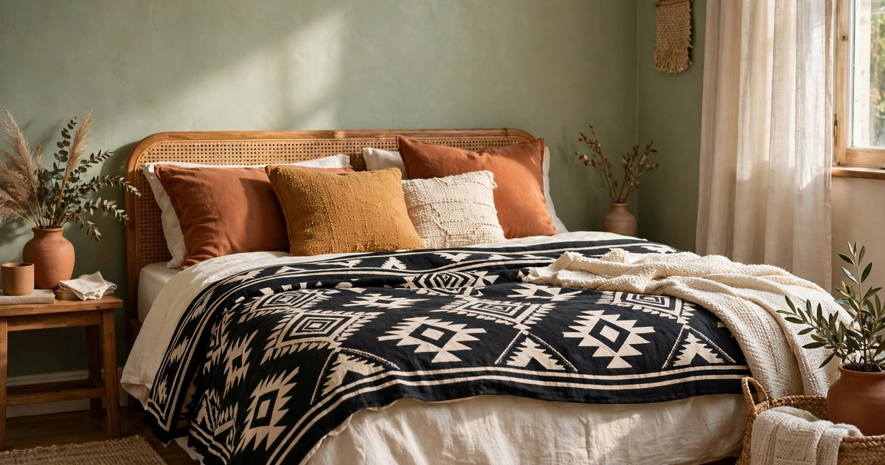
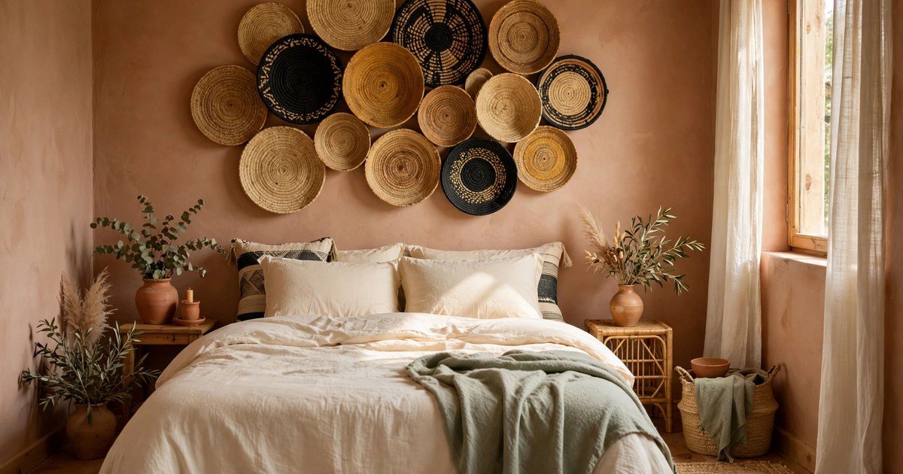
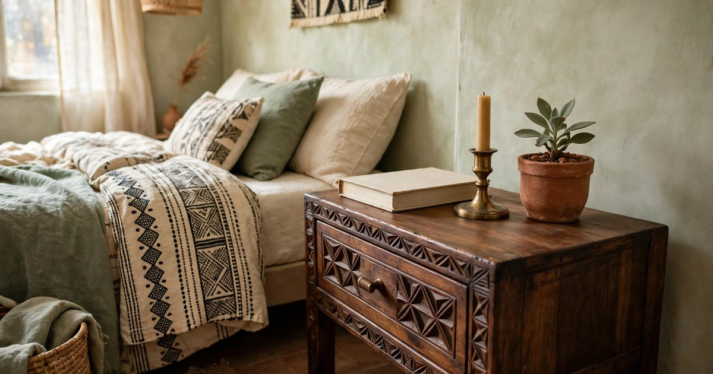
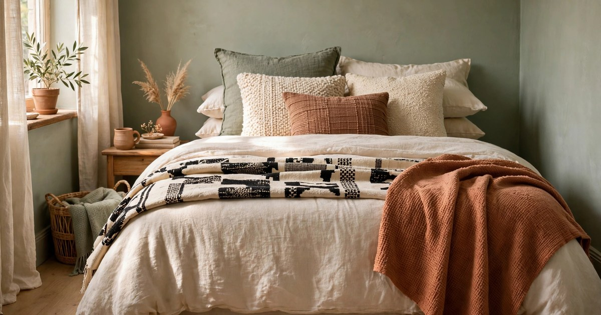
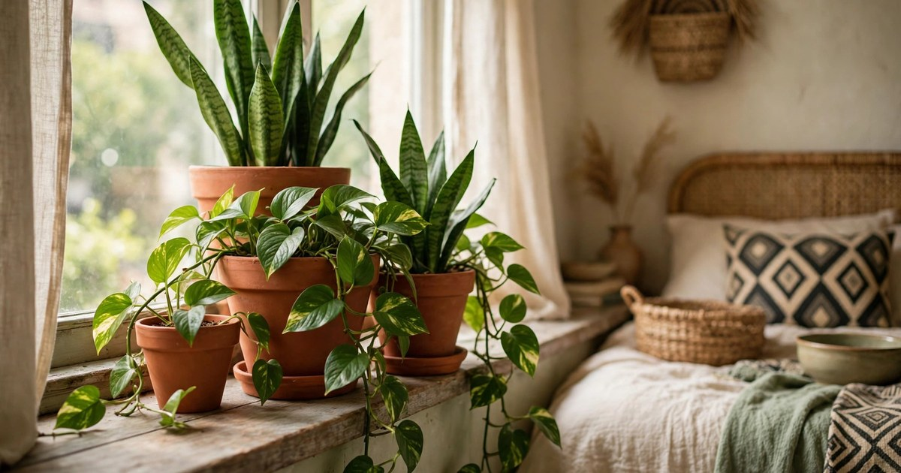
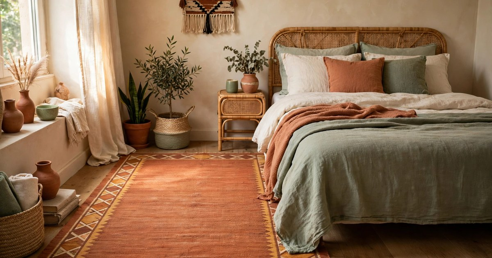
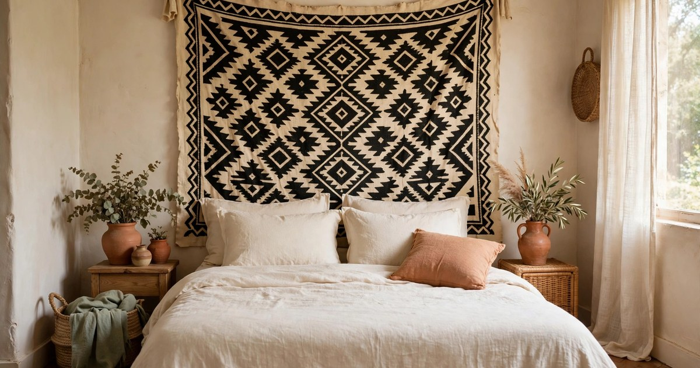
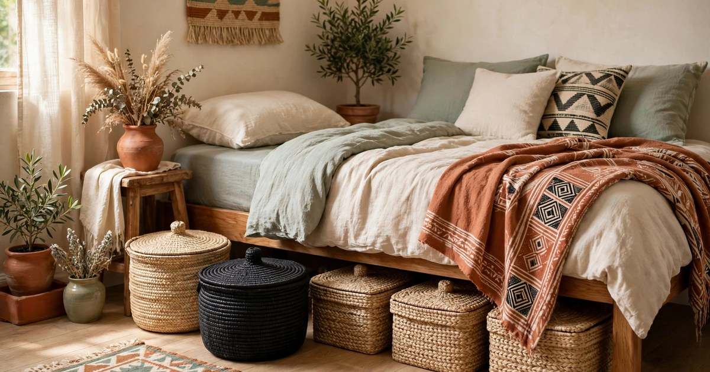
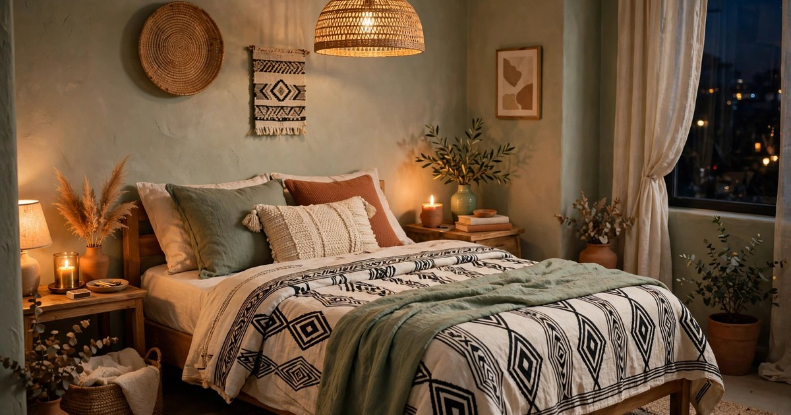
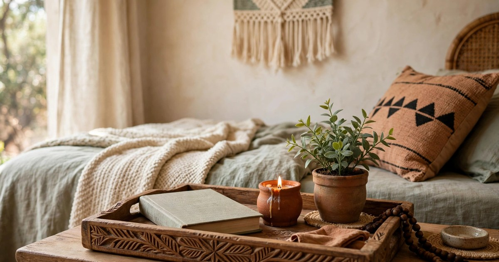

Afrohemian style belongs in the bedroom. The look mixes African textiles and craft — mudcloth, woven baskets, carved wood, hand-dyed fabrics — with relaxed bohemian layering, and the result is a room that feels warm, grounded and deeply restful. It suits a small rented bedroom because it is built from bedding, baskets and small wooden pieces rather than big furniture, so you can get the whole look without drilling a single hole or painting a single wall.

The key is to let texture do the work and keep the colour palette earthy. Afrohemian bedrooms use a warm base — cream bedding, terracotta, ochre, deep brown and charcoal — and let pattern carry the personality. One mudcloth duvet set, one woven basket wall, one carved bedside table: each piece earns its place, and nothing needs to match perfectly. Work through these ten ideas one at a time, starting with the piece you will touch every day, and stop when the room feels finished rather than full. A small bedroom layered with three good Afrohemian pieces beats a room stuffed with ten.

Budget comes first in every idea below. Most cost under $25, several cost almost nothing, and all of them are renter-friendly — removable hooks, leaning pieces, textiles and baskets, nothing permanent. If you already own plain bedding or a few baskets, start there; the style is about collecting and layering, not buying a matching set in one afternoon.

### 1. The Mudcloth Bedding Layer

Start with the bed, because it fills most of a small bedroom and sets the whole tone. A mudcloth duvet cover or a mudcloth throw folded across the foot of the bed instantly makes the room Afrohemian, and genuine mudcloth — hand-woven cotton with geometric patterns in natural dye — has a texture no printed copy can match. Keep the sheets plain cream or warm white, and let the mudcloth be the pattern. If a full duvet set stretches the budget, a single mudcloth throw across the foot of the bed plus two mudcloth pillow shams gives you the same effect for under $40.

Mix one bold geometric pattern with a quieter stripe, and keep the rest of the bedding plain so the eye has somewhere to rest. Cotton mudcloth softens with every wash and wears beautifully, while cheap printed copies go shiny and flat after a few months. Look for a [mudcloth duvet cover set on Amazon](https://www.amazon.com/s?k=mudcloth+duvet+cover+set&tag={{AMAZON_TAG}}) in black and cream to start, or check our [mudcloth pillow styling guide](/mudcloth-pillow-styling-guide/) for how to build the pillow stack around it. The bed is where you spend a third of your life; dressing it in a textile you love is the best money in this whole list.

### 2. The Woven Basket Wall Headboard

A basket wall above the bed is the Afrohemian answer to a headboard: it is sculptural, warm and cheap, and it hangs on removable adhesive hooks, so there is not a single nail hole in the plaster. Collect five to seven flat woven baskets and plates in different sizes — seagrass, sisal and raffia in natural, black and ochre — and arrange them in a loose cluster above the bed, centred on the headboard wall. Vary the sizes and leave uneven gaps; a basket wall should look gathered over time, not installed in an afternoon.

Start with the largest basket slightly off-centre, then build outwards with smaller ones, stepping back every few placements to check the balance. Flat baskets hang best and stay flush to the wall, while one deeper bowl works as the centrepiece. In a tiny bedroom this trick also saves the floor space a real headboard would eat, and it draws the eye up, which makes the ceiling feel higher. For more on basket walls, see our [Afrohemian living room ideas for small apartments](/afrohemian-living-room-ideas-small-apartments/), where the same arrangement anchors the sofa wall. A full basket wall can be built for $30–50 from charity shops and market stalls, and every basket can move to another room when you redecorate.

### 3. The Carved Wood Bedside Table

One carved wood piece gives a small bedroom the handcrafted anchor the style needs. A low carved bedside table, a wooden stool or a small carved tray table in dark walnut or warm teak adds weight next to soft bedding, and its shape — often round, often slightly irregular — breaks up the straight lines of the bed and the wardrobe. Look in charity shops, flea markets and the clearance pages of homeware sites: carved wood turns up constantly for $20–40 because it is heavy to ship and easy to overlook.

Place the table where it will actually be used — beside the bed, holding a book, a glass of water and a phone charger — rather than pushed against a wall as decoration. Wood darkens and improves with a little oil, so a scratched second-hand table is a bargain rather than a problem: rub in a little teak or coconut oil and the grain comes alive. Pair it with a small terracotta pot or a brass candle holder and the corner is done. If the budget is tighter still, a plain wooden stool from a thrift shop does the same job for under $15, and a carved tray on top gives you the carved detail without the cost of a carved table.

### 4. The Layered Throw and Cushion Stack

Afrohemian bedrooms layer textiles the way other rooms layer paint: a throw across the foot of the bed, a second folded over one corner, a cushion stack at the head. Use a mudcloth throw in black and cream, a plain woven throw in terracotta or ochre, and let the edges hang unevenly — neat, tucked-in throws read as hotel, while a casually draped throw reads as home. The layering also hides a tired or mismatched rented bed frame, which is a practical bonus in a rental.

Choose throws in cotton or a cotton blend so they wash easily and drape well; heavy wool throws slide off smooth bedding and look lumpy on a small bed. A throw that is too short looks like a mistake, so measure the bed width before you buy — it should reach at least halfway across the bed. Two throws and three cushions are enough for a double bed; a single bed can take one throw and two cushions before it starts to look like a textile shop. Our [mudcloth pillow styling guide](/mudcloth-pillow-styling-guide/) shows the one-bold, one-medium, one-plain cushion mix that keeps the stack from turning noisy. This is also the easiest idea to start with: one throw, tonight, and the room already feels different.

### 5. The Terracotta Pot Cluster

Terracotta is the Afrohemian pot, and a cluster of three or five terracotta pots in different sizes on the windowsill, the bedside table or the floor by the bed brings the earthy palette down to plant level. Fill them with easy greenery — a snake plant, a pothos, a small palm — and the warm clay against green leaves is the colour combination the whole style is built on. Plain terracotta pots cost $2–5 each, which makes this the cheapest idea on the list.

Group the pots in odd numbers and vary the heights, with the tallest at the back and the smallest at the front, so the cluster reads as a deliberate arrangement. Leave the pots unpainted: the raw clay colour is the point, and painted terracotta loses the warmth that makes it work. A saucer under each pot protects rented sills and tables from water rings, and a thin coat of clear sealant on the inside stops the clay from wicking moisture onto the wood. One trailing pothos on the windowsill softens the hardest corner of a small bedroom and costs less than a takeaway coffee to set up.

### 6. The Earthy Rug Beside the Bed

An Afrohemian bedroom needs a rug that grounds the bed and gives bare feet something warm to land on in the morning. Choose a flat-weave or low-pile rug in terracotta, warm brown or ochre with a simple geometric border, sized to run along the side of the bed — in a small room that usually means a runner or a 120 by 180 centimetre rug placed lengthways. A rug that is too small makes the room feel scattered; one that fits the bed makes it feel like a room.

Natural fibres suit the style best: jute, wool and cotton all work, and a jute runner under $50 is one of the best value buys in budget decor. Jute is rough under bare feet, so layer a smaller, softer cotton rug on top where your feet land first thing, or place the jute under the bed where feet rarely land. Keep the pattern simple — a border or a single geometric motif — because the bedding and baskets already carry the busy patterns. A rug also muffles sound in a thin-walled flat, which is a genuine quality-of-life win in a rental.

### 7. The Mudcloth Wall Hanging Headboard

If the basket wall is too busy for you, one large mudcloth wall hanging does the same job with a single piece — and it doubles as a soft, fabric headboard. Hang a genuine mudcloth panel — roughly a metre wide — above the bed on a wooden dowel or a pair of removable hooks, and let it be the room's artwork. The bold geometric patterns read beautifully at that scale, and because mudcloth is fabric it adds softness and sound absorption to a small hard-walled bedroom. It also cushions the wall where pillows lean, which a painted wall never will.

Real mudcloth panels cost $30–60 and are worth it; printed imitations look flat at large sizes and the pattern repeats obviously. Hang the panel so its bottom edge sits just behind the pillows, and keep the wall around it clear — a mudcloth hanging needs breathing room to be the focal point. If you sew, two smaller panels hung side by side with a gap between them work just as well and cost less than one large one. Pair the hanging with plain cream bedding and the panel carries the whole room, which is why this is the best single-piece idea on the list for a very small bedroom.

### 8. The Woven Storage Baskets

Small bedrooms have no storage, and Afrohemian style turns storage into decor. Woven baskets under the bed hold spare bedding, off-season clothes and shoes, while a large lidded basket beside the bed swallows laundry, books and the clutter that small rooms collect. Choose seagrass, sisal or water hyacinth baskets with lids, in natural tones with one black or ochre accent, so the storage looks intentional rather than improvised. Our guide to [woven storage baskets for small rentals under $25](/woven-storage-baskets-small-rentals-under-25/) lists the best sizes and prices for exactly this job.

Measure the gap under your bed before you buy — most rented beds clear 15 to 25 centimetres, which fits a low, wide basket perfectly. Two matching baskets under the bed plus one tall basket in the corner is enough for most small bedrooms; every extra basket should replace something, not join it. Lids matter: an open basket of laundry reads as mess, while a lidded basket reads as furniture. This is the idea that pays for itself, because it replaces a storage unit you would otherwise have to buy and find floor space for.

### 9. The Warm Glow Lighting

Afrohemian bedrooms come alive in warm light, and lighting is where the style's earthy palette pays off. Swap cool white bulbs for warm white (2700K), add a woven or rattan pendant shade above the bed or a small rattan table lamp on the bedside table, and finish with candles in brass or terracotta holders. The warm glow deepens the terracotta and ochre, softens the black and cream mudcloth, and makes the whole room feel like evening in a place far warmer than your flat.

A woven pendant shade costs $15–30 and is renter-friendly if it hangs from an existing ceiling hook or a plug-in swag cord, with no wiring needed. Battery candles are the safe choice in a small bedroom full of textiles — they give the same flicker without the fire risk — and a string of warm fairy lights along a shelf or a basket wall adds a soft glow for pennies. Keep the overhead light off in the evenings and let the lamps and candles do the work; the room will look twice as expensive, and you will sleep better for the softer light. Look for a [rattan pendant light shade on Amazon](https://www.amazon.com/s?k=rattan+pendant+light+shade&tag={{AMAZON_TAG}}) if your ceiling hook needs a shade, or start with a warm bulb swap, which costs under $5 and changes the room tonight.

### 10. The Bedside Vignette

The last idea is the smallest and the most personal: a bedside vignette. Take a carved wooden tray, a woven placemat or a flat piece of mudcloth, and build a tiny scene on the bedside table — a book you are actually reading, a candle in a terracotta holder, a small plant in a clay pot, and nothing else. Three objects, one tray, one surface: that is the whole recipe. The tray corrals the clutter that bedside tables collect, and the carved or woven base ties the vignette back to the rest of the room.

This is also where the style becomes yours rather than a catalogue. A carved figure from a market, a bracelet on a small brass dish, a postcard from a trip — one personal object among the three is what makes the vignette feel collected rather than staged. Keep it to three objects and edit ruthlessly: a fourth object is the difference between a vignette and a pile. For more budget Afrohemian finds to build vignettes from, see our [Afrohemian decor finds under $25](/afrohemian-decor-finds-under-25/) — most of the pieces there cost less than a takeaway and work beautifully at bedside scale.

## Frequently Asked Questions

### What is Afrohemian bedroom decor?

Afrohemian bedroom decor blends African textiles and craft — mudcloth, woven baskets, carved wood, hand-dyed fabrics — with relaxed bohemian layering. It uses an earthy palette of terracotta, ochre, cream and charcoal, and it is built from bedding, baskets and small handmade pieces rather than big furniture, which makes it ideal for small rented bedrooms.

### Is Afrohemian bedroom decor expensive?

No — it is one of the cheapest styles to build, because its key pieces are textiles and baskets rather than furniture. A mudcloth throw costs $20–40, a basket wall can be built from $5–10 baskets, and terracotta pots cost a few dollars each. Charity shops and flea markets are excellent sources for carved wood and woven baskets.

### How do I make an Afrohemian bedroom work in a tiny rented room?

Start with the bed: mudcloth bedding or a throw, plain cream sheets, and one woven basket wall or mudcloth hanging above the bed. Add one carved wood piece and one plant cluster, then stop. Nothing in the style needs drilling or painting — basket walls hang on removable hooks, mudcloth hangs from a dowel, and throws protect rented furniture.

### Can Afrohemian decor work with a small double bed?

Yes, and it suits small beds particularly well. Two throws and three cushions are enough for a double bed, and a basket wall or mudcloth panel above the bed draws the eye up without taking any floor space. Keep the pattern mix to one bold, one medium and one plain so the small room does not feel noisy.

### Where can I find affordable Afrohemian decor?

Charity shops, flea markets and the clearance pages of homeware sites are the best sources for carved wood and woven baskets. For new pieces, look for genuine cotton mudcloth rather than printed copies, and start with the budget finds in our [Afrohemian decor finds under $25](/afrohemian-decor-finds-under-25/) guide before buying anything full price.
