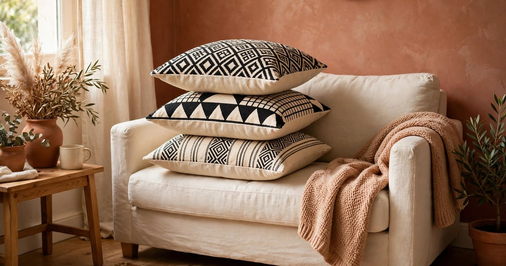
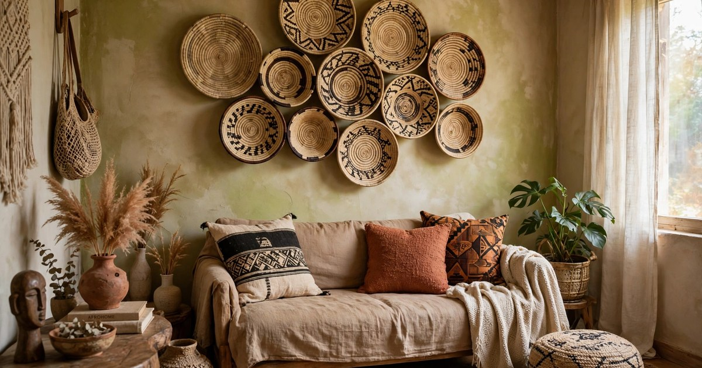
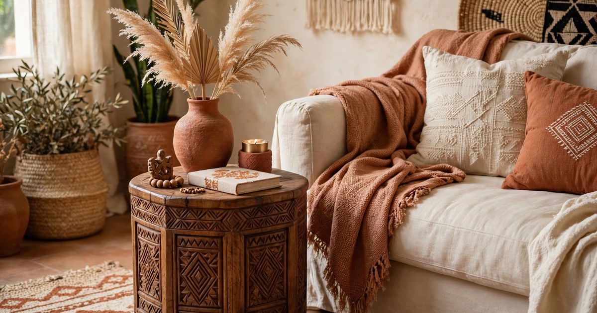
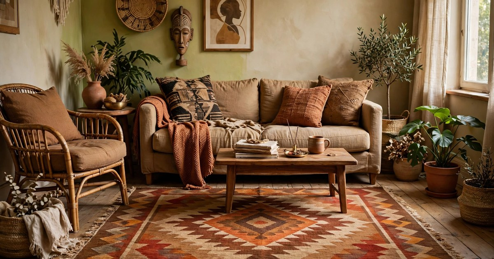
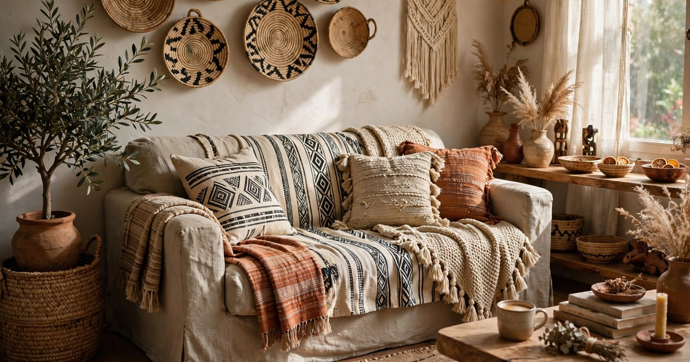
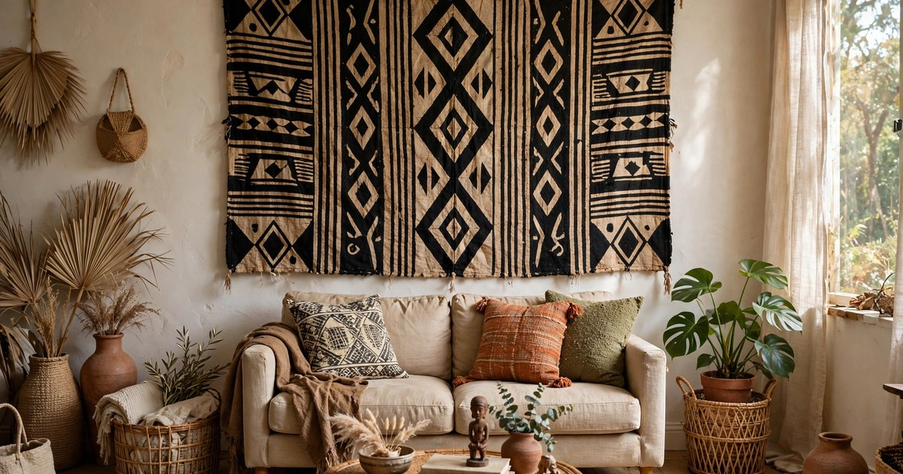
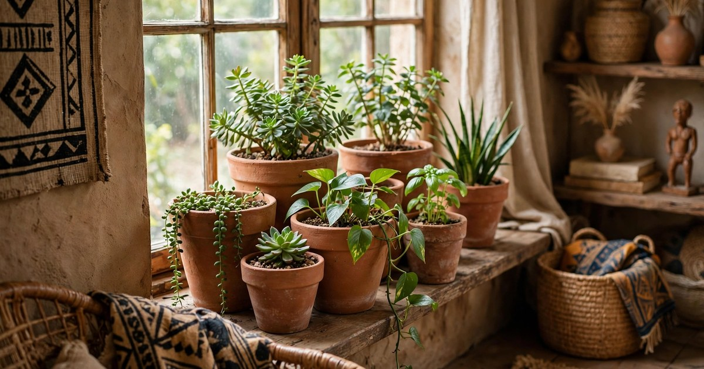
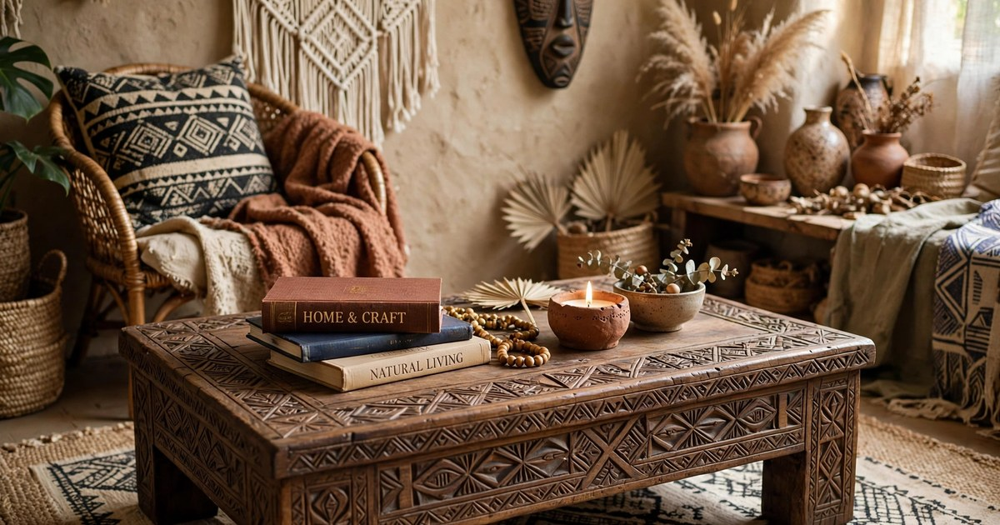
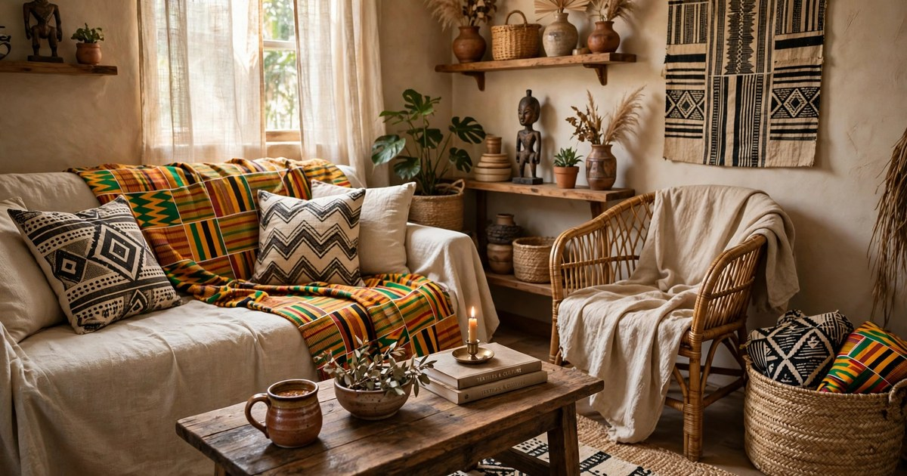
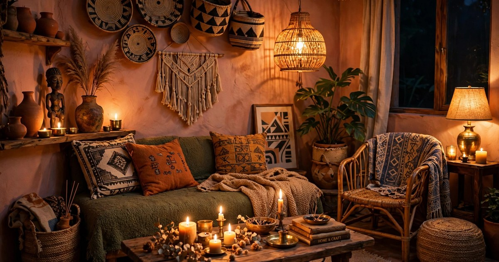

Afrohemian decor is having a moment, and small apartments are where it works best. The style mixes African textiles and craft — mudcloth, woven baskets, carved wood, hand-dyed fabrics — with relaxed bohemian layering, and the result is a room that feels warm, personal and collected rather than decorated. It suits a small living room because it is built from textiles, baskets and small wooden pieces rather than big furniture, so you can get the whole look on a renter's budget without moving a single wall.

The key is restraint with colour and generosity with texture. Afrohemian rooms use an earthy base — warm cream walls, terracotta, ochre, deep brown and charcoal — and let pattern do the talking. One mudcloth pillow, one woven basket wall, one carved side table: each piece earns its place, and nothing needs to match perfectly. Work through these ten ideas one at a time, starting with the piece you love most, and stop when the room feels finished rather than full. A small room layered with three good Afrohemian pieces beats a room stuffed with ten.

### 1. The Mudcloth Pillow Stack

Start with pillows, because they are the cheapest way into the style and the easiest to change. Two or three mudcloth cushions in black, cream and ochre on a plain sofa instantly set the Afrohemian tone, and genuine mudcloth — hand-woven cotton with geometric patterns in natural dye — has a texture no printed copy can match. Mix one bold geometric pattern with one quieter stripe, and keep the third pillow plain linen in a warm cream so the eye has somewhere to rest. For more pillow ideas, see our [mudcloth pillow styling guide](/mudcloth-pillow-styling-guide/).

Buy pillow covers rather than whole pillows if you already own inserts, and look for cotton rather than polyester: cotton mudcloth softens with use and washes well, while cheap printed copies go shiny and flat. A single genuine mudcloth cover costs $15–25, which makes a stack of three a $50 room transformation. Keep the sofa itself plain — a neutral cream, warm grey or deep brown — and let the pillows carry the pattern.

### 2. The Woven Basket Wall

A basket wall is the Afrohemian answer to gallery art: it is sculptural, warm and cheap, and it fills a blank wall without a single nail hole in the plaster if you hang it on removable adhesive hooks. Collect five to seven flat woven baskets and plates in different sizes — seagrass, sisal and raffia in natural, black and ochre — and arrange them in a loose cluster above the sofa. Vary the sizes and leave uneven gaps; a basket wall should look gathered over time, not installed in an afternoon.

Start with the largest basket slightly off-centre, then build outwards with smaller ones, stepping back every few placements to check the balance. Flat baskets hang best and stay flush to the wall, while deeper bowls work as the centrepiece of the cluster. If you already have baskets holding plants or blankets, pull one or two into the display — the style is about using what you own. Our guide to [styling a woven basket wall with trailing plants](/woven-basket-wall-trailing-plants-guide/) shows how to add greenery to the same arrangement.

### 3. The Carved Wood Side Table

One carved wood piece gives a small living room the handcrafted anchor the style needs. A low carved side table, a wooden stool or a small carved tray table in dark walnut or warm teak adds weight next to soft textiles, and its shape — often round, often slightly irregular — breaks up the straight lines of a sofa and a television. Look in charity shops, flea markets and the clearance pages of homeware sites: carved wood turns up constantly for $20–40 because it is heavy to ship and easy to overlook.

Place the table where it will actually be used — beside the sofa arm, holding a book and a cup — rather than pushed against a wall as decoration. Wood darkens and improves with a little oil, so a scratched second-hand table is a bargain rather than a problem: rub in a little teak or coconut oil and the grain comes alive. Pair it with a small terracotta pot or a brass candle holder and the corner is done.

### 4. The Earthy Rug Anchor

An Afrohemian living room needs a rug that grounds the seating area and pulls the earthy palette together. Choose a flat-weave or low-pile rug in terracotta, warm brown or ochre with a simple geometric border, sized so the front legs of the sofa and chairs sit on it — in a small room that usually means 120 by 180 centimetres. A rug that is too small makes the room feel scattered; one that fits the seating group makes it feel like a room.

Natural fibres suit the style best: jute, wool and cotton all work, and a jute rug under $60 is one of the best value buys in budget decor. Jute is rough under bare feet, so layer a smaller, softer cotton or wool rug on top if you sit on the floor, or place the jute rug under the coffee table where feet rarely land. Keep the pattern simple — a border or a single geometric motif — because the pillows and baskets already carry the busy patterns.

### 5. The Layered Textile Sofa

Afrohemian rooms layer textiles the way other rooms layer paint: a throw across the sofa back, a second folded over one arm, a cushion stack at each end. Use a mudcloth throw in black and cream, a plain woven throw in terracotta or ochre, and let the edges hang unevenly — neat, tucked-in throws read as hotel, while a casually draped throw reads as home. The layering also protects a rented sofa from wear and hides a tired or mismatched one, which is a practical bonus in a rental.

Choose throws in cotton or a cotton blend so they wash easily and drape well; heavy wool throws slide off a leather sofa and look lumpy on a small one. A throw that is too short looks like a mistake, so measure the sofa back before you buy — it should reach at least halfway down the seat cushions. Two throws and three cushions are enough for a two-seater; a three-seater can take one more of each before it starts to look like a textile shop.

### 6. The Statement Mudcloth Wall Hanging

If the basket wall is too busy for you, one large mudcloth wall hanging does the same job with a single piece. Hang a genuine mudcloth panel — roughly a metre wide — above the sofa on a wooden dowel or a pair of removable hooks, and let it be the room's artwork. The bold geometric patterns read beautifully at that scale, and because mudcloth is fabric it adds softness and sound absorption to a small hard-walled room.

Real mudcloth panels cost $30–60 and are worth it; printed imitations look flat at large sizes and the pattern repeats obviously. Hang the panel so its bottom edge sits 15 to 20 centimetres above the sofa back, and keep the wall around it clear — a mudcloth hanging needs breathing room to be the focal point. If you sew, two smaller panels hung side by side with a gap between them work just as well and cost less than one large one.

### 7. The Terracotta Pot Cluster

Terracotta is the Afrohemian pot, and a cluster of three or five terracotta pots in different sizes on a windowsill, a side table or the floor by the sofa brings the earthy palette down to plant level. Fill them with easy greenery — a snake plant, a pothos, a small palm — and the warm clay against green leaves is the colour combination the whole style is built on. Plain terracotta pots cost $2–5 each, which makes this the cheapest idea on the list.

Group the pots in odd numbers and vary the heights, with the tallest at the back and the smallest at the front, so the cluster reads as a deliberate arrangement. Leave the pots unpainted: the raw clay colour is the point, and painted terracotta loses the warmth that makes it work. A saucer under each pot protects rented sills and tables from water rings, and a thin coat of clear sealant on the inside stops the clay from wicking moisture onto the wood.

### 8. The Low Wooden Coffee Table

A low wooden coffee table — ideally carved, reclaimed or simply made from warm dark wood — is the piece that makes an Afrohemian living room feel like a place to sit rather than a showroom. Keep it low, no higher than the seat of the sofa, and keep the top mostly clear: a stack of two books, a candle and a small bowl is enough. A cluttered coffee table fights the calm, collected feeling the style is aiming for.

In a very small room, a round table works better than a rectangular one because there are no corners to bruise shins on and it leaves more walking space. A carved wooden tray on top of a plain table gives you the carved detail without the cost of a carved table, and it doubles as a serving tray. If your table is a rented flat's tired glass or white laminate one, a large woven placemat or a piece of mudcloth laid across the top transforms it for under $20.

### 9. The Pattern Mix

Afrohemian style is a pattern mix done well, and the rule is simple: one bold pattern, one medium pattern and one plain, all in the same earthy palette. Mudcloth is the bold pattern, a kente-inspired stripe or a simple geometric weave is the medium, and plain linen or cotton in cream or terracotta is the rest. Spread them across the room — bold on the cushions, medium on the throw, plain on the curtains — so no single spot is shouting.

The mistake to avoid is mixing two bold patterns at the same scale, which turns a warm room into a noisy one. If you fall in love with a second bold textile, use it in a different room or fold it away for a seasonal swap. Curtains are the easiest place to go plain: warm cream linen curtains soften the light and let the patterned pieces stand out, and they cost less than patterned ones. The mix should feel collected over time, so add one pattern at a time and live with it for a week before adding the next.

### 10. The Warm Glow Lighting

Afrohemian rooms come alive in warm light, and lighting is where the style's earthy palette pays off. Swap cool white bulbs for warm white (2700K), add a woven or rattan pendant shade over the coffee table, and finish with candles in brass or terracotta holders on the side table and the windowsill. The warm glow deepens the terracotta and ochre, softens the black and cream mudcloth, and makes the whole room feel like evening in a place far warmer than your flat.

A woven pendant shade costs $15–30 and is renter-friendly if it hangs from an existing ceiling hook or a plug-in swag cord, with no wiring needed. Battery candles are the safe choice in a small room full of textiles — they give the same flicker without the fire risk — and a string of warm fairy lights along a shelf or a basket wall adds a soft glow for pennies. Keep the overhead light off in the evenings and let the lamps and candles do the work; the room will look twice as expensive.

## Frequently Asked Questions

### What is Afrohemian decor?

Afrohemian decor blends African textiles and craft — mudcloth, woven baskets, carved wood, hand-dyed fabrics — with relaxed bohemian layering. It uses an earthy palette of terracotta, ochre, cream and charcoal, and it is built from textiles and small handmade pieces rather than big furniture, which makes it ideal for small rented flats.

### Is Afrohemian decor expensive?

No — it is one of the cheapest styles to build, because its key pieces are textiles and baskets rather than furniture. A mudcloth pillow cover costs $15–25, a basket wall can be built from $5–10 baskets, and terracotta pots cost a few dollars each. Charity shops and flea markets are excellent sources for carved wood.

### How do I keep an Afrohemian living room from looking cluttered?

Use the one-bold, one-medium, one-plain pattern rule, and stop adding pieces when the room feels finished rather than full. Three good Afrohemian pieces — a pillow stack, a basket wall and a carved table — are enough for a small room; every extra piece should replace something, not join it.

### Can Afrohemian decor work in a rental?

Yes, and it suits rentals particularly well. Basket walls hang on removable hooks, mudcloth panels hang from a dowel, throws protect a rented sofa, and nothing in the style needs drilling, painting or permanent changes. For more no-damage ideas, see our [renter-friendly Christmas garland ideas](/renter-friendly-christmas-garland-ideas/) and other rental guides.
