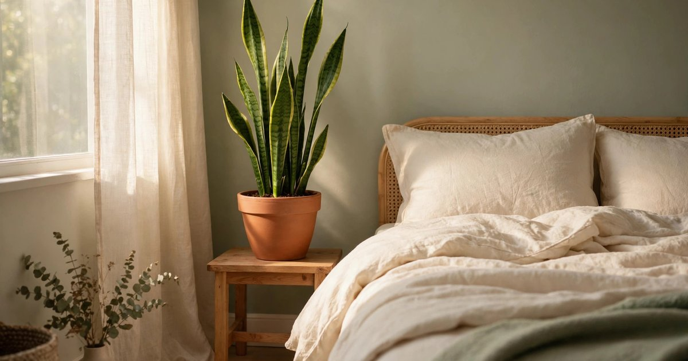
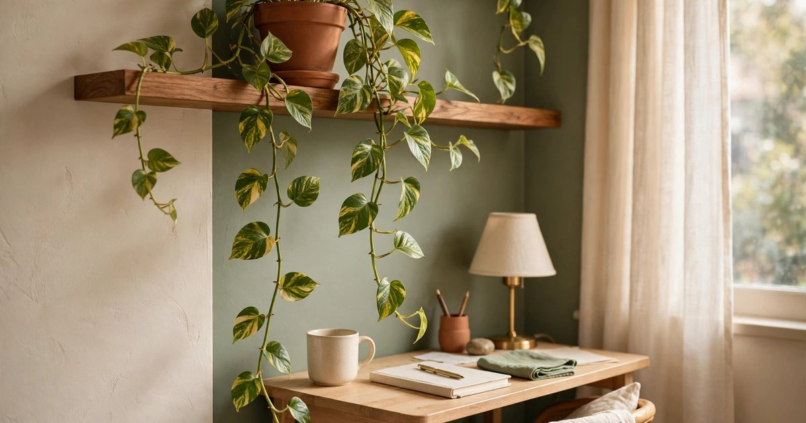
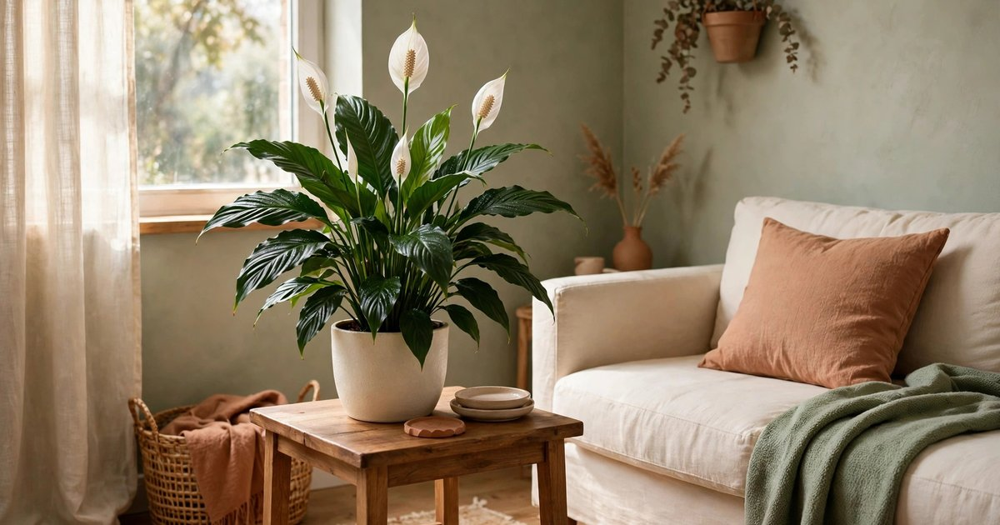
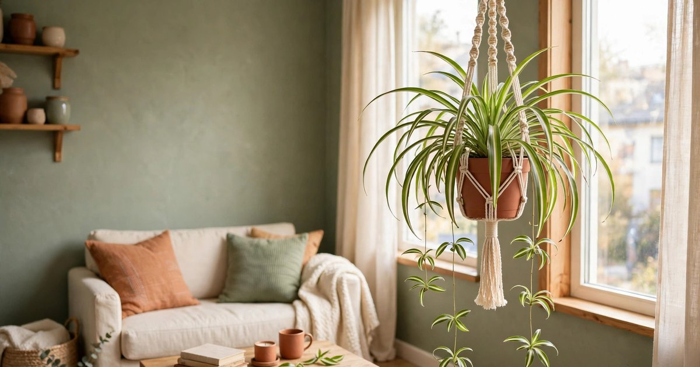
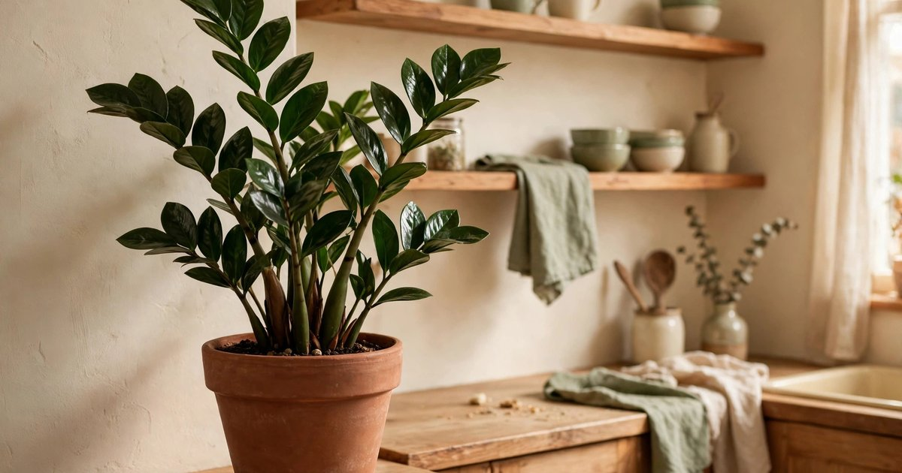
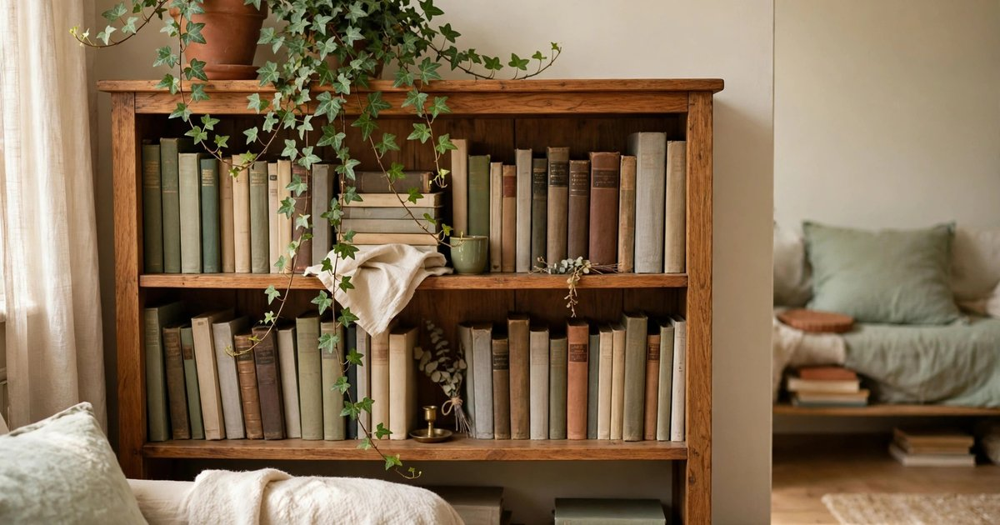
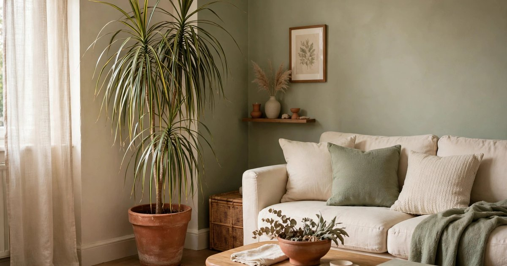
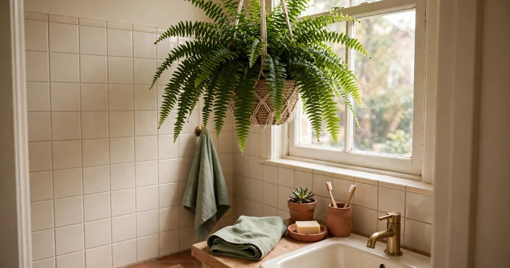
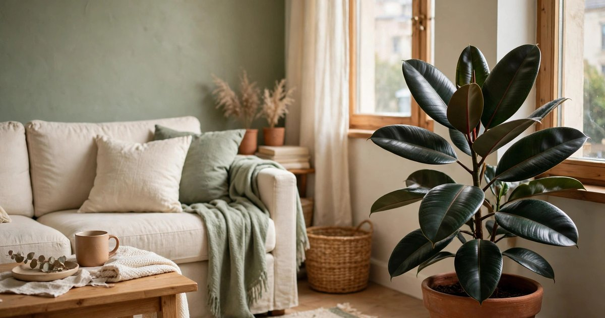

There is a famous NASA study from 1989 that everyone quotes when they call a plant "air-purifying," and it deserves an honest reading before you buy anything. In that study, plants in sealed chambers did remove volatile organic compounds — the chemicals that drift off paint, furniture, cleaning products and new carpets — from the air. What gets left out of the retelling is that the chambers were tiny and airtight, the plants were lit for 24 hours a day, and the effect needed far more plants per square metre than any flat could hold. One snake plant on your windowsill is not going to replace opening a window, and no honest plant guide should tell you it will.

That said, the plants in this roundup do genuinely help, in modest but real ways. Their leaves absorb small amounts of common indoor pollutants like formaldehyde and benzene, their roots and soil microbes break down some of those compounds, and — the benefit you will actually notice — they raise the humidity of a dry, centrally heated flat by a few per cent, which makes the air feel softer on your skin and sinuses in winter. Think of them as a complement to fresh air and ventilation, not a substitute for it: open the windows, keep the flat ventilated, and let the plants do their quiet, slow work on top of that.

What makes these nine special for small apartments is that they were chosen on three tests at once: they are among the best-studied air-cleaning houseplants, they tolerate the low light and dry air of a small flat, and every one of them can be bought as a small plant for under $25. They are compact, slow-growing enough not to take over a shelf, and forgiving of the forgotten watering. You do not need a jungle to notice the difference — a handful of well-chosen plants in the rooms where you sleep, work and cook will freshen the air and make the whole flat feel calmer and more alive.

### 1. Snake Plant

The snake plant is the obvious first pick, and for good reason: it is one of the toughest houseplants in existence and one of the most studied for air cleaning. Its tall, upright, sword-shaped leaves take up almost no floor space, which is exactly what a small apartment needs, and it was one of the strongest performers in the NASA study at removing formaldehyde and benzene from sealed air. It also does something almost no other houseplant does — it releases oxygen at night, taking in carbon dioxide while you sleep, which makes it the classic bedroom plant.

Care is about as simple as houseplants get. A snake plant wants bright indirect light but will survive happily in a dim corner, and it actually prefers to be left alone: water it only when the soil has dried out completely, which is usually every two to three weeks, and less in winter. The one thing it cannot forgive is wet feet, so always let the pot drain fully and never let it sit in standing water. It grows slowly, needs repotting only every couple of years, and a small plant in a 6-inch pot will happily fill a bedside table or a narrow shelf for years.

Where it fits best in a small apartment is exactly where space is tightest: the bedside table, the corner of the bedroom, the narrow gap beside a wardrobe, or the bathroom windowsill. Because it grows straight up rather than out, it gives you the air-cleaning benefit and the architectural green look without stealing a single square centimetre of usable surface. One snake plant per bedroom is the easiest air-purifying upgrade a renter can make.

Find it on Amazon: [snake plant in pot for bedroom air purifying](https://www.amazon.com/s?k=snake+plant+in+pot+indoor&tag={{AMAZON_TAG}})

### 2. Pothos

Pothos is the plant that turns a bare wall into a green curtain, and it does it faster than anything else on this list. Its trailing vines grow several metres in a year, it roots from cuttings in a glass of water, and it is one of the most effective houseplants at absorbing formaldehyde and carbon monoxide from indoor air. The golden variety, with its marbled yellow-and-green leaves, is the cheapest and hardiest of the lot, and a small pot costs less than a takeaway.

It is almost impossible to kill. Pothos tolerates low light — it will grow in a windowless hallway lit only by a ceiling lamp, though the golden variegation fades to plain green in the dimmest spots — and it forgives both drought and overwatering better than most plants. Water when the top few centimetres of soil dry out, or grow it permanently in a jar of water on a shelf. It needs almost no feeding, and you can snip a trailing vine, pop it in water, and have a free plant for another room within a fortnight.

In a small apartment, pothos is best used vertically, where it costs no floor space at all. Let it trail from a high shelf above a desk or a kitchen counter, hang it in a macramé hanger by a window, or train it up a moss pole in the corner of the living room. Its vines soften hard edges — the top of a bookshelf, the side of a wardrobe, the blank wall above the sofa — and because one plant quickly becomes many, a single $10 pot can green an entire flat within a year.

Find it on Amazon: [golden pothos plant trailing hanging basket](https://www.amazon.com/s?k=golden+pothos+plant+hanging+basket&tag={{AMAZON_TAG}})

### 3. Peace Lily

The peace lily is the only plant on this list that flowers in low light, and it is also one of the strongest all-round air cleaners ever tested — the NASA study rated it among the best at removing formaldehyde, benzene, trichloroethylene and ammonia from the air. Its glossy dark-green leaves and elegant white flowers make it look far more expensive than it is, and it is one of the few houseplants that will bloom for months at a time in a north-facing room. It also raises humidity noticeably, which is a genuine bonus in a dry, heated flat.

Care is straightforward, with one tell-tale signal built in: when a peace lily is thirsty, its leaves droop dramatically, then perk right back up within hours of watering. Water when the top few centimetres of soil dry out, usually once a week, and keep it out of direct sun, which scorches the leaves. It likes a little more water than the other plants on this list, so it is the one to put in a bathroom or a kitchen, where the air is naturally more humid. Wipe the leaves with a damp cloth every few weeks and they stay glossy and bright.

Where it fits best is a side table, a plant stand in the living room, or the bathroom — its favourite spot in any flat. A peace lily in a bathroom gets the humidity it loves from the shower steam and in return gives you fresh-feeling air and a spa-like look for the price of a small plant. Just keep it out of reach of cats and dogs, as its leaves are toxic if eaten, so a high side table or a bathroom shelf is safer than the floor.

Find it on Amazon: [peace lily plant in ceramic pot for indoor air](https://www.amazon.com/s?k=peace+lily+plant+indoor+pot&tag={{AMAZON_TAG}})

### 4. Spider Plant

The spider plant was one of the stars of the original NASA study, and decades of testing since have confirmed it: few houseplants remove formaldehyde and xylene from the air as reliably, and none does it while being quite so easy to keep alive. Its arching striped leaves and dangling baby plantlets look like a green waterfall, and a single plant becomes a whole collection within a year, because every baby is a free new plant. It is also completely pet-safe, which matters in a small flat shared with a cat or a dog.

Give it bright indirect light — within a metre or two of a window is ideal — and water when the top soil dries out, usually every week or so in summer and less in winter. The most common complaint is brown leaf tips, caused by fluoride or salts in tap water; let your tap water sit uncovered overnight before watering, or use filtered water, and the new leaves come in clean. It likes a slightly snug pot and produces the most babies when it is a little root-bound, so do not rush to repot it.

In a small apartment, a spider plant belongs in the air, not on the floor. Hang it from a ceiling hook or a wall bracket, let it cascade from a high shelf, or sit it on the end of a bookshelf where its babies can dangle freely. It takes up zero floor space, catches the light near the window, and looks better from below than almost any other houseplant. One mother plant and a few small pots will fill every shelf in your flat with free greenery.

Find it on Amazon: [spider plant hanging planter with babies](https://www.amazon.com/s?k=spider+plant+hanging+planter&tag={{AMAZON_TAG}})

### 5. ZZ Plant

The ZZ plant is the one for the flat with almost no light. It thrives in the darkest corners — a hallway, a windowless bathroom, a north-facing bedroom — and still looks like a designer plant, with glossy, dark-green leaves that catch the light beautifully. It is a steady, quiet air cleaner, removing airborne toxins like benzene and toluene, and its thick rhizomes store water, so it can go a month without watering and not even notice. For a renter who travels, forgets, or simply does not want a high-maintenance plant, it is the safest buy on this list.

Care could hardly be simpler. Put it anywhere from low light to bright indirect light, water only when the soil is completely dry — usually every two to four weeks — and leave it alone. Overwatering is the only real danger: too much water rots the rhizomes, so err on the side of underwatering and always empty the saucer. It grows slowly, rarely needs repotting, and a small plant in a 6-inch pot is an ideal size for a kitchen counter, a desk, or a bedside table.

Where it fits best is the spot where other plants give up: the dark hallway console, the corner of a north-facing living room, the bathroom shelf with no window, or the desk that never sees direct sun. Its upright, architectural leaves add structure to a room without taking up space, and because it looks immaculate with almost no effort, it is the plant to buy first if you have ever killed a houseplant before.

Find it on Amazon: [ZZ plant in pot low light indoor plant](https://www.amazon.com/s?k=zz+plant+in+pot+indoor&tag={{AMAZON_TAG}})

### 6. English Ivy

English ivy is a quiet overachiever: studies have found it is particularly good at filtering airborne mould and faecal particles, and it was one of the stronger performers in the NASA testing for removing formaldehyde and benzene. It is also one of the cheapest plants on this list — a small pot costs a few dollars — and it grows fast, so it pays you back quickly. Its small, lobed leaves look charming trailing from a shelf or climbing a trellis, and it brings a soft, cottage-garden feel to a modern flat.

It likes cooler rooms and bright indirect light, and it appreciates more humidity than most plants on this list, so it does best in a bathroom or a kitchen, or near other plants where the air is a little moister. Water when the top soil dries out, mist the leaves occasionally in dry heated rooms, and keep it out of hot, dry spots near radiators, which is where ivy most often struggles. Watch for spider mites in very dry air — a quick shower under the tap every few weeks keeps the leaves clean and the mites away.

Where it fits best in a small apartment is a hanging basket, a high shelf, or a trellis on a wall, where its vines can trail and climb. It is also the ideal plant for a bathroom window, where the steam keeps it happy and it helps filter the moist air. Keep it out of reach of pets, as the leaves are mildly toxic if eaten, and trim the vines whenever they get too long — a quick snip keeps it bushy instead of leggy.

Find it on Amazon: [english ivy plant hanging basket indoor](https://www.amazon.com/s?k=english+ivy+plant+hanging+basket&tag={{AMAZON_TAG}})

### 7. Dracaena

Dracaena is the plant that gives a small apartment a tall, tropical look without taking over the room. Varieties like Dracaena marginata, with its thin, spiky, red-edged leaves, and Dracaena fragrans, the classic corn plant, grow straight up on a slim trunk, so they fill an empty vertical corner beautifully while using almost no floor space. They are also proven air cleaners: Dracaena species were among the best at removing trichloroethylene, formaldehyde and benzene in the NASA study, and the corn plant in particular is one of the most effective at filtering formaldehyde.

Care is easy, with one quirk: dracaena is sensitive to fluoride in tap water, which shows up as brown leaf tips, so use filtered water or let tap water sit overnight before watering. Water when the top few centimetres of soil dry out, usually every one to two weeks, and keep it in bright indirect light — a spot near a window, but not in harsh direct sun, which scorches the leaves. It grows slowly and steadily, and a plant that starts at knee height will reach the ceiling over a few years, so buy small and let it grow into the corner.

Where it fits best is the awkward empty corner that every small apartment has — beside the sofa, next to the wardrobe, at the end of a hallway, or flanking the television. A dracaena turns dead space into a green focal point, and because it grows up rather than out, it never crowds the furniture around it. One tall dracaena in a corner does the visual work of three smaller plants.

Find it on Amazon: [dracaena marginata plant tall indoor pot](https://www.amazon.com/s?k=dracaena+marginata+plant+indoor+pot&tag={{AMAZON_TAG}})

### 8. Boston Fern

The Boston fern is the humidity hero of this roundup. It is one of the best natural humidifiers you can buy — its dense, feathery fronds release a lot of moisture into the air — and it is also a strong air cleaner, particularly good at removing formaldehyde from the air. Nothing else on this list gives you that soft, lush, cloud-like greenery, and in a small flat its arching fronds turn an ordinary corner into something that feels like a greenhouse.

It is also the thirstiest plant here, which is the trade-off. A Boston fern wants consistently moist soil and humid air, and it sulks in dry, centrally heated rooms. Water whenever the top soil feels dry, usually twice a week in summer, mist it regularly, and give it a bright spot out of direct sun. The single best place for a Boston fern in a small apartment is the bathroom: the steam from the shower gives it the humidity it craves, and in return it thrives with almost no extra effort from you. A pebble tray under the pot helps a lot if the bathroom has no window.

Where it fits best is a hanging basket in the bathroom, a pedestal in a bright corner of the living room, or a high shelf where its fronds can spill over the edge. It needs more attention than the snake plant or the ZZ plant, but it rewards that attention with the most dramatic greenery on this list — and the freshest-feeling air in the room. If your flat feels dry in winter, a Boston fern is the plant that will change that feeling fastest.

Find it on Amazon: [boston fern hanging basket live plant](https://www.amazon.com/s?k=boston+fern+hanging+basket+live+plant&tag={{AMAZON_TAG}})

### 9. Rubber Plant

The rubber plant is the boldest leaf on this list: big, glossy, deep-green leaves that look almost lacquered, on a plant that grows into a small indoor tree. It is a proven air cleaner, effective at removing formaldehyde and other indoor pollutants, and its large leaf surface gives it more filtering area than most houseplants its size. It is also very forgiving — it tolerates low light, missed waterings and the dry air of a heated flat — and a small plant costs well under $25, even though it looks far more expensive.

Care is simple. Give it bright indirect light if you can — the darker varieties, like the popular 'Burgundy', hold their colour best with a few hours of gentle morning sun — and water when the top few centimetres of soil dry out, usually every one to two weeks. Wipe the leaves with a damp cloth every few weeks: dust blocks light, and a clean rubber plant leaf shines like polished leather. If it gets too tall, snip the top stem and it will branch out, and the cutting roots easily in water.

Where it fits best is the statement spot in a small apartment: beside the sofa, next to the television, in the corner by the window, or on a plant stand in the hallway. Its large, bold leaves anchor a room and make a small space feel considered and finished, and because it grows steadily upwards, one plant can fill a corner for years. The burgundy variety adds a deep, dramatic colour to a terracotta-and-cream palette that no other plant on this list offers.

Find it on Amazon: [rubber plant ficus elastica live plant pot](https://www.amazon.com/s?k=rubber+plant+ficus+elastica+live+plant&tag={{AMAZON_TAG}})

Nine plants, nine corners of a small flat, and an honest promise: none of them will purify your air on its own, but together — with open windows, decent ventilation, and a little care — they will freshen the air, raise the humidity, soften the hard edges of a small room, and make the whole place feel like a home rather than a box. Start with the two or three that suit your light and your habits — a snake plant for the bedroom, a pothos for the shelf, a peace lily for the living room — and add the rest as you go. The best air-purifying plant for a small apartment is not the one with the best study results: it is the one that is still alive and thriving in your flat six months from now, and every plant on this list was chosen because it passes that test.

## Frequently Asked Questions

### How many air-purifying plants do I need per room?

Be honest with yourself: one plant will not purify a room. The NASA study used roughly one plant per 9 square metres in sealed chambers, and real rooms have draughts, open doors and ventilation, so the filtering effect of a single plant is small. A practical rule is three to five small plants per room, spread around the space, plus regular fresh air from open windows — that combination gives you the modest air-cleaning benefit and the very real humidity and wellbeing benefits, without pretending one pot can replace ventilation.

### Do air-purifying plants actually work?

Yes, but modestly. In controlled chambers, plants absorb volatile organic compounds like formaldehyde and benzene through their leaves, and soil microbes break some of them down. In a real flat, the effect is much smaller, because rooms are not sealed and air moves constantly. Plants also raise humidity and can reduce airborne dust and mould spores. The honest verdict is that they help a little with air quality and a lot with how a room feels — and the best way to clean indoor air is still opening a window and ventilating properly.

### Which air-purifying plant is best for a bedroom?

The snake plant is the classic bedroom pick because it releases oxygen at night while most plants release it during the day, and it tolerates the low light of a bedroom corner. A peace lily also works well if the bedroom gets some light, and a pothos trailing from a shelf is a good choice for small bedrooms. Avoid strongly scented plants in the bedroom if you are sensitive to fragrance, and keep any plant at least a few centimetres from the bed so falling leaves do not land on the pillows.

### Are air-purifying plants safe for cats and dogs?

It depends on the plant. Spider plants, Boston ferns and rubber plants are safe for pets, though the rubber plant's sap can irritate skin if a leaf is broken. Pothos, peace lilies, snake plants, ZZ plants, English ivy and dracaena are all toxic if eaten, so keep them on high shelves or in hanging planters where pets cannot reach them. If your cat chews plants, choose the pet-safe ones first and keep the toxic varieties out of reach.

### Can air-purifying plants survive in low light?

Yes, several of the best air cleaners are also the best low-light plants. The ZZ plant, snake plant and pothos will all grow in dim corners, and the peace lily will even flower in low light. English ivy, dracaena and rubber plants prefer brighter indirect light but will survive in a dim room, growing more slowly. The Boston fern and spider plant are the fussiest about light on this list, so keep them nearest to a window.

### How much do air-purifying plants cost?

All nine plants in this roundup can be bought as small plants for under $25, and most cost between $8 and $20 depending on size and where you buy them. Pothos, spider plants and English ivy are the cheapest, often under $10, while a peace lily, ZZ plant or rubber plant in a decorative pot can cost closer to $20 or $25. Buying small and letting the plant grow is the cheapest route, and plants like pothos and spider plants multiply for free, so one purchase can fill a whole flat within a year.
