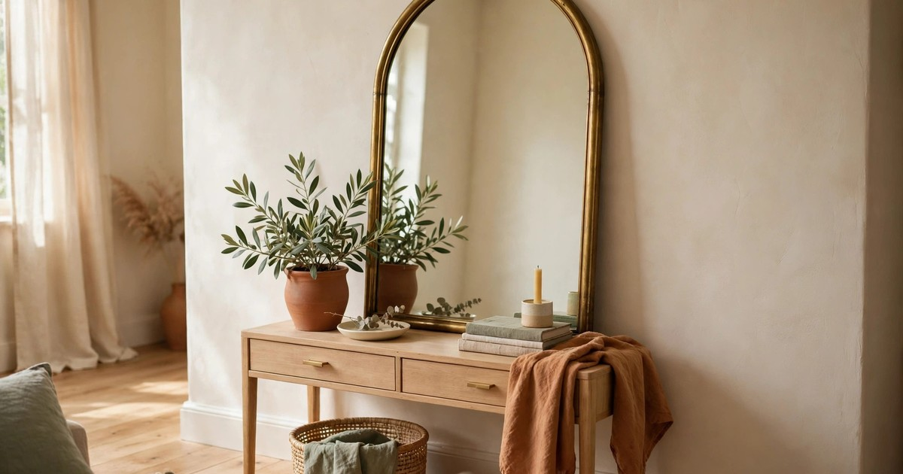
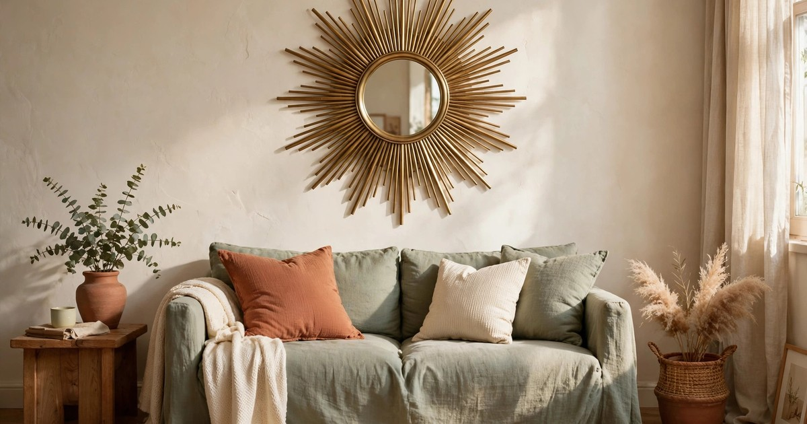
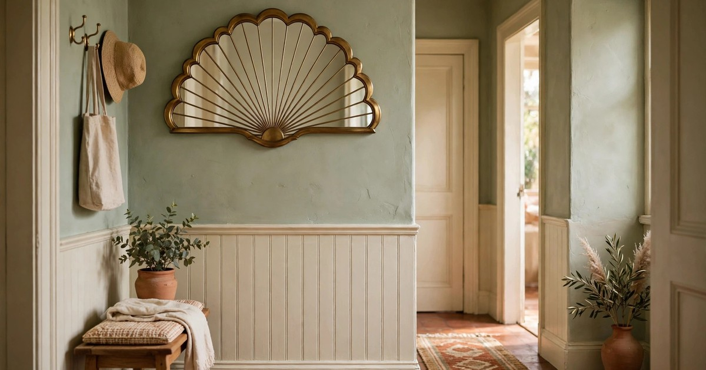
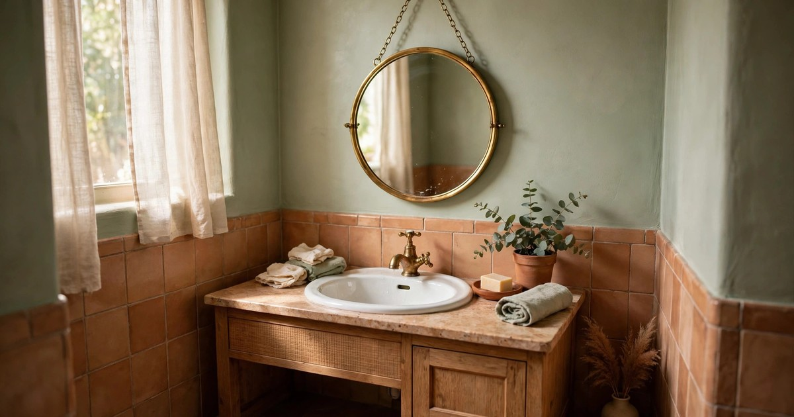
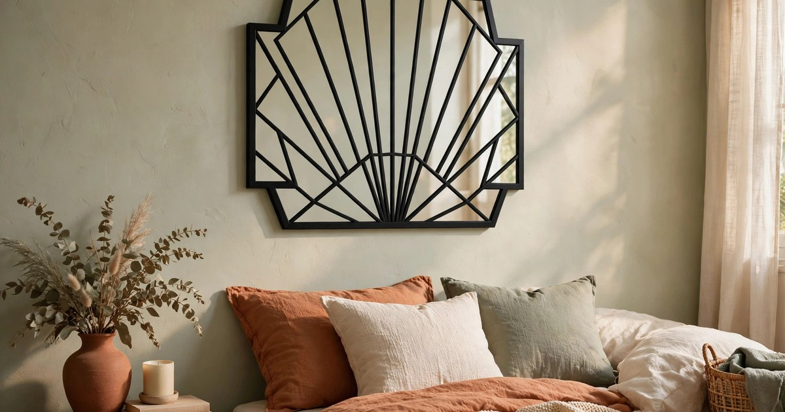
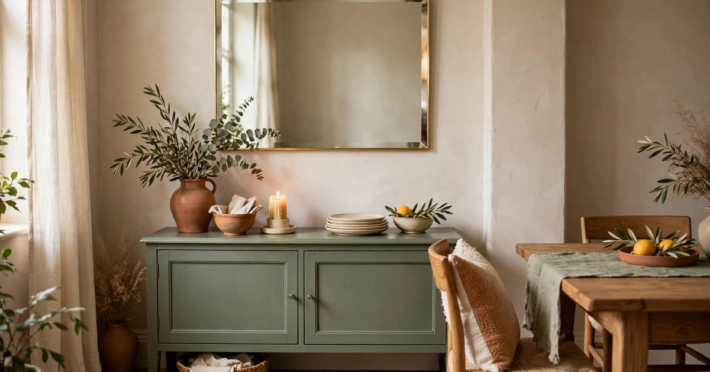
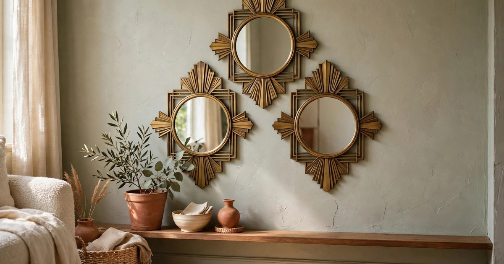
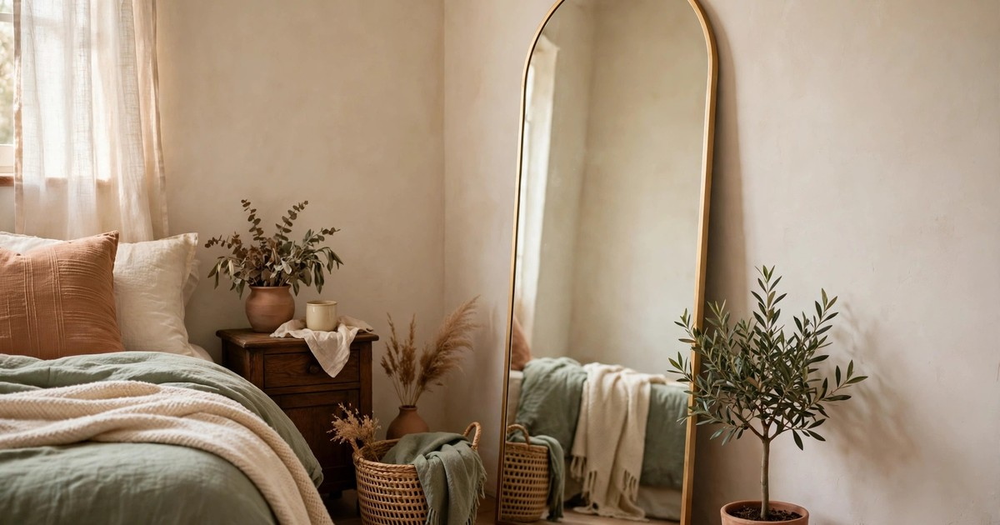
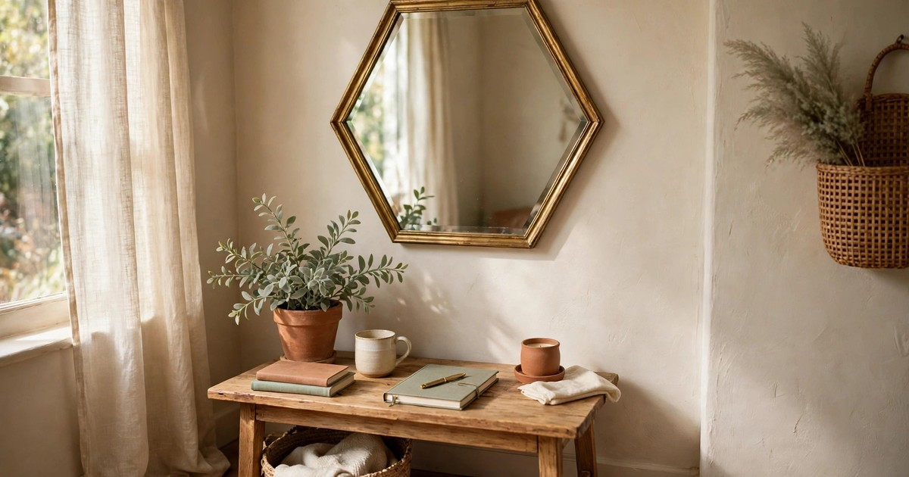

A mirror is the hardest-working piece of decor a small room can own. It bounces light into corners the window never reaches, it makes a narrow wall feel twice as wide, and in a Neo Deco scheme it does a third job as well: it is the geometry. An arched mirror, a sunburst mirror or a brass-framed fan mirror reads as 1920s glamour even before you notice it is reflecting anything, which is why mirrors are the smartest first purchase in the trend — one piece, three effects, and most of them hang from a single adhesive hook.

Every mirror below costs under $25, hangs without drilling, and is light enough for a rental wall. Each pick includes a why-it-works note and a where-it-fits note, so you buy the right shape for the right wall rather than the prettiest shape in the shop. If you are building the full look, our [Neo Deco living room ideas](/neo-deco-living-room-ideas-small-apartments/) show how these mirrors sit alongside brass, jewel tones and vintage rugs, and our [Neo Deco bedroom ideas](/neo-deco-bedroom-ideas-renters/) use the same pieces in a smaller room.

## 1. Arched brass mirror

The arch is Neo Deco's signature shape, and an arched mirror ($18–25) in a thin brass frame is the purest expression of it. Leaned against the wall behind a console table or a chair, it draws the eye upward, makes a low ceiling feel taller, and reflects the window light straight across the room. A leaning mirror needs no fixings at all, which makes it the most renter-friendly pick on this list.

**Why it works:** the arch softens the hard rectangles of a small room — sofa, television, bookshelf — without adding any visual weight, and the brass frame ties it to every other warm metal in the room.

**Where it fits:** leaning behind a console table in an entryway, behind an armchair, or in a bedroom corner as a full-length check. [Shop arched brass mirrors](https://www.amazon.com/s?k=arched+brass+mirror+small&tag={{AMAZON_TAG}})

## 2. Sunburst mirror

A sunburst mirror ($15–25) is the fastest glamour available: radiating brass rays around a small round mirror, hung from a single adhesive hook, and the whole wall is done. It reads as sculpture by day and catches lamplight in the evening, so it earns its place twice over. Keep the wall around it plain — a sunburst does not want competition from a gallery wall.

**Why it works:** the rays fill a wide stretch of wall without the weight of a large mirror, so a small room gets the drama of a statement piece and the light-bouncing of a mirror in one purchase.

**Where it fits:** centred over a sofa, above a sideboard, or on the wall opposite a window to throw light back into the room. [Shop sunburst mirrors](https://www.amazon.com/s?k=brass+sunburst+mirror+wall&tag={{AMAZON_TAG}})

## 3. Fan or scallop mirror

The fan motif is pure 1920s, and a fan or scallop mirror ($16–24) brings it to a wall in a shape no rectangular mirror can match. The scalloped edge catches the eye, the brass finish keeps it warm, and the compact size suits the narrow walls small flats are full of — hallways, the wall beside a door, the stretch above a radiator cover.

**Why it works:** it delivers the deco pattern in the mirror itself, so you do not need patterned wallpaper or artwork to establish the theme, and its unusual shape makes a forgettable wall memorable.

**Where it fits:** hallways, above a small desk, or as one of a pair flanking a window. [Shop fan scallop mirrors](https://www.amazon.com/s?k=fan+shaped+art+deco+mirror&tag={{AMAZON_TAG}})

## 4. Round brass mirror with a hanging chain

A round mirror ($12–20) in a thin brass frame, hung from a short chain or a leather strap, is the most versatile deco mirror there is. The chain lets you hang it at exactly the height you want from a single hook, and the round shape softens a room full of rectangles. In a bathroom it replaces the builder-grade mirror entirely; in a bedroom it works over a dressing table.

**Why it works:** the circle is the calmest shape in the deco vocabulary, so it balances the sharp geometry of sunbursts and fans, and the hanging chain adds a crafted detail that a fixed frame cannot.

**Where it fits:** bathrooms, over a dressing table, or in a small entryway above a console. [Shop round brass chain mirrors](https://www.amazon.com/s?k=round+brass+mirror+chain+hanging&tag={{AMAZON_TAG}})

## 5. Black-framed geometric mirror

Not every deco mirror has to be brass. A black-framed geometric mirror ($14–22) — angular lines, a diamond or stepped outline — gives you the same 1920s geometry in a finish that suits rooms where brass would feel too warm, or where black is already the accent colour in the picture ledge and the light fittings. It reads as graphic and modern rather than gilded.

**Why it works:** the black frame acts as a line drawing on the wall, defining the mirror's shape crisply against a pale wall, and it pairs beautifully with gold-framed art nearby without matching it exactly.

**Where it fits:** bedrooms with black accents, above a desk, or on a wall with other black-framed pieces. [Shop black geometric deco mirrors](https://www.amazon.com/s?k=black+geometric+art+deco+mirror&tag={{AMAZON_TAG}})

## 6. Rectangle bevelled mirror with gold trim

A bevelled rectangle ($15–25) is the quietest mirror on this list and often the most useful. The bevelled edge catches light along its border, the thin gold trim keeps it firmly deco, and the rectangular shape fits the walls that arches and sunbursts cannot — above a sideboard, beside a door, over a low bookshelf. It is the mirror to buy when you want the room to feel brighter and more finished without announcing the theme.

**Why it works:** it does the practical job — light, space, a last check before leaving — while the gold trim and bevelled edge quietly establish the glamour, so it never fights with bolder pieces nearby.

**Where it fits:** above a sideboard or dining table, in a dining nook, or as a pair flanking a window. [Shop bevelled gold trim mirrors](https://www.amazon.com/s?k=bevelled+mirror+gold+trim+rectangular&tag={{AMAZON_TAG}})

## 7. Set of three small deco mirrors

A set of three small mirrors ($18–25 for the set) solves the awkward wall: too narrow for one large mirror, too blank for nothing. Hang them in a row, a triangle or a staggered line, and they read as one intentional composition rather than three small afterthoughts. Adhesive strips hold each one, so the whole arrangement goes up in minutes and comes down without a mark.

**Why it works:** three small mirrors bounce light from three angles, which brightens a dark corner better than one large mirror, and the arrangement itself becomes the decoration — no artwork needed.

**Where it fits:** narrow hallway walls, above a desk, beside a door, or in a stairwell. [Shop sets of small deco mirrors](https://www.amazon.com/s?k=set+of+3+small+art+deco+mirrors&tag={{AMAZON_TAG}})

## 8. Full-length arched leaning mirror, budget size

A full-length arched mirror ($20–25 at the budget end) is the one piece that changes how a bedroom feels every single morning. Leaned in a corner, it reflects the whole room, doubles the light, and gives you a proper full-length check that a small mirror never can. At this price the frame is thin metal or resin rather than solid brass, but at arm's length the difference is invisible.

**Why it works:** it is the largest mirror a small room can hold without a single fixing, and the arch shape keeps it deco rather than generic — a rectangular full-length mirror is a utility, an arched one is a statement.

**Where it fits:** bedroom corners, behind a door, or in a dressing area. Check the lean angle carefully so it rests securely, and keep the floor in front of it clear. [Shop arched full-length mirrors](https://www.amazon.com/s?k=arched+full+length+mirror+gold+frame&tag={{AMAZON_TAG}})

## 9. Hexagonal brass-framed mirror

The hexagon is deco geometry at its most compact: six straight edges, a brass frame, and a shape that looks deliberate on a wall where a round mirror would disappear. A hexagonal mirror ($12–20) suits desks, dressing tables and home-office corners, where its small size is a virtue and its angles echo the geometry of the rest of the scheme.

**Why it works:** it is the mirror for the wall you forgot — the one beside the desk, above the radiator, at the end of the hallway — and its unusual shape makes a small wall feel designed rather than leftover.

**Where it fits:** above a desk or dressing table, in a home-office corner, or as part of a mixed-shape mirror cluster. [Shop hexagonal brass mirrors](https://www.amazon.com/s?k=hexagonal+brass+framed+mirror&tag={{AMAZON_TAG}})

## Frequently Asked Questions

### How do I hang a mirror in a rental without drilling?
Leaning mirrors need no fixings at all. For hung mirrors, use adhesive picture-hanging strips rated for the mirror's weight, or a single adhesive hook for mirrors under two kilos. Clean the wall, press for thirty seconds, and wait an hour before hanging.

### What size mirror should I buy for a small living room?
Aim for a mirror roughly two-thirds the width of the furniture below it — a sofa, a sideboard, a console. A mirror that is too small looks lost; one that is too wide overwhelms the wall. When in doubt, buy the larger size: mirrors shrink visually once they are on the wall.

### Can I mix mirror shapes in one room?
Yes, if you keep the frame finish consistent. A sunburst over the sofa and a round mirror in the hallway works beautifully when both are brass; mixing brass, black and silver frames in one small room is what makes it feel accidental.

### Are cheap mirrors worth buying?
For decor, yes. A budget mirror's job is light and shape, not perfect optical clarity, and a thin brass frame reads identically to a solid one at normal viewing distance. Spend the money you save on the one mirror you look into every day — the bathroom or dressing-table mirror — and buy budget for the decorative walls.
