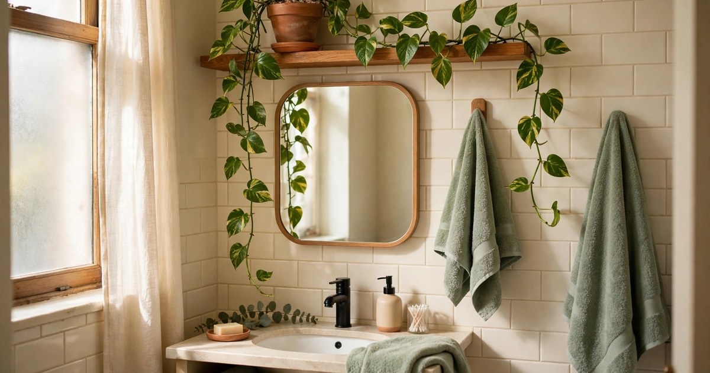
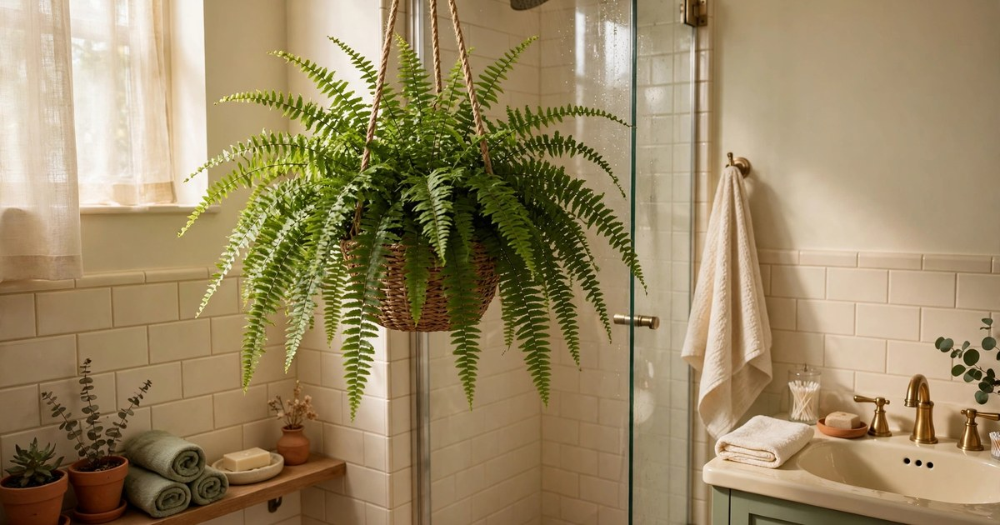
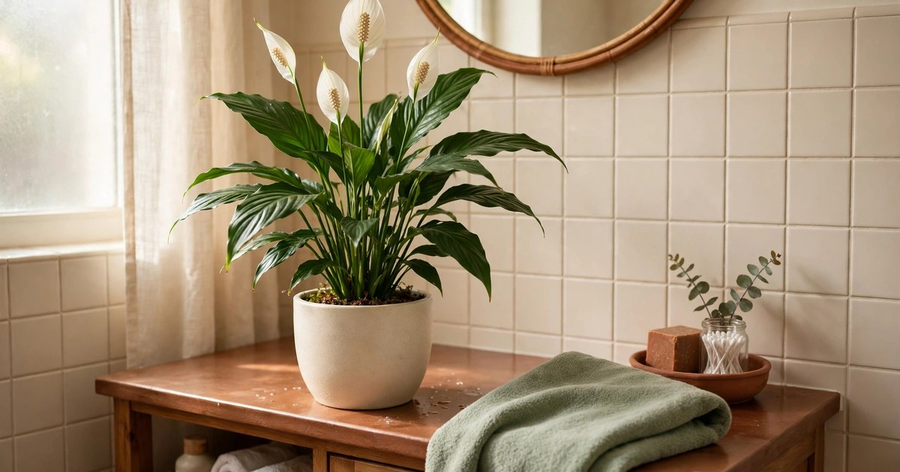
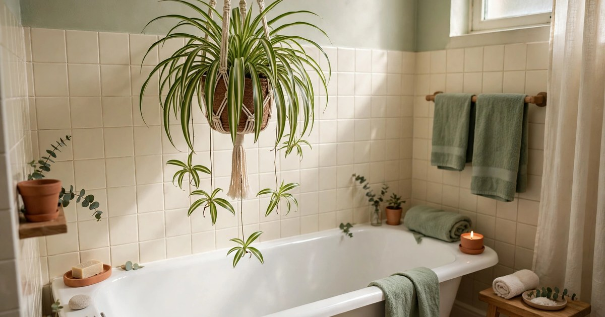
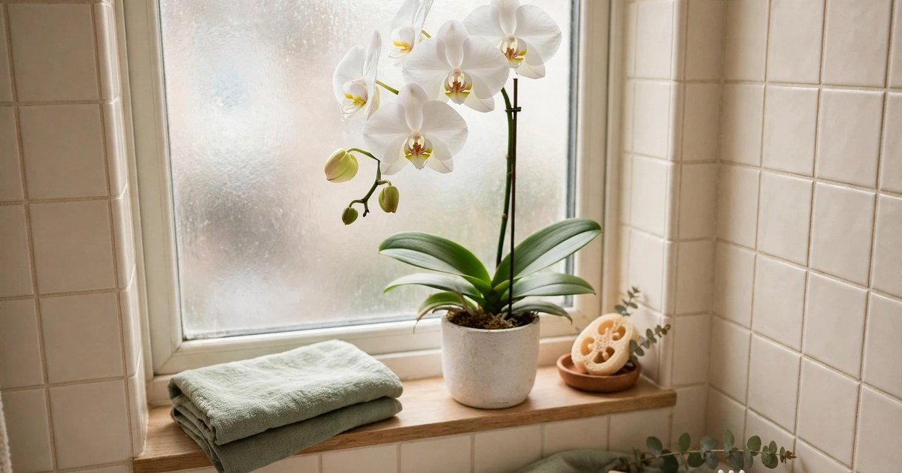
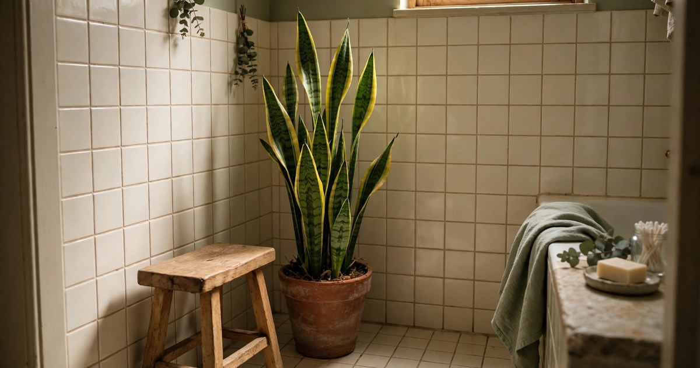
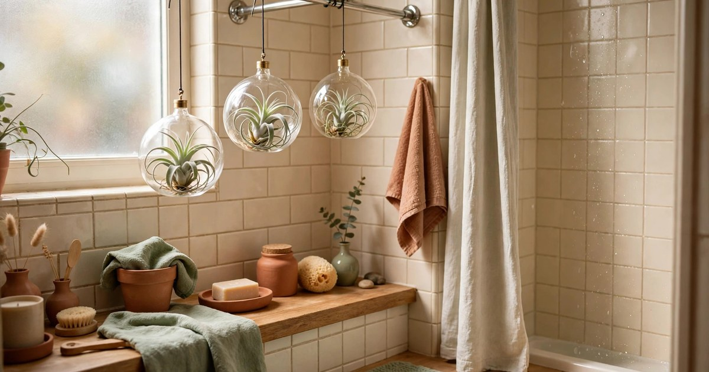
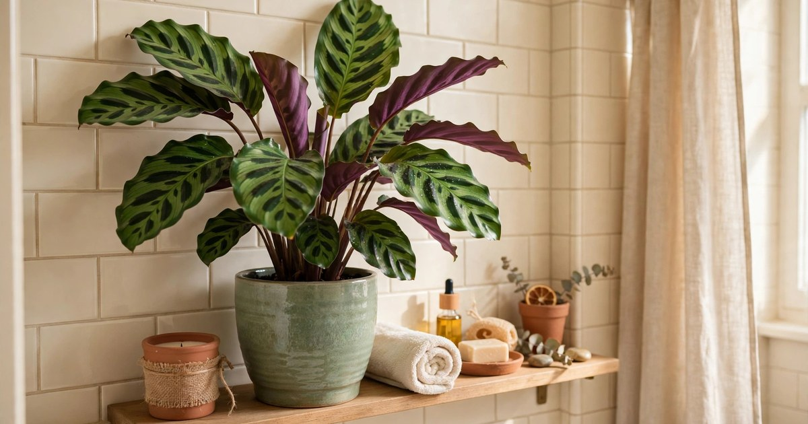
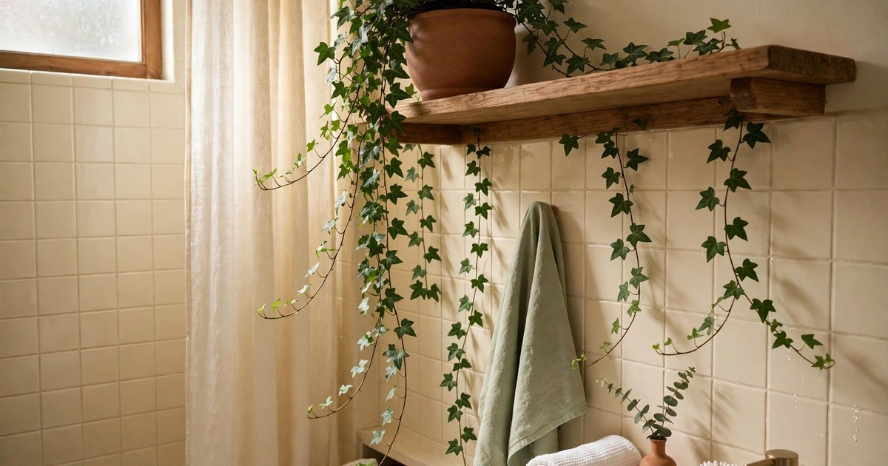
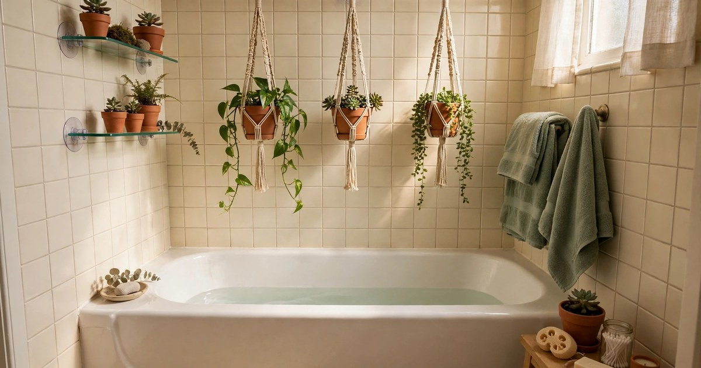

The bathroom is the most underrated room in a small flat for keeping plants — and it is secretly the best one. Every shower fills the air with steam, the humidity stays high for hours afterwards, and most bathrooms get exactly the kind of soft, indirect light that tropical houseplants love. It is, in effect, a free greenhouse that you already own, and you do not need to buy a humidifier or rearrange your living room to make it work.

That matters in a small apartment, where every surface is spoken for and every square metre has to earn its keep. A bathroom is usually the smallest room in the flat, but it is also the room with the most unused vertical space: the wall above the loo, the corners beside the mirror, the rail over the bath, the sill of a frosted window. Plants turn that dead space into something soft and alive, and a trailing pothos or a fern in a hanging basket makes a plain white rental bathroom feel like a spa — without a single permanent change.

Everything here is renter-friendly and budget-first. No drilling, no wall fixings, no holes in tiles, nothing that risks your deposit. Most of these plants cost under $15, and several of them will happily live for years in the same pot they came in. Pick one or two to start with, learn what your bathroom's light is really like, and add more once you know what thrives.

### 1. Golden Pothos Trailing Over the Mirror

If you only buy one bathroom plant, make it a golden pothos. It is the toughest trailing houseplant you can own, it forgives missed waterings, low light and the occasional cold draught, and it grows fast enough that you will see new leaves within weeks. The heart-shaped leaves, splashed with gold, look wonderful spilling down either side of a mirror, and the vines soften the hard edges of tiles and glass in a way nothing else does.

A pothos is a tropical plant, so it genuinely enjoys the steam from your shower — the humidity keeps its leaves glossy and stops the brown, crispy edges that dry living rooms cause. It will grow in low light, though the golden variegation fades a little in a very dark corner; near a frosted window or under the bathroom's main light is ideal. Water it when the top few centimetres of soil feel dry, roughly once a week in summer and every ten days or so in winter, and let it drain fully before you put it back on the shelf.

Where it fits: on a shelf or the top of a wall cabinet above the mirror, with the vines trained along a picture rail or left to trail down. In a tiny bathroom, a pothos in a hanging basket from a suction hook does the same job without taking up a single surface. If you want more plants for free, snip a stem below a node, pop it in a glass of water on the sill, and it will root in a fortnight. For more ways to hang plants without drilling, our guide to [hanging planters for small apartments under $25](/hanging-planters-small-apartments-under-25/) has renter-safe options that work in bathrooms too.

Light: low to bright indirect light. Water: when the top 5 cm of soil is dry. Cost: usually $8–$15 for a small plant.

### 2. Boston Fern Hanging Beside the Shower

A Boston fern is the plant that was made for bathrooms. In the wild it grows on forest floors in dappled shade and constant humidity, so a steamy shower room is the closest thing to home it will ever find indoors. The arching, feathery fronds soften a tiled corner beautifully, and a hanging fern draws the eye upward, which makes a small bathroom feel taller and airier than it really is.

Ferns are thirstier than most houseplants, and that is exactly why they do so well here. The daily steam tops up the humidity around the leaves, so you will see far fewer brown frond tips than you would in a dry living room — the classic complaint about Boston ferns. Keep the soil consistently damp but never soggy, and water it two or three times a week in warm weather, a little less in winter. A saucer or a drip tray underneath the basket catches any drips and protects the floor.

Where it fits: hanging from a tension rod over the bath, from a suction hook on the wall beside the shower, or on a high shelf where the fronds can arch down freely. Give it a little space — a happy Boston fern spreads to 60 cm across — and turn it every few weeks so it grows evenly. If the fronds start to look sparse in winter, a light misting a couple of times a week helps, and our guide on how to [humidify houseplants without a humidifier](/humidify-houseplants-without-humidifier/) has more tricks that cost nothing.

Light: bright indirect light, no direct sun. Water: keep the soil damp; water 2–3 times a week in summer. Cost: usually $10–$18 for a medium plant.

### 3. Peace Lily on the Vanity or the Floor

The peace lily is the rare houseplant that actually flowers in low light, and it does it in a bathroom better than almost anywhere else. Its deep green leaves and white, sail-shaped blooms look calm and elegant on a vanity, and it is one of the few flowering plants that will not sulk in a windowless bathroom with only a ceiling light. If your bathroom has no window at all, this is the plant to try first.

Peace lilies are famously dramatic about water — they droop theatrically when thirsty and perk up within hours of a drink — which makes them an excellent beginner plant, because they tell you exactly what they need. They love humidity, so the steam from a daily shower keeps their leaf tips from browning, and they prefer their soil to stay lightly moist rather than drying out completely. Water when the top few centimetres feel dry, and wipe the leaves now and then so they stay glossy and dust-free.

Where it fits: a medium peace lily works on a wide vanity or a stool beside the bath; a large one belongs on the floor in a corner, where it can grow to 60 cm tall and fill an awkward gap. Keep it out of reach of cats and dogs, as the leaves are mildly toxic if chewed. Choose a pot with a drainage hole and a saucer, and never let it sit in standing water for days on end.

Light: low to medium indirect light — the best low-light bloomer. Water: keep soil lightly moist; water weekly. Cost: usually $10–$20 depending on size.

### 4. Spider Plant in a Hanging Basket Above the Bath

Spider plants are the plant world's great survivors, and they look their best when they are allowed to hang. The arching, striped leaves spill over the edge of the pot, and within a year a healthy plant produces long stems of tiny white flowers followed by baby plantlets — little spider plants dangling in the air like ornaments. Hung above the bath, it turns an ordinary tub into the prettiest corner of the flat.

A spider plant is not fussy about light, and it is one of the few plants that tolerates the fluorescent light of a windowless bathroom reasonably well. It likes the humidity too, though it is tougher about dry air than a fern. Water it when the top few centimetres of soil are dry, and use rainwater or water left out overnight if your tap water is very hard — brown leaf tips are usually a sign of fluoride or salts rather than underwatering. The plantlets can be snipped off and potted up, so one spider plant becomes a whole collection within a year.

Where it fits: in a hanging basket or macramé hanger from a suction hook or a tension rod over the bath, where the plantlets can dangle without brushing the floor. It also works on a high shelf, but hanging shows off the trailing stems best. Keep it away from the direct blast of a hot shower — warm steam is lovely, but scalding spray will scorch the leaves.

Light: low to bright indirect light. Water: when the top 5 cm of soil is dry, roughly weekly. Cost: usually $8–$12 for a small plant.

### 5. A Phalaenopsis Orchid on the Windowsill

An orchid on a bathroom windowsill looks like a luxury, but a phalaenopsis — the moth orchid you see in every supermarket — is one of the easiest flowering plants to keep, and the bathroom is where it is happiest. Orchids grow on trees in tropical forests, where the air is warm and humid and the light is filtered through leaves. A steamy bathroom window recreates those conditions almost exactly, and the blooms last for two or three months, far longer than a cut bouquet.

The trick with orchids is to water them less than you think. They grow in bark, not soil, and the roots need air as much as moisture. Water once a week by running lukewarm water through the bark for a few seconds, then let it drain completely — never leave the roots sitting in water. A bathroom windowsill is ideal because the steam keeps the air humid between waterings, and the frosted glass of most bathroom windows gives exactly the soft, indirect light an orchid wants. If the sill is the brightest spot in your bathroom, it is also the spot where herbs do well — our guide on how to [keep herbs alive indoors through winter](/keep-herbs-alive-indoors-winter-guide/) covers the same light and watering logic.

Where it fits: on the windowsill itself, or on a small stand on the vanity if the window is too narrow. After the flowers fade, cut the stem back to just above a node and keep watering — a healthy orchid will rebloom within a few months.

Light: bright indirect light, ideally a frosted east- or west-facing window. Water: once a week, drain fully. Cost: usually $12–$20 in bloom.

### 6. Snake Plant in the Dark Corner

Every bathroom has one corner that gets no light at all — behind the door, beside the loo, under a high window that never sees the sun. The snake plant is the answer for that corner. It is nearly impossible to kill, it tolerates low light better than almost any other houseplant, and its tall, upright, architectural leaves add height and structure to a room that is mostly flat tiles and porcelain. It also releases oxygen at night, which is a nice bonus in a small, enclosed room.

Snake plants are succulents, so they store water in their thick leaves and need very little of it from you. In a bathroom, the humidity means the soil stays damp longer, so water even less than you would elsewhere — once every three or four weeks is usually plenty, and in winter you can go longer still. The one thing a snake plant cannot forgive is sitting in wet soil, so a pot with a drainage hole is essential, and if your bathroom is very steamy, choose a terracotta pot, which wicks moisture away from the roots.

Where it fits: on the floor in the darkest corner, beside the loo or the door, where its vertical shape fills dead space without getting in the way. It grows slowly, so a small plant in a neat pot will stay tidy for years. If you want a softer look, pair it with a trailing pothos on the shelf above — the contrast of upright and trailing leaves is one of the simplest styling tricks there is.

Light: low to bright indirect light — the best plant for a dark bathroom. Water: every 3–4 weeks; let the soil dry out completely between waterings. Cost: usually $10–$18.

### 7. Air Plants on the Mirror or the Shower Rail

Air plants are the ultimate small-bathroom plant because they need no soil and no pot at all. Tillandsias absorb water and nutrients through their silvery leaves, so they can live in a glass globe, on a piece of driftwood, in a shell, or simply tucked into a wire frame on the wall. They take up no surface space, they weigh almost nothing, and they look like little sculptures — which makes them perfect for a bathroom where every shelf is already full.

A bathroom is an ideal home for air plants because the steam does most of the watering for you. Mist them lightly two or three times a week, or give them a 20-minute soak in a bowl of lukewarm water once a week, then shake them dry and put them back. The drying part matters: an air plant left wet in a dark corner will rot from the centre, so always let it dry upside down for an hour after a soak. Bright, indirect light near a window is best, though they will tolerate lower light if you give them a weekly soak.

Where it fits: hanging in glass globes from the shower rail, suction-cupped to the mirror in a small holder, or arranged on a narrow shelf above the sink. They are also the easiest plant to move — take them down for a soak, dry them on a towel, and hang them back up. A set of three small air plants costs less than a single potted plant and fills three separate spots.

Light: bright indirect light is best; tolerates medium light. Water: mist 2–3 times a week or soak weekly, then dry fully. Cost: usually $3–$8 each.

### 8. Calathea, the Humidity Diva

Calatheas are famous for two things: their leaves are the most beautiful of any houseplant, painted with stripes and patterns in green, silver and purple, and they are famously fussy about dry air. In most rooms, that fussiness means brown, crispy leaf edges within weeks. In a bathroom, it disappears. The daily steam gives a calathea the 60% humidity it craves, and its leaves stay vivid and unblemished in a way they almost never do in a living room.

A calathea's leaves fold up at night and open again in the morning — a habit called nyctinasty — which makes it a quietly fascinating plant to live with. It needs low to medium indirect light and soil that stays lightly moist, so water when the top few centimetres feel dry and use rainwater or filtered water if your tap water is hard, as calatheas are sensitive to the salts in it. Keep it away from cold draughts and from the direct blast of a hot shower, and it will reward you with new patterned leaves all year round.

Where it fits: on a shelf or a stool at eye level, where you can actually see the leaf patterns, or on the vanity beside the mirror. It stays compact — most varieties reach 30–45 cm — so it suits the narrowest bathroom shelf. If you have been tempted by calatheas before and killed one in a dry room, the bathroom is your second chance.

Light: low to medium indirect light, no direct sun. Water: keep soil lightly moist; water weekly. Cost: usually $12–$20.

### 9. English Ivy Trailing from a High Shelf

English ivy brings a cottage-garden softness to a bathroom that nothing else quite matches. Its small, lobed leaves trail in long green curtains from a high shelf, softening the hard lines of tiles and making a plain white room feel lived in. It grows quickly, it is cheap, and it is one of the few trailing plants that is genuinely happy in cool, low-light rooms — which is exactly what most small bathrooms are for much of the year.

Ivy likes its soil lightly moist and its leaves humid, so the steam from a shower suits it perfectly. Water when the top few centimetres of soil feel dry, and give the leaves a rinse under the tap or a wipe with a damp cloth every few weeks to keep dust off and discourage spider mites, which love dry, dusty ivy. It does not need a big pot — a small one on a high shelf is plenty — and you can trim the vines back whenever they get too long, using the cuttings to start new plants in water.

Where it fits: on the highest shelf in the room, above the door frame, or on top of a wall cabinet, with the vines trained along a picture rail or left to cascade down. In a tiny bathroom, a single ivy on a high shelf does more for the room than three plants crowded onto the vanity. One caution: keep it away from painted walls if you let it climb, as the little aerial roots can mark paint — in a rental, let it trail rather than climb.

Light: low to bright indirect light. Water: keep soil lightly moist; water weekly. Cost: usually $6–$12 for a small plant.

### 10. The Renter-Friendly Display: Suction Shelves and a Tension Rod

The plants are only half the idea — the other half is where you put them, and in a rental bathroom the display has to be clever, because you cannot drill into tiles. The good news is that the two best renter-friendly display systems cost very little and leave no trace at all. The first is a suction-cup shelf: a small glass or acrylic shelf that sticks to smooth tiles and holds a couple of small pots, a candle and a jar. The second is a tension rod — the same kind that holds a shower curtain — fitted across an alcove or over the bath, from which you can hang baskets, macramé hangers and glass globes.

Choose suction shelves rated for at least 2 kg each, and press them onto clean, smooth tiles — they will not grip textured tiles or grout lines, so check the surface first. A tension rod needs two flat, facing surfaces and a snug fit; measure the gap before you buy, and test it with a gentle pull before you hang anything heavy from it. Both systems come down in seconds when you move out, with no holes to fill and no deposit to lose.

Where it fits: suction shelves work beside the mirror or above the loo, where small plants are at eye level; a tension rod works over the bath or across a window alcove, where hanging plants get the most light and steam. Start with one shelf and one rod, add plants gradually, and keep the total weight modest — a bathroom display should feel like a spa, not a jungle gym. If you need the hardware, a [suction-cup bathroom shelf](https://www.amazon.com/s?k=suction+cup+bathroom+shelf+glass&tag={{AMAZON_TAG}}) and a [tension rod for hanging plants](https://www.amazon.com/s?k=tension+rod+hanging+plants+bathroom&tag={{AMAZON_TAG}}) are both easy to find for under $20, and a [small glass plant mister](https://www.amazon.com/s?k=glass+plant+mister+spray+bottle&tag={{AMAZON_TAG}}) is worth adding for the plants that like a regular mist.

## Frequently Asked Questions

### Will plants really survive in a bathroom with no window?

Yes — some of them will, though not all. Peace lilies, snake plants, pothos and spider plants all tolerate low light, and a bathroom with a bright ceiling light on for several hours a day is enough for them to survive, if not to grow quickly. The trade-off is that they will grow more slowly and may not flower, so keep your expectations realistic and rotate plants out to a brighter room for a week or two every couple of months if you can. If your bathroom is both windowless and dark for most of the day, start with a snake plant or a pothos — they are the toughest of the lot.

### How often should I water bathroom plants?

Less often than the same plant in a living room. The steam from showers keeps both the air and the soil damper for longer, so a plant that needs weekly watering elsewhere may only need it every ten days in a bathroom. Always check the soil first: push a finger a few centimetres in, and water only if it feels dry. Overwatering is the most common way to kill a bathroom plant, because the soil dries out slowly in a humid room. If a plant's leaves turn yellow and the soil smells sour, you are watering too much, not too little.

### Which bathroom plants are safe if I have pets?

Spider plants, Boston ferns and calatheas are all considered safe for cats and dogs, which makes them good choices if your pets wander into the bathroom. Pothos, peace lilies, English ivy and snake plants are mildly toxic if chewed, so keep those up high or behind a closed door if your cat is a keen chewer. Air plants and orchids are generally considered safe too. When in doubt, hang the plant where paws cannot reach it — which, in a small bathroom, usually just means a high shelf.

### Will the steam from my shower damage my plants?

For almost every plant on this list, steam is a benefit, not a danger. Tropical plants evolved in humid air, and the steam keeps their leaves from drying out and browning at the edges. The only real risk is scalding: do not put a plant directly in the path of a very hot shower spray, and do not leave a plant pressed against a hot radiator. Warm, gentle steam is lovely; a blast of near-boiling water is not. If your bathroom gets extremely steamy and stays damp for hours, make sure pots have drainage and the room gets some ventilation, so the soil does not stay permanently soggy.

### How do I hang plants in a rental bathroom without drilling?

Use suction hooks and shelves on smooth tiles, tension rods across alcoves or over the bath, and adhesive hooks on painted walls or the back of the door — all of them come off cleanly when you move out. Check the weight rating before you hang anything, and test each fixing with a gentle pull first. A tension rod is the sturdiest option for heavier baskets, while suction hooks are best for light glass globes and air plants. Our guide to [hanging planters for small apartments under $25](/hanging-planters-small-apartments-under-25/) covers the full range of renter-safe fixings, including the ones that work on tiles and the ones that do not.
