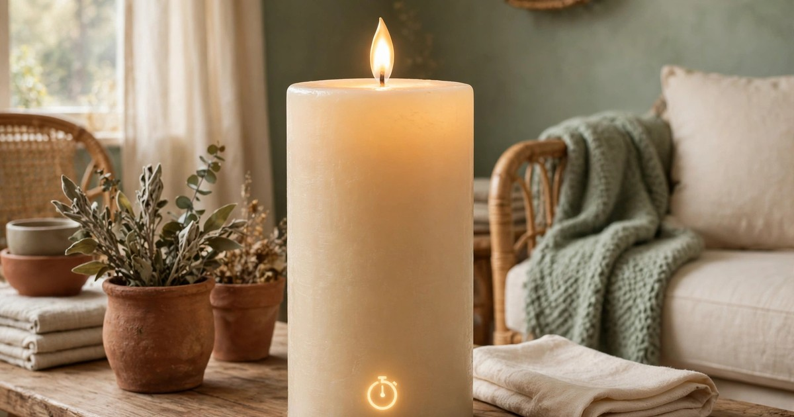
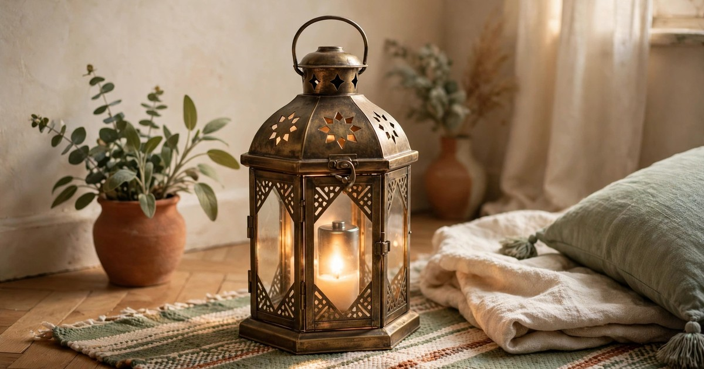

Real candles are beautiful, and on a small, crowded Christmas table or shelf they are also a genuine worry. Tenancy agreements often restrict open flames, a table packed with plates and sleeves is exactly where a candle gets knocked, and a small flat leaves very little room between a flame and a curtain. Battery-operated candles solve all of it: they flicker convincingly, they run on a timer, and you can tuck them into spots where a real flame would be a risk. Here are nine that look like the real thing, all under $20, all sized for small apartments.

### 1. Flickering pillar candle set

Why it works: a set of three pillars at different heights is the fastest way to build a candle display, because the height variation does the arranging for you. Modern LED pillars flicker with a warm, irregular flame that reads as real from sofa distance, and the wax-style exterior means they look convincing even switched off during the day. Most sets include a remote and a timer, so the whole display lights itself every evening.

Where it fits: grouped on a coffee table tray, along a windowsill, or on a shelf where real candles would be too close to books or curtains. In a small flat, a pillar set is the centrepiece that never needs watching, which means you can actually leave the room while it glows.

Budget tip: buy the set rather than singles — three pillars for under $20 is common, and the remote alone is worth it, since it saves the daily hunt for a switch behind furniture. Look for [flickering pillar candle sets](https://www.amazon.com/s?k=flickering+flameless+pillar+candles+set&tag={{AMAZON_TAG}}) with a 6-hour timer, which matches an evening perfectly.

### 2. LED taper candles with remote

Why it works: tapers are the elegant candle — tall, slim, and formal — and the battery versions finally look the part, with a realistic flame tip and a slim profile that fits standard holders. They give a Christmas table the candelabra look without the wax drips, the fire risk, or the need to watch them through dinner. A remote lets you light the whole table from your seat.

Where it fits: in the holders you already own, on a dining table, a mantel shelf, or a windowsill where a tall real flame would be too close to a curtain. Because they are slim, tapers take up almost no surface area, which matters on a small table where every centimetre is already claimed by plates and glasses.

Budget tip: tapers are often sold in pairs, so two pairs give you a full table display for under $20. Check the height before buying — standard tapers suit most holders, but extra-tall ones can dominate a small table.

### 3. Tealight multipack

Why it works: tealights are the workhorse of Christmas lighting — tiny, cheap, and able to go anywhere. A multipack of battery tealights lets you scatter light across the whole flat: inside [lanterns](/winter-candle-holders-small-apartments-under-25/), along a [garland](/renter-friendly-christmas-garland-ideas/), in jars on the windowsill, inside a glass cloche. Individually they are subtle; together they create the layered glow that makes a small room feel like Christmas.

Where it fits: everywhere a real tealight would be a risk — inside a paper lantern, under a glass dome, in a [stocking display](/christmas-stocking-holders-no-mantel/), or tucked into a wreath. Because they are small and light, they also travel: from the table at dinner to the bathroom shelf for a bath, to the bedroom for the evening.

Budget tip: buy the largest multipack you can find under $20, since you will use more tealights than you expect. [Battery tealight multipacks](https://www.amazon.com/s?k=battery+operated+tealight+candles+bulk&tag={{AMAZON_TAG}}) with a simple on-off switch are cheapest; remote-controlled ones cost a little more but save endless fiddling.

### 4. Pillar candle with built-in timer

Why it works: sometimes one big candle does the work of a whole display, and a single large pillar with a built-in timer is the simplest Christmas decoration there is. Switch it on once, and it lights itself at the same time every evening for the whole of December. The large size reads as a statement piece, and the timer means you never have to remember it.

Where it fits: as the one statement piece on a coffee table, a side table, or a shelf — the anchor of a small display that needs no other candles around it. In a studio, one large pillar by the bed or on the windowsill can be the entire evening lighting plan, which is exactly the kind of simplicity a small flat rewards.

Budget tip: a single large pillar is often under $15, leaving room in the budget for a second one. Look for a timer with both 4-hour and 8-hour options so you can match it to your evenings.

### 5. Candle lantern with LED candle included

Why it works: a lantern turns a candle into a decoration in its own right — the frame, the glass, and the glow all work together, and the candle inside is protected from draughts, sleeves, and curious pets. Many lanterns now come with a battery candle included, so one purchase gives you a complete, finished display with nothing else to buy.

Where it fits: on the floor beside the sofa, on a doorstep, on a balcony, or as the centrepiece of a table display. A lantern is also the easiest Christmas decoration to move: from the living room in the evening to the hallway when guests arrive, to the bedroom at night, all without relighting anything.

Budget tip: a lantern with a candle included is usually cheaper than buying the two separately, and it guarantees the candle fits. A [lantern with LED candle included](https://www.amazon.com/s?k=christmas+lantern+with+led+candle&tag={{AMAZON_TAG}}) in black or gold works with almost any colour scheme and looks good all year, not just at Christmas.

### 6. Window candle set

Why it works: [window candles](/christmas-window-candles-small-apartments-under-25/) are a classic Christmas look — a single glowing candle in each window, visible from the street — and the battery versions finally make it practical. They clip or suction to the window, run on a timer, and glow every evening without a single trailing cable or a flame near a curtain. From outside, a row of lit windows looks like a proper Christmas house; from inside, the glow is soft and warm.

Where it fits: one in each front-facing window, or a pair flanking a single large window in a small flat. Because they are slim and self-contained, they suit windowsills of any depth, and they are the rare decoration that is enjoyed more by passers-by than by you — which is part of the charm.

Budget tip: window candles are usually sold in sets of two or three, and one set covers a small flat's front windows. Look for suction-cup or clip mounts rather than adhesive, so they come down in January without a mark on the glass or frame.

### 7. Scented-look LED candle with wax finish

Why it works: the giveaway with cheap LED candles is the plastic look, and the fix is a real-wax exterior. Wax-finish LED candles look and feel like real candles — slightly irregular, softly matte, with a melted-looking top — and from a metre away even a sceptic cannot tell the difference. They give you the visual warmth of a real candle with none of the risk, and they photograph beautifully.

Where it fits: anywhere a candle will be seen up close — a bedside table, a bathroom shelf, a dining table where guests sit within arm's reach. In a small flat, where every surface is within arm's reach, the realistic finish matters more than it would in a big house.

Budget tip: wax-finish candles cost a little more than plain plastic ones, so buy one or two for the spots people see up close, and use cheaper pillars for the background glow. One realistic candle on the table plus a set of plain ones on the shelves is the budget-smart split.

### 8. Colour-changing LED candle for kids' rooms

Why it works: a colour-changing LED candle is the one candle a real flame could never be: a soft, shifting glow that cycles through warm white, red, green, and gold. In a child's bedroom it doubles as a night light, and because there is no flame and no heat, it is completely safe to leave on while a child falls asleep. The remote lets a child choose their own colour, which makes it a decoration they actually care about.

Where it fits: a child's bedroom windowsill or bedside table, or anywhere you want a playful touch rather than a formal one. In a small flat where children share rooms or sleep in a corner of the living room, a colour-changing candle gives them their own little piece of Christmas light.

Budget tip: colour-changing candles are usually sold singly and are still under $20, but check that the remote includes a steady warm-white mode — you will want it on the nights when the colour cycle gets old.

### 9. Outdoor-rated LED pillar for balconies

Why it works: a balcony is the hardest spot in a small flat to light for Christmas — wind kills real flames, rain kills cheap electronics, and there is rarely a socket outside. An outdoor-rated LED pillar solves all three: sealed against weather, weighted against wind, and battery-powered so it needs no socket. One or two on a balcony railing or table turn the outside of the flat into part of the Christmas display.

Where it fits: on a balcony table, a railing shelf, or beside the door, where they greet you every time you come home. They also work on a doorstep or a porch, and because they are sealed, they survive a winter of rain and frost without a second thought.

Budget tip: outdoor-rated pillars cost slightly more than indoor ones, so buy one for the balcony and use indoor pillars everywhere else. An [outdoor LED pillar candle](https://www.amazon.com/s?k=outdoor+flameless+pillar+candle&tag={{AMAZON_TAG}}) with a timer is the set-and-forget option that will still be glowing in February if you forget to bring it in.

## The Glow Without the Worry

Battery candles are not a compromise; in a small apartment they are the better candle. They go where real flames cannot, they light themselves on a timer, and they let you build the layered, warm glow that makes a small room feel like Christmas without a single moment of worry. Start with a pillar set and a tealight multipack — those two purchases cover most of a small flat — then add a lantern or a window set for the spots that deserve something special.

The real test of a battery candle is the evening test: switch off the overhead light, let the candles light themselves, and see whether the room feels like Christmas. With the right set, it will, and nobody will ask whether the flame is real.

## Frequently Asked Questions

### Do battery-operated candles really look like real candles?
Modern LED candles with a flickering flame and a wax-style exterior look convincing from normal room distance, especially in the evening when the room is otherwise dim. Wax-finish models are the most realistic up close; plain plastic ones are best used as background glow on shelves and windowsills.

### Are flameless candles allowed in rentals that ban real candles?
Almost always, yes — flameless candles produce no flame, no heat, and no smoke, so they fall outside the open-flame restrictions in most tenancy agreements. They are also safe around curtains, pets, and children, which is why landlords rarely object. Check your agreement if it specifically mentions candles, but the restriction is almost always about fire, not light.

### How long do battery candles last on one set of batteries?
Most LED candles run 100-200 hours on a set of batteries, and with a 6-hour timer that means roughly a month of evening use. Rechargeable batteries are worth it if you use candles every night, since the running cost drops to almost nothing after the first purchase.

### Can I use battery candles outside on a balcony?
Only outdoor-rated models, which are sealed against rain and weighted against wind. Indoor LED candles will fail quickly in wet weather, so check the rating before putting any candle outside. Outdoor-rated pillars are the safest choice for balconies, doorsteps, and porches.
