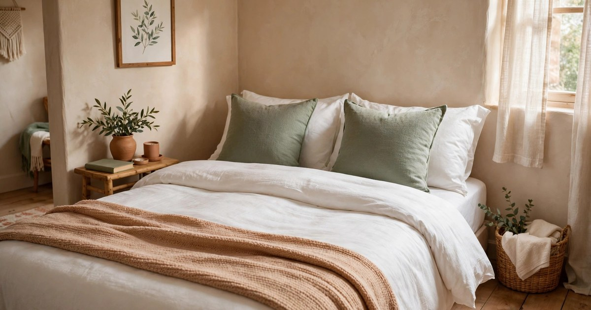
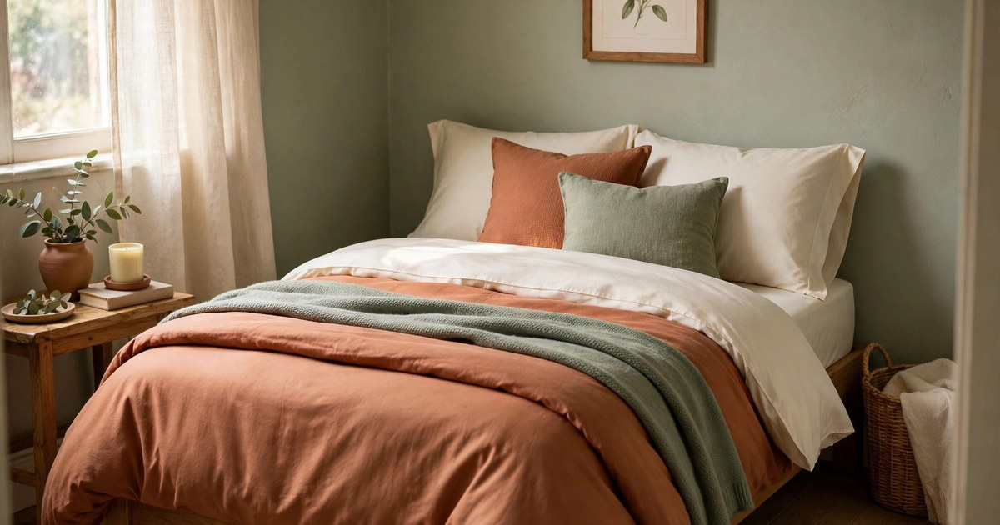
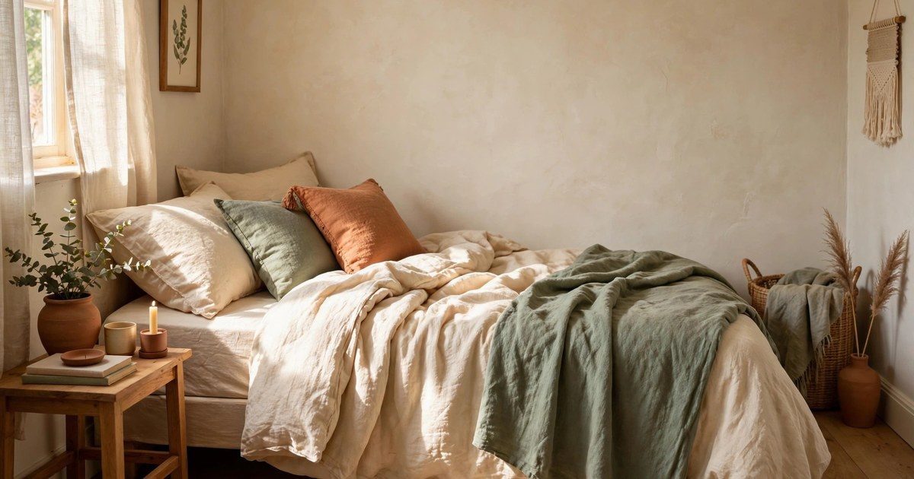
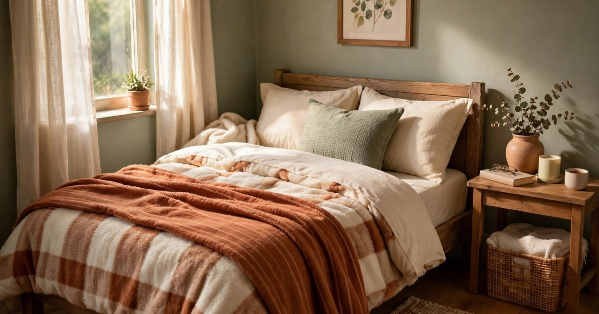
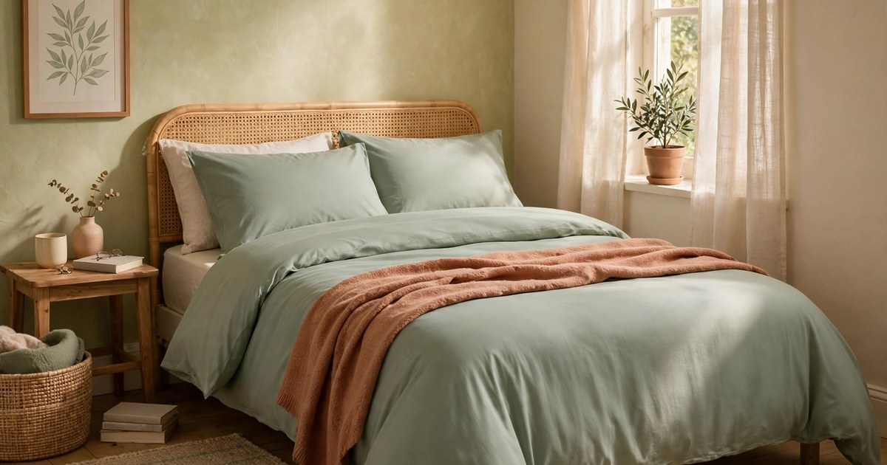
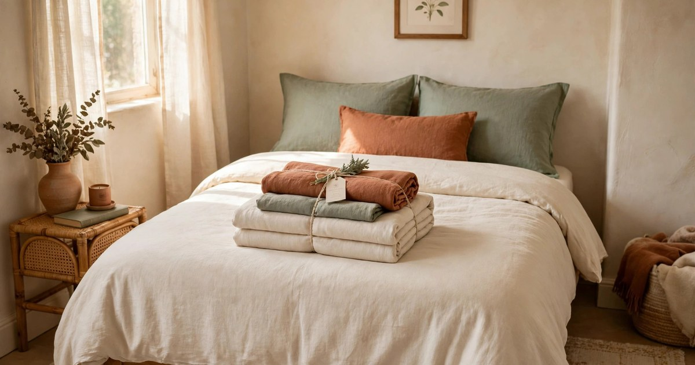
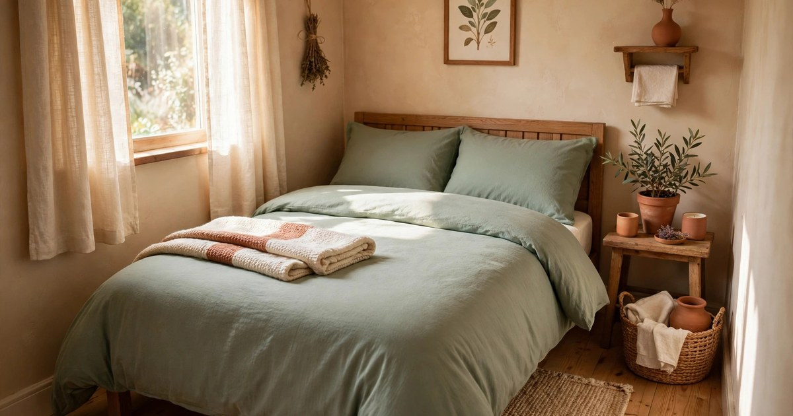
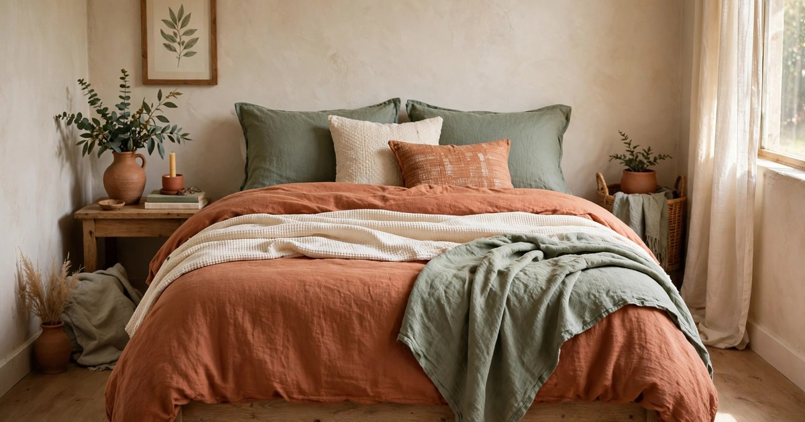
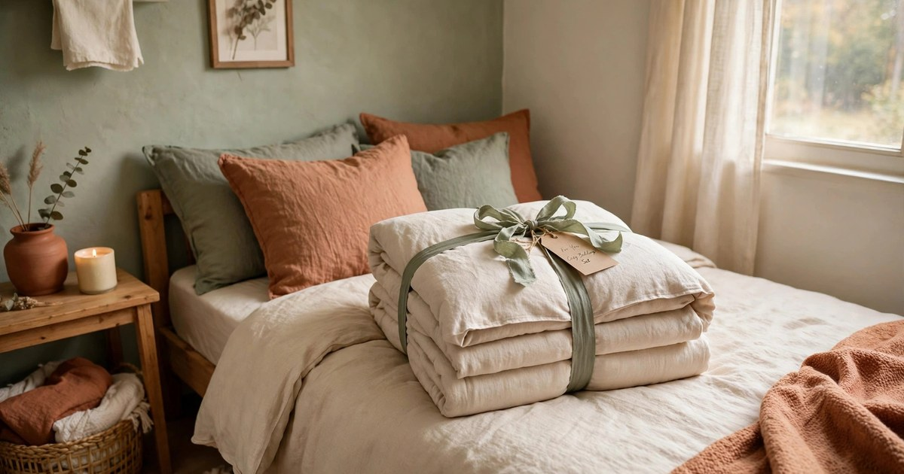
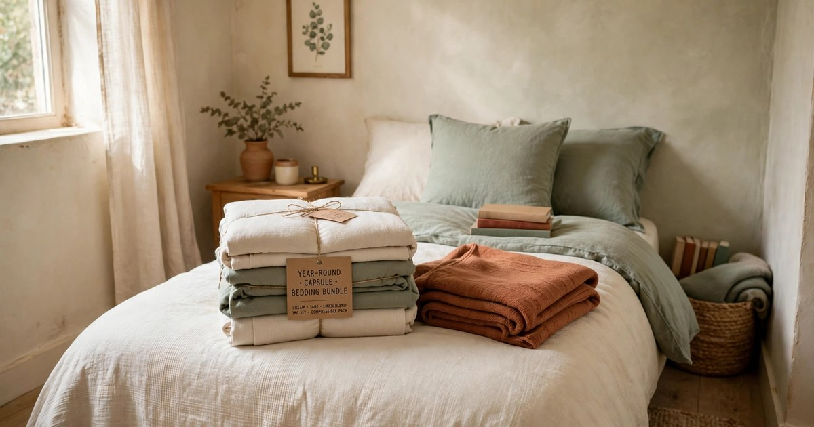

A bedding bundle is a matched set sold as one purchase: usually a duvet cover, a fitted sheet, a flat sheet, and pillowcases, sometimes with a throw or a spare set of cases thrown in. Instead of buying each piece separately, guessing at colours, and hoping the sizes line up, you get a whole bed in one box, designed to work together. For a small bedroom, that single-box logic is the whole point. There is no linen cupboard to hide mismatched spares in, no spare shelf for a third duvet, and no patience left for a sheet that does not fit the mattress. A good bundle solves all of that in one go.

Bundles also beat buying pieces separately on price. Sellers bundle because it moves more stock at once, and the discount usually lands somewhere between ten and thirty percent compared with buying the same pieces one by one. That matters when you are furnishing a rental bedroom on a budget, because the bed is the biggest surface in the room and the one you touch every single night. Spending less per piece while getting a coordinated look is the rare decor win that is both cheaper and prettier. The trick is choosing a bundle built for year-round use, not a seasonal set that is too hot in July and too thin in January.

Year-round bedding is about the middle ground. A true all-season bundle uses breathable natural-feel fabrics — cotton, cotton blends, or bamboo — in a medium weight that layers well. You add a blanket or a throw when it is cold and strip back to the sheet when it is warm, instead of owning two completely different bedding wardrobes. That layering habit is what makes one bundle work for twelve months, and it is also what keeps the storage problem small: one set on the bed, one spare set folded in a drawer, and a throw at the foot of the bed. If a bundle cannot fit in a single drawer or on one shelf when it is not on the bed, it is too much bedding for a small bedroom.

There is a gift angle here too, and December is the right moment for it. A bedding bundle is one of the few home gifts that is genuinely useful, easy to wrap, and hard to get wrong if you know the bed size. New renters, first-flat movers, students, and anyone setting up a guest room all need bedding, and a bundle in a calm, neutral colour is a safe, generous present that does not demand to know someone's taste in art or furniture. Keep the receipt, check the returns window, and choose a colour the recipient can live with for a year, not just a season.

Before you buy, run through three quick checks. First, the size: measure the mattress, not the bed frame, and confirm whether the bundle is sized for a single, small double, double, or king — a cover made for a king will drown a small double and leave metres of fabric to tuck in every night. Second, the contents: count what is actually included, because some bundles skip the flat sheet or include only one pillowcase, and those gaps cost you a second purchase. Third, the wash: everything in the bundle should be machine washable and quick to dry, because in a small flat there is no tumble dryer and no drying room, only a rack by the radiator. With those checks done, here are the ten bundles that do the most for small bedrooms, all year round.

### 1. The classic hotel-white cotton bundle

What is in the bundle: a white cotton duvet cover, a fitted sheet, a flat sheet, and two pillowcases, all in the same plain white cotton. Some versions add a second pair of pillowcases, which is worth having, because white cases show wear first and a spare pair keeps the bed looking fresh while one set is in the wash.

Best fabric and weight: 100 percent cotton or a cotton-rich blend in a medium 200 to 400 thread count. That range is the sweet spot for year-round use — smooth enough to feel like a hotel bed, breathable enough for summer, and sturdy enough to survive weekly washing without going thin. Very high thread counts feel luxurious but trap heat, and very low ones feel rough, so stay in the middle.

Approximate price range: roughly $40 to $90 for a small double set, with the best value usually sitting around $50 to $70. White sets are often the cheapest colour in a range, because they are produced in the largest volumes, so the classic look is also the budget look.

Small-bedroom fit tip: white bedding makes a tiny bedroom feel bigger and brighter, because it reflects light instead of absorbing it, and it turns a small bed into the calm focal point of the room. The trade-off is laundry: white shows every mark, so keep a spare set of cases in the drawer and wash on a warm cycle. A [white cotton bedding set](https://www.amazon.com/s?k=white+cotton+bedding+set+queen&tag={{AMAZON_TAG}}) in a plain weave is the easiest starting point, and it pairs with any throw or cushion you already own, which means you can change the look of the whole room for the price of a single cushion cover.

### 2. The breathable percale bundle for hot sleepers

What is in the bundle: a percale duvet cover, a fitted sheet, a flat sheet, and two pillowcases, usually in a solid pale colour. Percale bundles are often sold as sheet sets with the duvet cover added, so check the listing carefully and make sure the cover is actually included before you pay.

Best fabric and weight: cotton percale, which is a tight, plain weave that feels crisp and cool rather than silky. Percale is the fabric of choice for hot sleepers because air moves through it easily, so you stay cool without the clammy feeling of a synthetic sheet. It suits a medium-weight duvet in winter and a light summer duvet or just the flat sheet in the hottest weeks.

Approximate price range: roughly $45 to $100 for a small double bundle. Percale costs a little more than standard cotton because of the weave, but it lasts longer, so the cost per night works out lower over a year of weekly washes.

Small-bedroom fit tip: percale wrinkles. That is part of its charm — a slightly rumpled, lived-in look — but if you want it smooth, pull the cover taut when you make the bed and fold the top sheet back in a neat cuff. In a stuffy box room with one small window, percale is the single best upgrade you can make to your sleep, and it needs no fan, no gadget, and no extra storage. Search for a [percale bedding set](https://www.amazon.com/s?k=cotton+percale+bedding+set&tag={{AMAZON_TAG}}) in a pale colour, and avoid dark shades, which show the creases more and make a small room feel darker.

### 3. The linen-look bundle on a budget

What is in the bundle: a linen-look duvet cover, a fitted sheet, and two pillowcases, usually in a washed, slightly textured finish. True linen is expensive, so most budget bundles use a cotton-linen blend or a washed microfibre made to look like linen, which gives you the relaxed, textured appearance for a fraction of the price.

Best fabric and weight: a cotton-linen blend or a stonewashed-look cotton in a medium weight. The texture is the point — it hides creases, looks deliberately relaxed, and feels breathable in summer while layering well under a blanket in winter. Real linen softens beautifully with every wash, but a good blend gets you ninety percent of the look for half the money.

Approximate price range: roughly $35 to $80 for a small double bundle, with blends at the lower end and higher-linen-content sets at the top. This is the bundle to buy when you want the boutique-hotel look without the boutique-hotel price tag.

Small-bedroom fit tip: linen-look bedding is forgiving, which is exactly what a small bedroom needs. You do not have to iron it, you do not have to make the bed perfectly, and it still looks intentional. Choose a warm neutral — cream, sage, oatmeal, or soft terracotta — so the texture does the talking and the colour stays calm. A [linen duvet cover set](https://www.amazon.com/s?k=linen+duvet+cover+set&tag={{AMAZON_TAG}}) in a washed finish is the fastest way to make a plain rental bed look styled, and because the fabric is textured, it hides the odd wrinkle from a bed that doubles as a daytime sofa.

### 4. The cosy flannel bundle for winter nights

What is in the bundle: a flannel fitted sheet, a flannel flat sheet, and two brushed flannel pillowcases, sometimes with a matching flannel duvet cover. Flannel bundles are sold as sheet sets more often than full bedding sets, so if you want the full effect, look for one that includes the cover too, or pair it with a plain cover you already own.

Best fabric and weight: brushed cotton flannel, which feels warm the moment you climb in — no cold-sheet shock on a winter night. Flannel is a winter specialist, not a year-round fabric, so treat this bundle as the cold-season half of your year-round system: flannel sheets under a medium duvet in winter, cotton or percale on top of the same duvet in summer.

Approximate price range: roughly $30 to $70 for a small double flannel sheet set, which makes it one of the cheapest bundles on this list. Flannel is a budget fabric that performs like a luxury one in cold weather, and that is why it appears in so many renter bedrooms.

Small-bedroom fit tip: flannel folds down small, so the whole set fits in one drawer when spring arrives, and it dries fast on a rack, which matters when the flat is cold and damp. Keep the colour warm — terracotta, cream, or sage — so it matches the rest of your bedding and you can mix the flannel pillowcases with your year-round cover. For more cold-weather layering ideas, see our [cosy winter bedding under $25](/cozy-winter-bedding-small-apartments-under-25/), which is winter-specific, while this bundle is the one you swap in and out as the seasons change. A [flannel sheet set](https://www.amazon.com/s?k=flannel+sheet+set+queen&tag={{AMAZON_TAG}}) is also a good gift for anyone in a draughty flat, because it fixes the cold-bed problem on the very first night.

### 5. The cooling bamboo bundle

What is in the bundle: a bamboo or bamboo-blend duvet cover, a fitted sheet, a flat sheet, and two pillowcases, usually in a smooth, slightly silky finish. Bamboo bundles are often marketed as cooling sets, and the best ones include the full set rather than just the sheets, so check the contents list before you buy.

Best fabric and weight: bamboo viscose or a bamboo-cotton blend in a light to medium weight. Bamboo fibres wick moisture away from the body, which is why they feel cool and dry even on a warm night, and the fabric drapes softly, so it suits a small bed where a stiff cover would bunch up. It layers well under a light blanket in spring and autumn, and it is a good choice if you run hot but still want a proper duvet cover rather than sleeping under a bare sheet.

Approximate price range: roughly $50 to $110 for a small double bundle. Bamboo costs more than plain cotton, so look for blends rather than pure bamboo if the budget is tight — a blend keeps most of the cooling benefit at a much lower price.

Small-bedroom fit tip: bamboo bedding is light and packs down small, so it is easy to store and easy to wash, and it dries quickly, which is a real advantage in a flat with no dryer. Choose a pale sage or cream so the bed stays light and airy, and wash on a cool, gentle cycle to keep the fibres smooth. A [bamboo cooling sheet set](https://www.amazon.com/s?k=bamboo+cooling+sheet+set&tag={{AMAZON_TAG}}) is worth the extra money if you are a hot sleeper in a small, warm flat, because it is the one bundle that actually changes how cool the bed feels rather than just how it looks.

### 6. The all-in-one guest-room bundle

What is in the bundle: everything a guest needs in one box — a duvet cover, a fitted sheet, a flat sheet, two pillowcases, and often a spare pillow or a throw. The point is completeness: you buy it once, put it on the bed, and the guest room is done, with no second trip to the shops and no forgotten pillowcase discovered at midnight.

Best fabric and weight: medium-weight cotton or a cotton-polyester blend, chosen for durability and easy washing rather than luxury. Guest bedding gets washed between every stay and sometimes sits in a cupboard for weeks, so it needs to survive frequent laundering and still look fresh. A plain colour in a calm neutral is the right choice, because it suits every guest and hides nothing but offends no one.

Approximate price range: roughly $50 to $100 for a small double all-in-one set, with the spare pillow or throw pushing the price toward the top end. Buying it as a bundle is still cheaper than assembling the same pieces separately, and the time saved is worth as much as the money.

Small-bedroom fit tip: in a small flat, the guest room is usually also the office, the reading corner, or the storage room, so the bed needs to look made and tidy even when nobody is staying over. A matching all-in-one bundle does that with one purchase, and because it is a complete set, you can strip it, wash it, and remake the bed in ten minutes before a guest arrives. Store the spare set folded inside the pillowcase it came with, and it takes up no more than one shelf. Look for a [complete bedding set queen](https://www.amazon.com/s?k=complete+bedding+set+queen&tag={{AMAZON_TAG}}) with all the pieces listed in the title, and count them when the box arrives — a missing flat sheet is the most common surprise.

### 7. The small-double bundle that fits tiny beds and tiny storage

What is in the bundle: a duvet cover, a fitted sheet, a flat sheet, and two pillowcases, all sized specifically for a small double bed — usually 120 by 190 centimetres for the mattress, with a cover to match. This is the bundle most small-bedroom renters actually need, and it is the one most often bought wrong, because shoppers grab a standard double set and spend every night tucking in the excess.

Best fabric and weight: medium-weight cotton or a cotton blend, in a plain colour or a small, quiet pattern. The fabric matters less here than the fit: a cover that matches the duvet exactly, a fitted sheet with deep enough pockets for your mattress plus a topper, and pillowcases that fit standard pillows without sagging.

Approximate price range: roughly $35 to $80 for a small double bundle. Small double sets are sometimes a few dollars cheaper than standard doubles, because they use less fabric, so do not pay double prices for a smaller size.

Small-bedroom fit tip: measure the mattress before you order, and write the measurements on a note in your phone so you never guess again. A correctly sized bundle also stores smaller — the folded set fits in a single drawer, and the spare set fits beside it, which means your entire bedding wardrobe lives in one drawer and nowhere else. That is the small-bedroom test every bundle should pass. Search for a [small double bedding set](https://www.amazon.com/s?k=small+double+bedding+set&tag={{AMAZON_TAG}}) rather than a generic double, and check the listed dimensions in the product details, not just the title, because titles are not always accurate.

### 8. The mix-and-match bundle (duvet + sheets + pillowcases in one buy)

What is in the bundle: a duvet cover in one colour or pattern, sheets in a second, and pillowcases in a third — or a set that lets you choose the pieces separately within a single purchase. Some sellers call these curated sets, and the idea is a bed that looks styled rather than matched, without you having to coordinate three separate orders.

Best fabric and weight: medium-weight cotton or a cotton blend across all the pieces, so they wash and wear at the same rate. Mixed fabrics are a false economy — if the cover is heavy cotton and the sheets are thin polyester, one will wear out long before the other, and the set will fall apart as a set.

Approximate price range: roughly $45 to $95 for a small double mix-and-match bundle. You pay a small premium for the styling, but it is still cheaper than buying three separate pieces in three separate shops and paying delivery three times.

Small-bedroom fit tip: keep one colour constant across the pieces — for example, a cream sheet with a terracotta cover and sage cases — so the bed looks deliberate rather than random. In a small room, three clashing colours will shrink the space visually, while one anchor colour with two accents will make it feel designed. This is also the bundle to choose if you already own a good duvet and just need the rest: buy the set, use the pieces you need, and keep the spare cover as your backup. A [mix and match bedding set](https://www.amazon.com/s?k=mix+and+match+bedding+set&tag={{AMAZON_TAG}}) in warm neutrals is the easiest way to get a styled bed without a stylist, and it photographs well too, which matters if the bedroom doubles as a content backdrop.

### 9. The bedding gift bundle for a new home or new renter

What is in the bundle: a complete, gift-ready set — duvet cover, fitted sheet, flat sheet, two pillowcases, and often a folded throw or a small cushion — packaged so it looks like a present rather than a chore. Some gift bundles come in a fabric storage bag or a keepsake box, which doubles as storage in a small flat, and that packaging is part of the value.

Best fabric and weight: soft, medium-weight cotton or a cotton blend in a neutral colour, because a gift has to suit someone else's taste. Avoid bold patterns and dark colours for gifts, and avoid fabrics that need special care — the recipient should be able to wash it on a normal cycle without reading a label like a contract.

Approximate price range: roughly $50 to $100 for a gift-ready small double bundle. Spend toward the top of that range only if the packaging is genuinely reusable, like a proper storage bag; otherwise, buy a good plain bundle and wrap it yourself with a ribbon and a handwritten note, which costs less and feels more personal.

Small-bedroom fit tip: this is the gift for the person who has just moved into their first flat and owns one towel and a kettle. It solves a real problem on day one, and because it is a complete set, they do not need to buy anything else for the bed. If you are buying for a new renter, check the bed size first — a quick message asking "single or small double?" saves an awkward exchange. A [bedding gift set](https://www.amazon.com/s?k=bedding+gift+set&tag={{AMAZON_TAG}}) in cream or sage is a safe, generous choice, and if you want more ideas for a new home, our [cosy winter bedroom ideas](/cosy-winter-bedroom-ideas-small-apartments/) show how one bundle and a throw can finish a whole room.

### 10. The year-round capsule bundle (one set, four seasons, with a swap tip)

What is in the bundle: a single medium-weight cotton duvet cover, a fitted sheet, a flat sheet, and two pillowcases, plus the swap system that makes it work all year: a light summer duvet insert and a warmer winter insert, or one medium insert with a blanket you add in winter and remove in summer. The bundle is the covers; the inserts are the seasonal swap, and together they are the capsule.

Best fabric and weight: medium-weight cotton percale or plain cotton in a 200 to 400 thread count, because it is the only weight that works in every season. Too light and it feels flimsy in winter; too heavy and it is stifling in summer. The capsule works because the covers never change — only the layer underneath does — so the bed always looks the same and you never have to store a second set of covers.

Approximate price range: roughly $45 to $90 for the cover bundle, plus $25 to $60 for a second duvet insert if you do not already own one. That sounds like two purchases, but it replaces two full seasonal bedding sets, so it is the cheapest way to dress a bed for a whole year.

Small-bedroom fit tip: this is the ultimate small-bedroom bundle, because the entire system lives in one drawer. The covers are on the bed, the spare insert is vacuum-packed under the bed or on top of the wardrobe, and the blanket lives folded at the foot of the bed. The swap takes five minutes at the start of each season: change the insert, add or remove the blanket, and the bed is ready for the next three months. Buy a [year round bedding set](https://www.amazon.com/s?k=year+round+bedding+set&tag={{AMAZON_TAG}}) in a colour you will not tire of — cream, sage, or soft terracotta — because you will be looking at it every day for a year, and a calm colour is the one you will still like in month twelve.

## How to choose your bundle in ten minutes

Start with the bed size, then the season you are buying for, then the fabric. If you sleep hot, start with percale or bamboo. If you sleep cold, start with flannel sheets under a medium cover. If you are buying for someone else, start with the hotel-white cotton bundle, because it is the safest gift and the easiest to live with. Then count the pieces, check the wash instructions, and confirm the whole set folds into one drawer. If it passes all of those tests, it is a good bundle for a small bedroom. If it fails even one, keep looking — there are plenty of bundles, and the right one is the one that fits your bed, your washing routine, and your storage, not just your budget.

A good bedding bundle is not the most expensive one or the prettiest one in the photograph. It is the one that is on your bed every night, washed every week, and still looking good a year later, without ever needing a second cupboard. Buy the bundle that fits your small bedroom as it is, not the bedroom you wish you had, and let the throw, the cushion, and the light do the styling. The bed will do the rest.

## Frequently Asked Questions

### What is a bedding bundle?
A bedding bundle is a matched set of bedding sold as one purchase, usually a duvet cover, a fitted sheet, a flat sheet, and pillowcases. Bundles are cheaper than buying the same pieces separately, everything matches, and you only have to get the size right once. For small bedrooms, the best bundles also fold down small enough to store in a single drawer or on one shelf.

### What should a year-round bedding bundle include?
At minimum, a duvet cover, a fitted sheet, a flat sheet, and two pillowcases, all in a medium-weight breathable fabric such as cotton or a cotton blend. A spare pair of pillowcases is a useful bonus. You do not need a second set of covers for different seasons — instead, swap the duvet insert or add a blanket in winter and remove it in summer.

### What is the best bedding fabric for all seasons?
Medium-weight cotton is the best all-round choice, because it breathes in summer and layers well in winter. Cotton percale suits hot sleepers, bamboo suits warm flats, and flannel is the best cold-weather sheet fabric, used as a seasonal swap rather than all year. Avoid heavy, non-breathable synthetics if you want one set to work in every season.

### How many bedding sets do I need for a small bedroom?
Two sets are enough: one on the bed and one spare in the drawer. A third set is a luxury, not a necessity, and in a small bedroom it is usually a storage problem rather than a help. Wash the spare while the fresh set is on the bed, and rotate them weekly so they wear evenly.

### Are bedding bundles a good gift for a new renter?
Yes, they are one of the best new-home gifts, because every new renter needs bedding and a complete bundle solves the problem in one box. Choose a neutral colour, confirm the bed size before you buy, and pick a set that is fully machine washable. Keep the receipt in case the size is wrong, and add a ribbon rather than paying extra for gift packaging you could do yourself.
