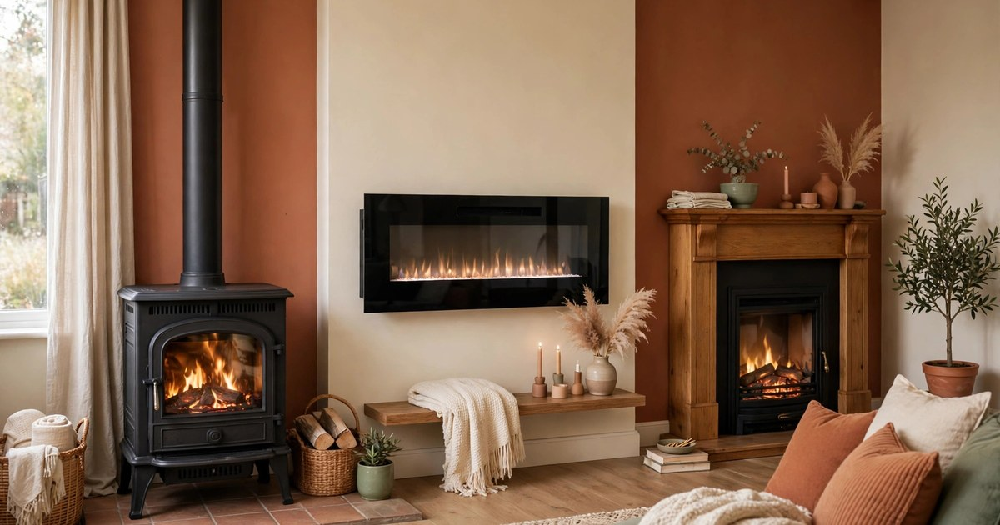
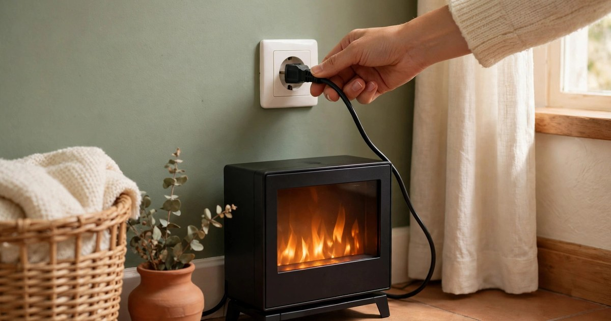
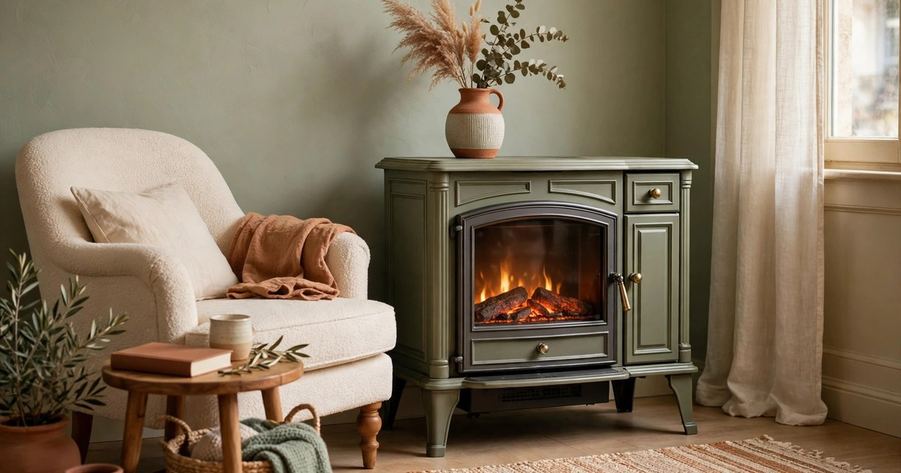
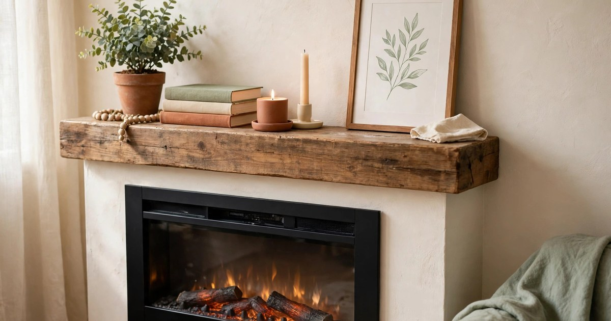
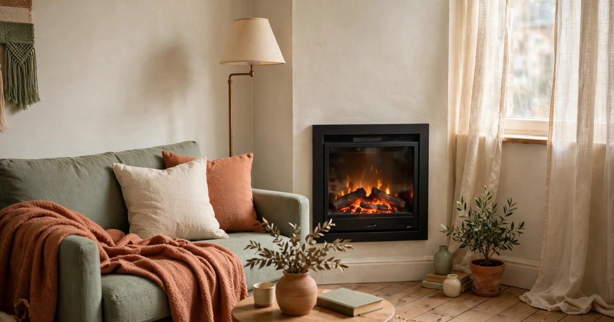
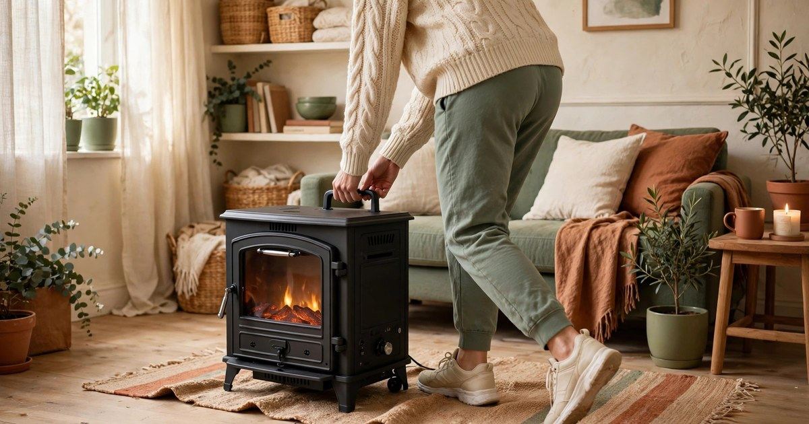

There is a specific kind of cold that only a small apartment delivers: the draughty corner by the window, the living room that never quite warms up, the bedroom that feels two degrees colder than everywhere else. A real fireplace would fix the feeling instantly, but renters cannot have one — no chimney, no gas line, no landlord who will sign off on a hole in the wall. An electric fireplace is the workaround that actually works. It plugs into a normal socket, produces real heat, and gives you the flickering glow and the focal point that make a room feel like home, all without a single screw going into the wall.

It is also, honestly, a bigger purchase than most apartment decor. A decent electric fireplace costs more than a throw blanket and a candle combined, which is exactly why choosing the wrong one stings. Buy too big and it swallows your one good wall; buy too small and it looks like a space heater wearing a costume; buy the wrong type and you end up with a unit that fights your furniture instead of anchoring it. The good news is that the choice is simple once you work through it in order: measure first, pick the type second, check the power and the lease third, and only then think about styling. This guide walks through all seven steps, with honest prices and renter rules at every turn, so the fireplace you bring home is the one you will still love in February — and still be able to take with you when you move.

If you want the wider picture first, our [fireplace alternatives overview](/small-apartment-fireplace-alternatives/) covers every no-drill way to get the firelight feeling, from candle clusters to faux mantels. This guide is the dedicated electric buying guide: the one to read once you have decided that real heat, a real flame effect and a piece of furniture you can keep are what you want. Pair it with our ideas for [renter-friendly warmth without paint](/renter-friendly-warmth-without-paint-ideas/) and your apartment will feel warm in every sense of the word, long before the heating bill arrives.

### 1. Measure your space and work out the heat you need

Every fireplace mistake starts with skipping this step, so do it properly: tape measure out, ten minutes, no guessing. Measure the wall where the fireplace will live, the width of the space it can occupy, and the distance to the nearest plug socket — because an electric fireplace needs to sit close to an outlet, and a trailing extension lead across a small room is both ugly and unsafe. Note the ceiling height too, since a tall mantel package in a low-ceilinged room will look top-heavy, while a low TV-stand fireplace under a high ceiling can look lost.

Then work out how much heat you actually need. Most electric fireplaces run on a standard household outlet at around 1,400 to 1,500 watts, which produces roughly 4,600 to 5,100 BTU — enough to warm a room of about 35 to 45 square metres as a supplement to central heating, or a smaller room of 15 to 25 square metres as the main heat source. The rule of thumb is simple: a compact stove or a 30-inch wall-mounted unit suits a bedroom or a studio corner, while a 42-inch or wider unit suits an open-plan living room. Bigger is not automatically warmer, though — almost every model on the market tops out at the same 1,500 watts, so a wider unit mostly buys you a wider flame picture, not more heat. Check the product's stated heating area rather than its width, and be honest about whether you want a heater that looks like a fireplace or a fireplace that happens to heat.

Also measure the walkways. In a small apartment, a freestanding unit that sticks out 30 centimetres from the wall can turn a comfortable path into a daily shin-bruise, and a mantel package that is wider than the wall it sits on looks like furniture that wandered in from another house. Leave at least 60 centimetres of clear floor in front of the unit and a metre of clearance from curtains, bedding and anything else flammable. Write the numbers down — width, depth, socket distance, clearance — and keep them on your phone when you shop. [Shop measuring tape and electric fireplaces](https://www.amazon.com/s?k=electric+fireplace+small+apartment+heater&tag={{AMAZON_TAG}})

### 2. Pick your type: freestanding stove, wall-mounted, TV stand or mantel package

There are four types worth considering, and they solve different problems. A freestanding stove is the classic: a compact cast-iron-look box on little feet, usually 40 to 60 centimetres wide, that stands in a corner and looks like a tiny wood burner. It is the cheapest way in (typically $120 to $300), the easiest to move, and the most convincing at a glance, because the stove shape reads as "real fireplace" to the eye. Its downside is that it heats one spot rather than a whole room, and it needs floor space you may not have.

A wall-mounted electric fireplace is a slim glass-fronted panel that hangs on the wall like a television, usually 30 to 60 inches wide. It is the best choice for the smallest rooms because it takes up zero floor space, and the wide flame picture looks genuinely modern and expensive. Prices typically run $150 to $450. The catch for renters is the word "mounted": many models are designed to be screwed to the wall, so look specifically for models that can sit on a console or a stand, or that come with a freestanding bracket. If it needs screws, it is not renter-friendly, no matter how good it looks in the photos.

A TV-stand fireplace does two jobs at once: it holds your television and hides a fireplace in the base, with storage shelves on either side. In a small apartment that is an unbeatable deal, because one piece of furniture replaces two and the fireplace becomes the natural focal point of the room. Expect $250 to $600 depending on size and finish, and measure twice — the stand has to fit your TV's width, and a stand that is narrower than the television sitting on it looks wrong from every angle.

A mantel package is the full traditional look: a fireplace insert set into a wooden mantel surround, freestanding against the wall, with a shelf on top for styling. It is the most convincing fake fireplace you can buy, and the mantel shelf gives you the classic decorating moment — garland, candles, stockings — without any installation. Prices run $300 to $700, and it is the biggest of the four, so it needs a proper wall to live on. If your apartment has one good blank wall and you want the full fireplace fantasy, this is the one. [Shop freestanding electric fireplace stoves](https://www.amazon.com/s?k=freestanding+electric+fireplace+stove&tag={{AMAZON_TAG}})

### 3. Check power, safety and your lease

Electric fireplaces are unusually renter-friendly, but only if you respect the power rules. Almost every model plugs into a standard outlet and draws up to 1,500 watts on its highest heat setting — roughly the same as a hair dryer. That means it needs its own socket, not a shared power strip, and never an extension lead. Plug it directly into the wall, keep the cable out of walkways, and check that the socket is not already loaded with other heavy appliances. If your apartment has old wiring or the socket feels warm after an hour of use, turn the heat down and have the outlet checked before using it again.

Safety features are worth paying attention to, because they are the difference between a fireplace you relax in front of and one you keep an eye on. Look for automatic shut-off if the unit overheats, a tip-over switch on freestanding stoves, a cool-touch glass front, and a timer so the heat switches itself off if you fall asleep. Most modern units also let you run the flame effect with the heat switched off, which is the feature you will use most in spring and autumn — all of the glow, none of the warmth, pennies of electricity.

On the lease side, electric fireplaces are about as landlord-proof as a purchase gets. Nothing is fixed to the wall, nothing is drilled, nothing is plumbed, and the whole thing leaves with you when you move out. That is the sentence to use if your landlord asks: "It plugs in like a lamp and leaves no mark." Still, read your lease's clause on heaters before you buy. A small minority of leases ban portable heaters outright, and a few require any heater to be a certain type. If yours does, a flame-only model with the heat switched off is usually fine, and your landlord will almost always prefer a modern electric unit with a thermostat and auto shut-off to a cheap fan heater. Keep the manual and the receipt — if anything ever needs proving, the safety certifications printed on the box do the talking. [Shop electric fireplaces with safety shut off](https://www.amazon.com/s?k=electric+fireplace+heater+safety+shut+off&tag={{AMAZON_TAG}})

### 4. Style it like real furniture, not an appliance

The single biggest styling mistake with electric fireplaces is treating them like an appliance that happens to sit in the room. A fireplace — even a fake one — is a piece of furniture, and it should be styled like one. That starts with the finish. Black glass and chrome read as "gadget"; warm wood tones, matt black with brass details, cream, sage or terracotta read as "furniture". Choose a finish that already exists somewhere else in your room — the wood of your coffee table, the black of your lamp base, the cream of your sofa — and the fireplace will look like it was always meant to be there.

Then give it the same treatment you would give any focal point. A rug in front of it defines the hearth zone and stops the unit floating on bare floor; a reading chair angled towards it at forty-five degrees creates the fireside seat every room wants; a floor lamp or a tall plant on one side balances the weight so the fireplace does not look marooned against a blank wall. Keep the flame brightness low and warm rather than cranked to maximum — the most convincing flame effect is the subtle one, and the garish orange blast is what gives electric fireplaces a bad name.

The other rule is to hide the evidence. Tuck the cable behind the unit or run it along the skirting board with a cable cover that matches the wall colour, and never let the remote control live on the mantel — it is the one object that instantly says "appliance". A small basket beside the unit for the remote, a throw and a book turns the fireplace corner into a destination rather than a display. When a guest walks in and says "what a lovely fireplace" instead of "oh, an electric heater", you have styled it right. [Shop wall mounted electric fireplace 36 inch](https://www.amazon.com/s?k=wall+mounted+electric+fireplace+36+inch&tag={{AMAZON_TAG}})

### 5. Dress the mantel or top like a styled shelf

If your model has a mantel shelf or a flat top — a mantel package, a TV stand or even a wide stove — you have just gained the best styling surface in the apartment, and it deserves the same care as a bookshelf. The formula that never fails is five objects in three heights: something tall at one end (a vase with dried stems, a candlestick, a framed print leaning against the wall), something medium in the middle (a stack of two books, a small clock, a ceramic bowl), and something low at the other end (a candle cluster, a tiny plant, a decorative box). Odd numbers, varied heights, and one material repeated twice — brass, wood, ceramic — and the shelf looks collected rather than arranged.

Seasonal swaps are where the mantel earns its keep. A garland in December, a bowl of pinecones in January, fresh eucalyptus in spring, a stack of woven baskets in summer — the shelf changes with the year while the fireplace stays put, which is exactly how a real mantel behaves. Keep anything flammable a safe distance from the heat outlet, and never put candles directly above a unit that vents heat upwards; check where your model's warm air comes out before you style above it.

For TV-stand fireplaces, the styling surface is the top of the stand on either side of the television, and the rule is restraint: two objects, one on each side, low enough not to compete with the screen. A small plant and a stack of books is plenty. The fireplace below is already doing the visual work, so the shelf above it should whisper, not shout. And remember that the mantel is the first thing people photograph in your living room, so keep it tidy — a styled shelf that is also a dumping ground for keys and post loses its magic fast. [Shop electric fireplace TV stand](https://www.amazon.com/s?k=electric+fireplace+TV+stand&tag={{AMAZON_TAG}})

### 6. Place it for small rooms: focal wall, corner, under the TV, zone heating

Placement is where small apartments win or lose, because the fireplace has to work as a heater and as a focal point at the same time. The first option is the focal wall: the wall your sofa faces, where a real fireplace would logically go. This is the classic placement and it works because it gives the room a centre — the seating arranges itself around the fireplace without you having to think about it. It needs a wall at least a metre wider than the unit, and it works best with a mantel package or a wide wall-mounted unit.

The second option is the corner. Corners are dead space in most small apartments, and a freestanding stove tucked into one turns wasted square footage into the cosiest spot in the room. Angle the stove at forty-five degrees so the flame faces into the room rather than straight at the adjacent wall, put a chair beside it, and you have created a reading nook out of nothing. This is the best placement for studios and one-bedroom flats, because it costs no usable wall at all.

The third option is under the television, which is really just the TV-stand fireplace doing its job — but even a freestanding stove or a wall-mounted unit can sit beneath a wall-mounted TV if the heat vents forward rather than upward. Check the manual before you try this one: heat rising into a television is the fastest way to shorten its life.

The fourth idea is zone heating, and it is the one that saves money. Instead of heating the whole apartment, put the fireplace in the room you actually live in during the evening and let the thermostat do the work. A 1,500-watt unit warming your living room while the bedroom stays cool is cheaper than heating the whole flat, and it is the reason so many renters find their winter electricity bill goes down after buying a fireplace — the central heating runs less because the room that matters is already warm. [Shop small electric fireplace for corner](https://www.amazon.com/s?k=small+electric+fireplace+corner+apartment&tag={{AMAZON_TAG}})

### 7. Renter rules: moving it, storing it in summer, keeping your deposit safe

The last step is the one that makes an electric fireplace a genuinely renter-smart purchase: it moves with you, and it has to survive both the move and the summer. Moving a freestanding stove or a mantel package is a two-person job — lift, never drag, and keep the glass front facing inwards with a blanket wrapped around it. Wall-mounted units come off their bracket in minutes, and TV-stand fireplaces travel like any other piece of furniture: empty the shelves, tape the doors shut, and wrap the corners. Photograph the unit before you move it, and photograph the wall behind it after you take it down, so you have proof that no mark was left.

Summer storage is simple but worth doing properly. Dust the unit, wipe the glass, and run the flame effect for a few minutes to make sure everything still works before you put it away. Freestanding stoves can stay out all year as a side table with a plant on top — honestly, most renters never bother storing them, and the flame effect with the heat off is lovely on a cool summer evening. Mantel packages and TV stands are furniture, so they stay in place and simply stop being heaters. Only wall-mounted units sometimes come down in summer, and if yours does, store it upright in its original box with the remote and manual taped inside the lid, so next winter you are not hunting for parts.

The deposit rules are short: no drilling, no adhesive strips rated for more than the unit weighs, nothing stuck to the wall to hold it up, and a felt pad under every foot that touches the floor. If your fireplace sits on wooden floors, those felt pads are the difference between a full deposit and a deduction for scratches. Check the wall behind the unit once a month for heat marks — a properly installed electric fireplace should leave none, but catching a problem early is always cheaper than explaining it at checkout. And when you do move out, take the fireplace with you. It is yours, it is portable, and it will make the next apartment feel like home on the first night, which is a better housewarming gift than anything you could buy. [Shop electric fireplace mantel package](https://www.amazon.com/s?k=electric+fireplace+mantel+package+freestanding&tag={{AMAZON_TAG}})

## Frequently Asked Questions

### How much does a good electric fireplace for a small apartment cost?

Expect $120 to $300 for a freestanding stove, $150 to $450 for a wall-mounted unit, $250 to $600 for a TV-stand fireplace and $300 to $700 for a mantel package. The sweet spot for most renters is $200 to $400: below that, the flame effect tends to look flat and the thermostat tends to be imprecise; above it, you are mostly paying for size and finish rather than better heat. Buy once, in that range, and you will not be shopping again next winter.

### Can I use an electric fireplace in a rental apartment?

Yes, in almost every case. An electric fireplace plugs into a standard socket, needs no drilling, no gas line and no chimney, and leaves with you when you move out. Read your lease's heater clause first — a small minority of leases ban portable heaters — and if in doubt, ask your landlord with the sentence "it plugs in like a lamp and leaves no mark". Most landlords prefer a modern electric unit with auto shut-off to a cheap fan heater.

### How much does it cost to run an electric fireplace?

On full heat, a 1,500-watt unit uses about 1.5 kWh per hour, which at typical US electricity prices works out to roughly 20 to 25 cents per hour. The flame-only mode, with the heat switched off, costs pennies. Most renters use the heat for a few hours in the evening and the flame effect the rest of the time, so the running cost is usually lower than heating the whole apartment with central heating — that is the zone-heating saving from step six.

### What size electric fireplace do I need for a small apartment?

For a bedroom or studio corner, a 30-inch unit or a compact stove is plenty. For a living room up to about 40 square metres, go for a 36 to 42-inch unit. Remember that nearly all models top out at 1,500 watts, so a wider unit gives you a wider flame picture rather than more heat — choose the width that fits your wall, and check the stated heating area rather than the size alone.

### Is a wall-mounted electric fireplace renter friendly?

Only if it can be used without screws. Many wall-mounted models are designed to be screwed to the wall, which is not renter-friendly. Look for models that sit on a console or come with a freestanding bracket, or choose a freestanding stove or mantel package instead. If a wall-mounted unit is the look you want, a media console underneath it gives you the same floating effect with zero holes in the wall.

A fireplace is not really about heat. It is about the room having a heart — somewhere the eye lands, somewhere the chairs turn towards, somewhere the evening gathers. An electric fireplace gives a small rented apartment that heart without asking the landlord for anything, and it comes with you to the next place. Measure first, pick the type that fits your room and not someone else's, and style it like furniture. Then put the kettle on, switch the flame low, and enjoy the warmest corner of a flat that finally feels like yours.
