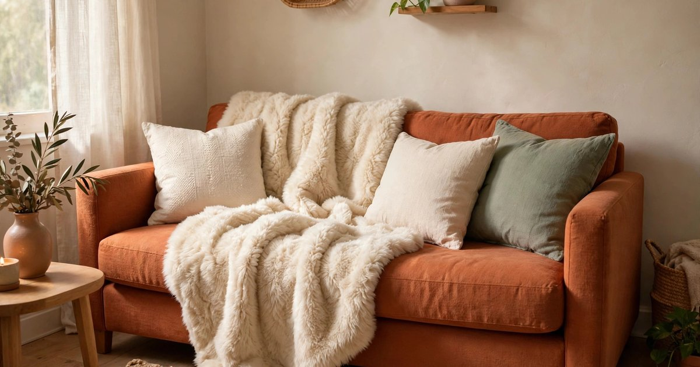
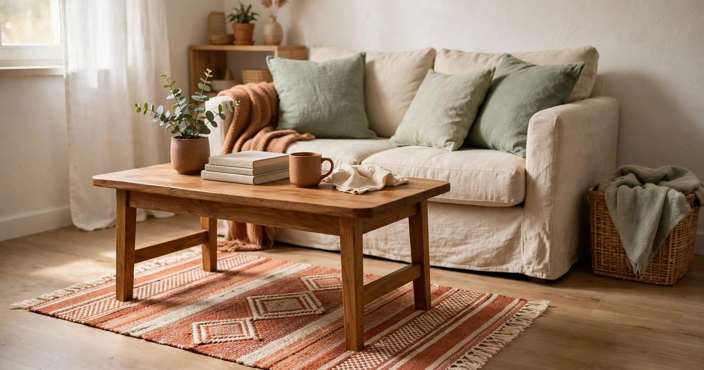
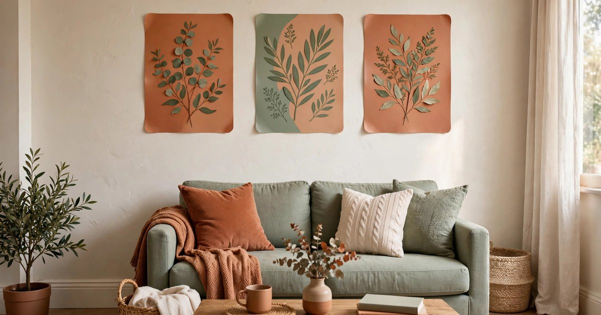
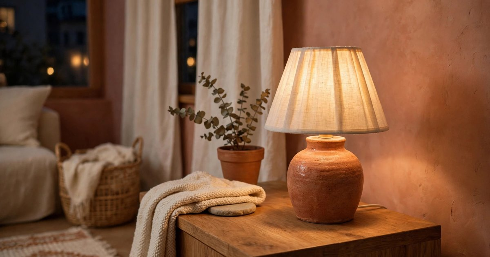

Black Friday has arrived, and for anyone decorating a small rented flat on a budget, it is genuinely the best shopping day of the year. The big homeware retailers, the online marketplaces and the small sellers all cut prices on the same day, which means the soft furnishings, lighting and little finishing touches that usually feel like a luxury suddenly fall into the under-$25 bracket. A throw that was just out of reach in October becomes an easy yes in November. A lamp, a rug or a set of cushion covers that would have cost twice as much in January can be yours today for the price of a takeaway.

That is especially good news for renters. Small apartments are the hardest homes to decorate well, because every object has to earn its place and nothing can be fixed to the walls in a way that risks the deposit. Black Friday is the day to stock up on the renter-friendly pieces that do the heavy lifting — the things that add warmth, texture and light without a single nail, screw or coat of paint. A string of fairy lights, a faux fur throw, a peel-and-stick print: these are the pieces that make a small flat feel like a home, and today they cost less than they will at any other point in the year.

The trick, of course, is shopping the sale smartly rather than letting the sale shop you. Start with a short list of the gaps in your flat before you open a single tab — the bare windowsill, the cold-looking sofa, the dark corner that never quite works — and buy to fill those gaps, not to fill a basket. Measure first: a rug that is too big for a studio living room is no bargain at any price, and a throw that does not fit the sofa will live folded in a cupboard. Check the returns policy before you buy, because sale items are sometimes final sale, and a piece you cannot send back is only cheap if you actually keep it. And give yourself a hard budget for the day. Nine pieces under $25 each is a whole flat's worth of warmth for less than a weekly shop — but only if you stop at nine. Below are the nine picks worth your money this Black Friday, each one chosen because it works hard in a small space, asks nothing of your landlord, and costs less than $25 while the sale lasts.

### 1. LED Fairy Lights

Fairy lights are the single cheapest way to change the mood of a small apartment, and on Black Friday they are almost always one of the deepest discounts in the whole homeware sale. A warm white string, draped along a shelf, around a window frame or across a headboard, turns flat overhead lighting into a soft, golden glow that makes even the smallest room feel layered and intentional. In a studio or one-bedroom flat, where one ceiling light often has to do the work of three, that extra layer of light is transformative — it lets you switch the harsh main light off in the evening and live in a warmer, calmer room instead.

What makes fairy lights such a perfect renter's pick is that they ask nothing of the walls. Clear adhesive hooks, a few command strips or simply draping them over a curtain rod is all the fixing they need, and they come down in minutes on moving day without a mark left behind. Battery-operated sets are the most flexible for small flats, because they free you from hunting for a spare socket behind the sofa, and many come with a remote and a timer so the lights switch themselves off at bedtime. Copper wire strings are the prettiest in a small space — the wire all but disappears against a cream wall, leaving only the glow.

Fairy lights fit almost anywhere a small flat needs warmth: along the top of a bookshelf, framing a mirror so it bounces light around the room, wound through a plant on a windowsill, or strung above a bed as a soft alternative to a bedside lamp. In a dark hallway or a windowless corner they can be the only light source that makes the space feel finished rather than forgotten. Look for warm white rather than cool white — the golden tone suits the terracotta, cream and sage palette of a cosy flat far better, and it flatters skin tones in a way that cool, blue-white light never does.

Find it on Amazon: [warm white LED fairy lights battery operated with timer](https://www.amazon.com/s?k=warm+white+LED+fairy+lights+battery+operated+timer&tag={{AMAZON_TAG}})

### 2. Faux Fur Throw

If a small apartment could have only one Black Friday purchase, a faux fur throw would be a very strong candidate. Nothing else changes the feel of a room so fast for so little money: drape it over the arm of a sofa and the whole seating area looks softer, warmer and more expensive, and on a cold November evening it is the thing you actually reach for. In a rental, where the sofa is often the landlord's and the flat is rarely as warm as you would like, a good throw does double duty as decor and as a blanket.

The reason a faux fur throw works so well in a small space is texture. Small flats tend to be visually flat — smooth walls, smooth floors, smooth furniture — and a pile of soft fur breaks that up instantly. Cream, ivory or soft beige are the safest colours for a small room, because they bounce light around instead of absorbing it, and they sit happily against terracotta, sage or charcoal without clashing. A throw in a pale tone also makes a dark or tired-looking sofa look intentional rather than inherited, which is a trick every renter needs at some point.

Size matters more than it seems. A throw that is too small looks like a scarf draped over a sofa, while one that is generously sized can be folded, layered and tucked. Look for something around 130 by 170 centimetres, which is large enough to cover two people on the sofa and still drape nicely over the arm when it is not in use. Check that it is machine washable before you buy — a throw that cannot be washed will not survive a winter of evening use, and Black Friday is no bargain if the piece is ruined by February.

Find it on Amazon: [faux fur throw blanket cream for sofa](https://www.amazon.com/s?k=faux+fur+throw+blanket+cream+sofa&tag={{AMAZON_TAG}})

### 3. Cushion Covers Set

A set of cushion covers is the fastest room makeover a renter can buy, and Black Friday is when sets of four — which would normally cost far more — drop comfortably under $25. Swapping the covers on the cushions you already own changes the colour story of the whole sofa in about five minutes, with no new furniture, no new cushions and nothing to store when you move. It is the closest thing to repainting a room that a rental agreement allows.

In a small apartment, cushion covers earn their keep by doing two jobs at once. First, they add the texture and colour that a plain sofa lacks: a mix of terracotta, cream and sage in linen-look or woven fabric instantly warms up a grey or beige sofa and ties the room's palette together. Second, they protect the cushions underneath from the daily wear of a small flat, where the sofa is also the dining chair, the home office and the reading nook. A set of four gives you enough to style the sofa properly — two on each side, or a mix of sizes — without the room looking like a cushion shop.

Shopping smart means checking three things before you buy. First, the size: measure your existing cushion inserts and buy covers to match, because a cover that is two centimetres too small will never sit right. Second, the closure: a hidden zip is far neater than an envelope fold and will survive far more washes. Third, the fabric: linen-look and cotton canvas wear beautifully and wash well, while velvet-look covers add a touch of richness for winter but show every mark. Buy a set rather than singles on Black Friday — the per-cover price is almost always far lower, and a coordinated set looks far more deliberate than four random singles.

Find it on Amazon: [cushion covers set of 4 terracotta cream sage linen](https://www.amazon.com/s?k=cushion+covers+set+of+4+terracotta+cream+sage+linen&tag={{AMAZON_TAG}})

### 4. Battery Candles

Real candles are a renter's headache: many tenancy agreements ban open flames outright, and even where they do not, a candle in a small flat is a fire risk on a crowded shelf and a soot mark on a white ceiling waiting to happen. Battery candles solve all of that. A set of flameless LED candles gives you the same warm, flickering glow with no flame, no wax, no smoke and no argument with the landlord — and on Black Friday, sets of three or more regularly fall under $25.

The best battery candles are the ones you would mistake for the real thing at a glance. Look for ivory or cream wax-look bodies with a slightly uneven, melted edge, and a flame that flickers rather than glowing steadily — the flicker is what sells the illusion. Many sets come with a remote control and a timer, which matters more than it sounds: in a small flat, being able to switch a whole shelf of candles on from the sofa, and have them turn themselves off after four or six hours, turns them from a novelty into a nightly habit.

Battery candles fit wherever a small flat needs a focal point. A trio of different heights on a coffee table instantly makes the table look styled rather than cluttered. A single tall candle on a windowsill turns an empty sill into a feature after dark. A cluster inside a lantern or a hurricane vase on a shelf adds depth to a display that would otherwise look flat. They are also the safest way to get candlelight in a bedroom or a bathroom, where a real flame is a risk you do not need. Keep a spare set of batteries in the drawer and they will last you all winter.

Find it on Amazon: [flameless LED battery candles with remote timer set](https://www.amazon.com/s?k=flameless+LED+battery+candles+remote+timer+set&tag={{AMAZON_TAG}})

### 5. Small Rug

A small rug is the piece that turns a patch of bare floor into a room, and it is one of the best-value Black Friday buys for a small apartment because rugs are heavily discounted and small sizes are the cheapest of all. In a rental, where the flooring is fixed and often uninspiring — grey carpet, pale laminate, tired tiles — a rug is the only way to change the floor without changing the floor. It adds colour, pattern and warmth underfoot, and it quietly defines the living area in an open-plan studio where there are no walls to do the job.

Size is everything with a rug in a small flat. The classic mistake is buying one that is too small: a rug that only just fits under the coffee table looks like a mat, and it makes the room feel smaller rather than larger. For a small living area, look for something around 120 by 180 centimetres, big enough for the front legs of the sofa and the coffee table to sit on it. That anchors the seating area and makes the whole arrangement look intentional. If your flat is a studio, a rug under the bed area and a smaller one by the sofa can quietly split one room into two zones.

Colour and pattern deserve a moment's thought, too. A warm terracotta, cream or muted sage rug suits the cosy palette of a small flat and hides the dust and crumbs that a pale rug shows within a day. A low pile is more practical than a deep shag in a small space — it is easier to vacuum, chairs slide over it, and it does not trap as much dust. And because a rug in a rental sits on someone else's floor, a thin non-slip pad underneath is worth the few extra pounds: it stops the rug creeping across laminate and protects the floor beneath it from scuffs.

Find it on Amazon: [small area rug 120x180 terracotta cream living room](https://www.amazon.com/s?k=small+area+rug+120x180+terracotta+cream+living+room&tag={{AMAZON_TAG}})

### 6. Peel-and-Stick Wall Art

Bare walls are the giveaway of a rental, and peel-and-stick wall art is the renter's answer to them. These are printed panels, decals or framed-look art pieces that stick to the wall with a removable adhesive and peel off cleanly when you move, leaving no holes, no marks and no deposit dispute. On Black Friday they are a classic doorbuster item, with sets of prints and large statement decals regularly dropping under $25.

What makes peel-and-stick art so good for a small apartment is scale. A single large piece above the sofa or the bed does more for a room than a dozen small frames, because it gives the eye one clear focal point instead of visual clutter. Botanical prints, abstract arches in terracotta and sage, or simple line drawings all suit the warm, cosy palette of a small flat, and a set of two or three coordinated prints lets you build a small gallery wall without a single nail. The adhesive is the whole point: if the piece is crooked, you peel it off and try again, which is a freedom no framed print ever gives you.

There are two things to check before you buy. First, your wall surface: peel-and-stick art grips smooth painted walls beautifully but struggles on textured wallpaper or rough plaster, so check the product notes if your walls are not smooth. Second, the size: measure the wall space above your sofa or bed before you order, because a print that is too small for the wall looks lost and a print that is too large overwhelms a small room. A good rule is that wall art should be about two-thirds the width of the furniture beneath it. Get the size right and a $25 stick-on print can look like a piece you paid ten times as much for.

Find it on Amazon: [peel and stick wall art prints terracotta botanical set](https://www.amazon.com/s?k=peel+and+stick+wall+art+prints+terracotta+botanical&tag={{AMAZON_TAG}})

### 7. Table Lamp

A small apartment with only one overhead light always looks flat after dark, and a table lamp is the cheapest fix there is. A small ceramic or linen-shaded lamp on a side table or a shelf adds a pool of warm light exactly where you sit, which is what makes a room feel cosy rather than merely lit. On Black Friday, small table lamps are one of the most reliably discounted homeware items, and a well-chosen one regularly lands under $25.

In a small flat, the right lamp is small, warm and unobtrusive. A base in ceramic, wood or matte terracotta suits the cosy palette far better than chrome or glass, which can look cold and show every fingerprint. A fabric shade in cream or linen softens the light and spreads it gently, while a shade that is too dark will swallow the light and leave the room dim. Height matters: a lamp of 30 to 40 centimetres is right for a side table next to a sofa, tall enough to light a book but low enough not to dominate the room.

The practical details are worth checking while the sale is on. A lamp with a warm white bulb included saves a separate purchase, and a bulb you can dim — or a lamp with a three-way switch — lets you drop the light low in the evening without buying a separate dimmer. Check the base is heavy enough not to topple when you reach past it in a tight space, and look for a cord long enough to reach the nearest socket without trailing across the floor. In a small flat, a lamp that is beautiful but impractical is just another thing to trip over.

Find it on Amazon: [small ceramic table lamp warm white for living room](https://www.amazon.com/s?k=small+ceramic+table+lamp+warm+white+living+room&tag={{AMAZON_TAG}})

### 8. Woven Storage Basket

Every small apartment has the same problem: things with nowhere to live. Throws, spare cushions, magazines, chargers, the clutter that accumulates on every flat surface — and the only cure is storage that looks like decor. A woven basket is exactly that. Made from seagrass, jute or cotton rope, it holds a surprising amount while looking like a deliberate design choice, and on Black Friday a good-sized basket regularly drops under $25.

The beauty of a woven basket in a small flat is that it hides the mess without hiding the warmth. A basket beside the sofa swallows the throws and cushions that would otherwise pile up on the arm. One by the front door holds shoes, scarves and the bits you grab on the way out. One on a shelf corrals the small things — remote controls, chargers, hand cream — that otherwise spread across every surface. And because it is woven, it adds exactly the natural texture a small, smooth-walled flat needs: the same warm, earthy quality as a jute rug or a wooden shelf.

Size and handles are the two things to get right. A basket of about 35 to 45 centimetres across is the sweet spot for a small flat — big enough to be genuinely useful, small enough to tuck beside a sofa or under a console table. Sturdy handles matter, because a basket that cannot be carried is a basket that never gets moved, and in a small flat everything needs to move. Check that the weave is tight and even, and that the basket stands up straight when empty rather than slumping — a slumped basket looks tired within a week. Buy one, use it for a month, and you will wonder how the flat ever coped without it.

Find it on Amazon: [woven seagrass storage basket with handles large](https://www.amazon.com/s?k=woven+seagrass+storage+basket+handles+large&tag={{AMAZON_TAG}})

### 9. Mini Faux Tree

Black Friday falls at the perfect moment for one purchase in particular: the mini faux tree. With Christmas less than a month away, a small artificial tree is the renter's way into the festive season without the cost, the mess or the floor space of a full-sized tree. A tabletop tree of 60 to 90 centimetres, already potted in a terracotta or ceramic pot, sits on a side table, a windowsill or a shelf and brings the whole room into the season — and on Black Friday, when festive decor is at its cheapest, a good one is comfortably under $25.

What makes a mini faux tree so right for a small apartment is that it solves the Christmas problem in one object. There is no stand to store, no needles to hoover, no watering, and no wrestling a six-foot tree up the stairs of a rented flat. It needs no floor space at all, which is the one thing a small flat cannot spare in December. A few battery fairy lights wound through the branches and a handful of small ornaments are all the decorating it needs, and it looks finished rather than makeshift — especially in a warm terracotta pot that suits the room's palette rather than a plastic base that gives the game away.

The details to check are the fullness and the pot. A tree with sparse, widely spaced branches looks thin no matter how you dress it, so look for one described as full or with a high tip count for its height, and check the product photos for gaps. A tree that arrives in a decent pot is worth more than one that arrives bare, because a good pot is half the look and buying one separately eats into the saving. And think beyond December: a mini faux tree in a terracotta pot works as a year-round plant stand-in on a shelf, so this is a Black Friday buy that keeps earning its place long after the baubles come down.

Find it on Amazon: [mini faux Christmas tree tabletop terracotta pot](https://www.amazon.com/s?k=mini+faux+christmas+tree+tabletop+terracotta+pot&tag={{AMAZON_TAG}})

Black Friday only works if you buy the pieces your flat actually needs, so start with the gaps, measure twice, and let these nine under-$25 finds do the work. A string of fairy lights, a soft throw, a small rug and a mini tree will change how a small rented flat feels for less than the cost of one large piece of furniture — and because every one of them is renter-friendly, they will all come with you to the next flat, too. Shop the sale, not the hype, and enjoy a warmer, cosier home before the year is out.

## Frequently Asked Questions

### Are Black Friday home decor deals actually cheaper than other sales?

Usually, yes — Black Friday is when homeware retailers run their deepest discounts of the year, often beating the January sales on the same items. That said, not every "deal" is a genuine saving, so it is worth checking the price history of a bigger item before you buy. For small under-$25 pieces like throws, cushions and fairy lights, the saving is usually real and the risk is low.

### What should I buy first for a small apartment on Black Friday?

Start with the pieces that change how the room feels the most: lighting and soft furnishings. Fairy lights or a small table lamp fix the lighting, a faux fur throw and a set of cushion covers transform the sofa, and a small rug grounds the whole living area. Those four purchases alone can make a small flat feel like a different home, all for well under $100 combined.

### Can I decorate a rented flat without losing my deposit?

Yes, as long as you stick to non-permanent pieces. Peel-and-stick wall art, fairy lights on adhesive hooks, freestanding lamps, rugs, throws and baskets all add warmth and personality without a single hole in the wall. Avoid nails, screws, heavy adhesive strips and anything that marks paintwork, and always check your tenancy agreement for any specific restrictions before you hang or stick anything.

### How do I avoid impulse buys on Black Friday?

Make a short list of the gaps in your flat before the sale starts, set a hard budget, and buy only what is on the list. Measure the spaces the items will go into — the sofa, the wall above it, the floor area for a rug — so you know the right size before you shop. If a deal is not on your list and does not fit a measured space, it is not a bargain, it is clutter.

### Is it safe to buy home decor from Amazon on Black Friday?

Amazon is a reliable place to buy small home decor items, especially when you buy from sellers with strong ratings and plenty of reviews. Check the returns policy before ordering, because some sale items have shorter return windows, and read recent reviews rather than only the top-rated ones. For under-$25 items, the risk is low and the convenience of fast delivery is hard to beat.

### Will these under-$25 finds last, or are they cheap for a reason?

A well-chosen budget piece can last for years if you check the basics before you buy: washable fabric on throws and cushion covers, a sturdy base on a lamp, tight weaving on a basket, and a full, well-made mini tree. Black Friday discounts usually reflect the sale event rather than poor quality, so a careful choice at a sale price is often the same item you would have paid full price for in October.

