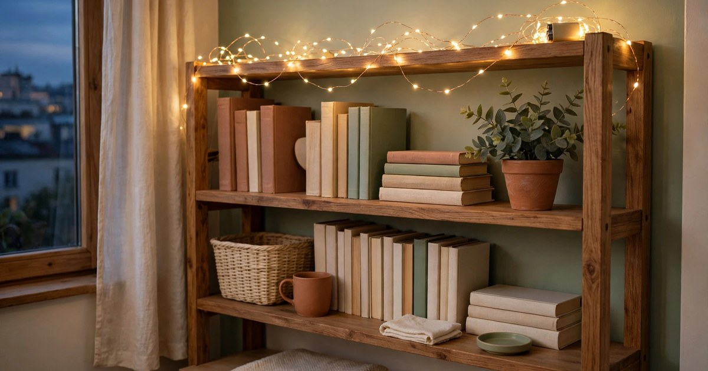
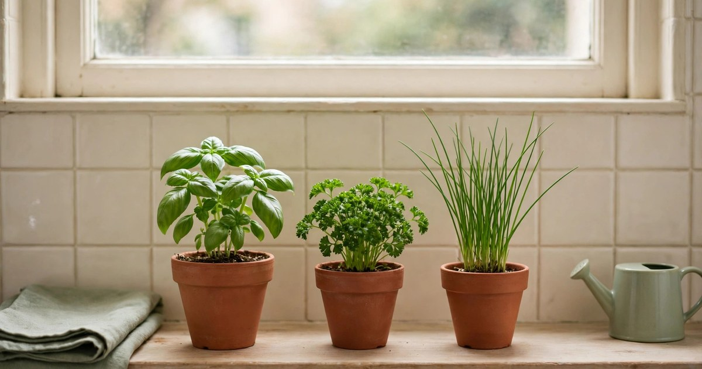
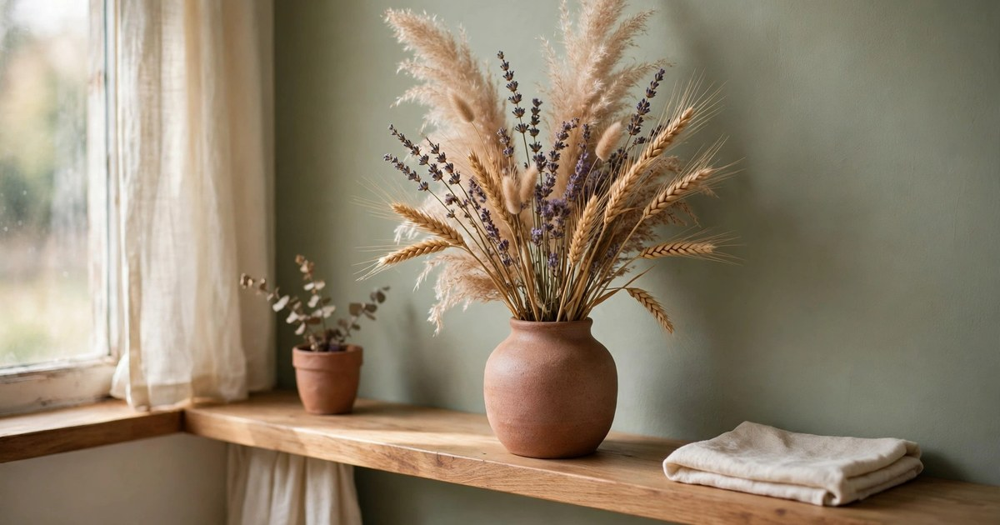
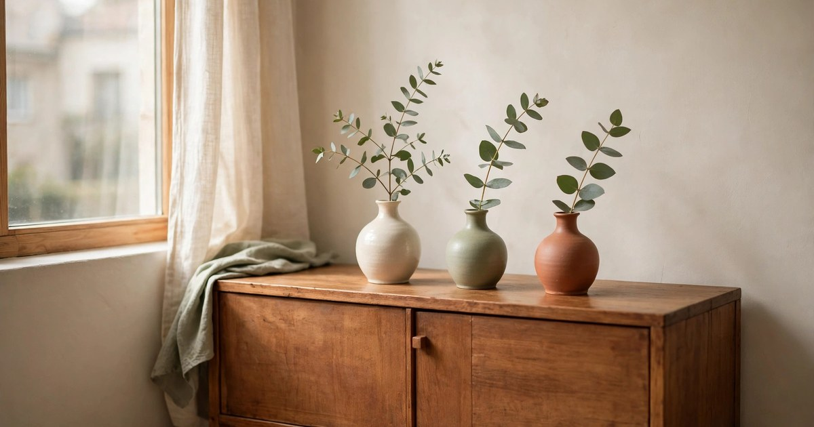
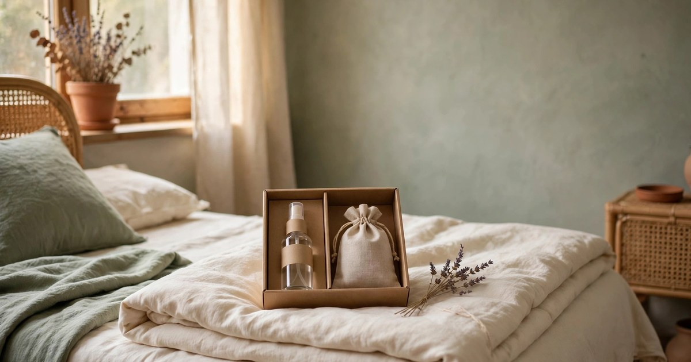
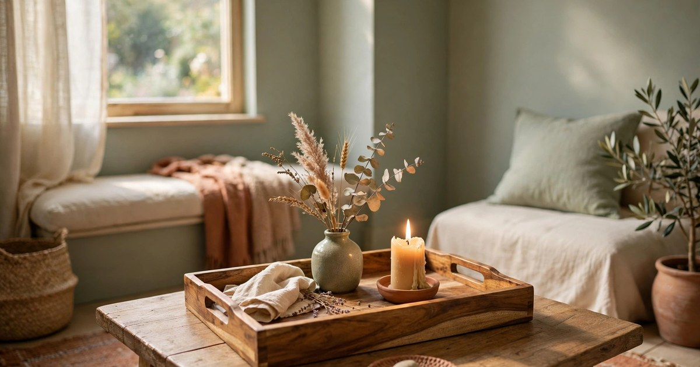
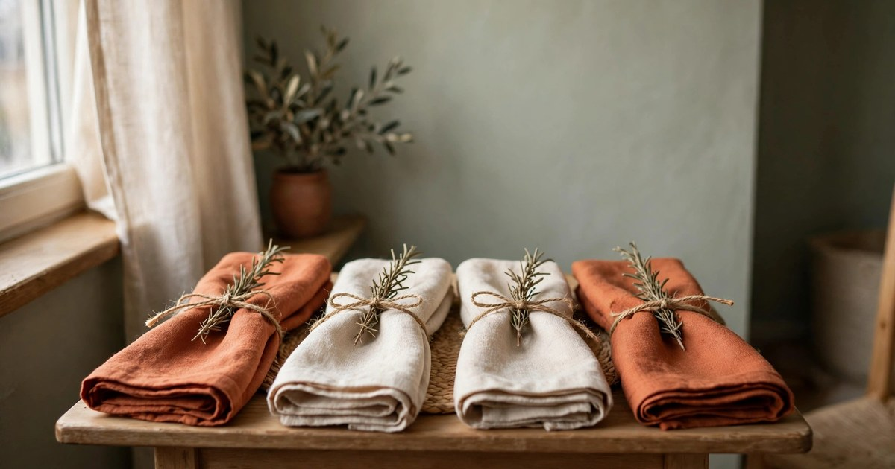
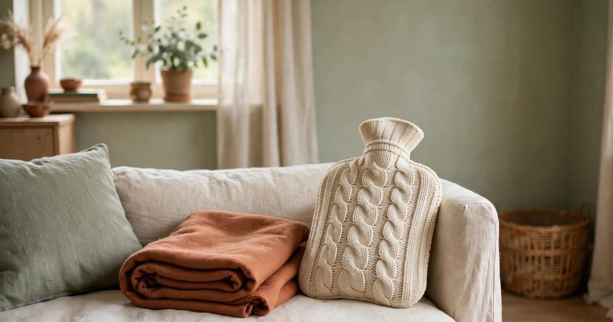

Buying a Christmas gift for someone who loves home decor is a particular kind of puzzle. You want something they will actually use and display, not something that ends up in a drawer by January. And if they rent — if their flat is small, their walls are off-limits for nails, and every surface already earns its keep — the puzzle gets harder still. A giant vase is no gift when there is nowhere to put it. A wall-mounted anything is no gift when the deposit depends on undamaged plaster. The best decor gifts for renters are small, useful, beautiful, and easy to move when the lease ends.

That is exactly what this roundup is for. Nine gifts, every one under $25, chosen for people who love a cosy home and live in a small one. Each pick works in a studio or a one-bedroom flat, needs no drilling, no gluing and no landlord's permission, and looks far more expensive than it is. There is something here for the candle lover, the plant person, the person who hosts tiny dinners, and the friend whose idea of a perfect evening is a blanket, a book and a warm drink.

Prices are approximate and will wobble with sales and stock, so treat the $25 cap as a shopping target rather than a guarantee — check before you buy, and look for the same styles at charity shops, discount stores and local markets too. If you are buying for someone who has just moved into a rental, our [cosy throw blankets for renters](/cozy-throw-blankets-renters-under-25/) guide pairs beautifully with several of these picks.

## How to choose a decor gift for a renter

Before you shop, think about the recipient's space rather than your own taste. A gift that suits a three-bedroom house can be a burden in a 40-square-metre flat. Start with size: will it fit on a shelf, a side table or a windowsill that already holds other things? Small wins. A bud vase trio beats a floor vase. A single beautiful candle beats a candelabra. If you are unsure, choose something consumable or something that folds flat — candles, dried flowers, linen spray and napkins all disappear gracefully when they are used up, which is a kindness in a small home.

Next, think about their taste and their routines. Do they light a candle every evening, or would they rather have something for the table? Do they cook and host, or do they curl up and read? A gift that matches a habit they already have will be used within a week; a gift that asks them to start a new habit will sit on a shelf gathering dust. The fairy lights on this list are for the person whose flat already glows in December; the herb garden kit is for the one who cooks most nights and talks about growing their own basil.

Finally, check the practicalities. Anything that needs a plug should be battery-operated or USB-powered so it can live anywhere, not just beside a socket. Anything scented should be gentle — a small flat concentrates fragrance fast, so a subtle soy candle beats a heavy perfume. And anything fragile should come in packaging that survives the post, or better still, buy it in person and wrap it yourself. A little kraft paper, a sprig of dried eucalyptus and a handwritten tag turns a $15 gift into something that feels considered, which is the whole point.

## 1. Scented soy candle in a reusable jar

A good candle is the safest decor gift there is, and the hardest to get wrong — provided you choose well. Look for a soy wax candle in a reusable glass jar, in a warm, gentle scent like cedarwood, amber, cinnamon or spiced orange. Soy burns cleaner and slower than paraffin, so a small 200-gram candle can last forty hours or more, and the jar becomes a pen pot, a cotton-ball holder or a tiny vase once the wax is gone. That second life matters in a small flat, where everything should earn its place twice.

Why it works as a gift: a candle is both decor and atmosphere. Unlit, the amber jar looks lovely on a shelf or a bedside table. Lit, it turns an ordinary Tuesday evening into something soft and deliberate. It suits the friend who works from home and lights a candle at five o'clock to mark the end of the day, the reader who likes a flicker beside their book, and the new renter whose flat still smells faintly of the previous tenant's cooking. Scent is personal, so stick to warm, woody or gently spiced fragrances rather than anything floral or overpowering — a small room concentrates scent quickly, and nobody wants their living room to smell like a perfume counter.

Where it fits: a side table, a bookshelf, a bathroom shelf, or a bedside table. Keep it away from curtains and draughts, and pair it with a simple wooden lid or a small tray if you want the gift to feel finished. If your recipient already owns a dozen candles, look for one with an unusual vessel — a ceramic pot, a tin with a wooden lid, or a jar in a terracotta tone that matches their palette.

Shop this style: [scented soy candle reusable jar on Amazon](https://www.amazon.com/s?k=scented+soy+candle+reusable+glass+jar&tag={{AMAZON_TAG}})

## 2. Warm-white fairy lights, battery-operated

Fairy lights are the fastest way to make a small flat feel like Christmas, and the battery-operated kind are the renter's version: no socket hunting, no trailing cables, no command hooks overloaded with weight. A string of warm-white micro LEDs on a thin copper wire can be draped over a bookshelf, coiled inside a glass jar, wound around a bed frame, or tucked along a windowsill — and when January comes, it coils back into a drawer until next year.

Why it works as a gift: fairy lights are pure mood. They soften a room that overhead lighting makes harsh, they photograph beautifully, and they cost almost nothing to run — a set of AA batteries lasts weeks on a timer setting. They suit the friend who decorates for every season, the student in a tiny studio who wants their room to feel like home, and the person who hosts small gatherings and wants the flat to glow without buying a single extra lamp. Choose warm white, not cool white: cool white reads as office lighting, while warm white reads as candlelight.

Where it fits: anywhere, which is the point. Drape them over a mirror, along the top of a bookcase, inside a lantern, or around a small tree. The copper-wire versions are the most versatile because they bend and hold their shape. Look for a set with a remote or a built-in timer — six hours on, eighteen off — so your recipient never has to remember to switch them off, and the batteries last the whole festive season.

Shop this style: [battery operated warm white fairy lights on Amazon](https://www.amazon.com/s?k=battery+operated+warm+white+fairy+lights+copper+wire&tag={{AMAZON_TAG}})

## 3. Windowsill herb garden grow kit

A herb garden grow kit is a gift for the cook and the plant lover in one small box: usually three little pots, seed packets for basil, parsley and chives, soil discs and a tray that sits neatly on a windowsill. It costs less than a takeaway, takes up no more space than a row of mugs, and gives its recipient fresh herbs for months. For a renter who cannot dig a garden, it is a tiny piece of one.

Why it works as a gift: it is useful in a way most decor is not. Fresh basil on a weeknight pasta, parsley snipped straight into a salad, chives over scrambled eggs — the kit pays for itself in flavour within a few weeks. It also suits people who claim they kill every plant, because herbs are forgiving: give them light, water when the soil feels dry, and they mostly look after themselves. And there is a quiet pleasure in watching something grow in the darkest weeks of the year, when the world outside the window is bare and grey.

Where it fits: a kitchen windowsill is ideal, but any bright sill or a small shelf near a window will do. The pots are small — usually 8 to 10 centimetres across — so three of them fit on a sill that would never hold a full planter. If your recipient's kitchen has no windowsill, look for a kit with a slim wooden stand that sits on a worktop instead. Our [winter windowsill garden ideas](/winter-windowsill-garden-guide/) has more small-space growing inspiration if the gift sparks a new hobby.

Shop this style: [windowsill herb garden grow kit on Amazon](https://www.amazon.com/s?k=windowsill+herb+garden+grow+kit+indoor&tag={{AMAZON_TAG}})

## 4. Dried flower bouquet

A dried flower bouquet is the gift for the person who loves fresh flowers but cannot justify buying them every week — or the renter whose flat is too dark for a vase of living blooms. A bundle of dried lavender, pampas grass, wheat stems and bunny tails, tied with twine and arranged in a simple vase, looks beautiful for a year or more with no watering, no sunlight and no maintenance at all. It is the lowest-effort decor there is, and it photographs like a styling shoot.

Why it works as a gift: dried flowers are forgiving in a way fresh flowers never are. They do not wilt if your recipient is away for a weekend, they do not need a sunny spot, and they do not trigger the guilt of watching something beautiful die in a vase. They suit the friend whose taste runs warm and natural — terracotta, cream, sage, dried grasses — and they work in almost any room: a hallway console, a bedroom shelf, a bathroom that never sees direct sun. Choose a bouquet in muted, natural tones rather than bright dyed colours, which tend to look garish after a few months and clash with everything else in the room.

Where it fits: a tall, narrow vase on a shelf, a side table, or a mantelpiece that does not exist — in a rental, the top of a bookcase does nicely. Keep dried flowers out of steamy bathrooms and away from radiators, or they will fade and crumble. A light shake outside every few weeks keeps the dust off, and that is the entire maintenance routine.

Shop this style: [dried flower bouquet pampas lavender on Amazon](https://www.amazon.com/s?k=dried+flower+bouquet+pampas+lavender+decor&tag={{AMAZON_TAG}})

## 5. Ceramic bud vase trio

A trio of small ceramic bud vases is a gift that looks far more considered than its price. Three little vases — usually in a mix of shapes, heights and soft colours like cream, sage and terracotta — each hold a single stem: a sprig of eucalyptus, one dried flower, a cutting from a houseplant. Together they make a styled group; apart, they dot around a flat wherever a little colour is needed. It is the kind of gift that makes a shelf look finished.

Why it works as a gift: bud vases solve the small-space flower problem. A full bouquet needs a big vase and a big surface, but a single stem in a bud vase needs nothing more than a few centimetres of shelf. They suit the person who buys themselves a bunch of supermarket flowers and splits it across the flat, the renter who propagates cuttings in water and needs somewhere pretty to put them, and the minimalist whose decor is quiet but deliberate. Ceramic feels warmer and more expensive than glass at this price, and a matte glaze in earthy tones fits the terracotta, cream and sage palette most small flats already lean towards.

Where it fits: a windowsill, a bookshelf, a bedside table, or grouped on a coffee table. They are also brilliant on a dining table for a small Christmas dinner — three little vases down the centre of the table, each with one stem, look intentional without taking up the space a centrepiece would. If your recipient already has vases, choose an unusual shape — a narrow neck, a rounded belly, a speckled glaze — so the trio adds something new rather than duplicating what they own.

Shop this style: [ceramic bud vase trio set on Amazon](https://www.amazon.com/s?k=ceramic+bud+vase+trio+set+small&tag={{AMAZON_TAG}})

## 6. Linen spray and sachet gift set

A linen spray and sachet set is the quiet luxury gift — the one for the person who notices how a room smells and how sheets feel, and who would never buy something this indulgent for themselves. A small bottle of linen spray in a soft scent like lavender, cedar or clean cotton, plus two or three fabric sachets filled with dried lavender or cedarwood, tucked into drawers and wardrobes. It is small, it is useful, and it makes every cupboard in a small flat smell like a boutique hotel.

Why it works as a gift: scent is the most overlooked part of home decor, and the most personal. A linen spray freshens bedding, curtains and the sofa between washes — a real help in a small flat where the sofa is also the office and the dining room. Sachets keep drawers smelling fresh for months and, with cedarwood, quietly discourage moths. It suits the friend who irons their pillowcases, the new renter whose wardrobe still smells of the previous occupant, and anyone who loves the ritual of making a bed properly. Choose gentle, natural scents and avoid anything heavily synthetic, which can feel cloying in a small room.

Where it fits: everywhere, in the best sense. The spray lives on a bedside table or a bathroom shelf; the sachets disappear into drawers, wardrobes and linen cupboards. Because the set is consumable, it never becomes clutter — when it is used up, it is simply gone, which is exactly what a small home needs. Wrap it in tissue and a sprig of dried lavender for a gift that feels twice its price.

Shop this style: [linen spray and sachet gift set on Amazon](https://www.amazon.com/s?k=linen+spray+sachet+gift+set+lavender&tag={{AMAZON_TAG}})

## 7. Wooden serving tray

A wooden serving tray is the gift that organises a home while looking like decor. A simple tray in acacia, mango wood or pale oak — rectangular, with low handles — corrals the clutter that collects on a coffee table, turns a bedside table into a tidy vignette, and carries cups of tea from the kitchen to the sofa without a spill. In a small flat, where every surface does double duty, a tray is the difference between a mess and a display.

Why it works as a gift: it is genuinely useful every single day, which is rare for a decor gift. It suits the person who hosts friends for tea or mulled wine and needs a way to carry four mugs at once, the reader who likes a candle, a book and a cup within reach on the sofa, and the renter whose coffee table is the only surface in the living room and therefore holds everything. A tray makes that everything look intentional. Choose solid wood rather than plastic or thin bamboo — it feels better, ages better, and at this price a small acacia tray is easy to find. A size around 40 by 25 centimetres fits a coffee table without dominating it, and still holds two mugs, a candle and a small vase.

Where it fits: a coffee table, an ottoman, a bedside table, or a kitchen worktop as a home for oils and salt. It is also the easiest gift on this list to style for a Christmas table — lay it down the centre with a candle, a few sprigs of greenery and a small bowl of clementines, and the table is dressed. If you are pairing gifts, a tray and a candle together make a ready-made present that looks like you planned it for weeks.

Shop this style: [wooden serving tray acacia handles on Amazon](https://www.amazon.com/s?k=wooden+serving+tray+acacia+handles&tag={{AMAZON_TAG}})

## 8. Set of linen table napkins

A set of linen table napkins is a gift for the person who hosts — even if hosting means two friends squeezed around a tiny table in a one-bedroom flat. Four napkins in a warm festive colour like terracotta, deep green or natural flax, washed soft and slightly crumpled, instantly make a weeknight supper feel like an occasion. They are reusable, washable, and they fold away to nothing in a drawer, which is precisely what small-space living demands.

Why it works as a gift: napkins are one of those things people rarely buy for themselves but love once they have them. Paper napkins feel thin and wasteful; cloth napkins feel like a proper meal. They suit the friend who cooks for people, the couple who have just moved in together and are building their first table, and the host of a small Christmas dinner who wants the table to look dressed without buying a whole new tablecloth. If you want to make the gift feel festive, choose a warm colour — terracotta, forest green or a deep rust — rather than plain white, and tie each napkin with twine and a sprig of dried rosemary before you wrap them.

Where it fits: a dining table, obviously, but also a coffee table for a cheese board evening, or a picnic. Pair them with our [Christmas table runners for small apartments](/christmas-table-runners-small-apartments-under-25/) if you want to build a whole table setting as a gift. Linen softens with every wash, so this is a gift that actually improves with use — a nice thought for something that costs less than a takeaway.

Shop this style: [linen table napkins set terracotta on Amazon](https://www.amazon.com/s?k=linen+table+napkins+set+terracotta&tag={{AMAZON_TAG}})

## 9. Knitted hot water bottle with cover

A knitted hot water bottle is the cosiest gift on this list, and the most honest about what winter in a rental actually feels like. Old flats are draughty, heating is expensive, and the sofa is where the evening happens. A traditional rubber hot water bottle in a soft cable-knit cover — cream, sage or a warm oatmeal — keeps its recipient warm for hours, looks lovely draped over an armchair, and costs less than a single evening's takeaway. It is old-fashioned in the best way.

Why it works as a gift: it is useful from the moment it is unwrapped. It suits the friend who works from home in a cold flat and keeps a blanket over their knees, the reader who falls asleep on the sofa, the person with a bad back or cold feet, and anyone whose landlord's idea of insulation is a polite suggestion. A knitted cover matters — it stops the bottle feeling clammy, it looks like a piece of knitwear rather than a medical device, and it can be removed and washed. Choose a classic rubber bottle with a good stopper, not a novelty shape; the classics last for years, and the knit cover is what makes it a gift rather than a pharmacy purchase.

Where it fits: on the sofa, in bed, or draped over an armchair when not in use — the cover makes it look like part of the soft furnishings rather than something to hide. If you are buying for a couple, two matching bottles in different colours are a sweet paired gift. And if your recipient already owns a hot water bottle, a beautiful spare cover on its own still makes a lovely present.

Shop this style: [knitted hot water bottle cover set on Amazon](https://www.amazon.com/s?k=knitted+hot+water+bottle+cover+set&tag={{AMAZON_TAG}})

## Wrapping it up

The best Christmas gifts for home decor lovers are not the biggest or the most expensive — they are the ones that fit the life the recipient actually lives. A candle that burns on a quiet evening, fairy lights that make a small room glow, a tray that tidies a coffee table, a hot water bottle that gets someone through a cold January: these are gifts that get used, and used gifts are remembered. Keep it small, keep it useful, keep it beautiful, and keep it under $25. Your recipient's flat — and their deposit — will thank you.

If you are shopping for more than one decor lover, mix and match across this list: a candle and a tray for the host, fairy lights and dried flowers for the stylist, the herb kit and the napkins for the cook. And if you are the decor lover in question, there is no rule against buying yourself one or two of these — consider it research for next year's list.

## Frequently Asked Questions

### What is the best Christmas gift for someone who loves home decor?

The best gift matches their space and their habits. Small, useful items — a scented candle, a set of bud vases, a wooden tray — work in almost any home and get used daily. Avoid anything large, anything that needs wall fixings, and anything in a style you have not seen in their home. When in doubt, choose something consumable like a candle or dried flowers: it can be enjoyed without adding clutter.

### Are these gifts suitable for renters?

Yes — every pick in this roundup is renter-friendly. Nothing needs screws, nails, adhesive or a landlord's permission. Everything is freestanding, portable and easy to take to the next flat. Fairy lights are battery-operated, the tray and vases simply sit on a surface, and the candle, linen spray and dried flowers leave no mark on the property at all.

### How do I choose a gift when I don't know their taste?

Stick to warm, neutral colours — cream, terracotta, sage and natural wood — which suit most small flats and most existing decor. Avoid bold patterns and strong colours unless you know they love them. A gift in a natural palette blends in anywhere, while a bright or heavily themed item can clash with a room you have never seen.

### What if my budget is less than $25?

Several picks on this list come in well under $15, especially the linen spray set, the dried flower bouquet and a single scented candle. You can also pair two smaller items — a candle and a sachet set, or fairy lights and a bud vase — to make a thoughtful gift bundle that still stays under $25 in total.

### Can I buy these gifts as a set for one person?

Yes, and it often makes a better present. A candle with a wooden tray, fairy lights with a bud vase trio, or napkins with a linen spray set all feel like a curated gift rather than a single item. Just keep the total under your budget and wrap the pieces together in one box with tissue paper and a handwritten tag.
