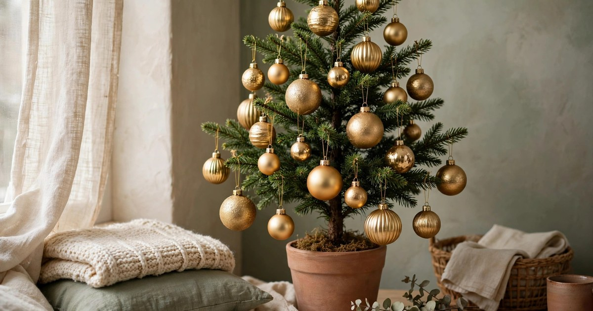
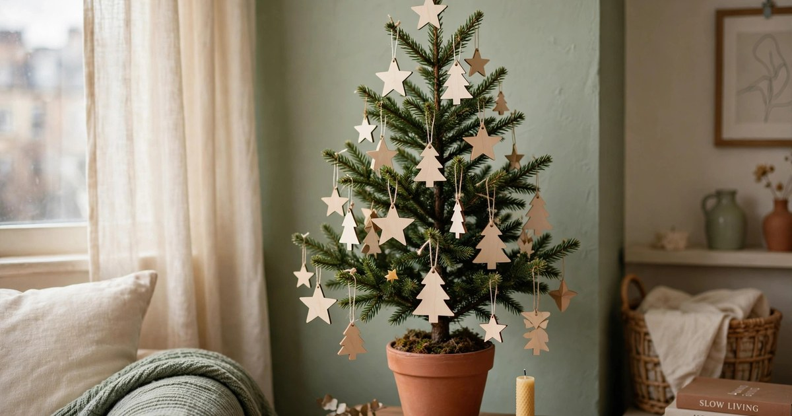
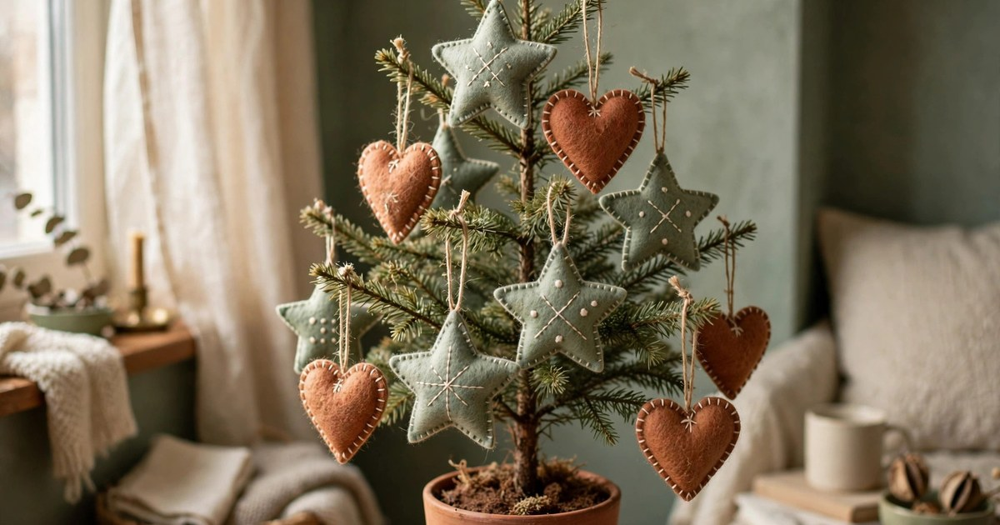
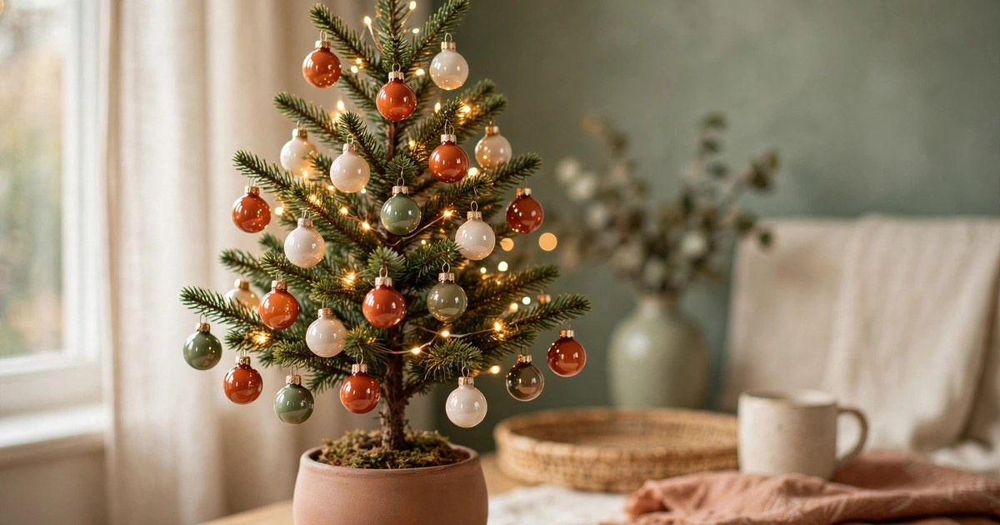
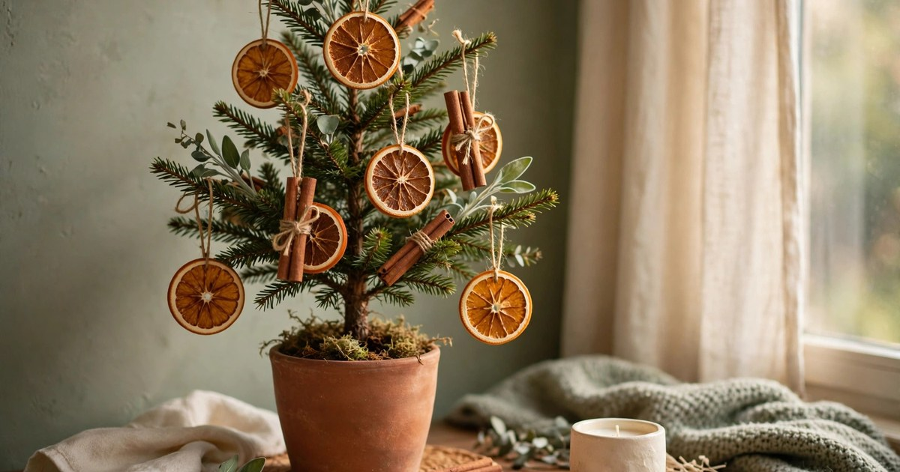
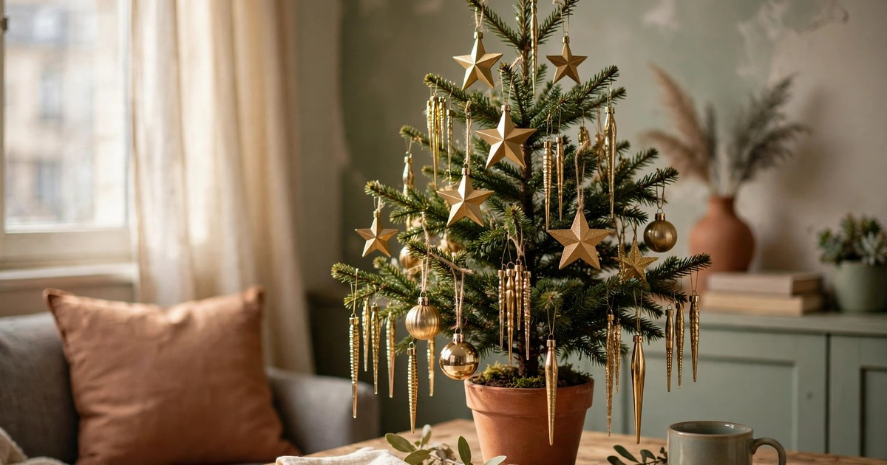
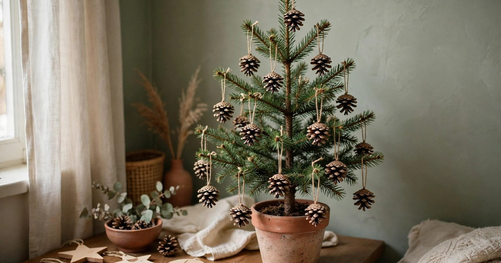
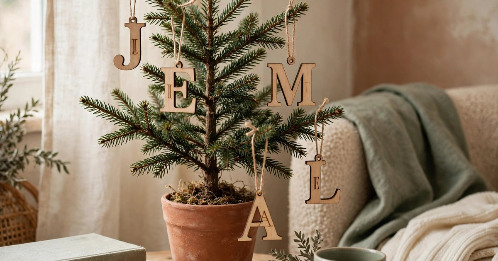
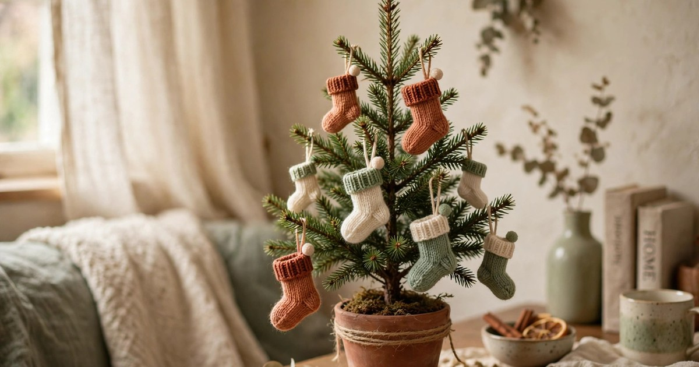

A small tree needs small ornaments. Full-size baubles overwhelm a mini tree, drag its branches down and make the whole thing look top-heavy, while a set of light, well-chosen ornaments makes the same tree look full, intentional and expensive. The best budget ornaments are shatterproof, light enough for thin branches, and sold in sets, so one box dresses the whole tree. Every set in this roundup costs $25 or less, and each one was chosen for a rented flat first: no glass to smash on a hard floor, no hooks that damage branches, and nothing that needs a ladder to hang.

Count before you buy: a mini tree of 60 to 90 centimetres needs about 20 to 30 small ornaments, and a small tree of 120 centimetres needs about 40. Buy one set, hang the ornaments in odd numbers, and leave a few branches bare — a tree with breathing room looks better than a tree stuffed to the trunk.

## 1. Shatterproof Bauble Set in Mixed Sizes

A shatterproof bauble set is the first ornament box every renter should own. Mixed sizes — small, medium and a few large — in one colour family, unbreakable plastic that bounces instead of smashing, and a price of $12–18 for a box of 30 or more. Hang the largest baubles deep inside the tree, the medium ones in the middle, and the smallest on the branch tips, and a bare mini tree looks full in twenty minutes.

**Why it works:** Shatterproof means no glass on a rented floor and no panic when a branch droops, and mixed sizes give a small tree the depth a single size never can.

**Where it fits:** Any small tree, in any flat — choose gold for a warm room, silver for a cool one, and red for a traditional Christmas.

[Shop shatterproof bauble sets](https://www.amazon.com/s?k=shatterproof+christmas+bauble+set+mixed+sizes&tag={{AMAZON_TAG}})

## 2. Wooden Ornament Set

Wooden ornaments are the warmest choice on this list: stars, trees, reindeer and snowflakes cut from pale wood, light enough for the thinnest branch, and impossible to break. A set of 20 to 30 costs $10–18, and wooden ornaments suit flats that already have wood, wicker and natural textures. They also age well — a wooden star looks the same in ten years as it does today, which is more than you can say for glitter.

**Why it works:** Wood adds warmth and a handmade feel, and the ornaments are so light that even a mini tree on a table can hold a full set without drooping.

**Where it fits:** A rustic, boho or Scandinavian flat, on a tree with dried orange slices, cinnamon sticks and warm white lights.

[Shop wooden ornament sets](https://www.amazon.com/s?k=wooden+christmas+ornament+set&tag={{AMAZON_TAG}})

## 3. Felt Ornament Set

Felt ornaments are the softest, safest choice: stitched stars, hearts, trees and stockings in wool felt, light as a feather, silent when they fall, and completely safe around children and pets. A set of 12 to 20 costs $12–20, and felt ornaments bring a craft-fair charm that plastic baubles cannot. They are also the easiest ornaments to make yourself next year, once you see how simple the shapes are.

**Why it works:** Felt is soft, safe and charming, and the matte texture contrasts beautifully with shiny baubles and fairy lights on the same tree.

**Where it fits:** A cosy family flat, on a small tree at child height, mixed with a few baubles for sparkle.

[Shop felt ornament sets](https://www.amazon.com/s?k=felt+christmas+ornament+set&tag={{AMAZON_TAG}})

## 4. Mini Glass-Look Baubles

Mini glass-look baubles give you the shine of glass without the risk: small, lightweight plastic baubles with a glossy, reflective finish, sold in sets of 30 to 50 for $10–16. They are the right scale for a mini tree — full-size baubles look clownish on small branches, but these look deliberate — and their shine bounces fairy light around the room, which makes a small tree glow far beyond its size.

**Why it works:** The reflective finish multiplies the light from a small string of fairy lights, and the mini size suits thin branches that cannot hold heavy ornaments.

**Where it fits:** A modern or glam flat, on a mini tree with cool white lights and metallic ribbon.

[Shop mini bauble sets](https://www.amazon.com/s?k=mini+christmas+baubles+small+tree&tag={{AMAZON_TAG}})

## 5. Dried Orange and Cinnamon Ornaments

Dried orange slices and cinnamon sticks are ornaments you can make for pennies, and a ready-made set costs $12–20 if you would rather buy them. Thread orange slices and cinnamon bundles onto twine, hang them on the tree, and the whole flat smells like Christmas baking for weeks. They are light, natural and completely compostable in January, which makes them the most sustainable ornaments on this list.

**Why it works:** They add colour, scent and a handmade feel in one move, and the warm orange against green is the most festive colour combination there is.

**Where it fits:** A kitchen tree, a rustic tree, or any small tree in a flat that loves natural materials and real scent.

[Shop dried orange ornaments](https://www.amazon.com/s?k=dried+orange+christmas+ornaments&tag={{AMAZON_TAG}})

## 6. Gold and Brass Metal Ornaments

Gold and brass metal ornaments — stars, bells, icicles and geometric shapes in thin stamped metal — are the most elegant budget buy on this list at $15–25 for a set. They catch the light, they never fade, and they make a small tree look like it belongs in a boutique hotel. Metal ornaments are light despite looking substantial, and they survive being dropped, packed and unpacked year after year.

**Why it works:** Metal adds shine and structure, and gold against green is the classic luxury combination that makes a cheap tree look expensive.

**Where it fits:** A glam or neo deco flat, on a small tree with warm white lights and a velvet tree skirt.

[Shop gold metal ornaments](https://www.amazon.com/s?k=gold+metal+christmas+ornaments+set&tag={{AMAZON_TAG}})

## 7. Pinecone Ornament Set

Pinecone ornaments are the cheapest real thing you can hang on a tree: natural mini pinecones, sometimes tipped with white paint or glitter, sold in sets of 20 to 30 for $8–15, or gathered free from a park and strung on twine in an afternoon. They add texture and a woodland feel that no manufactured ornament can match, and they are light enough for the thinnest branch. A pinecone ornament also hides a multitude of sins — hang one on a bare patch and the tree looks full.

**Why it works:** Pinecones add weight, texture and a natural woodland character, and they cost almost nothing while looking crafted rather than bought.

**Where it fits:** A rustic or farmhouse flat, on a tree with wooden ornaments, burlap ribbon and warm white lights.

[Shop pinecone ornaments](https://www.amazon.com/s?k=pinecone+christmas+ornaments+set&tag={{AMAZON_TAG}})

## 8. Personalised Initial Ornaments

Personalised initial ornaments — wooden or acrylic letters, one per person in the flat — are the most meaningful budget buy on this list, at $15–25 for a set. They turn a generic tree into your tree, they make a wonderful gift, and they are the ornaments guests actually notice and ask about. Hang one initial per person near the top of the tree, where it can be seen, and the tree tells a story instead of just sparkling.

**Why it works:** Personalisation makes a small tree feel like a family tradition rather than a decoration, and letters are light, flat and easy to store.

**Where it fits:** Any small tree in a shared flat or a family home — one initial each, hung where everyone can find their own.

[Shop personalised initial ornaments](https://www.amazon.com/s?k=personalised+initial+christmas+ornaments&tag={{AMAZON_TAG}})

## 9. Mini Stocking Ornaments

Mini stocking ornaments — tiny knitted or felt stockings, three to five inches long, sold in sets of 12 to 24 for $10–18 — are the cutest ornaments on this list and the most versatile. Hang them on the tree, tuck a candy cane or a small gift inside each one, or string them along a shelf as a garland when the tree comes down. They add a soft, knitted texture to a tree full of hard baubles, and children love finding the one with their name on it.

**Why it works:** Mini stockings add softness, colour and a surprise — each one can hold a tiny treat — and they double as a garland after Christmas.

**Where it fits:** A cosy family flat, on a small tree with felt ornaments and warm white lights, or strung along a mantel alternative.

[Shop mini stocking ornaments](https://www.amazon.com/s?k=mini+stocking+christmas+ornaments+set&tag={{AMAZON_TAG}})

## Frequently Asked Questions

### How many ornaments does a small tree need?

A mini tree of 60 to 90 centimetres needs about 20 to 30 small ornaments, and a small tree of 120 centimetres needs about 40. Count your branches first — a tree with breathing room looks better than one stuffed to the trunk.

### What ornaments are safe for a rented flat with children or pets?

Shatterproof baubles, felt ornaments and wooden ornaments are the safest: nothing breaks, nothing is sharp, and nothing makes a sound when it falls. Avoid real glass on a hard floor and anything small enough to be swallowed.

### How do I hang ornaments on thin mini-tree branches?

Use short ornament hooks or green twist ties, and hang lighter ornaments on the branch tips with heavier ones closer to the trunk. If a branch droops, move the ornament inward — a drooping branch is a sign the ornament is too heavy for that spot.

### Can I mix ornament styles on one small tree?

Yes, and you should — a tree with one texture looks flat. Mix shiny baubles with matte felt or wood, and add one natural element like pinecones or dried orange. Keep to two or three colours so the mix looks intentional rather than random.
