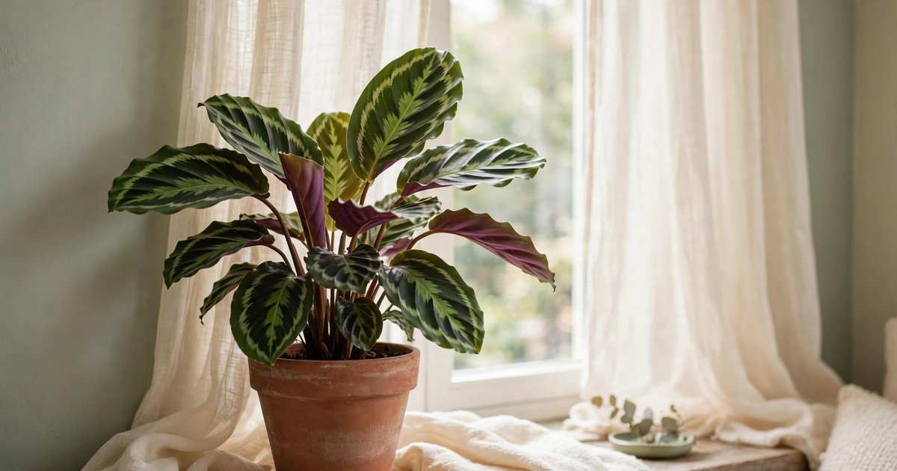
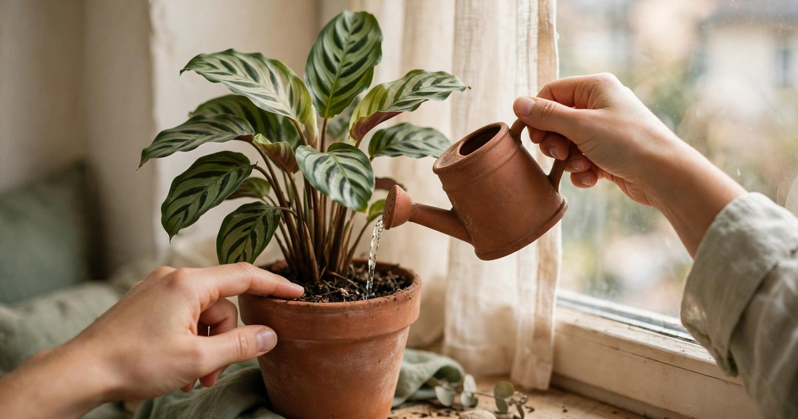
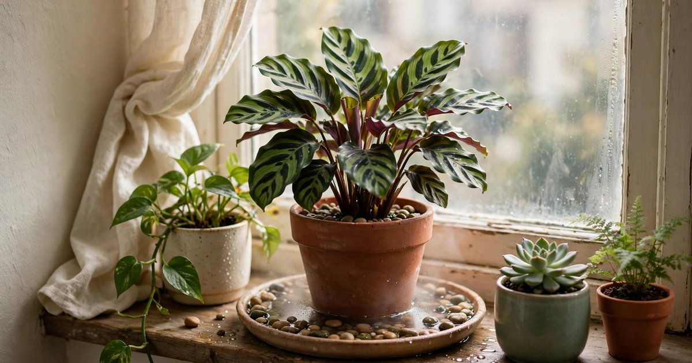
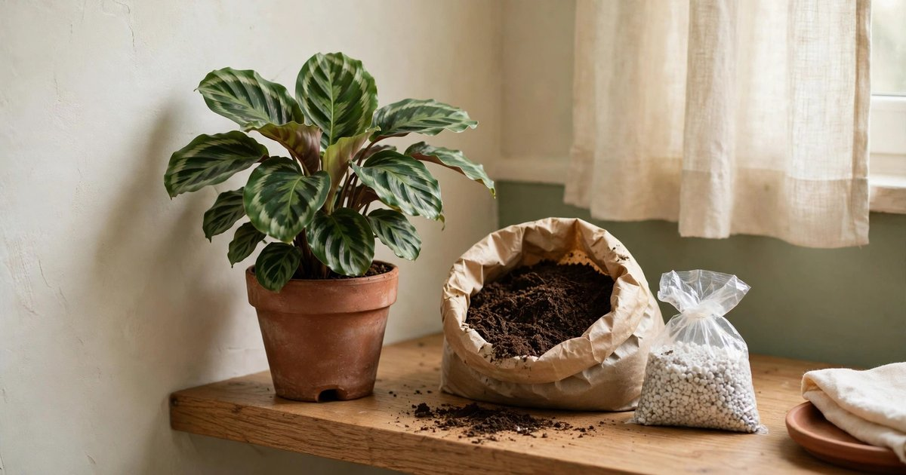
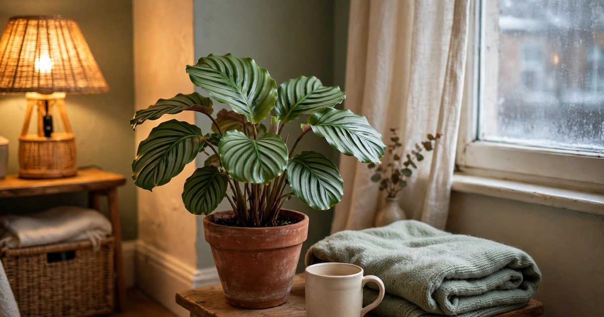
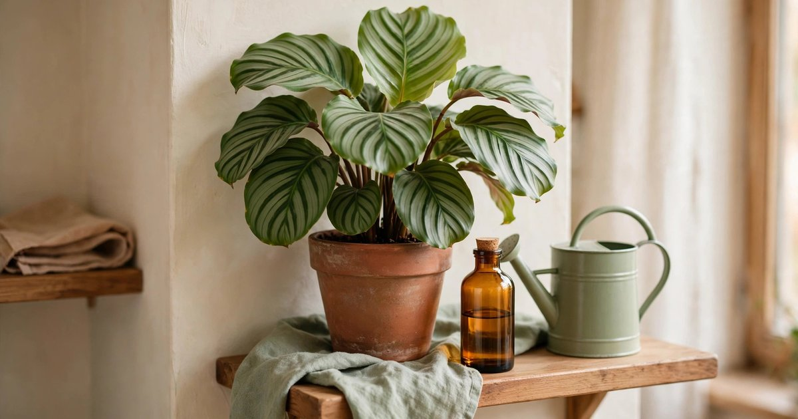
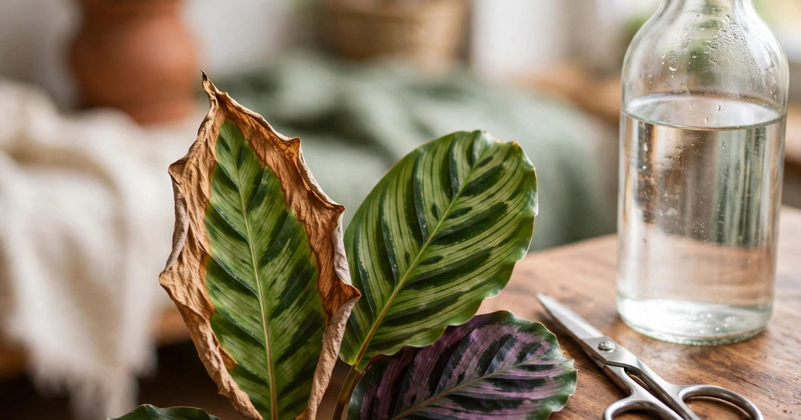
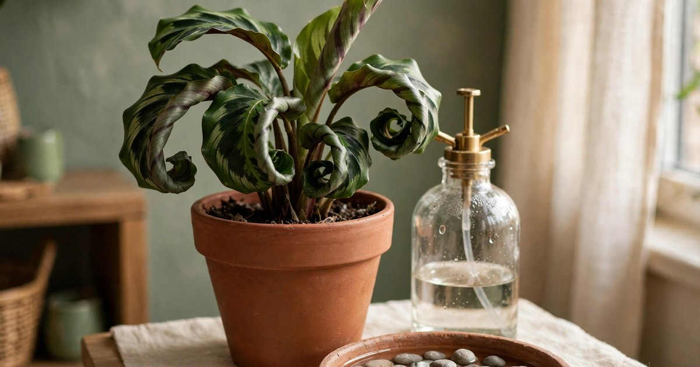
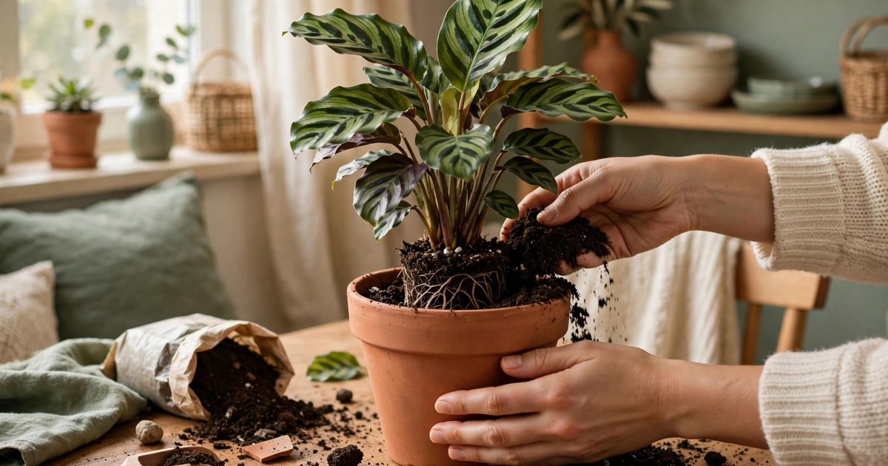

Few houseplants inspire as much love — and as much frustration — as the calathea. Its leaves are genuinely extraordinary: deep green patterned with silver, pink or burgundy, with undersides that flash purple as the foliage moves through the day. Calatheas are part of the prayer plant family, and like their cousins they fold their leaves upright at night and lower them again in the morning, so the plant looks alive in a way few others do. In a small apartment, where every plant has to earn its place, a calathea earns it on looks alone.

The frustration comes because calatheas are famously fussy. They are tropical forest plants, used to warm, humid air, filtered light through a canopy, and soft rainwater — none of which a typical small flat provides naturally. Give a calathea hard tap water and the leaf edges go brown and crispy. Put it in a draughty hallway and the leaves curl. Forget it for a week in dry central-heated air and it looks like a crisp packet. That reputation is deserved, but it is also exaggerated: once you understand the four things a calathea actually wants — gentle light, soft water, steady humidity and warmth — it becomes a reliable, long-lived houseplant that looks better every year.

That is why calatheas suit small apartments so well, once the basics are in place. They stay compact, growing to around 30–60 centimetres rather than taking over a room, and they are slow enough that one plant in a corner can be a feature for years. They are also completely pet-safe — non-toxic to cats and dogs — which matters enormously in a small flat where a curious cat can reach every shelf. And their patterned leaves do the work of a piece of art on a plain wall: one calathea in a terracotta pot on a shelf is often all the decoration a corner needs.

This guide walks through nine practical steps for keeping a calathea happy in a small apartment: the light it actually wants, how and what to water it with, humidity tricks that cost almost nothing, soil, temperature, feeding, and how to fix the two problems every calathea owner meets sooner or later — brown crispy edges and curling leaves. Follow them, and your calathea will stop being the plant you apologise for and start being the plant your guests ask about.

### 1. Give it bright, indirect light — never harsh direct sun

Light is the first thing to get right, because it decides whether a calathea's leaves stay vivid or fade to a washed-out green. In the wild, calatheas grow on the forest floor under a canopy, where the sunlight reaches them filtered and dappled, never direct. In your flat, that translates to bright, indirect light: close to a window, but never in a beam of direct sun. An east-facing window is ideal, with gentle morning light and brightness for the rest of the day. A north-facing window works too, though growth will be slower and the patterns slightly less bold. A south- or west-facing window is fine provided the plant sits a metre or so back from the glass, or behind a sheer curtain that softens the afternoon sun.

Direct sun is the fastest way to ruin a calathea's looks. The leaves scorch easily, bleaching pale or developing dry, papery patches that never heal, and the delicate patterns fade. If your calathea's leaves are curling inward during the day or the colours look washed out, too much direct light is the first suspect. Move the plant back from the window and watch the new leaves: they should come in with crisp, vivid markings within a few weeks.

Too little light is the other trap, and it is common in small apartments where the only free surface is a dark corner. A calathea in very low light grows slowly, its stems stretch and lean toward the nearest window, and the patterned leaves lose their contrast and turn plain green. The prayer plant movement — leaves folding up at night — may also stop, which is a sign the plant is not getting enough light to run its normal daily rhythm. If your flat is dim, the fix can be as simple as moving the plant to the brightest spot you have, even if that means rearranging a shelf, or adding a daylight bulb in a desk lamp aimed at the plant for a few hours a day.

The small-apartment trick is to think about height and reflection. A calathea on a plant stand or a shelf at window height catches far more light than one sitting low on the floor in the shadow of furniture. A pale wall behind the plant bounces light back onto the leaves, and a sheer curtain diffuses harsh sun without blocking the brightness the plant needs. Rotate the pot a quarter turn every couple of weeks so all sides get their share of light and the plant grows evenly instead of leaning hard toward the window.

Find a sheer curtain or light-diffusing setup on Amazon: [sheer window curtain panels for houseplants](https://www.amazon.com/s?k=sheer+window+curtain+panels+light+filtering&tag={{AMAZON_TAG}})

### 2. Water with soft water — and never let it dry out completely

Watering a calathea is where most owners go wrong, and it is usually not about how much water but about what kind. Calatheas are famously sensitive to the chemicals and minerals in tap water — fluoride, chlorine and dissolved salts — which build up in the leaf edges and turn them brown and crispy. If your calathea's leaves keep developing brown edges no matter what you do, the water is almost always the cause. The fix is simple, if slightly more effort than filling a can from the tap: use rainwater, distilled water, or water from a filter jug. Letting tap water sit uncovered overnight helps with chlorine, but it does not remove fluoride, so a basic filter jug or a bottle of distilled water is a worthwhile investment for a calathea owner.

The watering rhythm itself is straightforward once you know the rule: keep the soil consistently moist, never soggy and never bone dry. Push your finger into the soil up to the second knuckle. If the top few centimetres feel dry, water thoroughly until it runs out of the drainage holes, then empty the saucer so the pot never sits in standing water. If it still feels damp, wait. In a warm, bright room in summer, that might mean watering once a week; in a cool flat in winter, every ten days to two weeks. The calendar is useless — the finger test is everything, and it is the cheapest habit in houseplant care.

A calathea that dries out completely will tell you immediately: the leaves curl inward and droop, and the edges go crispy within days. Unlike a hardier plant, a calathea rarely forgives a long dry spell — the damaged leaves do not recover, though the plant itself usually will if you water it properly and wait for new growth. The other extreme is just as bad: soil that stays soggy rots the roots, the leaves turn yellow and limp at the base, and by the time the plant looks ill the damage is done. A pot with a drainage hole and a habit of emptying the saucer after watering are non-negotiable for a calathea.

A simple moisture meter takes the guesswork out of the finger test, and it is especially useful for calatheas because the line between "moist" and "wet" is narrower than for most houseplants. Keep one by your plants and check before you water — it is the cheapest insurance against both root rot and a dried-out calathea you can buy, and it pays for itself the first time it stops you watering a plant that did not need it, or reminds you to water one that did.

Pick up a moisture meter on Amazon: [houseplant soil moisture meter](https://www.amazon.com/s?k=houseplant+soil+moisture+meter&tag={{AMAZON_TAG}})

### 3. Raise the humidity — the trick that changes everything

If there is one thing that separates a thriving calathea from a struggling one, it is humidity. Calatheas come from tropical forests where the air sits at 60–70% humidity, and a typical centrally-heated flat in winter can drop below 30%. In dry air, the leaf edges dry out, curl and go brown no matter how perfectly you water — and no amount of careful watering fixes a humidity problem. The good news is that a small apartment is actually the easiest place to raise humidity around a plant, because the air volume is small and a few cheap tricks go a long way.

The simplest trick is grouping. Plants release moisture through their leaves, so a cluster of plants creates a small pocket of more humid air around itself. Put your calathea next to two or three other houseplants on the same shelf or windowsill and they will all benefit — the group stays healthier than any one plant alone, and a little cluster of greenery looks far better than a single lonely pot. In a small flat, a grouped shelf is also the most efficient use of space: one shelf, several plants, one shared microclimate.

The second trick is a pebble tray. Take a shallow dish or saucer, fill it with pebbles or small stones, add water until it sits just below the top of the stones, and stand the pot on top. As the water evaporates it humidifies the air immediately around the plant, without ever wetting the roots. A pebble tray costs very little, needs topping up once or twice a week, and doubles as a drip tray that protects your shelf from water marks. It is the single best value purchase for a calathea owner, and it works quietly in the background all year round.

The third trick costs nothing at all: put the calathea in the most naturally humid room in your flat. A calathea thrives in a bright bathroom, where the steam from the shower keeps the air moist all day, and a kitchen windowsill above the sink is almost as good. If your bathroom has a window, even a small one, a calathea hanging or sitting there will often look better than any other plant in the flat. Misting the leaves occasionally helps a little — and calathea owners love doing it — but grouping, a pebble tray, or a bathroom spot does far more than any amount of misting ever will. If you want a guaranteed fix, a small room humidifier near your plants is the most reliable option of all, and in a small apartment one compact unit can humidify a whole room.

Find a small humidifier on Amazon: [small room humidifier for houseplants](https://www.amazon.com/s?k=small+room+humidifier+for+houseplants&tag={{AMAZON_TAG}})

### 4. The right soil and pot — drainage with moisture

The soil a calathea sits in decides how forgiving your watering mistakes are, and the right mix makes everything else easier. Calatheas want soil that holds moisture but drains freely — dense, heavy soil stays soggy and rots the roots, while very free-draining soil dries out too fast and leaves the plant thirsty within days. The sweet spot is a standard houseplant potting mix with a generous handful of perlite and a little orchid bark or coconut coir mixed in: the coir holds moisture like a sponge, the perlite and bark keep air moving through the mix so the roots can breathe, and the whole thing dries out evenly instead of staying wet at the bottom and dry at the top.

The pot matters just as much as the soil. The single most important feature is a drainage hole — a calathea in a pot without one is living on borrowed time, because every watering becomes a gamble and water collecting at the bottom rots the roots. If you fall in love with a decorative pot that has no hole, use it as a cover pot: keep the calathea in a plain plastic nursery pot with holes inside it, lift the inner pot out to water, let it drain fully in the sink, and put it back. It takes an extra minute and it saves more calatheas than any other single habit.

Size matters too. A calathea likes a pot that fits its root ball with about two to three centimetres of fresh soil around it — snug, not cramped. A pot that is far too big holds a large volume of soil that stays wet long after the plant has drunk its fill, which is the classic recipe for root rot, and a small apartment makes the problem worse because a big pot also eats precious shelf space. Terracotta is a good material choice: the porous clay breathes, letting excess moisture evaporate through the walls of the pot, which makes overwatering much harder, and its warm, earthy colour fits the terracotta-and-cream palette of a cosy flat. Plastic pots are lighter and cheaper and hold moisture longer, which can suit a calathea if you tend to underwater — just be extra careful not to water on a schedule rather than checking the soil.

Repot only when the plant genuinely needs it — roots circling the drainage holes, or the plant drying out within a day or two of watering — and go up just one pot size, in spring, with fresh mix. A calathea repotted into a huge pot spends months filling it with roots instead of growing leaves, and in a small flat the oversized pot is a waste of space as well as a watering risk.

Get potting mix and perlite on Amazon: [houseplant potting mix with perlite and coco coir](https://www.amazon.com/s?k=houseplant+potting+mix+perlite+coco+coir&tag={{AMAZON_TAG}})

### 5. Keep it warm and out of draughts

Calatheas are tropical plants, and they feel the cold in a way hardier houseplants simply do not. They are happiest between about 18°C and 27°C, and they start to suffer below 15°C — leaves droop, growth stops, and cold damage shows as dark, limp patches that never recover. In a small apartment, the danger spots are easy to name: the windowsill above a radiator that blasts hot dry air, the hallway by the front door that gets a blast of cold air every time someone comes in, and the window ledge in winter where the glass is cold enough to chill the leaves touching it.

The rule is simple: keep your calathea in the warmest, most stable part of the flat, and keep it away from anything that blows air at it. Radiators are the worst offender — hot, dry air streaming up past a calathea dries the leaf edges in days, and a plant sitting directly above a radiator is effectively living in a desert. Move it to a side table or a shelf a metre or two away from the heat source, and the same plant in the same room will look dramatically better. Air conditioning vents are the same problem in summer: cold, dry air blowing directly onto the leaves makes them curl and crisp.

Draughts are the sneakier enemy. A calathea near a door that opens and closes all day, or beside a window that is opened for ventilation, gets repeated shocks of cold air that stress it even if the room temperature is fine. The leaves respond by curling and by developing brown edges, and because the damage looks identical to underwatering, owners often water more — which makes things worse. If your calathea's leaves are curling and the soil is moist, check for a draught before you reach for the watering can.

Winter needs a little extra care. As the days shorten, move the calathea away from cold windows at night — even pulling it back from the glass by half a metre helps — and never leave it in a room that drops below 15°C overnight. A small apartment has one advantage here: it is easier to keep evenly warm than a draughty house, and a calathea in an interior corner of a warm flat will often sail through winter looking better than it did in summer.

Find a draught excluder on Amazon: [door draught excluder for cold air](https://www.amazon.com/s?k=door+draught+excluder+cold+air&tag={{AMAZON_TAG}})

### 6. Feed lightly, only in the growing season

Calatheas are not hungry plants, and in a small apartment the most common fertiliser mistake is giving them far too much. Overfeeding burns the leaf tips brown, builds up salts in the soil, and can do more damage than never feeding at all — and because calatheas are already sensitive to salts in tap water, extra fertiliser salts on top are a double blow. The rule is simple: feed lightly, only while the plant is actively growing, and always at half the strength printed on the bottle.

Start in early spring, when the days lengthen and you see new leaves unfurling from the centre of the plant. Use a balanced liquid houseplant fertiliser diluted to half strength, once a month through spring and summer, and stop entirely in autumn and winter when growth slows. Water the plant first, then feed — applying fertiliser to dry soil can scorch the roots, and a calathea's fine roots are particularly vulnerable. If you prefer a low-effort option, a slow-release fertiliser applied once in spring does the job for the whole season, though liquid feeding gives you more control over the dose.

The signs of overfeeding are easy to confuse with other problems, which is why it is worth knowing them: brown, crispy leaf edges that appear even though you are using soft water and the humidity is good, a white crust of salts on the surface of the soil, and leaves that look scorched at the tips. If you see that combination, stop feeding immediately and flush the soil — run plain, soft water slowly through the pot for a minute, let it drain fully, and you wash out the salt build-up before it reaches the leaves. Then skip feeding for a couple of months and let the plant recover.

Underfeeding, by contrast, is a slow, gentle decline: pale new leaves, smaller than usual, and growth that stalls even in good light and warm weather. It is easy to fix and hard to do serious damage with — which is why the safe approach with a calathea is always to underfeed rather than overfeed. A plant that gets a half-strength feed once a month in spring and summer, and nothing at all in winter, will have everything it needs to grow beautifully patterned leaves year after year.

Stock up on liquid fertiliser on Amazon: [balanced liquid houseplant fertilizer half strength](https://www.amazon.com/s?k=balanced+liquid+houseplant+fertilizer&tag={{AMAZON_TAG}})

### 7. Fixing brown, crispy leaf edges

Brown, crispy leaf edges are the calathea's signature complaint, and almost every owner meets them sooner or later. The leaf edges go dry, brown and papery while the rest of the leaf looks perfectly healthy, and the plant slowly starts to look ragged. The good news is that brown edges are almost never a disease — they are a message about water, humidity, or salts, and each cause has a cheap fix. The trick is to diagnose the cause before you start changing everything at once.

Work through the causes in order. First, the water: if you have been watering with tap water, switch to rainwater, distilled water, or filtered water for a few weeks and watch the new leaves. If they come in clean, you have found your answer — the fluoride and salts in your tap water were building up in the leaf tips, where the water evaporates and leaves the minerals behind. A basic filter jug is a worthwhile investment if your water is heavily treated, and flushing the soil every couple of months with soft water washes out the salt build-up before it reaches the leaves.

Second, humidity: if the brown edges appeared in winter, when the heating came on and the air dried out, low humidity is the likely culprit. Group the calathea with other plants, set it on a pebble tray, or move it to the bathroom — and if the edges keep crisping, a small humidifier near the plant is the most reliable fix there is. Third, check for salts from overfeeding: a white crust on the soil surface and brown tips together point to too much fertiliser, so stop feeding and flush the soil. Finally, check for draughts and cold: leaves that touch a cold window in winter, or sit in the path of a door draught, crisp at the edges first.

For the brown edges already there, snip them off with clean scissors, following the natural shape of the leaf so the trim looks invisible. Do not pull the brown bits off by hand — that tears healthy tissue and leaves a ragged edge. And do not cut off a whole leaf just because its edge is brown: a leaf with a trimmed edge still photosynthesises and feeds the plant, and removing too many leaves at once weakens it. Fix the cause, trim the damage, and let the new leaves — which should come in clean — gradually replace the old ones.

Get a filter jug on Amazon: [water filter pitcher for houseplants](https://www.amazon.com/s?k=water+filter+pitcher+for+houseplants&tag={{AMAZON_TAG}})

### 8. Fixing curling leaves

Curling leaves are the calathea's way of telling you something is wrong right now, and they are actually one of the most useful warning signs in houseplant care — because unlike brown edges, which are damage already done, curling is often reversible within hours. A calathea curls its leaves inward to reduce the surface area losing moisture, which means the plant is either thirsty, too dry in the air, too hot, or too cold. The art is in working out which one, and the order you check matters.

Check the soil first. If the top few centimetres are dry, the plant is thirsty: water thoroughly with soft water until it runs out of the drainage holes, let it drain, and watch the leaves over the next few hours. A thirsty calathea often uncurls remarkably quickly once it has had a proper drink, and that fast recovery is one of the most satisfying sights in houseplant care. If the soil is already moist, though, do not water more — a calathea with wet soil and curling leaves is not thirsty, and more water will only risk root rot.

If the soil is moist, check the air. Low humidity is the most common cause of curling in an otherwise well-watered calathea, especially in winter when central heating dries the air. Move the plant to the bathroom for a few days, set it on a pebble tray, group it with other plants, or run a humidifier nearby — and misting the leaves can help in the short term, buying the plant time while you fix the humidity properly. Check the temperature too: a calathea in a room below 15°C, or sitting in a cold draught from a door or window, will curl its leaves as a stress response, and the fix is warmth and still air, not water.

There is one curling pattern that is completely normal and should not worry you: calatheas fold their leaves upward at night, like hands in prayer, and lower them again in the morning. That nightly movement is the plant's signature, not a problem — it is how you know the plant is healthy and keeping its daily rhythm. The curling to fix is the daytime kind, where the leaves roll inward along their length and stay curled while the plant should be open and flat. Learn to tell the two apart, and you will stop worrying about the normal one and act fast on the one that matters.

Find a plant mister on Amazon: [plant mister spray bottle for indoor plants](https://www.amazon.com/s?k=plant+mister+spray+bottle+indoor+plants&tag={{AMAZON_TAG}})

### 9. Repotting and propagation — growing your collection

Calatheas grow slowly, and they prefer to be slightly snug in their pots, so repotting is a rare job — usually once every two years, in spring, and only when the plant genuinely needs it. The signs are clear: roots circling the drainage holes, the plant pushing itself up out of the pot, or soil that dries out within a day or two of watering because the pot is mostly roots. When you see those signs, go up just one pot size — about two to three centimetres wider — with fresh, airy mix, and water the plant well the day before so the root ball holds together when you lift it out.

Repotting is also your best chance to propagate, because calatheas divide naturally as they grow. A mature calathea forms several clumps of stems, each with its own roots, and in spring you can gently tease the root ball apart into two or three sections, each with several stems and a healthy set of roots, and pot each one up separately. It is the only reliable way to propagate a calathea — leaf cuttings do not work, and a stem without roots will not root in water the way a pothos or spider plant would. Division sounds drastic, but a healthy calathea recovers quickly, and one plant becomes two or three for the price of a bag of potting mix.

After repotting or dividing, expect a short pause: the plant will spend a few weeks settling its roots before it gets back to growing leaves, and the leaves may droop or curl slightly for a few days. Keep it warm, humid and out of direct sun while it settles, water it with soft water, and resist the urge to feed it until you see new growth — fertiliser on freshly disturbed roots can scorch them. A calathea that has been divided and repotted in spring will usually reward you with a flush of fresh, vividly patterned leaves by early summer, and a second plant for another shelf — or for a friend who has been admiring yours.

One mother plant can supply divisions for every shelf in a small apartment, and each division is a plant that already knows your flat's conditions. Keep a few spare nursery pots and a bag of potting mix on hand, divide in spring when the plant is growing strongly, and your calathea collection will grow without you ever buying another one. It is the cheapest way to fill a small apartment with the most beautiful foliage you can grow indoors.

Stock up on nursery pots on Amazon: [plastic nursery pots with drainage holes for houseplants](https://www.amazon.com/s?k=plastic+nursery+pots+drainage+holes+houseplants&tag={{AMAZON_TAG}})

A calathea asks for more attention than a spider plant or a snake plant, and it is honest about it: give it soft water, steady humidity, gentle light and warmth, and it gives you the most beautiful leaves of any houseplant you can grow in a small apartment. Skip those basics and it tells you immediately, with brown edges and curling leaves, exactly what it needs. In a small flat, where every plant has to earn its place, a well-cared-for calathea earns it many times over — a living piece of patterned art that moves through the day, stays compact, and is safe around the pets that share your space. Start with one small plant, follow these nine steps, and by this time next year your fussy calathea will be the plant you are proudest of.

## Frequently Asked Questions

### Why do my calathea leaves have brown edges?

Brown edges are usually caused by fluoride or salts in tap water, low humidity, overfeeding, or cold draughts. Switch to rainwater, distilled water or filtered water, raise the humidity with a pebble tray or by grouping plants together, and check the plant is not sitting in a draught or above a radiator. Trim the brown edges with clean scissors, following the leaf's natural shape, and the new leaves should come in clean once the cause is fixed.

### How often should I water a calathea in a small apartment?

Water only when the top few centimetres of soil feel dry, which is usually once a week in summer and every ten days to two weeks in winter. Always use soft water — rainwater, distilled water or filtered water — because calatheas are very sensitive to fluoride and salts in tap water. Never water on a fixed schedule: check the soil with your finger or a moisture meter first, and always empty the saucer after watering so the pot never sits in standing water.

### Why are my calathea leaves curling?

Curling usually means the plant is thirsty, the air is too dry, or it is too cold or in a draught. Check the soil first: if it is dry, water thoroughly with soft water and the leaves should uncurl within hours. If the soil is moist, raise the humidity with a pebble tray, grouping or a humidifier, and move the plant away from cold windows, doors and air vents. Do not worry about leaves folding upward at night — that is the normal prayer plant movement, not a problem.

### Can calatheas grow in low light?

Calatheas will survive in low light, but they grow very slowly, their stems stretch toward the window, and the patterned leaves lose their contrast and turn plain green. For the fullest growth and the boldest patterns, keep your calathea within a metre or two of a window with bright, indirect light. An east-facing window is ideal, and a sheer curtain softens harsh sun on a south- or west-facing window without blocking the brightness the plant needs.

### Is a calathea safe for cats and dogs?

Yes. Calatheas are non-toxic to both cats and dogs, which makes them one of the safest houseplants for a small apartment shared with pets. Cats may still chew the leaves — the movement of the foliage can be tempting — so a plant stand or a high shelf keeps it looking its best, but a nibbled leaf is a mess, not a vet visit. That pet safety, combined with their compact size, is a big reason calatheas are so popular in small flats.

### How do I propagate a calathea?

Calatheas propagate by division, not by leaf or stem cuttings. In spring, when the plant is growing strongly, gently lift it from its pot and tease the root ball apart into two or three sections, each with several stems and a healthy set of roots. Pot each section up in fresh, airy potting mix, keep it warm and humid while it settles, and water with soft water. Expect a short pause in growth while the new plants establish themselves, then a flush of fresh patterned leaves.
