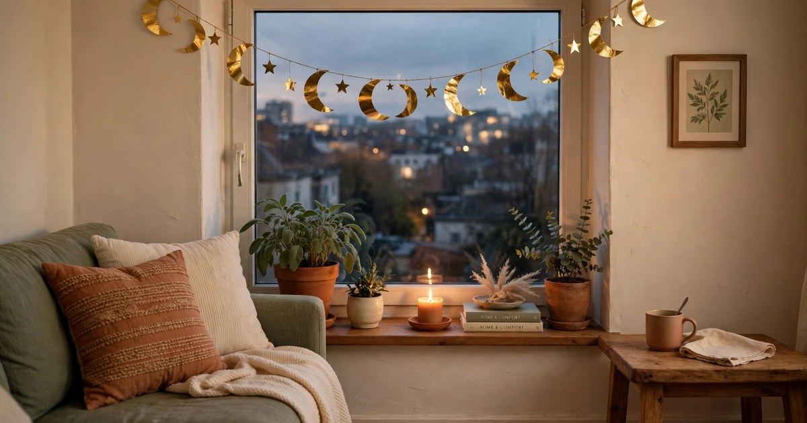
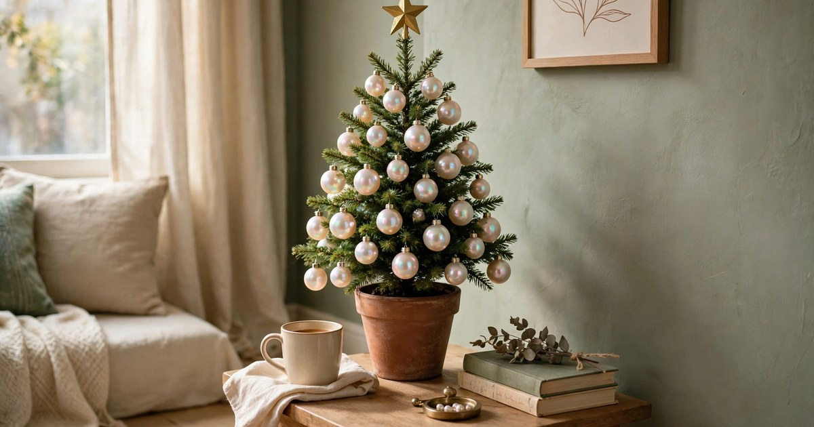
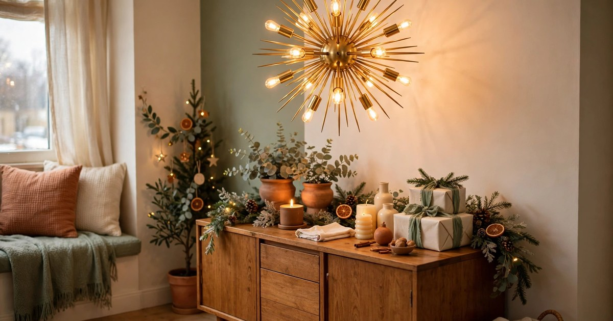
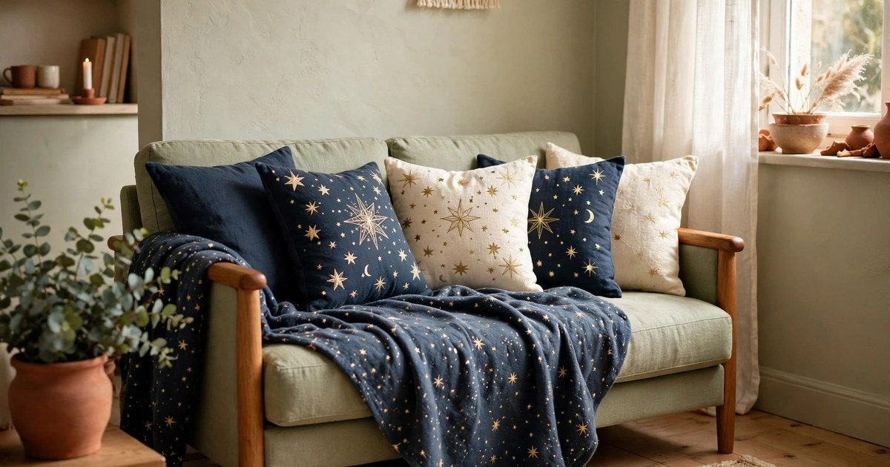
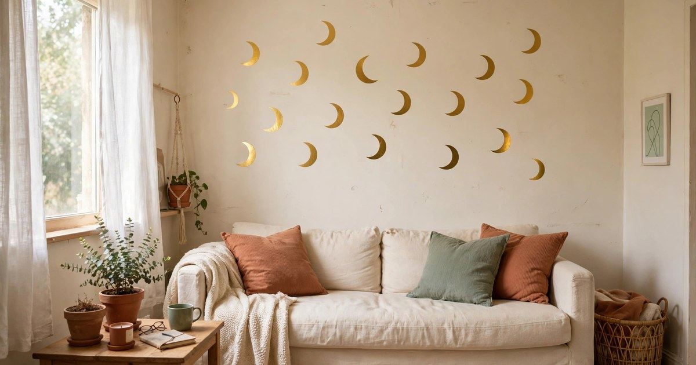
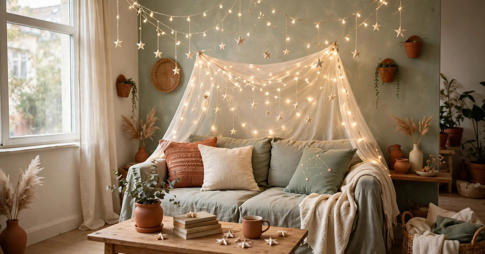
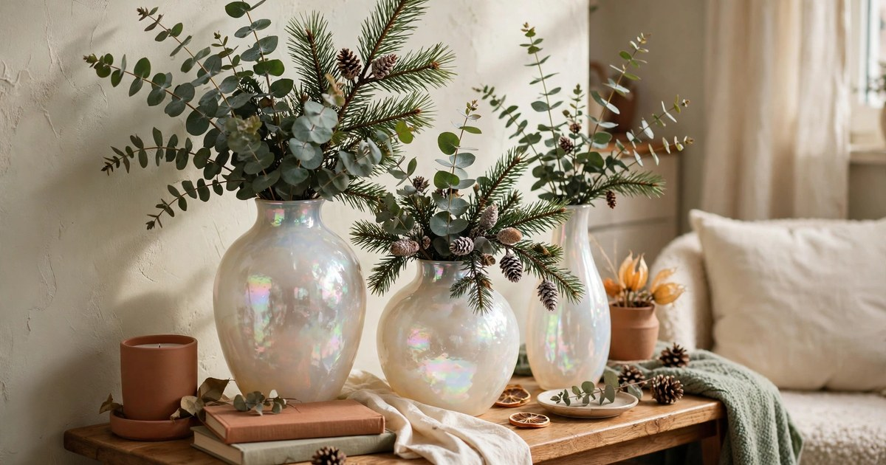
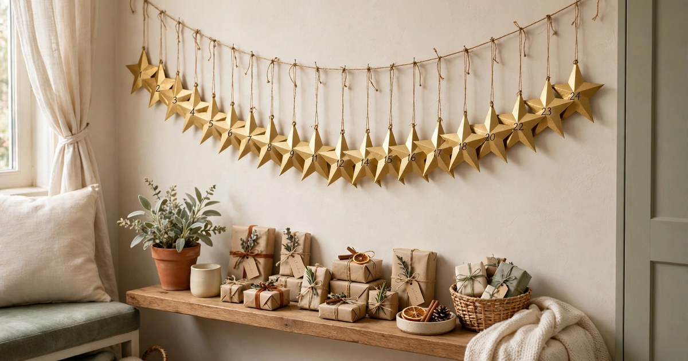
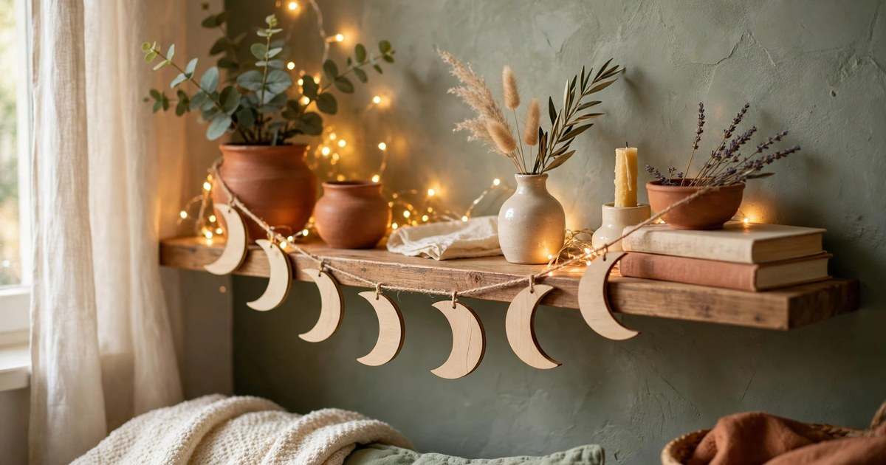

There is something quietly magical about a celestial Christmas. Instead of the usual red-and-green overload, you get moons, stars and shimmering light — a look that feels calm, grown-up and a little bit enchanted, and one that happens to suit a small flat beautifully. Celestial decor works in layers of light rather than piles of stuff, so it fills a tiny living room with atmosphere without filling it with clutter. A garland across the window, a scattering of star ornaments and a warm glow from fairy lights can transform a rented one-bedroom into somewhere that feels like a winter night sky, and none of it needs a nail in the wall or a fortune spent.

It also suits renters because almost all of it is light, flat or hanging. Moons and stars are made from paper, felt, foil and thin metal, so they weigh next to nothing and hang from command hooks, washi tape or a tension rod. Opalescent baubles catch the light instead of demanding floor space, and a starburst light does the work of a whole mantelpiece display from a side table. Everything here is deposit-safe, removable in January without a trace, and priced for a renter's budget — most ideas cost under £15, several under £5 if you make them yourself.

### 1. Moon-and-Star Garland Across the Window

Start with the window, because it is the one place in a small flat where decoration costs no floor space at all. A moon-and-star garland strung across the top of the window frames the view and catches the light from outside during the day and from your fairy lights at night. Look for garlands in gold foil, brass or warm wood — they read as festive without screaming Christmas, so they work from early December into January. Ready-made costs £6–£10; a paper one costs pennies with gold card and string.

Hang it with two small command hooks or a tension rod inside the recess — both come off cleanly in January. Drape it slightly off-centre, crescent moon low on one side, for a softer look than a straight line, and keep the window bare or sheer so the shapes show from the street.

### 2. Opalescent Baubles on a Mini Tree

A full-size tree is a luxury most small flats cannot afford, in space or in money, but a mini tree dressed in opalescent baubles gives you the same sparkle on a tabletop. Choose a tree between 60 and 90 centimetres tall and set it on a side table, a stool or the top of a bookcase, where it becomes a focal point instead of a floor-hogging obstacle. Opalescent baubles — pearly ones shifting between pink, blue and gold — are the celestial shortcut: a dozen makes a small tree feel finished.

Buy small baubles, not large ones — oversized decorations make a mini tree look top-heavy. Six to eight centimetres is the sweet spot, and a pack of twelve costs under £8. Top it with one gold star and a thin gold ribbon, then stop — a mini tree looks best slightly under-dressed. If you want more shimmer for less money, our roundup of [iridescent decor accents under £25](/iridescent-decor-accents-under-25/) has plenty of pieces that pair beautifully with a pearly tree.

### 3. A Starburst Light as the Room's Centrepiece

Every small room needs one piece that does the heavy lifting, and at Christmas a starburst light is it. These are the spiky, sputnik-style lights — a central globe with rays of thin metal or LED-tipped spokes — and they throw a warm, starry glow across the whole room from a single socket. A tabletop starburst light costs around £12 to £20, sits happily on a sideboard or a shelf, and instantly makes the room feel dressed even if you have done nothing else. It works all winter, not just in December, so the cost per use is tiny.

Place it where it can be seen from the sofa and the doorway, so it greets you when you come home — on a low sideboard beside the tree, or on the mantel if you have one. Battery versions need no nearby socket and no trailing cable across the floor. Our guide to [starburst light fixtures for small rentals under £25](/starburst-light-fixtures-small-rentals-under-25/) compares the best tabletop and wall-mounted options that will not damage your walls or your deposit.

### 4. Celestial Throw Pillows and a Starry Throw

Soft furnishings are the fastest way to change a room's mood, and they are the easiest to store when January arrives. Swap two everyday cushions for celestial ones — navy embroidered with gold stars, or cream printed with a crescent moon — and drape a starry throw over the sofa arm. Five minutes, under £20 on the sale rails, and the seating area becomes the cosiest corner of the flat. Choose covers over whole pillows: half the price, flat to store, and they reuse the inserts you already own.

Stick to two celestial pieces and keep the rest plain — too many stars looks like a children's bedroom. A navy pillow with gold stars beside a plain cream one, plus a throw in a soft grey or warm terracotta, gives you the night-sky feeling without the fancy-dress effect. Washable covers are worth the extra pound or two, and when Christmas is over they fold into a drawer and your everyday look returns in seconds.

### 5. Gold Crescent-Moon Wall Decals (Removable, Deposit-Safe)

Bare rental walls are the biggest challenge of festive decorating, and gold crescent-moon wall decals are the answer. These are peel-and-stick vinyl shapes — moons, stars and tiny dots — that press onto a painted wall and peel off in January without leaving a mark, a hole or a single speck of residue. A sheet costs £5–£8 and is enough for a constellation above the sofa, around a doorway or over the bed. 

Arrange them loosely, not in a grid: a large crescent moon with smaller stars trailing away, as if scattering light across the wall. Step back after placing the first few and check the spacing from across the room — decals always look sparser from a distance than they do up close, so be generous. Avoid freshly painted walls and textured wallpaper, where adhesive can lift paint, and test one in a hidden corner first. When the season ends, peel slowly from a corner and warm any stubborn decal with a hairdryer on low.

### 6. A Constellation Fairy-Light Canopy Over the Sofa or Bed

If you only do one dramatic thing this Christmas, make it a canopy of fairy lights over the sofa or the bed. Drape two or three strings of warm-white fairy lights from the ceiling using small command hooks, letting them fall in soft swags, then add a handful of tiny star ornaments or paper stars clipped to the wires. The effect is a night sky indoors. Under £15 for lights and hooks, and half an hour to put up.

Keep the lights warm white rather than cool white or multicoloured — warm white is what makes a room feel like candlelight instead of a shop window. Battery lights with a timer switch themselves off after six hours and need no socket, so you can hang them anywhere. In a bedroom, hang the canopy lower, just above the headboard, so it feels like sleeping under the stars. Keep swags high enough that nobody walks into them, and tuck the battery pack behind a cushion.

### 7. Pearlescent Vases With Winter Greenery

A celestial Christmas is not only about stars — it is about shimmer, and a pearlescent vase full of winter greenery is shimmer in its simplest form. The vase itself does the decorating: its milky, opalescent surface catches the light and glows softly, so all you need to add is a few sprigs of eucalyptus, pine or fir, real or faux. One vase on a side table or windowsill brings a quiet, elegant note to a room that might otherwise be all sparkle and foil. Faux greenery costs around £3 a bunch and lasts for years.

Mix one tall vase with one short one for height contrast, and keep the greenery loose and airy rather than packed tight — a few stems leaning at different angles look far more natural than a dense bouquet. A coat of pearlescent spray paint turns plain vases celestial for under £5. For more ideas on styling them through the cold months, our guide to [pearlescent vase styling with winter greenery](/pearlescent-vase-styling-winter-greenery-ideas/) covers shapes, stems and the best spots in a small flat.

### 8. A Starry Advent Countdown Corner

An advent countdown is one of the loveliest small-flat traditions, because it turns a corner you already have into a daily ritual. Pick a shelf, a windowsill or the top of a bookcase and make it your countdown corner: twenty-four small numbered stars — paper, felt or wooden — hung from a length of twine or pinned to a small board, each one hiding a tiny treat, a note or a small task for the day. It takes up no more space than a picture frame, costs under £10, and gives the household something to look forward to every morning.

Make the stars from gold and cream card, numbering them with a marker and hanging them with mini pegs. Behind each star, tuck a wrapped chocolate, a handwritten note or a tiny folded promise — a film night, a walk to see the lights, a mug of cocoa. Put a small tray underneath to catch wrapping paper, and keep it away from radiators so chocolate does not melt.

### 9. Star-Topped Stockings and Celestial Gift Wrap

Stockings are a small-flat essential, because they deliver the full Christmas feeling from a single hook. Hang them from a shelf, a picture rail or command hooks — no mantelpiece required — and top each with a small gold or silver star, sewn on or pinned with a brooch. A plain cream or deep navy stocking costs a few pounds, and the star on top ties it straight into the celestial theme. Fill them with small, useful things: a favourite chocolate, a lip balm, cosy socks, a handwritten note.

Carry the theme through to your gift wrap, because wrapped presents sitting under a mini tree or stacked on a shelf are decoration in themselves. Navy or kraft paper with gold stars, tied with gold ribbon or string, looks far more expensive than it is — a roll costs around £3 and covers a dozen gifts. Stamp plain kraft paper with a star-shaped potato stamp, or decorate it with gold star stickers. Stack the parcels where they can be seen — your present pile becomes part of the decor for free.

### 10. A Moon-Phase Garland on the Mantel or Shelf

Finish the room with a moon-phase garland — a string of moons in their different phases, from new to full — draped along a shelf, a mantelpiece or the top of a bookcase. It is the most quietly beautiful piece here: simple, rhythmic, a little mystical, and lovely with nothing else around it. Wooden or brass garlands cost £8–£12 ready-made; a paper version cut from gold and cream card costs almost nothing.

Drape it in a gentle swag with the full moon at the centre and the crescent moons tapering away on either side, and let it hang slightly unevenly — a perfect straight line looks stiff, while a soft dip looks natural. With no mantelpiece, a shelf above the sofa works just as well — layer fairy lights behind it so the moons glow. Pair it with a pearlescent vase or two from idea seven, and you have a display that looks styled, for the price of a takeaway.

## Shop this look: Celestial Christmas essentials

- **Moon-and-star garland, gold foil** — strung across the window, it frames the view and costs no floor space. [Shop moon and star garlands](https://www.amazon.com/s?k=moon+and+star+garland+gold+foil&tag={{AMAZON_TAG}})
- **Opalescent baubles, pack of 12** — pearly pink, blue and gold finishes make a mini tree feel finished. [Shop opalescent Christmas baubles](https://www.amazon.com/s?k=opalescent+christmas+baubles+pack&tag={{AMAZON_TAG}})
- **Tabletop starburst light** — one spiky sputnik-style light throws a starry glow across the room. [Shop starburst table lights](https://www.amazon.com/s?k=starburst+table+light+gold&tag={{AMAZON_TAG}})
- **Celestial throw pillow covers** — navy embroidered with gold stars, or cream with a crescent moon. [Shop celestial throw pillow covers](https://www.amazon.com/s?k=celestial+throw+pillow+covers+gold+stars&tag={{AMAZON_TAG}})
- **Gold crescent-moon wall decals** — peel-and-stick moons and stars that come off cleanly in January. [Shop crescent moon wall decals](https://www.amazon.com/s?k=gold+crescent+moon+wall+decals+removable&tag={{AMAZON_TAG}})
- **Moon-phase garland** — a string of moons from new to full, draped along a shelf or mantel. [Shop moon phase garlands](https://www.amazon.com/s?k=moon+phase+garland+wood+brass&tag={{AMAZON_TAG}})

## Frequently Asked Questions

### Is celestial Christmas decor suitable for a very small flat?

Yes — it works through light and hanging pieces rather than bulky objects. Garlands, decals, fairy lights and wall-hung stars all decorate the upper half of the room, leaving your floor and surfaces clear. A mini tree, a starburst light and a couple of cushions are the only pieces that take up any real space, and all three can sit on furniture you already own.

### How do I hang celestial decor without damaging rental walls?

Use command hooks, removable strips, tension rods and washi tape — never nails, screws or permanent adhesives. Peel-and-stick decals are designed to come off cleanly, but always test one in a hidden spot first and peel slowly, warming stubborn pieces with a hairdryer on low. Keep everything light — paper stars and foil garlands weigh almost nothing, which is exactly why they are safe on removable fixings.

### How much should I budget for a celestial Christmas in a small apartment?

A whole small flat costs £40–£60 if you buy the key pieces, or under £20 if you make the garlands and stars from card and foil. Spend the most on the one hero piece — a starburst light or a set of opalescent baubles — and make the rest. Paper garlands, potato-stamped wrapping paper and handmade advent stars all cost pennies and look just as good as shop-bought versions.

### Can I keep celestial decor up after Christmas?

Absolutely. Moons, stars and fairy lights are not obviously Christmassy, so a moon-phase garland, a constellation light canopy or a starburst lamp can stay up all winter without looking out of season. Take down the tree, stockings and advent corner in early January, and leave the celestial pieces until the nights lighten — they are winter decor, not just Christmas decor.

### Where can I find affordable celestial Christmas decorations?

High-street homeware shops and online marketplaces are cheapest, especially in late November when seasonal ranges launch. Look for gold foil garlands, opalescent bauble packs and starburst lights in the sale sections, and check charity shops for second-hand ornaments — celestial pieces are often donated barely used because they suit so many themes. Making your own paper stars and moon garlands is the cheapest option of all.
