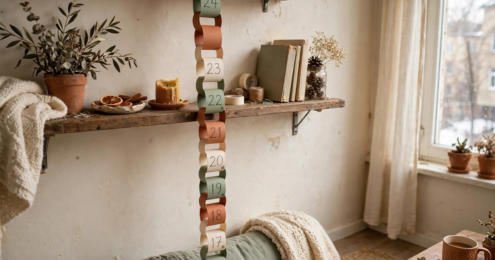
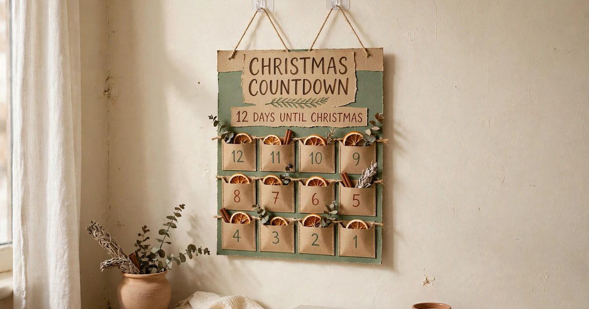
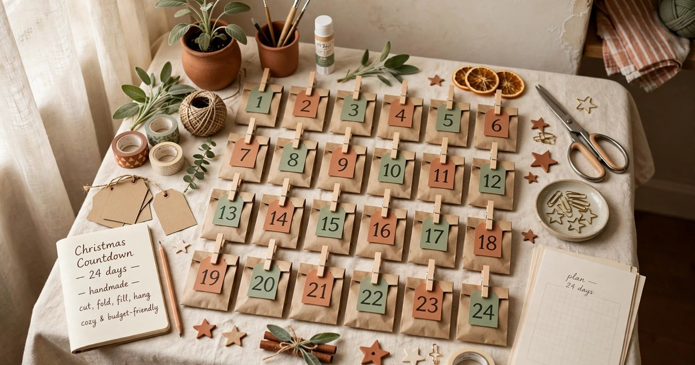
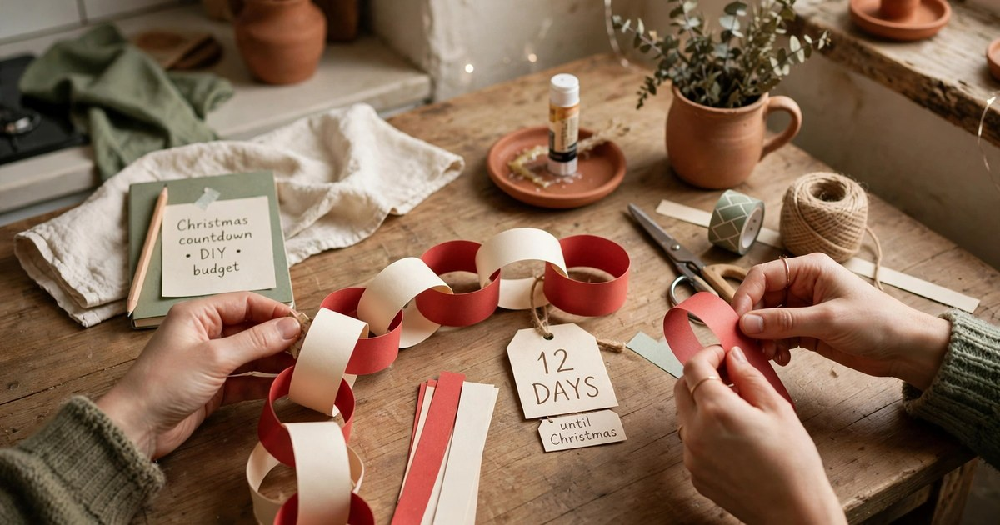
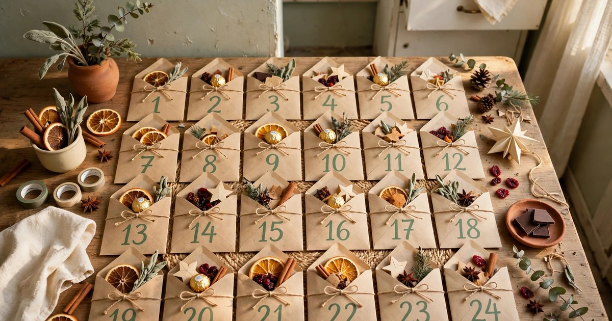
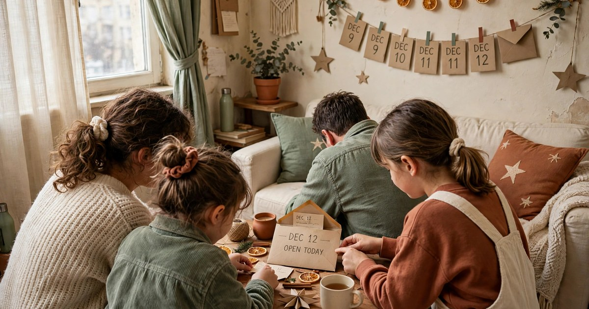
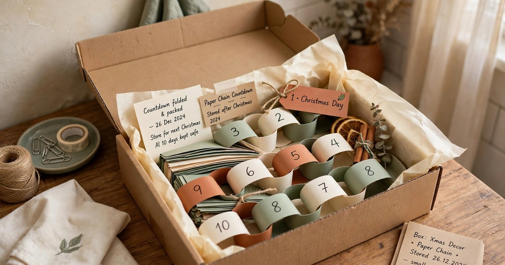

A Christmas countdown is the decoration that gets better every day. Unlike a wreath or a garland, which looks the same on 1 December as it does on the 24th, a countdown changes — a paper link comes off the chain, an envelope opens, a number flips — and that small daily ritual is what makes December feel like a season rather than a single day. In a rental, though, the classic countdown displays are a problem: the beautiful wooden advent calendars need a nail, the hanging pockets need a hook, and the chalkboard versions need a wall you are allowed to paint.

The good news is that a countdown does not need a single hole in the wall. Every version in this guide hangs from a removable hook, stands on a shelf, sits on a table, or leans against a wall it never touches. They all cost under £20 to make, most of them take an evening or less, and every one of them packs flat in January. Follow the seven steps, pick the format that suits your flat, and you will have a countdown that the whole household looks forward to opening — and a landlord who never knows it was there.

### 1. Choose a Countdown Format That Suits Your Space

Start by deciding what kind of countdown you actually want, because the format decides everything else. A paper chain is the simplest and the most forgiving: twenty-five loops of coloured paper, one removed each day, hung from a shelf or a curtain rod. An envelope wall is the most versatile: twenty-five small envelopes, each holding a treat or a note, arranged in a grid on a board that leans against the wall. A countdown jar is the smallest option: twenty-five slips of paper in a jar, one drawn each morning, which needs no wall space at all. And a flip-number or chalkboard countdown is the most reusable, bought once and used for years.

Think about who is counting down. Small children love a paper chain they can tear off themselves. Teenagers and adults usually prefer an envelope with a small treat or a daily activity inside. A household of one might love a jar of twenty-five small self-care treats — a bath bomb, a fancy tea bag, a ten-minute break. Choose the format for the people using it, not for the photo, and the countdown will actually get used rather than admired once and forgotten.

### 2. Pick a Spot That Needs No Fixings

The single most important decision in a rental is where the countdown lives, because the spot decides whether you need fixings at all. The best spots in a rented flat are the ones that already exist: the side of a bookshelf, a curtain rod, the front of a wardrobe door, a freestanding clothes rail, or the edge of a mantelpiece or sideboard. A paper chain draped along a shelf needs no hooks at all — it just sits there. An envelope board leans against the wall on top of a sideboard, held in place by gravity and a small wedge behind it.

If you do need to hang something, use removable adhesive hooks, and use more of them than you think you need — one hook per 30 centimetres of display spreads the weight and stops the whole thing peeling off at 2 a.m. Test every hook in a hidden spot first, follow the weight rating on the packet, and never stick adhesive directly onto wallpaper, which it will pull off when removed. Suction-cup hooks work on glass and mirrors, and magnetic hooks work on a metal radiator or a fridge door. A countdown on the fridge is genuinely practical: it is the one surface everyone in the flat walks past every day.

### 3. Gather Supplies for Under £20

A homemade countdown is one of the cheapest decorations you can make, because the supplies are mostly things you already own. For a paper chain you need coloured paper or old magazines, scissors, a stapler or tape, and string. For an envelope wall you need twenty-five small envelopes, a piece of foam board or a cork board, and removable hooks or a picture ledge to stand it on. For a countdown jar you need a jar, twenty-five slips of paper, and a pen. Add a packet of small treats — chocolates, tea bags, tiny ornaments — and the whole project comes in under £20.

Buy the paper in your festive palette rather than a rainbow: two or three colours, red and cream, or green and gold, look deliberate where five colours look like a classroom. If you are short on time, a shop-bought fillable advent calendar — the kind with twenty-four little drawers or pockets — costs £10–15, needs no making at all, and stands on a shelf. It is the honest shortcut, and there is no shame in it: the daily ritual matters more than whether you cut the paper yourself.

### 4. Build the Countdown in One Evening

Set aside one evening, put on a Christmas film, and build the whole thing in a single sitting — a countdown that takes three weekends to finish never gets finished. For a paper chain, cut twenty-five strips of paper about 3 centimetres wide and 20 centimetres long, loop the first one and staple it, then thread each new strip through the last and staple it closed. Number the loops from 25 down to 1 with a marker, so the last loop left on Christmas Eve says 1. For an envelope wall, number the envelopes, fill them, seal them, and pin or tape them to the board in a grid — five rows of five is the easiest layout to read.

For a jar, write twenty-five activities or treats on slips of paper — "watch a Christmas film", "make hot chocolate", "one fancy chocolate", "ten minutes of carols" — fold them, and drop them in. The trick with every format is to number or order everything before you hang it, because trying to number twenty-five envelopes after they are on the wall is how you end up with two number 14s and no number 7. Photograph the finished display before anyone touches it, because it will never look that tidy again.

### 5. Fill It with Treats That Fit the Format

The filling is what turns a decoration into a ritual, and the best fillings are small, daily and personal. Chocolates are the classic, but a countdown that only contains chocolate gets boring by day ten. Mix it up: a tea bag, a small candle, a handwritten note, a Christmas joke, a tiny ornament for the tree, a voucher for a film night or a lie-in. If the countdown is for children, add a small Lego piece a day, or a sticker, or a clue to a treasure hunt on Christmas Eve.

Keep the fillings flat and light if the countdown hangs on a wall — a heavy envelope will pull a removable hook off the paint. Put the bigger treats in the later envelopes, near the bottom of the display where the weight is best supported, and save the best one for the 24th. If your countdown is a paper chain, write a small activity on the inside of each loop instead of a treat — the chain itself is the decoration, and the activity is the reward. A chain that says "bake biscuits" or "walk to see the lights" costs nothing and gets the household doing things together.

### 6. Make Opening It a Daily Ritual

A countdown only works if someone opens it every day, and that takes a ritual, not willpower. Pick a fixed time — breakfast, or the moment everyone gets home, or just before bed — and make the opening part of it. The person who opens it rotates each day, or the youngest goes first, or whoever is home first gets the honour. The ritual matters more than the treat: the point is that December has a shape, a daily beat that builds towards Christmas Day.

Put the countdown somewhere you cannot ignore it. A display tucked in a spare room will be forgotten by day four; one on the kitchen wall, the living room shelf or the fridge gets opened because it is in the way of everyday life. If you miss a day, do not try to catch up by opening two at once and calling it even — just open the missed one and carry on. And if the countdown is for children, resist the urge to open tomorrow's envelope "just to check what is in it". The anticipation is the whole point, and a peeked countdown is a spoiled one.

### 7. Pack It Away Flat and Reuse It Next Year

The final step is the one renters care about most: taking it down without a trace. A paper chain lifts off its shelf in seconds and folds into a small bag. An envelope board lifts off its hooks, the hooks peel off the wall with a pull tab, and the board slides under a bed. A jar empties into the recycling and goes back in the cupboard. None of them leaves a hole, a mark or a patch of stripped paint, and your deposit stays exactly where it should.

If you made a paper chain, save it if you can — a chain that survives the season can be rehung next year, and a reused chain is a tradition rather than a craft project. Envelope boards are the most reusable format of all: swap the envelopes, refill the treats, and the board lasts for years. Store everything flat, in one labelled box or bag, with the hooks and string alongside it, so next December you open the box and the countdown is ready in ten minutes. A countdown that takes an evening to build the first year and ten minutes every year after is the best kind of Christmas decoration: cheap, damage-free, and better the second time around.

## Frequently Asked Questions

### Can I hang a Christmas countdown in a rental without damaging the walls?

Yes. Use removable adhesive hooks on painted walls, suction-cup hooks on glass, or magnetic hooks on radiators and fridges. Never use nails, screws or tape on wallpaper, and always test a hook in a hidden spot first. A board that leans on furniture needs no fixings at all.

### What is the easiest Christmas countdown to make?

A paper chain. Twenty-five strips of coloured paper, a stapler and a marker are all you need, and it takes about an hour. It hangs from a shelf or a curtain rod with no hooks, and it packs flat in January.

### How much should a homemade Christmas countdown cost?

Under £20 for most formats. Paper, envelopes, a board and a packet of small treats are all cheap, and a shop-bought fillable advent calendar costs £10–15 if you would rather not make one at all.

### What do I put in a countdown for adults?

Mix small treats with small experiences: a fancy tea bag, a chocolate, a candle, a note, a voucher for a film night or a lie-in, or a daily activity like baking biscuits or walking to see the lights. Variety matters more than value.

### Can I reuse a Christmas countdown next year?

Yes, and you should. Envelope boards and fillable advent calendars last for years with new fillings, and a paper chain that survives the season can be rehung. Store everything flat in one labelled box so next December takes ten minutes.
