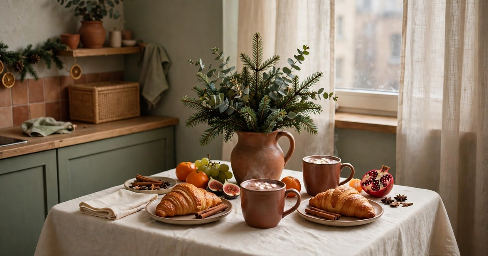

There is a particular kind of magic to Christmas morning in a small apartment. It is not the grand, sprawling kind you see in films, with a staircase garland and a tree that touches the ceiling. It is quieter and closer: the first grey light coming through the window, stockings hanging where you can see them from the sofa, a small pile of wrapped gifts beside a tree that fits on a side table, and the smell of coffee and cinnamon drifting from the kitchen. In a small space, every detail sits within arm's reach, and that is exactly what makes it feel so special.

The trick is to decorate for the morning itself, not for a showroom. Christmas morning is a sequence of small moments — waking up, finding the stockings, opening gifts on the floor, eating breakfast at a table that feels dressed up for the occasion, taking a photo before the wrapping paper takes over. If you plan your decorating around those moments, a one-bedroom flat or a studio can feel just as festive as a house, and it costs far less to get there.

Everything in this guide is renter-friendly and budget-first. There is no drilling, no painting, no holes in the wall and nothing that will cost you your deposit. Most of the ideas use things you already own — a tray, a throw blanket, a few jars, some greenery — plus a handful of cheap buys, and several steps cost nothing at all. Work through the eight steps in order, ideally on Christmas Eve, and you will wake up to a home that is ready for the morning before you are.

### 1. Set the scene the night before

Christmas morning starts the night before. The single best thing you can do is finish all of your decorating on Christmas Eve, while the flat is calm and you still have energy, so that the morning itself is pure enjoyment rather than a last-minute scramble. Give yourself an hour after dinner, put on some music, and walk through the whole morning in your head: where will you sit, where will the gifts be, where will breakfast happen, where will the photos be taken? Then set each spot up accordingly.

Start by clearing the stage. Christmas morning needs floor space more than it needs extra decor, so move anything that does not belong in the morning — drying laundry, the laptop, the pile of post — out of the living area and into a bedroom or a cupboard for the night. Push the coffee table a little to one side to open up a patch of floor in front of the tree, and lay down a rug or a folded blanket where people will sit to open gifts. A soft surface on the floor costs nothing and makes the gift-opening moment feel deliberate rather than accidental.

### 2. Hang the stockings where you will see them first

Stockings are the first thing most people look for on Christmas morning, so hang them where your eyes land the moment you walk into the room. In a small apartment without a fireplace, that usually means a living room wall, the side of a bookshelf, or the end of a low cabinet — somewhere at eye level, in a neat row, where they can be seen from the sofa and from the doorway. A row of stockings instantly says Christmas morning in a way that no other single decoration does.

The renter-friendly way to hang them is with removable adhesive hooks, and this is one place where it pays to follow the instructions properly. Clean the spot with a dry cloth, press the strip firmly for a full thirty seconds, and wait at least an hour before you hang anything heavy on it. Use one hook per stocking, and keep the stockings light — fill them with small treats, an orange, a few wrapped sweets, rather than anything heavy that could pull a hook off the wall overnight. If your stockings are chunky knitted ones, hang them from the hook by a short loop of ribbon so the weight hangs straight down instead of pulling forward.

### 3. Style a mini tree that feels full, not small

In a small apartment, a mini tree is not a compromise — it is the right tree. A tree between sixty centimetres and a metre tall, standing on a side table, a stool or a stack of books, sits at eye level where you can actually enjoy it, leaves the floor free, and costs a fraction of a full-size tree to decorate. The mistake people make is treating it as a lesser version of a big tree; the trick is to style it as a complete little tree in its own right.

Start with the lights, and use more than you think you need. A small tree swallows light, so one short string of fifty warm-white fairy lights, wound from the top down in a loose spiral, will make it glow instead of looking sparse. Battery-operated lights are ideal here because there is no cable trailing across the room, and a timer function means the tree is lit before you wake up. Once the lights are in, add your ornaments in clusters of three rather than spreading them evenly — a cluster reads as intentional and full, while evenly spaced baubles on a small tree just emphasise the gaps.

### 4. Build a small, beautiful gift pile

The gift pile is the centrepiece of Christmas morning, and in a small apartment it does not need to be big to feel generous — it needs to be neat. A tidy pile of six or eight wrapped gifts, arranged on the floor beside the tree or on a low tray, looks far more exciting than a sprawling heap spread across the room. Choose one spot, keep everything inside it, and let the pile itself become part of the decoration.

Wrapping is where a small pile earns its looks. Pick two or three wrapping papers that work together — kraft paper with red twine, cream paper with a sage ribbon, terracotta paper with a sprig of greenery tucked under the bow — and wrap everything in that palette. You do not need expensive paper; brown kraft paper, newspaper, or even plain brown paper bags turned inside out all look beautiful with a ribbon and a sprig of rosemary or eucalyptus. Add a handwritten tag to every gift, even the small ones, because a named pile is a morning ritual: each person can spot their gifts at a glance, and the tags themselves become part of the display.

### 5. Dress a festive breakfast table for two

After the gifts, breakfast is the second act of Christmas morning, and a dressed table turns an ordinary meal into an occasion. You do not need a dining room or a big table — a small kitchen table, a folding table, or even a tray on the coffee table works, as long as it feels different from every other morning. Lay the table the night before, so all you have to do in the morning is bring out the food.

Start with a base layer that changes the whole look: a tablecloth, a runner, or even a large linen napkin spread down the middle of the table. A cream or terracotta cloth instantly makes the table feel festive, and a runner made from a folded throw or a length of ribbon costs nothing. Add one simple centrepiece and stop there — a small jug of evergreen sprigs, a few pinecones in a bowl, a string of fairy lights coiled in a jar, or a couple of oranges studded with cloves. One centrepiece leaves room for plates and mugs; three centrepieces leave room for nothing.

### 6. Set up a hot cocoa station that runs itself

Nothing says Christmas morning like a mug of something hot in both hands, and a small cocoa station means nobody has to play host while everyone else relaxes. Pick one corner of the kitchen counter, a tray on a sideboard, or the top of a small trolley, and gather everything in one place the night before: mugs, the cocoa tin or a jar of drinking chocolate, a small jug of milk, marshmallows, cinnamon sticks, and a spoon for each person.

A tray is what makes it a station rather than a cluttered counter. A wooden tray, a baking tray lined with a tea towel, or a large chopping board will contain everything, keep the surface clean, and let you move the whole set-up to the living room if you want cocoa by the tree. Arrange the mugs upside down on the tray so they are ready to grab, put the toppings in small jars or ramekins, and add one festive detail — a sprig of greenery, a candy cane in each mug, a dusting of cocoa on a small plate. The whole thing should take five minutes to assemble and no time at all to use in the morning.

### 7. Layer warm light, scent and softness

Once the stockings, the tree, the gifts and the table are in place, the thing that ties the whole morning together is atmosphere — and atmosphere in a small flat comes from light, scent and texture rather than from more decorations. This is the step that costs the least and changes the most, because it works on how the room feels at seven in the morning rather than how it photographs at noon.

Light first. Keep the overhead light off and let the room be lit by the tree lights, one table lamp on its lowest setting, and a few battery candles on a shelf or a windowsill. Battery candles are the renter's best friend at Christmas: they flicker like the real thing, they are safe around wrapping paper and small hands, and they cost a few pounds for a set. Place them in a cluster of three at different heights — on a stack of books, in a jar, on a tray — rather than scattering them singly around the room. If your flat gets morning sun, leave the curtains open a crack so a shaft of real daylight joins the warm glow; the mix of cold morning light and warm lamplight is what makes Christmas morning feel like Christmas morning.

### 8. Make a photo-ready corner and plan the tidy-up

Every Christmas morning deserves at least one good photo, and in a small apartment the easiest way to get one is to decide in advance where it will be taken. Pick the corner that already looks best — usually the sofa with the tree and the stockings behind it — and make it the photo corner. Tidy the background, straighten the throw, make sure the tree lights are on, and leave that corner alone while the rest of the room gets happily messy. One good backdrop is worth more than ten attempts in a cluttered room.

Take the photo early, before the gift pile explodes. The best Christmas morning photos are the ones taken in the first ten minutes: everyone in pyjamas, stockings in hand, tree lights glowing, before the wrapping paper takes over. Use the morning light from the window rather than the flash, stand back far enough to include the tree and the stockings, and take several shots — someone will always be blinking. If you want a photo of the whole household together, prop the phone on a stack of books and use the timer; a slightly imperfect timer photo of everyone together beats a perfect photo of half the household.

## Frequently Asked Questions

### How can I decorate a small apartment for Christmas morning without a fireplace?

Hang stockings with removable adhesive hooks on a living room wall, the side of a bookshelf or the back of a door. One hook per stocking, light fillings only, and a handwritten name tag on each one gives you the same first-thing-in-the-morning moment as a mantel, with no damage to the wall.

### What size Christmas tree works best in a small apartment?

A mini tree between sixty centimetres and a metre tall, standing on a side table or stool, is ideal. It sits at eye level, leaves the floor free for the gift pile, and needs only one short string of lights and a handful of ornaments to look full.

### How do I keep the gift pile from taking over a small living room?

Choose one spot beside the tree, keep every gift inside it, and stack the biggest at the bottom. A neat pile of six to eight gifts in a matching wrapping palette looks more generous than a sprawling heap, and a bag beside it makes the tidy-up take seconds.

### What is a cheap way to make a Christmas breakfast table feel special?

Lay a tablecloth or runner, add one simple centrepiece such as greenery in a jug, and give each place a small touch like a cinnamon stick or a sprig of rosemary. Use your nicest mugs and keep the food simple and make-ahead.

### Can I decorate for Christmas morning as a renter without losing my deposit?

Yes. Use removable adhesive hooks, battery lights and candles, over-door hooks and freestanding displays. Nothing in this guide requires drilling, nails or paint, and everything comes down cleanly in January.

### When should I decorate for Christmas morning?

Do it on Christmas Eve. Set up the stockings, the tree, the gift pile, the breakfast table and the cocoa station in one calm hour after dinner, so you wake up to a finished room and the morning itself is entirely free for enjoying it.
