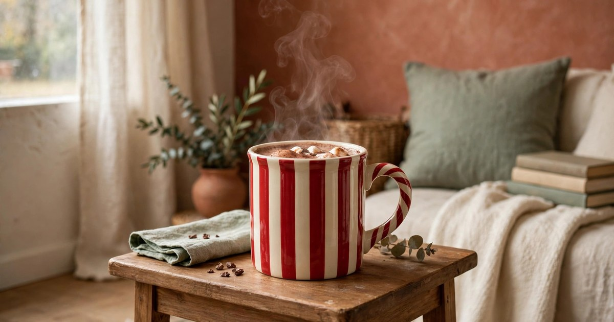
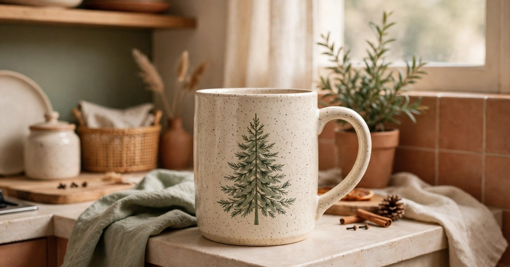
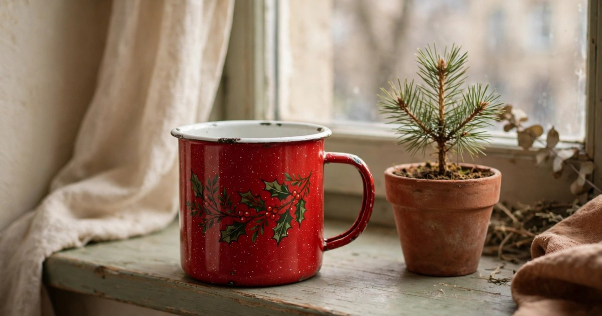
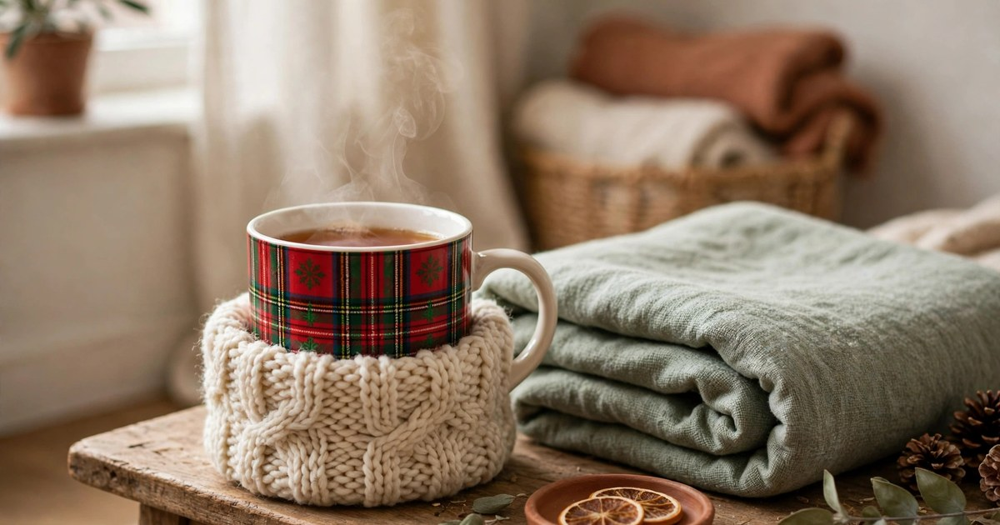
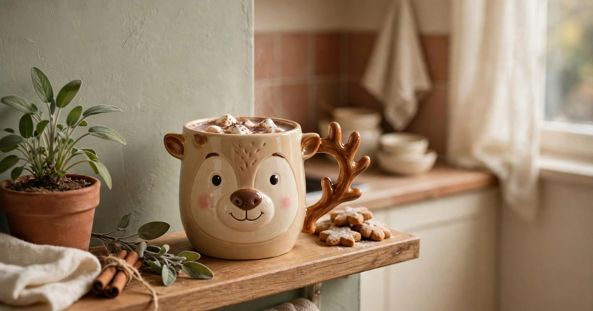
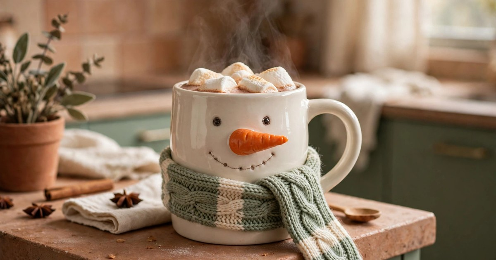
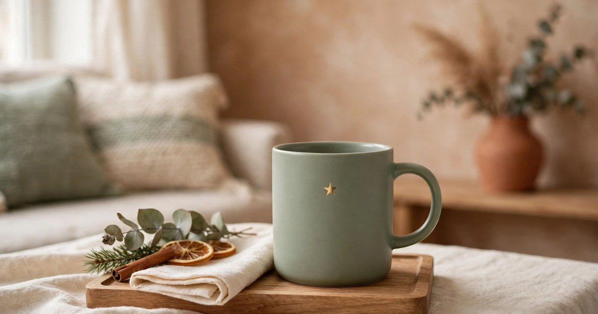
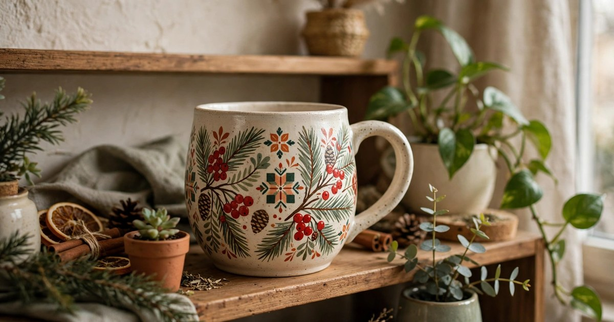
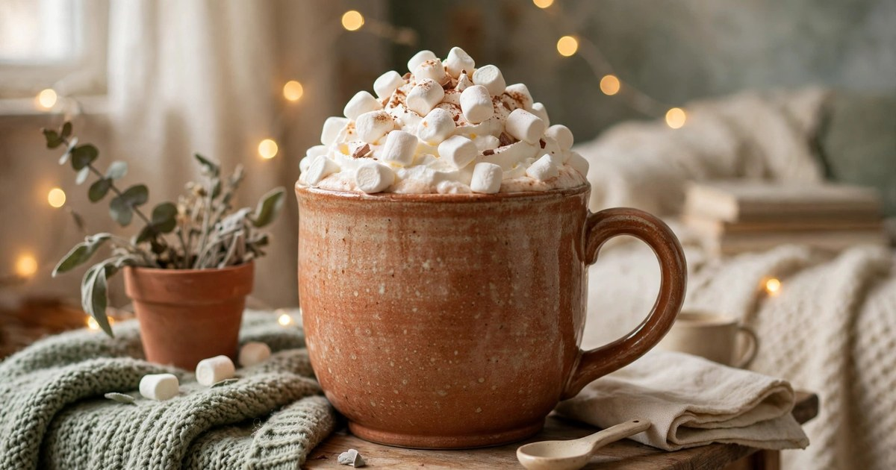

There is something about a Christmas mug that makes a small apartment feel like a holiday home. You do not need a fireplace, a mantel, or a tree that touches the ceiling. One warm mug, one slow morning, and a little steam curling up past the fairy lights — that is the whole season, really.

Mugs are also one of the smartest budget buys for renters. They cost less than a wreath, they take up almost no space, and unlike most Christmas decor, you actually use them every single day from the first week of December through to January. A single shelf, a mug tree, or even two hooks under a kitchen cabinet is all the storage they need, and when the season ends they stack neatly into one cupboard box.

This roundup is built for small spaces and small budgets. Every mug below costs under $25, works for cocoa, tea, coffee, or mulled cider, and earns its place in a tiny kitchen. We have mixed classic ceramic, speckled stoneware, lightweight enamel, and a few playful characters, so whether your style is minimalist sage or full-on reindeer, there is a pick here with your name on it. Prices are approximate at the time of writing, and all of them leave room in the budget for the marshmallows.

### 1. The Classic Candy Cane Ceramic Mug

Some mugs never go out of style, and the candy cane ceramic is one of them. The red-and-cream stripe reads Christmas from across the room, the generous 11 oz size holds a proper serving of cocoa, and the sturdy ceramic keeps your drink warm while you wrap presents or watch the snow fall outside a very small window. At around $12.99, it is the kind of cheerful classic you will reach for every December without a second thought.

In a small apartment, this mug earns its keep as everyday decor. Park it on an open shelf with a sprig of pine tucked inside, or hang it from a mug hook under your kitchen cabinet so the stripe becomes part of your holiday display. It stacks neatly with your everyday mugs, it is dishwasher-safe for busy weeknights, and it pairs beautifully with a simple red tea towel for an instant festive kitchen corner.

[Shop the candy cane ceramic mug on Amazon](https://www.amazon.com/s?k=candy+cane+ceramic+christmas+mug&tag={{AMAZON_TAG}})

### 2. Speckled Stoneware Pine Tree Mug

Speckled stoneware is the quiet luxury of the Christmas mug world. The creamy glaze, the hand-thrown feel, and a single understated pine tree make this mug feel far more expensive than its roughly $14.95 price tag. Stoneware is also thicker than standard ceramic, so your tea stays hot longer — a small mercy on cold mornings when you are lingering over breakfast in a chilly rental.

Where it fits in a small apartment is almost anywhere. The neutral cream palette blends with terracotta, sage, and wood tones, so it looks at home on a windowsill, a bedside table for a slow Sunday coffee, or a tiny dining table dressed with a linen napkin and a cinnamon stick. It is the mug to buy if you want Christmas cheer that still matches your everyday decor.

[Shop the speckled stoneware pine tree mug on Amazon](https://www.amazon.com/s?k=speckled+stoneware+pine+tree+christmas+mug&tag={{AMAZON_TAG}})

### 3. Red Enamel Camping Mug

Enamel mugs are the lightest, toughest option on this list, and at about $11.99 they are also one of the cheapest. The classic red body with a white rim and a small holly sprig gives off cosy cabin energy, and because enamel is nearly unbreakable, this is the mug to hand to guests, kids, or anyone prone to knocking things off a crowded countertop.

For small apartments, the real win is weight and storage. Enamel mugs are feather-light, so they hang happily from adhesive hooks or a tension rod under a cabinet — no drilling, no damage, no landlord drama. Stack two or three together on a shelf and they take up barely more room than one. They also travel well, so the same mug can go from your kitchen to a winter picnic or a friend's balcony cocoa night.

[Shop the red enamel Christmas camping mug on Amazon](https://www.amazon.com/s?k=red+enamel+christmas+camping+mug&tag={{AMAZON_TAG}})

### 4. Plaid Mug with Knit Cozy

Nothing says December quite like plaid, and this mug doubles down with a removable knit cozy in a chunky cable pattern. The cozy keeps your hands comfortable and your drink warm, and when you slide it off, you have a classic red-and-green plaid mug underneath — two looks for one price, around $13.50. It is the closest thing to wearing a Christmas jumper, for your cocoa.

In a small apartment, the knit cozy does double duty as texture. Set the mug on your coffee table next to a folded throw blanket and it instantly makes a plain corner look styled for the season. The cozy also means you can hold a very hot drink without a handle burn, which matters when your sofa is two steps from your kitchen and you are carrying cocoa across the room.

[Shop the plaid Christmas mug with knit cozy on Amazon](https://www.amazon.com/s?k=plaid+christmas+mug+knit+cozy&tag={{AMAZON_TAG}})

### 5. Reindeer Face Mug

The reindeer mug is pure joy. A friendly face on the front, antlers curving up into the handle, and a warm brown glaze that looks wonderful against cream and sage. At roughly $15.99, it is the pick that makes guests smile before they have even taken a sip, and it is a natural favourite with kids, who will fight over who gets the reindeer at breakfast.

Where it fits best is right out in the open. This is not a mug to hide in a cupboard — perch it on an open shelf, a mantel-free sideboard, or the top of a small bookcase where the antlers peek out between your plants. It is also a brilliant budget gift: pair it with a bag of cocoa mix and a candy cane, wrap it in tissue, and you have a thoughtful present for under $20 total.

[Shop the reindeer face Christmas mug on Amazon](https://www.amazon.com/s?k=reindeer+face+christmas+mug&tag={{AMAZON_TAG}})

### 6. Snowman Cocoa Mug

If the reindeer is the life of the party, the snowman is the cosy one. This mug wears a painted carrot nose, coal-button smile, and a little scarf wrapped around its base, and it practically begs to be filled with cocoa and topped with marshmallows. At about $12.49, it is one of the most affordable character mugs you will find, and it holds a generous 12 oz — plenty of room for whipped cream.

In a small apartment, the snowman mug works as a tiny centrepiece. Set it on a tray with a jar of marshmallows and a small candle, and you have a hot cocoa station that fits on a single shelf or the corner of a kitchen counter. When the season ends, it nests inside your other mugs, and its cheerful face makes it the one you will miss most in January.

[Shop the snowman cocoa mug on Amazon](https://www.amazon.com/s?k=snowman+face+christmas+cocoa+mug&tag={{AMAZON_TAG}})

### 7. Minimalist Sage Ceramic Mug

Not everyone wants a reindeer staring back at them at 7am, and that is exactly why the minimalist sage mug exists. Matte sage glaze, clean lines, and a single small gold star — that is the whole design, and it is perfect. At around $16.99, it is the most grown-up mug on this list, and the one most likely to stay in your cupboard long after the decorations come down.

This mug fits a small apartment like it was made for it. Sage is one of the easiest colours to live with in a rental: it flatters wood, cream, and terracotta, it photographs beautifully, and it never clashes with the rest of your kitchen. Use it for morning coffee all winter, then keep it as an everyday mug in January — no storage needed, because it never has to leave the shelf.

[Shop the minimalist sage ceramic Christmas mug on Amazon](https://www.amazon.com/s?k=minimalist+sage+green+ceramic+mug+gold+star&tag={{AMAZON_TAG}})

### 8. Hand-Painted Folk-Art Berry Mug

Hand-painted mugs have a warmth that printed designs cannot match. Each one carries slightly different brushstrokes — red berries, pine branches, a little folk-art flourish — so yours feels genuinely one of a kind. At about $19.95, it is the priciest pick here, but it still sits comfortably under $25, and it doubles as a small piece of art for your kitchen.

For renters, this is the mug that makes an open shelf look curated rather than cluttered. Display it with a trailing plant and a wooden spoon jar, and the whole shelf reads as intentional. It also makes a lovely housewarming or Secret Santa gift for a friend in a small space: beautiful, useful, and small enough that nobody has to find room for it.

[Shop the hand-painted folk-art Christmas mug on Amazon](https://www.amazon.com/s?k=hand+painted+folk+art+christmas+mug+berries&tag={{AMAZON_TAG}})

### 9. Oversized Cocoa Mug

Some December evenings call for a normal mug. Others call for a bowl with a handle. This oversized 16 oz mug is for the second kind of evening — the kind with a blanket, a film, and cocoa piled high with whipped cream and marshmallows. At roughly $17.99, it costs less than two takeaway hot chocolates and will serve you all winter long.

In a small apartment, one oversized mug beats three small ones. It replaces the need for a separate soup bowl on cold nights, it is big enough for a proper serving of mulled cider at a tiny holiday gathering, and it looks wonderfully generous sitting on a coffee table. Just be warned: once you have drunk cocoa from a mug this size, the regular ones will feel like espresso cups.

[Shop the oversized ceramic cocoa mug on Amazon](https://www.amazon.com/s?k=oversized+ceramic+cocoa+mug+16oz&tag={{AMAZON_TAG}})

## Frequently Asked Questions

### How many Christmas mugs do I need for a small apartment?

Two or three is plenty. One for your daily coffee or tea, one for guests, and one character mug for cocoa nights covers almost every scenario. A small collection also means they all fit on one shelf, so you never have to find extra storage.

### Are Christmas mugs under $25 good quality?

Yes, if you stick to ceramic, stoneware, or enamel from well-reviewed sellers. The mugs in this roundup are all everyday-use quality — dishwasher-safe in most cases — and the under-$25 price reflects simple designs and direct online pricing, not poor materials. Check reviews for chips and glaze quality before you buy.

### How do I store Christmas mugs in a rental without extra cupboard space?

Hang them from adhesive hooks or a tension rod under a kitchen cabinet, use a small mug tree on the counter, or display them on an open shelf as part of your decor. Stackable mugs nest inside each other, so a set of four takes up barely more room than one.

### Can I use Christmas mugs all year round?

Absolutely — especially the minimalist sage mug, the stoneware pine tree mug, and the enamel camping mug, which read as everyday designs once the season ends. Character mugs like the reindeer and snowman are more seasonal, but nobody will judge you for drinking cocoa from a snowman in March.

### What is the best Christmas mug for a gift under $25?

The reindeer face mug or the hand-painted folk-art berry mug both make excellent gifts. Pair either one with a bag of hot cocoa mix, a few candy canes, and a handwritten tag, and you have a thoughtful, budget-friendly present that fits in a small gift bag.
