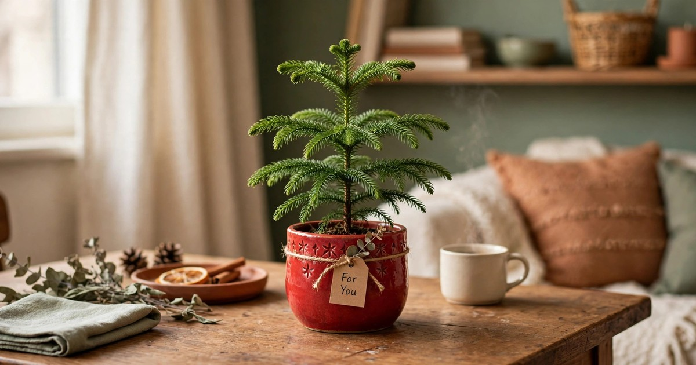
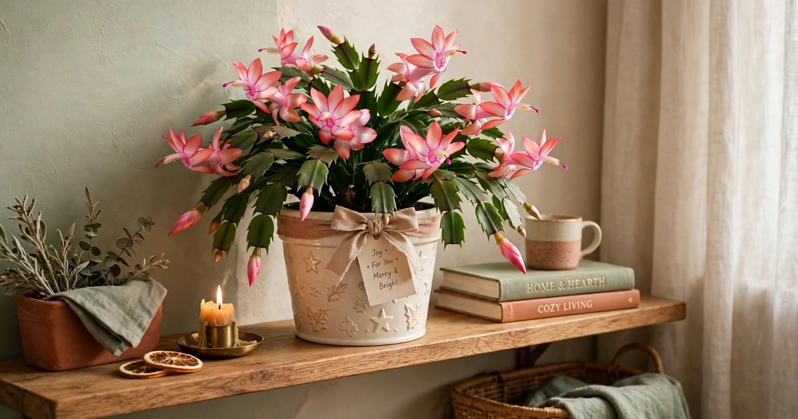
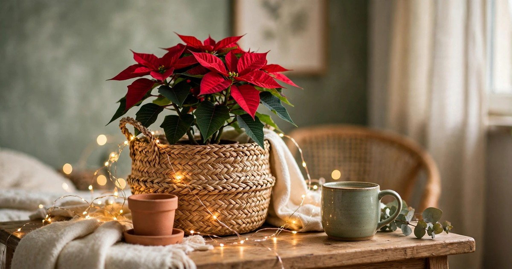
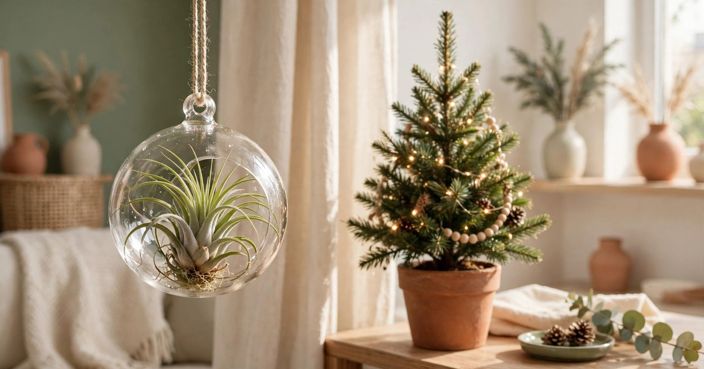
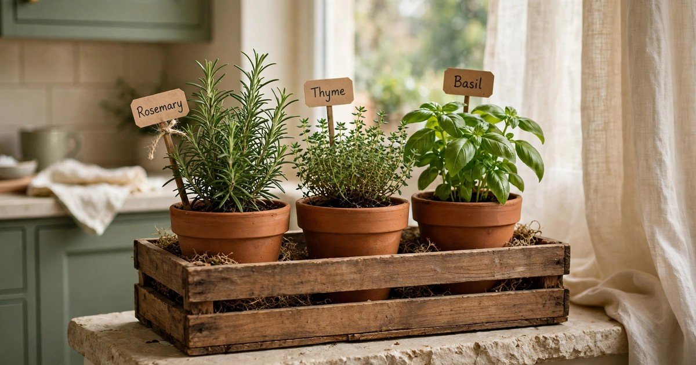
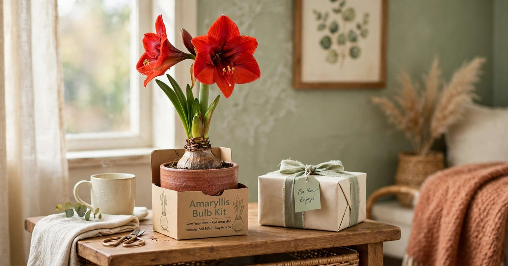
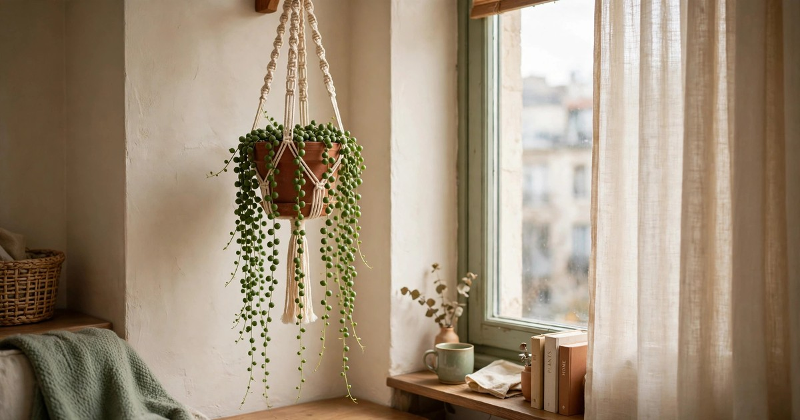
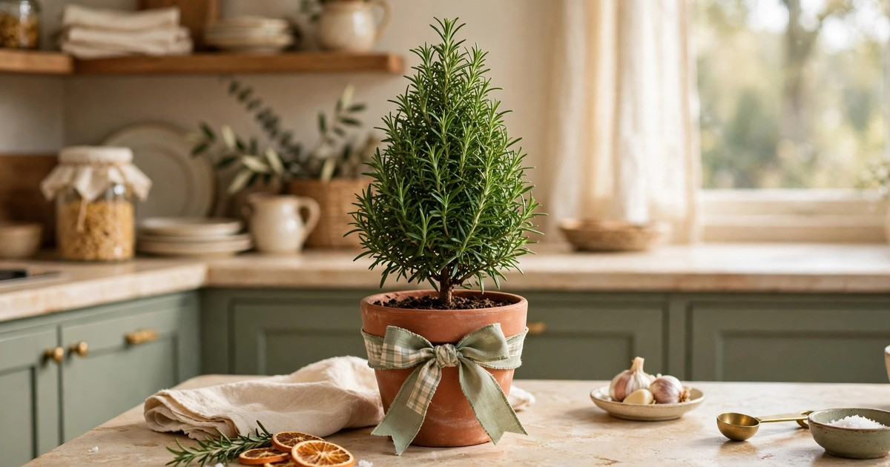
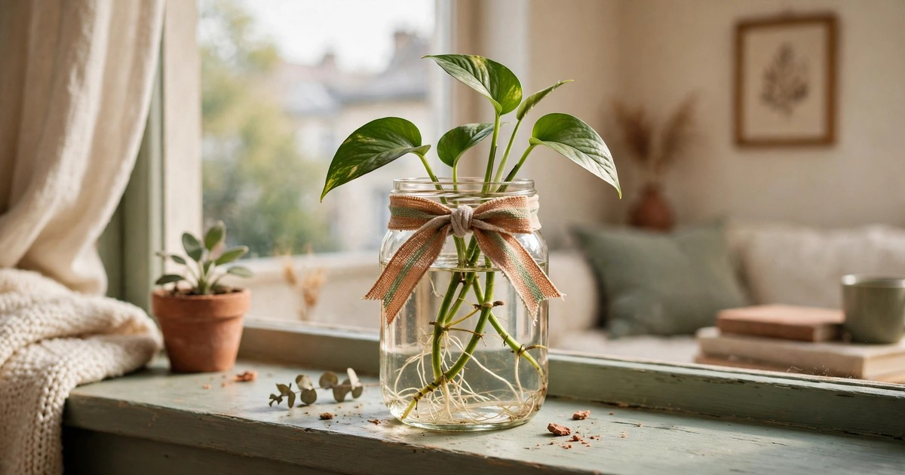
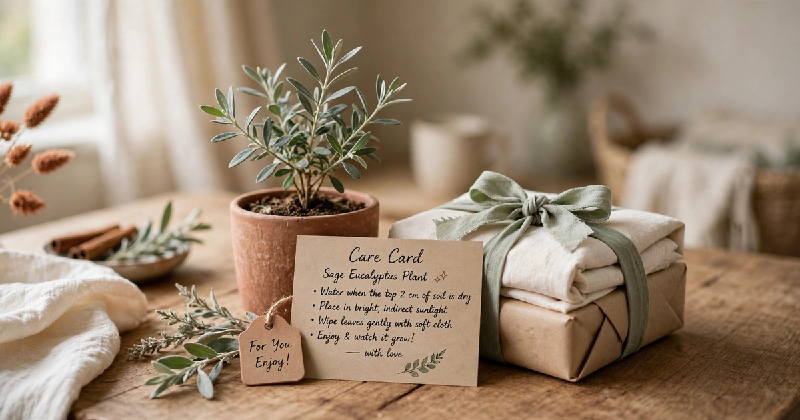

A bunch of cut flowers is lovely for about five days. Then the petals drop, the water turns murky, and the vase goes back in the cupboard until next year. A potted plant gift is the opposite: it arrives looking festive, it earns its place on a shelf or windowsill through January and February, and if the care is right it is still there next Christmas — a little bigger, a little more loved. For a small apartment, that is the perfect kind of gift. It takes up no more room than a mug, it costs less than most novelty presents, and it does not need a single nail in the wall.

The ten gifts below are all chosen with renters and small spaces in mind. Every one is compact enough for a shelf, a side table or a windowsill, cheap enough to feel generous without feeling extravagant, and forgiving enough to survive a new plant parent. For each one I have noted roughly what it costs, who it suits best, and the one care tip that will keep it alive well past January. Pair any of them with our guide to [christmas plants for small apartments](/christmas-plants-for-small-apartments/) if you want more festive greenery ideas, or keep it simple and pick one gift from this list — it is genuinely hard to go wrong.

A quick note on gifting plants well: always check whether the recipient has pets, since a few festive favourites are mildly toxic to cats and dogs. I have flagged the ones to watch. And always include a care card — even three lines about light and watering — because a plant with instructions is a plant that survives.

### 1. A mini Norfolk pine in a festive pot

The mini Norfolk pine is the closest thing to a living Christmas tree you can give in a gift bag. At 30–45 cm tall it is the size of a table lamp, and dressed with a few miniature baubles it looks instantly festive — then in January the baubles come off and you are left with a handsome evergreen houseplant that grows slowly enough to stay tabletop-sized for years. A small plant in a plain nursery pot costs around $10–15, and a festive ceramic pot adds another $5–8, so the whole gift lands at roughly $15–20.

This suits almost anyone: the friend who has no room for a real tree, the colleague who loves Christmas but lives in a studio, the relative who has everything. It is pet-safe, which makes it one of the easiest gifts to give without checking first, and it suits a bright spot away from radiators. The one care tip that matters most is humidity. Heated flats dry Norfolk pines out fast, so mist the foliage a couple of times a week or set the pot on a saucer of pebbles and water. Keep the soil lightly moist but never soggy, and it will reward you with soft, feathery branches all year round.

To make it feel like a gift rather than a garden-centre impulse buy, slip a kraft gift tag around the pot with the plant's name and a line like "water me when my top inch of soil feels dry". A ribbon in a deep red or forest green finishes it. If you are buying for someone who has never kept a plant alive, this is the safest pick on the list — it is slow-growing, hard to kill, and it looks good in every season, not just December.

### 2. A Christmas cactus in a gift pot

Few plants earn their name as honestly as the Christmas cactus. It blooms in November and December, right on schedule, with arching stems of pink, red or white flowers that last for weeks — and then it does it all again next year. A full plant costs $12–16, and because it is a succulent it tolerates the low light of a dark apartment far better than most flowering plants. Pop it into a pretty gift pot and you have a present that looks far more expensive than it was.

This is the gift for the sentimental recipient: the grandmother, the friend who keeps things, the person who values a present with a story. Christmas cacti live for decades and are often passed down through families, so you are genuinely giving something that could still be blooming in twenty years. It is completely pet-safe, which removes the one worry that comes with many festive plants. The care tip that makes all the difference is autumn darkness. To trigger buds, the plant needs cool, dark nights — under 15°C — for a few weeks in autumn, so a spot near a window away from lamps does the job naturally. Water when the top inch of soil dries out, and never let it sit in water.

Presentation matters here. The arching stems look best in a hanging basket or on a high shelf, but for gifting, a simple ceramic pot in cream or sage with a raffia bow lets the flowers do the talking. Add a handwritten care card noting that it likes bright indirect light and a rest after flowering, and your recipient will know exactly what to do. For more ideas in the same spirit, see our [budget christmas gifts for home decor lovers](/budget-christmas-gifts-home-decor-lovers-under-25/).

### 3. A poinsettia dressed in a woven basket

The poinsettia is the classic Christmas plant, and the trick to gifting it well is all in the dressing. A plain foil-wrapped poinsettia looks like a supermarket afterthought; the same plant slipped into a woven seagrass basket, with the basket's rim peeking over the pot, looks like something from a boutique. A mini poinsettia costs $3–5, a standard one $8–12, and a small woven basket $4–7, so the dressed-up version lands at roughly $10–18 — still firmly in stocking-filler territory for a main gift.

This suits the traditionalist: the person who puts the tree up on 1 December, who loves red and gold, who wants their home to look like Christmas the moment they walk in. It also suits the host — a dressed poinsettia is the perfect thing to carry through someone's front door instead of a bottle of wine. One honest flag: poinsettias are mildly toxic to cats and dogs, so skip this one for pet households and pick the Norfolk pine or Christmas cactus instead. The care tip is simple but crucial — keep it away from cold draughts and radiators. Poinsettias hate both. Water only when the top inch of soil is dry, and never let the plant sit in a puddle, or the leaves will drop within days.

The basket is what makes this gift reusable. Once the poinsettia has finished, the basket becomes storage for keys, scarves or the next plant — so the gift keeps giving after the flowers fade. Choose a basket with a natural, undyed finish so it works with any colour scheme, and tuck a sprig of dried orange or a cinnamon stick into the rim for scent. It is the fastest way to make a $10 plant look like a $30 gift.

### 4. An air plant in a glass bauble

Air plants are the ultimate small-space gift because they need no soil and no pot — just air, light and the occasional mist. Tucked inside a clear glass bauble, an air plant becomes a living ornament: hang it on the tree in December, then move it to a windowsill or hang it from a hook in January. A single air plant costs $3–6 and a glass bauble $2–4, so the whole gift can cost under $10, which makes it ideal as a stocking filler, a Secret Santa gift, or a little extra alongside a bigger present.

This suits the minimalist, the person with no surfaces to spare, and anyone who has ever killed a plant by overwatering — because air plants are almost impossible to overwater in the usual way. They suit renters perfectly: hang them from a Command hook or a curtain rail and there is not a single hole in the wall. The care tip is the opposite of what most people expect: air plants do need water, just not in a pot. Mist them two or three times a week, or soak them in a bowl of water for twenty minutes once a week, then shake them dry upside down. Rot is the enemy, so never leave water sitting in the base of the bauble.

To gift it beautifully, choose a bauble with a wide opening so the plant can be lifted out for soaking, and add a tiny tag explaining the weekly soak. A set of three baubles with different air plants — one spiky, one curly, one silvery — makes a lovely gift for under $20 and fills a whole window. It is the smallest, cheapest gift on this list, and somehow the one people remember most.

### 5. A herb trio in a wooden crate

A herb trio — rosemary, thyme and basil, or rosemary, sage and mint — in a small wooden crate is the gift for the cook. It is festive (rosemary clipped into a cone looks exactly like a miniature Christmas tree), it is useful every single day, and it smells wonderful on a kitchen windowsill. Three small herb plants cost $3–5 each, and a wooden crate runs $5–8, so the whole gift lands at roughly $15–22. For a food lover, it beats a hamper: nothing in it goes stale.

This suits the home cook, the new flatmate setting up a first kitchen, and anyone who loves the idea of plants but wants a practical reason to keep them alive. Cooking with your gift is the best possible care routine — snipping sprigs keeps the plants bushy and stops them getting leggy. The care tip is light: herbs need the brightest spot in the flat, ideally a south-facing windowsill or the sunniest kitchen counter. Let the soil dry between waterings — soggy herbs die fast, especially rosemary — and make sure the crate has drainage, or line it with a tray.

Make the crate feel like a gift by lining it with kraft paper, tying the whole thing with twine, and adding a small card with one recipe idea per herb: roast potatoes with rosemary, roast chicken with thyme, a festive cocktail with mint. A wooden crate also doubles as storage later, so the gift keeps working after the herbs are used up. If the recipient has a dark kitchen, swap the basil for parsley or chives, which tolerate lower light better.

### 6. An amaryllis bulb kit

A boxed amaryllis kit is the most dramatic $12 in Christmas decor. One huge bulb produces a 60 cm stem topped with trumpet flowers the size of your hand, usually within six to eight weeks of planting — buy in early November for Christmas blooms, or gift it in December for a January show. Kits cost $10–15 and include the bulb, pot and soil, so there is nothing else to buy. No green thumb is required, which is exactly why it makes such a good gift.

This suits the impatient gardener, the person who likes a project, and the friend who says they kill everything — because an amaryllis is almost impossible to get wrong. It also suits someone you will not see until after Christmas: hand over the box, and the flowers arrive weeks later like a delayed surprise. The care tip is patience with water. Water sparingly until the stem appears, then water more freely once it is growing, and give the plant the brightest spot you have so the stem grows straight instead of leaning. After flowering, cut the stem back and keep watering the leaves — the bulb can be saved and replanted next year.

Presentation is already handled by the box, but a ribbon and a note with the planting date turn it into a proper gift. Write "plant by 1 December for Christmas flowers" on the card if you are gifting early, or "plant now, flowers in six weeks" if it is already mid-December. It is the gift that keeps unfolding, and for a small apartment it is perfect: one pot, one stem, one spectacular flower, and no clutter at all.

### 7. A string of pearls in a hanging pot

A string of pearls — those trailing stems of bead-like leaves — looks like a living garland, which makes it feel made for Christmas. In a hanging pot it takes up zero surface space, which is gold in a small apartment: it hangs from a ceiling hook or a curtain rail and trails down like tinsel that never needs taking down. A small plant costs $8–14 and a hanging pot or macramé hanger $5–10, so the gift lands at roughly $15–22.

This suits the plant lover who already has a few pots and wants something different, the person with a sunny window and no shelf space left, and anyone whose style leans boho or modern. It is the prettiest gift on this list, and the trailing stems make it feel generous even in a small pot. The care tip is restraint: string of pearls is a succulent, so it wants bright light and very little water. Water only when the soil is completely dry, and never let the beads sit wet — they rot fast. A south-facing window is ideal, and in winter it will happily sit near the glass where other plants would shiver.

For gifting, a macramé hanger in cream or natural cotton looks soft and handmade, and it suits a renter because it hangs from a removable hook. Add a care card with one line — "bright light, water rarely" — and your recipient is set. If the recipient has cats, flag it: string of pearls is mildly toxic if eaten, so a high hanging spot out of reach is the way to go. Hung high, it is both safe and stunning.

### 8. A mini rosemary tree

A rosemary plant clipped into a cone looks exactly like a miniature Christmas tree, smells incredible, and — unlike every other plant on this list — you can cook with it. Snip sprigs for roast potatoes all December and it just keeps growing. Supermarkets and garden centres sell cone-shaped rosemary topiaries for $10–14 from late November, and a terracotta pot and a ribbon bring the total to around $15–18. It is festive decor and a herb garden in one pot, which makes it feel like two gifts for the price of one.

This suits the cook, the scent lover, and the person who wants their flat to smell like Christmas without a plug-in diffuser. Fresh rosemary beats any candle, and a living tree on the kitchen counter is a daily reminder of the season. It is pet-safe, which makes it an easy gift to give without checking first. The care tip is the same as for any herb: brightest spot you have, and let the soil dry between waterings. Soggy rosemary dies fast, so water little and often rather than drowning it, and never let the pot sit in water.

To gift it, choose a terracotta pot — the warm clay colour suits the festive palette perfectly — and tie a sprig of dried orange and a cinnamon stick to the ribbon for extra scent. Add a card with one recipe: "snip for roast potatoes". If the recipient's kitchen is dark, be honest on the card: rosemary needs sun, so a bright windowsill is non-negotiable. Given the right spot, this little tree will last for years and can be re-clipped into shape every December.

### 9. A propagated plant in a pretty jar

The most personal gift on this list costs almost nothing. Take a cutting from your own pothos, spider plant or monstera, root it in water for a few weeks, and gift it in a pretty glass jar with a ribbon and a care card. The jar costs $2–4, the plant costs nothing, and the gift is genuinely one of a kind — a piece of your own home, given to someone else's. It is the zero-waste, zero-spend option, and somehow the one that feels most thoughtful.

This suits the close friend, the sibling, the person who would rather have something handmade than something bought. It suits the new plant parent too: pothos and spider plants are famously hard to kill, and a cutting in water shows its roots, so the recipient can watch it grow before potting it up. The care tip is to change the water weekly and keep the jar out of direct sun, which turns the water green with algae. Once roots are a few centimetres long, the cutting can move into soil — or it can live in water for months, which makes it perfect for a desk or a bathroom shelf.

Presentation is everything here because the plant itself is free. Choose a jar with character — a vintage jam jar, a small milk bottle, a pretty apothecary bottle — and write the plant's name and the date you took the cutting on the tag. A line like "from my pothos, rooted 12 November" turns a free cutting into a story. If you have several plants, make a set of three jars in different shapes: it looks like a curated gift and still costs less than a coffee.

### 10. A plant, pot and care-card gift bundle

If you cannot decide between the gifts above, bundle them. Pick a small plant — a pothos, a peperomia or a mini fern — choose a ceramic pot that suits the recipient's style, and add a handwritten care card with three lines: how much light, how often to water, and what to do if the leaves droop. The plant costs $6–10, the pot $5–10, and the card costs nothing, so the bundle lands at roughly $12–20. It is the most flexible gift on the list because you can tailor every element to the person.

This suits everyone, but especially the person you do not know well — a new colleague, a neighbour, a Secret Santa draw. The pot is the part that makes it feel personal: cream for the minimalist, terracotta for the warm traditionalist, sage green for the plant lover. Choose a pot with a drainage hole and a matching saucer, because a plant that cannot drain is a plant that will not last. The care tip to write on the card is the simplest one in plant care: water when the top inch of soil feels dry, not on a schedule. That single sentence saves more plants than any other advice.

The bundle works because it removes every barrier. The recipient does not need to buy a pot, does not need to guess about care, and does not need to repot anything. It is ready to go on a shelf the moment it is unwrapped. Tie the whole thing with twine, tuck the card under the ribbon, and you have a gift that looks thoughtful, costs under $20, and — unlike a box of chocolates — is still there in March, quietly growing.

## Shop this look: Christmas plant gift basics

- **Mini Norfolk Pine Plant** — the living mini tree that doubles as a houseplant all year. [Shop mini Norfolk pine plant](https://www.amazon.com/s?k=mini+norfolk+pine+plant+live&tag={{AMAZON_TAG}})
- **Christmas Cactus Plant** — blooms right on schedule in December and lives for decades. [Shop Christmas cactus plant](https://www.amazon.com/s?k=christmas+cactus+plant+blooming+live&tag={{AMAZON_TAG}})
- **Amaryllis Bulb Kit** — one bulb, one spectacular flower, zero experience needed. [Shop amaryllis bulb kit](https://www.amazon.com/s?k=amaryllis+bulb+kit+gift+box&tag={{AMAZON_TAG}})
- **Air Plant Terrarium Bauble** — a living ornament that needs no soil and no pot. [Shop air plant terrarium bauble](https://www.amazon.com/s?k=air+plant+terrarium+bauble+glass+ornament&tag={{AMAZON_TAG}})
- **Herb Garden Kit** — rosemary, thyme and basil ready for the kitchen windowsill. [Shop herb garden kit](https://www.amazon.com/s?k=herb+garden+kit+indoor+starter&tag={{AMAZON_TAG}})
- **Small Woven Basket Planters** — dress any festive plant up in seconds. [Shop small woven basket planters](https://www.amazon.com/s?k=small+woven+basket+planters+set&tag={{AMAZON_TAG}})

## Frequently Asked Questions

### What is the best Christmas plant gift for a small apartment?

A mini Norfolk pine or a Christmas cactus. Both stay compact, tolerate apartment conditions, and look festive without needing a big pot. The Norfolk pine doubles as a mini Christmas tree, while the Christmas cactus blooms every December for decades.

### Are Christmas plant gifts safe for homes with pets?

Some are, some are not. Norfolk pines, Christmas cacti, rosemary and air plants are pet-safe. Poinsettias and string of pearls are mildly toxic if eaten, so keep them out of reach or choose a safer option for pet households.

### How much should I spend on a plant gift?

Most of the gifts in this list cost $10–20 all in, including the pot. A single air plant in a bauble can cost under $10, while a herb trio in a crate or a hanging string of pearls runs closer to $20. The pot and presentation matter more than the price of the plant itself.

### How do I keep a gifted plant alive past January?

The three rules are: water only when the top inch of soil feels dry, give it the brightest spot you have, and keep it away from radiators and cold draughts. A care card with those three lines is the best thing you can add to any plant gift.

### Can I gift a plant to someone who has never kept one alive?

Yes — choose a forgiving plant like a Christmas cactus, a pothos cutting or an amaryllis kit, and include a short care card. Plants that show you what they need (drooping leaves mean thirsty, yellow leaves mean too much water) are the easiest for beginners.
