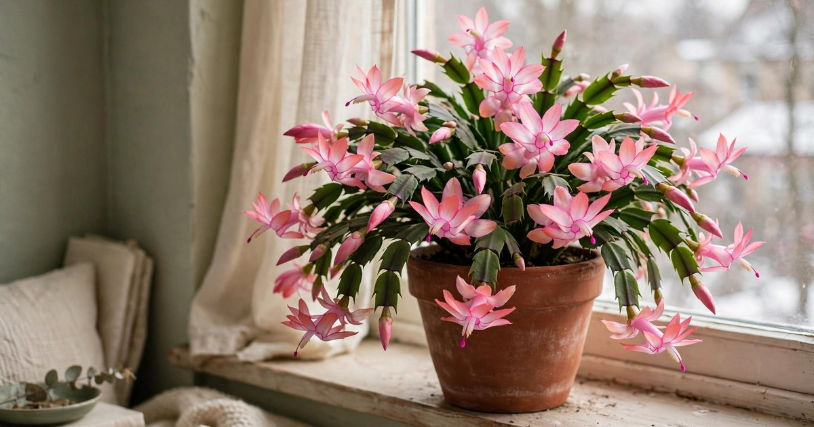
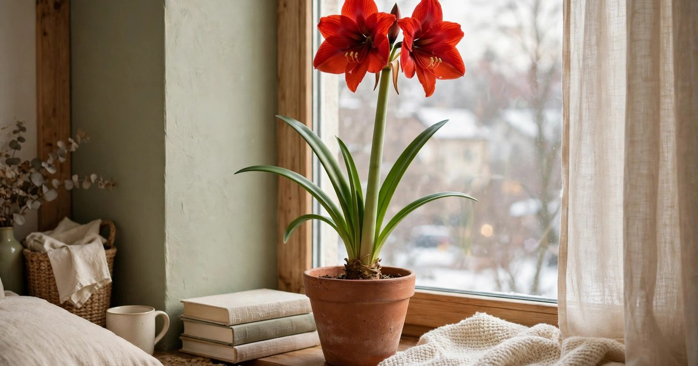
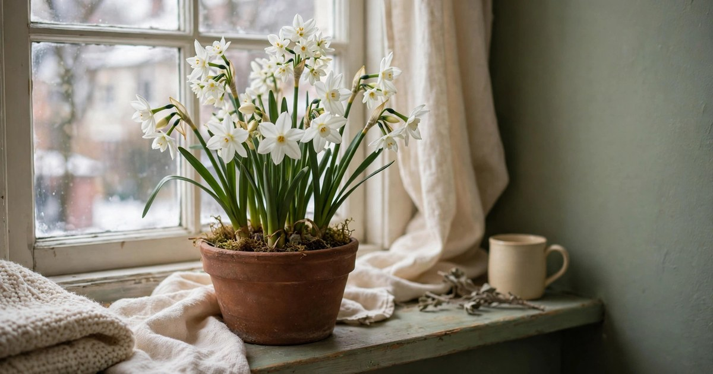
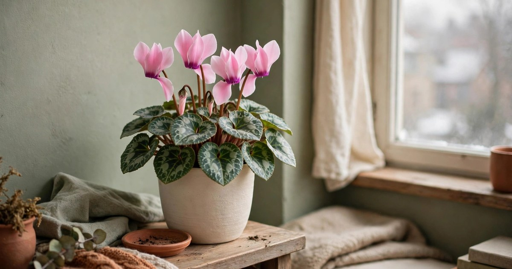
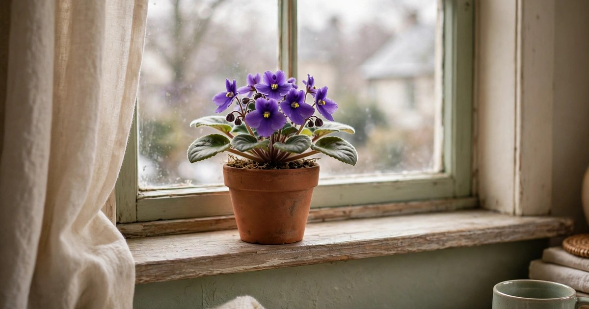
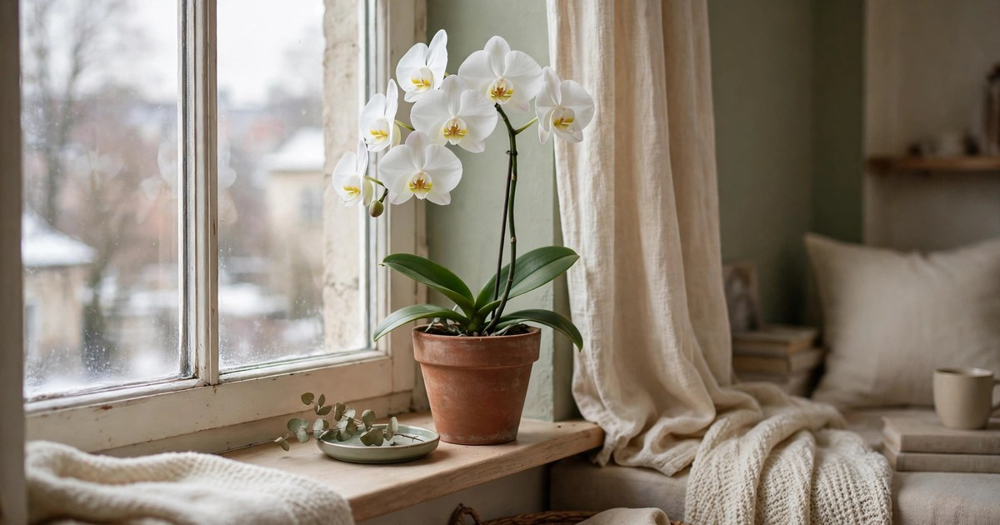
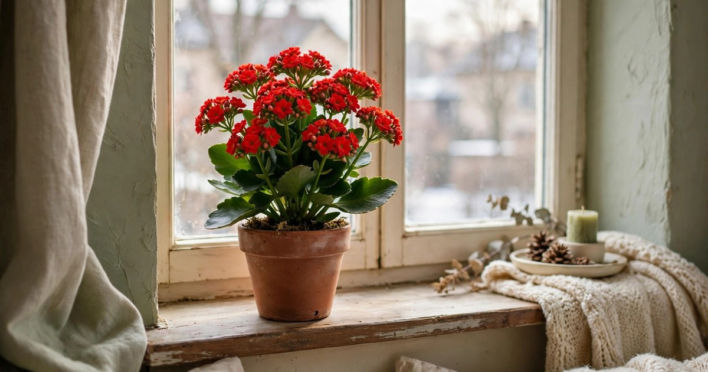
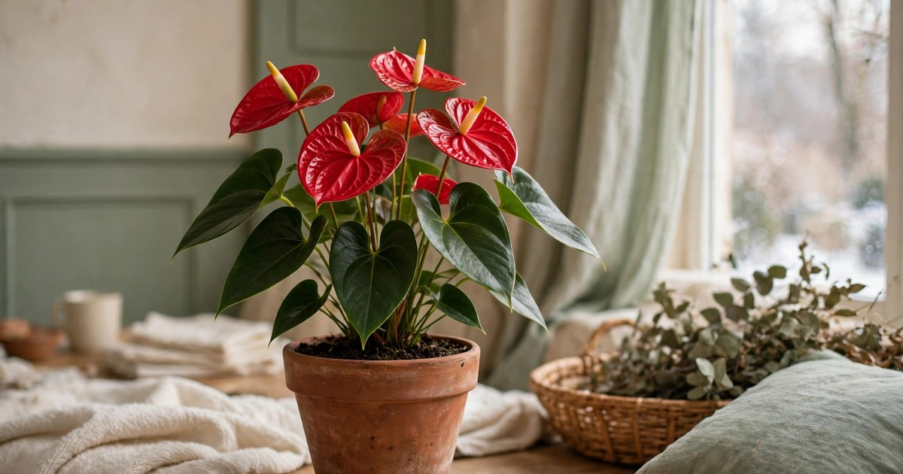
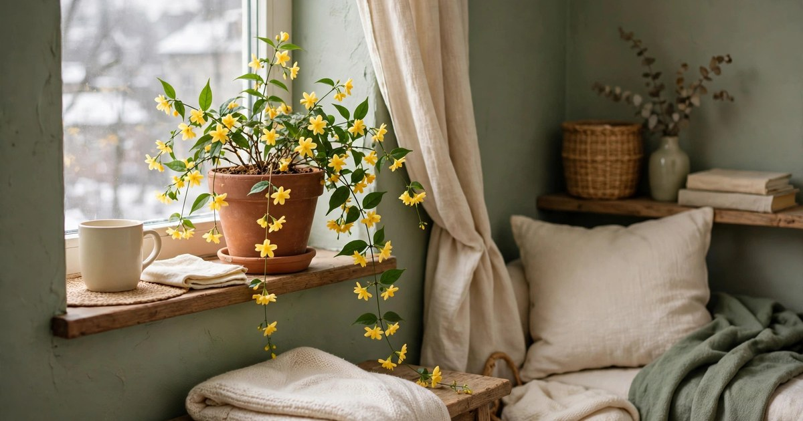
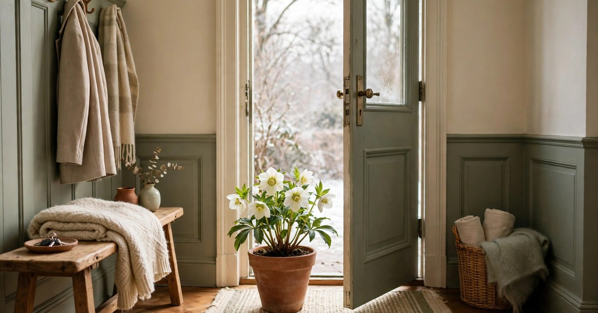

Everyone knows the [poinsettia](/keep-poinsettias-alive-guide/). It is the plant on every supermarket display in December, and it is lovely — but it is far from the only plant that flowers in winter. If your flat already has a poinsettia, or if you simply fancy something different this year, there is a whole cast of winter bloomers that will flower from December right through to February and beyond, often for less money and with far less fuss. Many of them are small enough for a [windowsill](/winter-windowsill-garden-guide/), happy in a rented flat with no special kit, and cheap enough to buy as a treat rather than an investment.

The trick with winter-flowering plants is understanding why they bloom when everything else is resting. Short days and cool rooms trigger flowering in many of them, which is exactly what a British winter — or any northern winter — delivers for free. That means you are not fighting the season; you are working with it. A bright windowsill, a pot with drainage, and a watering can are genuinely all you need for most of the plants below. Here are ten that earn their place, in the order you are most likely to find them in the shops.

### 1. Christmas cactus

The [Christmas cactus](/christmas-cactus-blooming-mistakes/) is the winter bloomer that asks for the least and gives the most. It flowers because the nights get longer, so a room that is not flooded with artificial light in the evening will see it burst into pink, red, or white flowers just in time for the festive season. It is a succulent, so it stores water in its flat green segments and forgives the occasional forgotten watering — ideal if you are busy or away for a few days over Christmas.

Give it bright indirect light rather than harsh midday sun, water when the top inch of compost feels dry, and keep it away from radiators, which dry the buds out and make them drop. It fits anywhere: a windowsill, a bookshelf, or hanging in a macramé holder above a desk. Budget tip: buy a small one now and keep it. Christmas cacti live for decades and get bigger every year, so a plant that costs a few pounds today becomes a large, spectacular specimen within a couple of winters, and you can root a broken segment in water to make a free plant for a friend.

### 2. Amaryllis

Few plants make as much impact for as little effort as an amaryllis. The bulb is enormous, the flower stalk shoots up within weeks of planting, and the trumpet-shaped blooms — often six inches across — look like something from a florist's window. Plant the bulb in autumn with its top third above the compost, water sparingly until growth appears, and then water regularly once the stalk is growing.

It needs a bright spot and a stake or a heavy pot, because the flower head is top-heavy and a tall stalk can topple a light pot. Keep it in a room that is not too hot, or the flowers will rush through and fade fast; a cool, bright room gives you blooms that last for weeks. In a small flat, one amaryllis on a side table or a kitchen windowsill is a whole display on its own — you do not need a collection. Budget tip: buy a bare bulb rather than a pre-potted gift set, and keep the bulb after flowering. With a summer rest, it will bloom again next winter, so one purchase covers many Christmases.

### 3. Paperwhites

[Paperwhites](/force-paperwhite-bulbs-christmas-guide/) are the fastest festive flower you can grow. Plant the bulbs in a shallow bowl of compost or even a jar of pebbles and water, and within four to six weeks you will have tall stems topped with clusters of small, sweetly scented white flowers. They need no chilling period, unlike most other bulbs, which is why they are the classic Christmas bulb for people who want results without planning months ahead.

They love a bright, cool windowsill — warmth makes them grow leggy and flop, so a cooler room actually gives you a sturdier display. Support tall stems with a few twigs pushed into the pot, or simply plant them close together so they hold each other up. For a small flat, a single bowl of paperwhites on a coffee table or a shelf gives you scent and flowers for the price of a bunch of cut flowers, and they last longer. Budget tip: buy bulbs in a multi-pack and stagger the planting by a fortnight, so you get a second wave of flowers in January when the first lot fades.

### 4. Cyclamen

Cyclamen is the plant that looks expensive and behaves like a bargain. Its swept-back petals in pink, red, or white sit above beautifully patterned silver-and-green leaves, and a healthy plant flowers for months through the winter. The secret to keeping it happy is counter-intuitive: cyclamen prefers cool rooms and dislikes central heating. A draughty windowsill or a cool hallway is perfect, which makes it a brilliant choice for rented flats where the heating is unpredictable.

Water from below by standing the pot in a saucer of water for ten minutes, then draining it — water on the crown of the plant causes rot. Deadhead faded flowers by twisting the stem off at the base, and the plant will keep producing new ones. It fits on the narrowest windowsill and in the smallest pot, and a single plant can look like a proper display on its own. Budget tip: buy cyclamen in autumn when garden centres discount them, and keep the tuber after the leaves die back in summer. Left dry and cool, it will sprout again the following autumn.

### 5. African violet

African violets are the windowsill classic for a reason: they are compact, they flower for most of the year including winter, and they come in purples, pinks, blues, and whites that suit any colour scheme. They like bright light but not direct sun, which scorches their fuzzy leaves, so an east- or north-facing windowsill is ideal — exactly the light many small flats have.

The one rule is to water from below or very carefully at the base, because cold water on the leaves leaves brown spots. A saucer of water for fifteen minutes, once a week, is enough, and a small pot is actually better than a large one: African violets flower best when slightly pot-bound. They are perfect for a desk, a kitchen shelf, or a bathroom windowsill, and a row of three in matching pots costs very little. Budget tip: propagate from a single leaf. Push a leaf stem into moist compost, cover it with a clear plastic bag, and within a couple of months you will have baby plants to give away or spread around the flat.

### 6. Orchid (phalaenopsis)

The moth orchid has a reputation for being fussy, but the truth is that it is one of the easiest winter bloomers once you know its two rules: bright indirect light, and water only when the roots look silvery-grey. The flowers last for two to three months — longer than almost any other houseplant — and a single stem arching over a table looks like a luxury purchase.

Keep it away from direct midday sun and cold draughts, and never let it sit in water: drain it thoroughly after watering, roughly once a week. After the flowers fade, cut the stem back to a node and it will often re-flower from the same stem within a few months. In a small flat, one orchid on a side table or a shelf is a statement piece, and it needs no more space than a mug. Budget tip: supermarkets sell phalaenopsis for a fraction of florist prices, and a plant bought in bud will flower for months. Ignore the expensive "orchid food" and use a weak general houseplant feed instead.

### 7. Kalanchoe

Kalanchoe is the plant for people who want colour without commitment. Its clusters of tiny flowers in red, pink, orange, or yellow sit above thick, glossy succulent leaves, and a single plant can flower for six to eight weeks through winter. As a succulent, it wants very little water — let the compost dry out between waterings, and it will be perfectly happy — and it loves the brightest windowsill you have.

It stays compact, which makes it ideal for a small flat: a couple of kalanchoes on a kitchen windowsill, in the bathroom, or on a bedside table add instant festive colour with no trailing stems and no mess. After flowering, trim the spent heads back and the plant will often flower again. Budget tip: kalanchoe is one of the cheapest flowering houseplants in the shops, often less than a takeaway coffee, and it roots easily from a stem cutting pushed into compost, so one plant quickly becomes several.

### 8. Anthurium

Anthurium brings a touch of the tropical to a winter windowsill. Its glossy, heart-shaped red, pink, or white spathes look like wax flowers and last for weeks — sometimes months — on the plant, and it flowers on and off all year, including through the darkest winter weeks. It likes bright indirect light and a little humidity, so a bathroom windowsill or a kitchen spot near (but not on) a radiator suits it well.

Water when the top of the compost feels dry, and wipe the leaves occasionally to keep them glossy. The flowers are so long-lasting that a single anthurium can carry a whole corner of a room through Christmas and into the new year, and its upright shape means it takes up very little floor or shelf space. Budget tip: buy a small anthurium rather than a large specimen — they grow steadily and will fill a bigger pot within a year — and skip the misting gadgets: a saucer of pebbles and water under the pot gives it all the humidity it needs for free.

### 9. Winter jasmine (indoors)

Winter jasmine is the cheerful surprise of this list. Outdoors it flowers on bare stems in the depths of winter, but a young plant in a pot will happily flower indoors too, producing small, starry yellow flowers that look like sunshine against a grey January sky. It is a scrambling plant, so give it a small trellis, a hoop, or simply let it trail from a shelf or a hanging pot.

It likes a bright, cool spot and regular watering, but it is not demanding — a missed watering will not kill it, and it responds to a light trim after flowering by growing back bushier. In a small flat, a trailing winter jasmine on a high shelf or in a hanging planter adds height and movement that a pot on a table cannot, and the yellow flowers lift a whole room. Budget tip: winter jasmine is usually sold as a cheap outdoor shrub in autumn, far cheaper than a named houseplant, and a small one potted up indoors will flower the same winter.

### 10. Hellebore in a pot by the door

Hellebores — sometimes called Christmas roses — flower in the coldest months, which is exactly why they make such a good plant for the doorway. A potted hellebore by the front door, in a porch, or just inside a cool hallway greets you with nodding white, pink, or dusky purple flowers every time you come home, and it keeps flowering for weeks even when the weather is grim.

It prefers cool conditions and shade over a warm, sunny room, so a sheltered spot by the door is ideal, and it is very hardy — a frost will not finish it. Water when the compost feels dry and remove tatty leaves to show off the flowers. For renters, a pot by the door is perfect: it is not planted in the ground, it moves with you, and it makes the entrance feel festive without a single decoration. Budget tip: buy hellebores in flower in winter, when you can see exactly what colour you are getting, and keep the pot after flowering. Planted out later, or simply kept in its pot, it will come back bigger every year.

## A winter windowsill that keeps giving

The real joy of winter-flowering plants is that they change the feel of a flat for months, not days. A bunch of cut flowers lasts a week; a Christmas cactus or an orchid bought in December can still be flowering in March. Start with one or two from this list — a Christmas cactus for the windowsill and a cyclamen for the hallway, say — and add another each year. Before long, your flat will have colour in every corner through the darkest part of the year, all grown in small pots, on ordinary windowsills, for very little money. That is the kind of festive decorating that pays for itself, winter after winter.

## Frequently Asked Questions

### Which Christmas plant blooms the longest?
The phalaenopsis orchid usually wins, with flowers lasting two to three months on a single stem. Christmas cactus and anthurium are close behind, and cyclamen can flower continuously for months if kept cool and deadheaded regularly.

### Do winter-flowering plants need special light?
Most of them need bright indirect light — a windowsill that gets daylight but not harsh midday sun. The exception is kalanchoe, which loves the brightest spot you have, and cyclamen, which is happy in a cooler, less sunny position. None of them need a grow light in an ordinary bright flat.

### How often should I water Christmas plants?
It depends on the plant, but the golden rule is to check the compost before watering. Succulents like Christmas cactus and kalanchoe want to dry out between waterings, while amaryllis and paperwhites want steady moisture once growing. Overwatering kills more houseplants in winter than underwatering, so when in doubt, wait a day.

### Are these plants safe around pets?
Some are not. Amaryllis, cyclamen, kalanchoe, and paperwhites are toxic to cats and dogs if eaten, so keep them out of reach of curious pets. Christmas cactus, African violet, and phalaenopsis orchids are generally considered pet-friendly, but always check before buying if you have animals that nibble leaves.

### Can I keep these plants after Christmas?
Yes — almost all of them are perennials that will flower again next year with basic care. Amaryllis and cyclamen need a rest period after flowering, Christmas cactus and orchids just need normal care, and hellebores will come back bigger every winter. Only paperwhites are usually treated as one-season plants, though you can plant the bulbs outside afterwards.

### What is the cheapest winter-flowering plant to start with?
Kalanchoe and cyclamen are usually the cheapest in the shops, often just a few pounds, and paperwhite bulbs bought in a multi-pack work out very cheaply per plant. All three give you weeks of flowers for less than the price of a bouquet.
