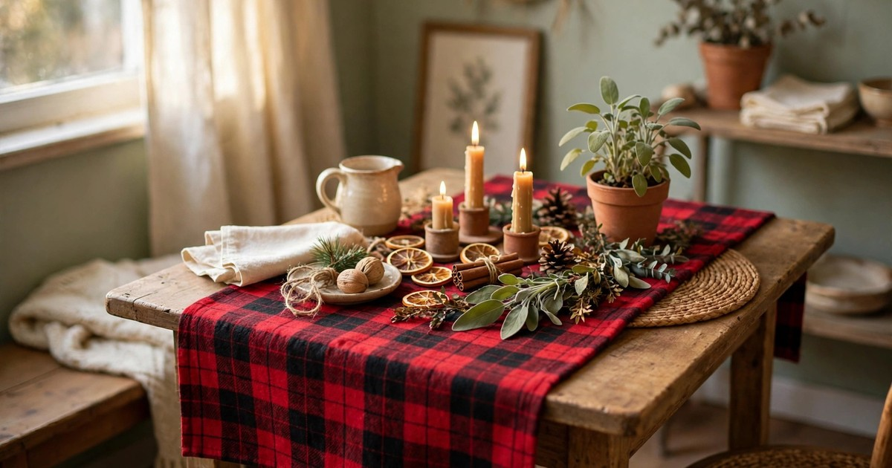
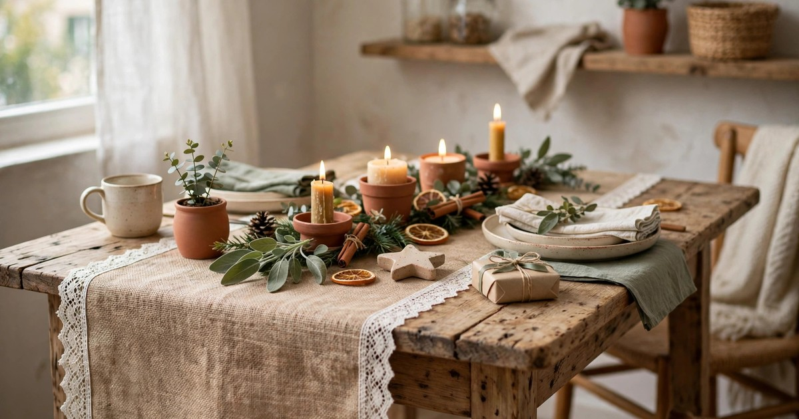
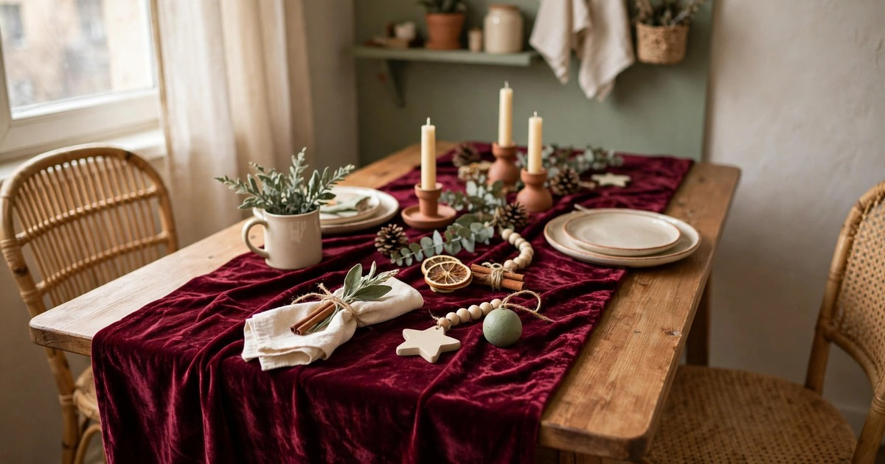
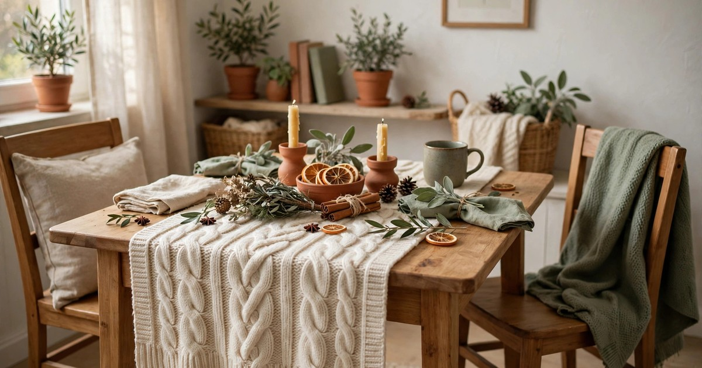
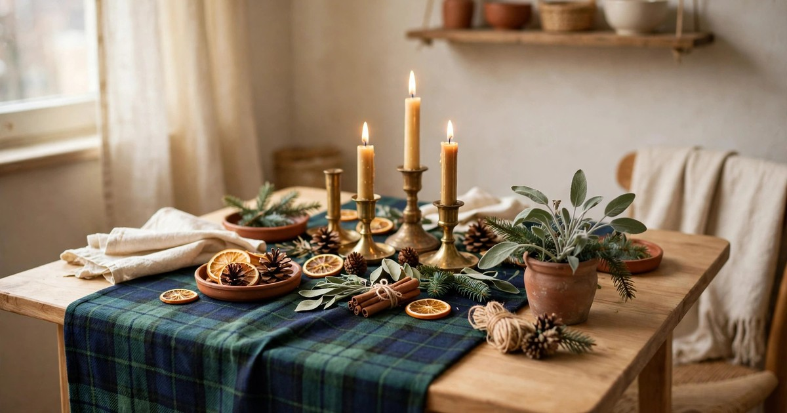
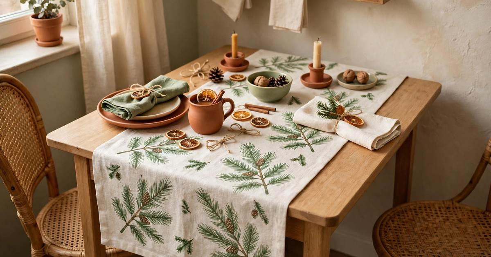
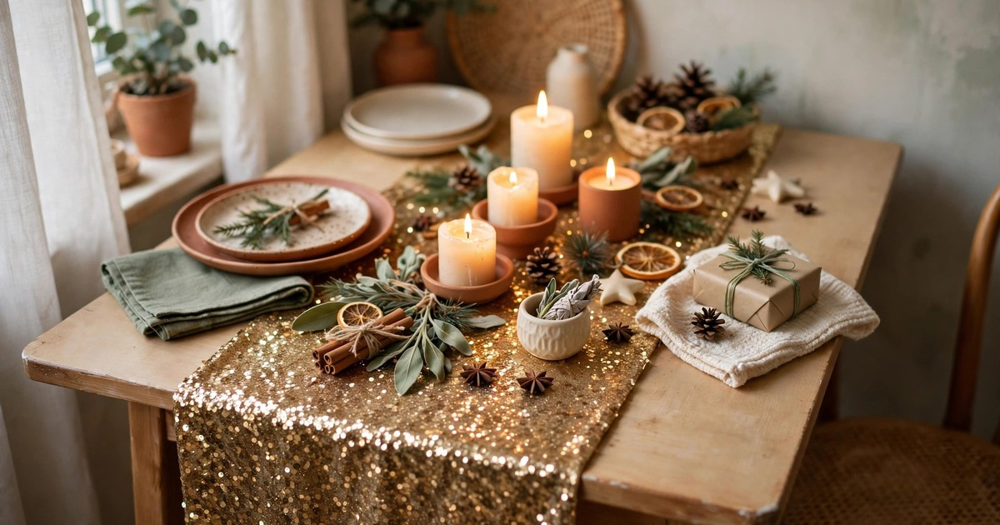
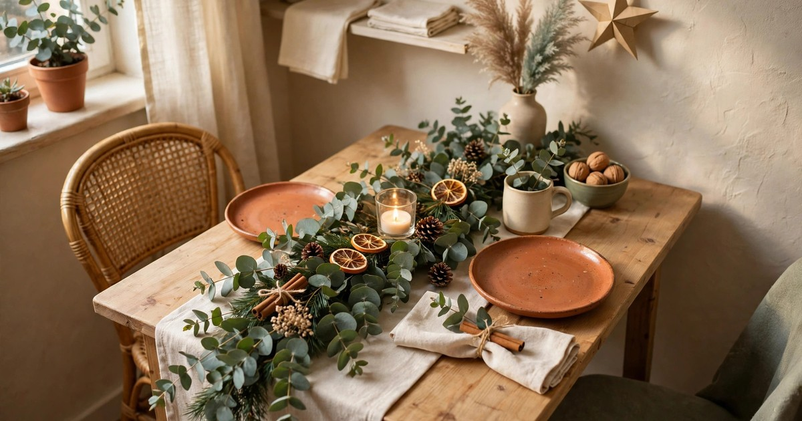

A table runner is the smartest £20 you can spend on Christmas decor in a small apartment. It is the one decoration that does three jobs at once: it protects a rented table from hot plates and red wine, it sets the colour scheme for the whole meal, and it makes a plain table look dressed without a single extra ornament. Unlike a full tablecloth, it leaves the wood visible at the edges, which matters when your dining table is also your desk, your wrapping station and your breakfast bar. And unlike a centrepiece, it folds flat into a drawer in January.

Every runner in this roundup costs $25 or less, and each one was chosen for a small table first. That means lengths that suit a two- or four-seater rather than a banqueting hall, fabrics that survive a washing machine, and colours that work with the warm terracotta, cream and sage palette of a cosy rented flat. Measure your table before you buy: a runner should hang 15 to 30 centimetres over each end, and for a small table that usually means a length of 180 centimetres or under. Pick one that matches your room, lay it down, and the table is dressed in thirty seconds.

## 1. Classic Red Plaid Flannel Runner

Red plaid is the Christmas table runner, and for good reason: it reads as festive from across the room, it hides stains better than any pale fabric, and it suits every style from farmhouse to flat-pack modern. A flannel or brushed-cotton plaid runner in red and cream costs $12–18, washes well, and looks just as good under a roast dinner as it does under a pile of wrapping paper. Look for a tight weave rather than a loose one, because loose flannel pills quickly and starts to look tired by New Year.

**Why it works:** Plaid carries the whole Christmas colour scheme on its own, so you need almost nothing else on the table.

**Where it fits:** A wooden dining table in a living room that doubles as a dining room, paired with cream candles and plain plates.

[Shop red plaid table runners](https://www.amazon.com/s?k=red+plaid+christmas+table+runner&tag={{AMAZON_TAG}})

## 2. Natural Burlap Runner with Lace Trim

Burlap is the budget runner that looks far more expensive than it is. A natural jute runner with a lace or crocheted edge costs $10–16, brings a warm rustic texture to a plain table, and works beautifully with greenery and candles because its neutral tone lets everything else shine. The open weave is the catch: crumbs and wine go straight through to the table, so always lay a cheap clear plastic liner or a folded tea towel underneath if you are serving a messy meal.

**Why it works:** It adds texture and warmth without adding colour, so it works with any plates, candles or centrepiece you already own.

**Where it fits:** A rustic or farmhouse-style flat, layered over a plain wood table with a simple evergreen garland down the middle.

[Shop burlap table runners](https://www.amazon.com/s?k=burlap+christmas+table+runner+lace&tag={{AMAZON_TAG}})

## 3. Deep Burgundy Velvet Runner

Velvet is the luxury pick, and a burgundy velvet runner is the closest thing to a dressed-up table you can buy for under $25. The fabric catches the light from candles and fairy lights, which makes the whole table glow in the evening, and the deep wine colour is the signature shade of the season. Expect to pay $18–25 for a velvet runner, and check the length carefully — velvet runners are often sold in longer sizes for big tables, so look for the 180-centimetre option.

**Why it works:** Velvet adds instant richness and depth, so a small table feels like a special-occasion table with no other effort.

**Where it fits:** Christmas dinner itself, over a dark wood table, with gold or brass candlesticks and cream linen napkins.

[Shop burgundy velvet table runners](https://www.amazon.com/s?k=burgundy+velvet+christmas+table+runner&tag={{AMAZON_TAG}})

## 4. Cream Cable-Knit Runner

A cable-knit runner is essentially a jumper for your table, and it brings the same cosy feeling. Cream or oatmeal knitted runners cost $14–22, feel soft and warm under your hands, and suit the hygge end of Christmas decorating — the quiet, candlelit, woolly-jumper version of the season rather than the glittery one. Knit is not practical for a messy dinner, so treat this as a display runner for the weeks before Christmas and swap it out for something wipeable on the day itself.

**Why it works:** It makes the table feel soft and lived-in, and the neutral cream works with every other decoration you own.

**Where it fits:** A small table that stays dressed all December as a display, with a vase of evergreen branches and a few pinecones on top.

[Shop cable knit table runners](https://www.amazon.com/s?k=cable+knit+christmas+table+runner+cream&tag={{AMAZON_TAG}})

## 5. Faux Fur White Runner

A faux fur runner is pure theatre: a strip of soft white fur down the middle of the table that reads as fresh snow and feels wonderful to touch. White faux fur runners cost $16–24, and they photograph beautifully, which is a genuine consideration if your Christmas table ends up on social media. The downside is practical — fur and gravy do not mix — so use it as a display runner and lift it off before the food arrives, or lay it over a wipeable runner underneath.

**Why it works:** It creates a snowy, luxurious centre strip that makes even a plain table look like a styled shoot.

**Where it fits:** A display table or sideboard rather than the eating table, or on the dining table for drinks and dessert only.

[Shop faux fur table runners](https://www.amazon.com/s?k=white+faux+fur+christmas+table+runner&tag={{AMAZON_TAG}})

## 6. Tartan Green and Navy Runner

Green and navy tartan is the quieter cousin of red plaid, and it suits flats that lean cool rather than warm — grey sofas, sage walls, brushed steel. A tartan runner in forest green and navy costs $12–20, hides stains as well as red plaid does, and pairs beautifully with brass or gold candlesticks for a look that feels expensive without trying too hard. It is also the runner least likely to clash with the rest of your home, because the colours are already in most rented flats.

**Why it works:** It brings the festive pattern without the shouty red, so it suits a calm, grown-up Christmas table.

**Where it fits:** A small table in a cool-toned flat, with brass candlesticks, white plates and a sprig of evergreen at each place.

[Shop green tartan table runners](https://www.amazon.com/s?k=green+tartan+christmas+table+runner&tag={{AMAZON_TAG}})

## 7. Pine Print Linen Runner

A linen runner printed with pine branches, holly or eucalyptus is the botanical option, and it is the best choice if your Christmas style leans greenery rather than glitter. Linen-blend runners with a subtle green print cost $15–23, wash well, and look elegant rather than novelty — the kind of runner you could leave on the table into January without it screaming Christmas. Look for a print that is mostly green on cream or natural linen, rather than a busy all-over pattern, which can fight with your plates.

**Why it works:** It brings the greenery theme onto the table itself, tying the meal to the rest of your festive decor.

**Where it fits:** A table dressed with fresh evergreen and white candles, where the runner echoes the greenery rather than competing with it.

[Shop pine print linen table runners](https://www.amazon.com/s?k=pine+print+linen+christmas+table+runner&tag={{AMAZON_TAG}})

## 8. Gold Sequin Runner

A gold sequin runner is the glamour pick, and it earns its place because nothing else catches candlelight the way sequins do. A sequin runner costs $14–22, and a little goes a long way — the sparkle does the decorating for you, so you can keep everything else on the table plain. The practical catch is that sequins snag on jumpers and scratch delicate plates, so use it as a display runner or lay placemats over it for the meal.

**Why it works:** It turns candlelight into a feature, making a small table sparkle with almost no other decoration.

**Where it fits:** Christmas Eve drinks or a New Year's Eve table, over a dark tablecloth, with plain white plates and gold cutlery.

[Shop gold sequin table runners](https://www.amazon.com/s?k=gold+sequin+christmas+table+runner&tag={{AMAZON_TAG}})

## 9. Eucalyptus Garland Runner

The ninth runner is not a runner at all: a fresh eucalyptus garland laid down the centre of the table, which costs $12–20 from a florist and doubles as decoration and scent. Eucalyptus lasts longer than pine indoors, smells wonderful, and dries beautifully, so you can keep the garland on the table for weeks and then hang it on a wall in January. Lay it over a plain linen runner to protect the table from sap, and tuck in a few battery fairy lights or small ornaments for sparkle.

**Why it works:** It is a living runner — decoration, scent and centrepiece in one, for the price of a fabric one.

**Where it fits:** Down the centre of a small table for the whole festive season, especially in a flat that already leans botanical.

[Shop eucalyptus garland table runners](https://www.amazon.com/s?k=eucalyptus+garland+table+runner+christmas&tag={{AMAZON_TAG}})

## Frequently Asked Questions

### What size table runner do I need for a small apartment table?

Measure your table and add 30 to 60 centimetres total, so the runner hangs 15 to 30 centimetres over each end. For a typical two- or four-seater table that means a runner around 180 centimetres long and 30 to 35 centimetres wide.

### Can I wash a Christmas table runner?

Most cotton, linen and polyester runners wash on a gentle cycle, but always check the label first. Velvet and sequin runners usually need a hand wash or a spot clean, and faux fur should be washed cold and air-dried, never tumble-dried.

### How do I protect a rented table under a runner?

Lay a cheap clear plastic liner or a folded tea towel under a fabric runner, especially under burlap or open-weave fabrics that let spills through. A runner alone will not stop red wine or hot plates from marking wood.

### Should a table runner match the rest of my Christmas decor?

It should match in tone, not necessarily in pattern. Pick a runner in one of your two main festive colours — red, green, gold or burgundy — and keep the rest of the table plain so the runner does the work.

### Can I use a table runner on a table that is also my desk?

Yes, and it is one of the best uses for one. A runner marks the table as "dressed" in the evening and lifts off in seconds when you need a clear work surface, which is exactly the flexibility a small apartment needs.
