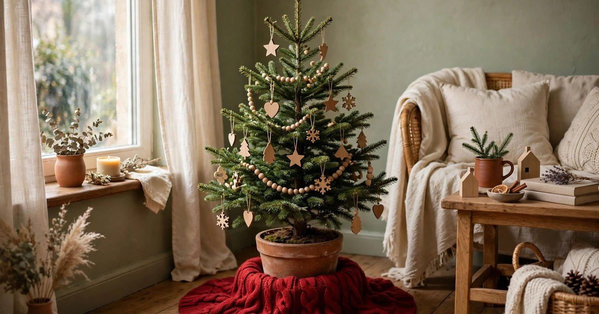
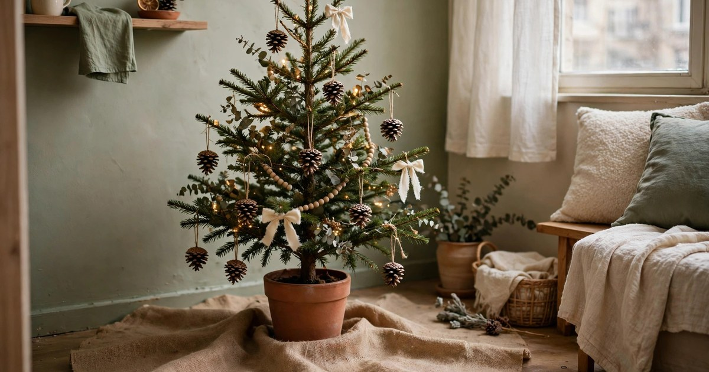
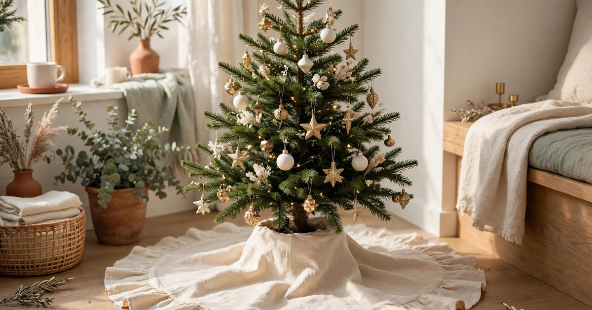
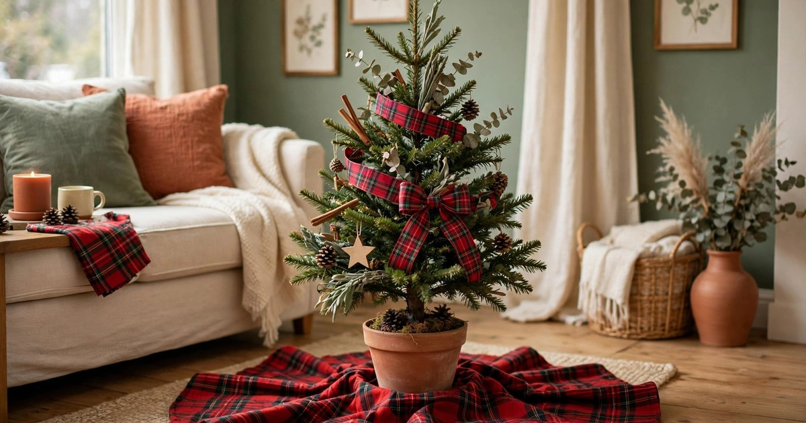
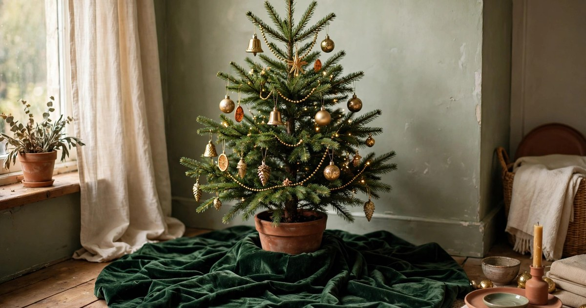
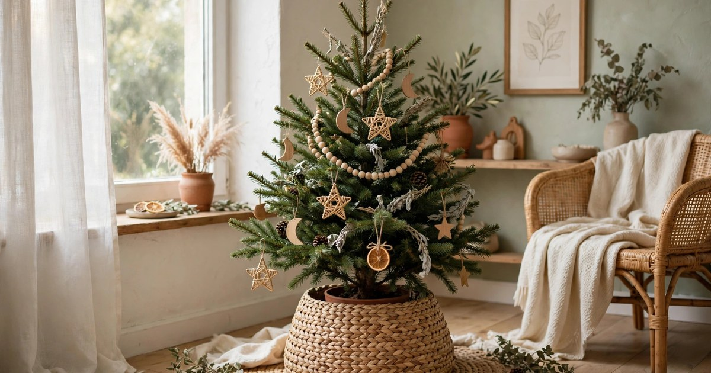
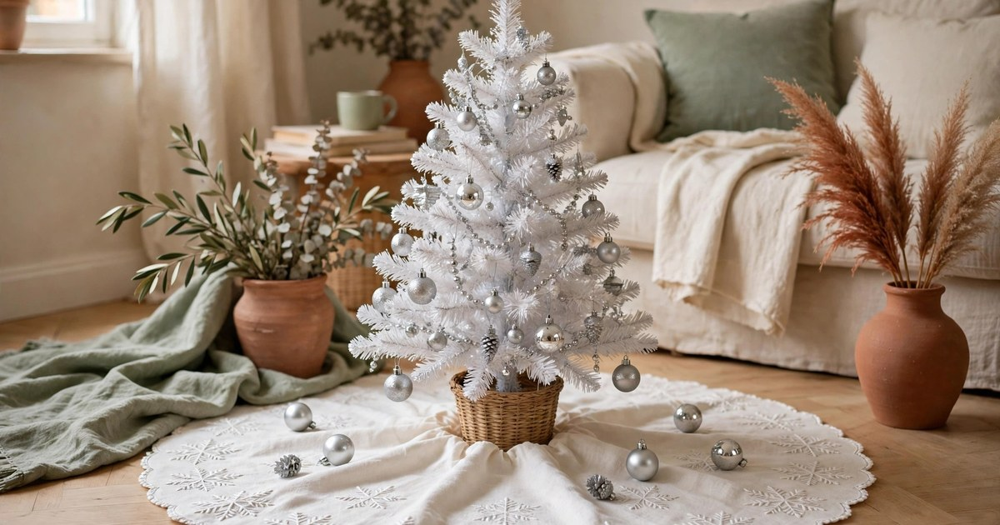
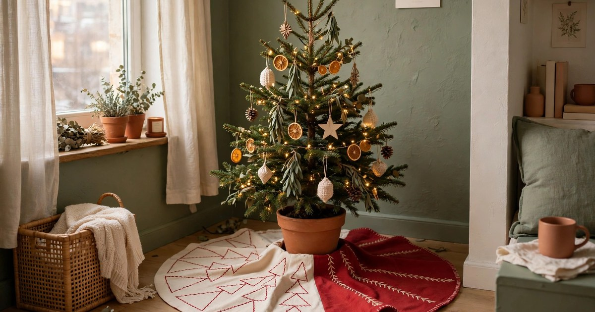

A tree skirt is the cheapest way to make a small Christmas tree look finished. It hides the stand, covers the tangle of wires, catches the fallen needles and gives the whole tree a base that looks intentional instead of improvised. A good skirt costs less than a string of lights, fits a tree of any size by folding or tucking, and works just as well under a mini tree on a table as under a six-foot tree in the corner. Every skirt in this roundup costs $25 or less, and each one was chosen for a small space first: light, easy to store flat, and simple enough to suit a rented home.

Measure before you buy: a skirt of 75 to 90 centimetres suits a small or mini tree, while anything larger will bunch up and swallow the presents. Pick a fabric that matches your room, lay it flat under the tree, and the tree is dressed.

## 1. Classic Red Knit Tree Skirt

A red knit tree skirt is the original, and it is still the best: chunky cable knit, a warm festive red, and a texture that makes a small tree look like it belongs in a much bigger house. Knit skirts cost $18–25, fold flat for storage, and survive being washed on a gentle cycle if a candle drips or a drink spills. Nothing looks more like Christmas morning than a red knit skirt with presents stacked on it.

**Why it works:** The knit texture adds warmth and a handmade feel, and the red anchors the whole tree so the ornaments have something to sit against.

**Where it fits:** A traditional or farmhouse-style flat, under a small tree with warm white lights and wooden ornaments.

[Shop red knit tree skirts](https://www.amazon.com/s?k=red+knit+christmas+tree+skirt&tag={{AMAZON_TAG}})

## 2. Faux Fur White Tree Skirt

A white faux fur tree skirt turns a small tree into a snow scene. Soft, plush and gloriously over the top, it costs $20–25, hides the stand completely, and makes even a skinny artificial tree look full and expensive. Faux fur skirts are the easiest to style — just lay one down and the tree is done — and they photograph beautifully against dark floors and wooden furniture.

**Why it works:** The fur adds luxury and softness for very little money, and the white base makes coloured ornaments and warm lights stand out.

**Where it fits:** A modern or glam flat, under a tree with metallic ornaments and cool white lights, on a dark wood floor.

[Shop faux fur tree skirts](https://www.amazon.com/s?k=white+faux+fur+christmas+tree+skirt&tag={{AMAZON_TAG}})

## 3. Natural Burlap Tree Skirt

A burlap tree skirt is the rustic choice, and it is the cheapest on this list at $12–18. Natural jute fabric, a loose weave, a slightly rough texture that looks like it came from a farmhouse rather than a shop. Burlap skirts suit flats that already have wood, wicker and natural textures, and they are tough enough to survive a cat, a toddler and a vacuum cleaner without showing a mark.

**Why it works:** Burlap adds texture and a natural, unfussy character that makes a small tree look grounded rather than dressed up.

**Where it fits:** A rustic or boho flat, under a tree with pinecone, wooden and dried orange ornaments.

[Shop burlap tree skirts](https://www.amazon.com/s?k=burlap+christmas+tree+skirt&tag={{AMAZON_TAG}})

## 4. Cream Linen Tree Skirt

A cream linen tree skirt is the quiet luxury option: plain, soft, and calm enough to let the tree do the talking. Linen skirts cost $20–25, wash well, and suit flats where the Christmas palette is cream, sage and gold rather than red and green. A linen skirt also works all winter — take the tree away in January and it still looks right under a plant stand or a basket.

**Why it works:** It is understated and elegant, and the neutral colour means it works with any ornament palette, year after year.

**Where it fits:** A calm, modern or Scandinavian-style flat, under a tree with white, gold and wooden ornaments.

[Shop cream linen tree skirts](https://www.amazon.com/s?k=cream+linen+christmas+tree+skirt&tag={{AMAZON_TAG}})

## 5. Plaid Flannel Tree Skirt

A plaid flannel tree skirt is Christmas in fabric form: red and green checks, soft brushed cotton, and a pattern that needs no other decoration. Plaid skirts cost $15–22, feel wonderfully warm underfoot, and match the throws and cushions most flats already have in winter. If your tree is plaid-adjacent — tartan ribbon, checked stockings, flannel pyjamas — this skirt ties the whole room together.

**Why it works:** Plaid is instantly festive, the flannel is soft and warm, and the pattern hides stains and needle drops better than any plain fabric.

**Where it fits:** A cosy, traditional flat, under a tree with tartan ribbon and warm white lights, near a fireplace alternative or a stack of books.

[Shop plaid tree skirts](https://www.amazon.com/s?k=plaid+flannel+christmas+tree+skirt&tag={{AMAZON_TAG}})

## 6. Velvet Green Tree Skirt

A deep green velvet tree skirt is the most dramatic option under $25, and it costs $20–25. Rich emerald or forest green velvet catches the light, looks far more expensive than it is, and makes gold and brass ornaments glow. Velvet skirts are heavier than the others on this list, so they sit flat and stay put, which matters in a small flat where the tree gets bumped every time someone walks past.

**Why it works:** Velvet adds depth, richness and a jewel tone that makes a small tree look like a deliberate design choice rather than a compromise.

**Where it fits:** A glam or neo deco flat, under a tree with gold, brass and jewel-toned ornaments.

[Shop velvet tree skirts](https://www.amazon.com/s?k=green+velvet+christmas+tree+skirt&tag={{AMAZON_TAG}})

## 7. Woven Seagrass Tree Skirt

A woven seagrass tree skirt is the boho choice: natural fibres, a basket-like weave, and a texture that looks like it was made by hand. Seagrass skirts cost $18–25, hold their shape beautifully, and suit flats with rattan, wicker and plants — which is to say, most rented flats. They are also the sturdiest skirt on this list, doubling as a basket for presents or a cover for an ugly tree stand.

**Why it works:** The woven texture adds craft and warmth, and the natural colour works with any ornament palette without competing with it.

**Where it fits:** A boho or coastal flat, under a tree with dried orange, wooden and rattan ornaments, near a basket of throws.

[Shop woven tree skirts](https://www.amazon.com/s?k=woven+seagrass+christmas+tree+skirt&tag={{AMAZON_TAG}})

## 8. Snowflake Embroidered Tree Skirt

A snowflake embroidered tree skirt is the pretty one: white or cream fabric with stitched snowflakes, sometimes with a little sparkle, always with a winter feel that is not tied to Christmas itself. Embroidered skirts cost $18–25 and work from the first week of December until the tree comes down, and they suit flats where the tree is white, silver or flocked rather than green. The embroidery catches the light and gives a plain tree a reason to be looked at from below.

**Why it works:** The snowflake pattern adds detail without colour, so it suits white and silver trees and flats that prefer a snowy palette over a red one.

**Where it fits:** A bright, modern flat, under a white or flocked tree with silver and white ornaments.

[Shop snowflake tree skirts](https://www.amazon.com/s?k=snowflake+embroidered+christmas+tree+skirt&tag={{AMAZON_TAG}})

## 9. Reversible Two-Tone Tree Skirt

A reversible two-tone tree skirt is the smart buy: red on one side, cream or green on the other, so one skirt gives you two looks for the price of one. Reversible skirts cost $20–25, and they are the best choice for renters who change their palette every year or who are not sure which colour suits their flat yet. Flip it in December, flip it back next year, and the tree looks new both times.

**Why it works:** Two skirts for the price of one, and the flexibility to change the room's palette without buying anything new.

**Where it fits:** Any small flat, under any small tree — flip to red for a traditional Christmas, to cream for a calm modern one.

[Shop reversible tree skirts](https://www.amazon.com/s?k=reversible+christmas+tree+skirt&tag={{AMAZON_TAG}})

## Frequently Asked Questions

### What size tree skirt do I need for a small tree?

A skirt of 75 to 90 centimetres suits a small or mini tree. Measure the widest point of your tree's branches and add about 15 centimetres — the skirt should peek out from under the branches, not disappear beneath them.

### Can I use a tree skirt under a mini tree on a table?

Yes. Fold a full-size skirt in half or quarters, or choose a 60-centimetre skirt made for tabletop trees. The skirt hides the pot or stand and stops needles and glitter from reaching the table.

### How do I keep a tree skirt flat under the tree?

Lay it flat before you put the tree up, then set the stand in the centre and smooth the fabric outwards. Heavier fabrics like velvet and seagrass sit flat on their own; lighter fabrics can be weighted with a few presents.

### Do tree skirts work with artificial trees?

They work even better — artificial trees have the ugliest stands, and a skirt hides them completely. A skirt also catches the small plastic needles artificial trees shed, which saves vacuuming.
