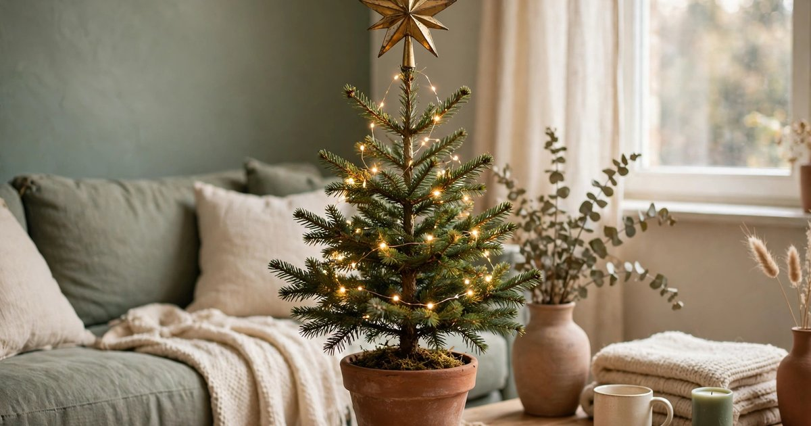
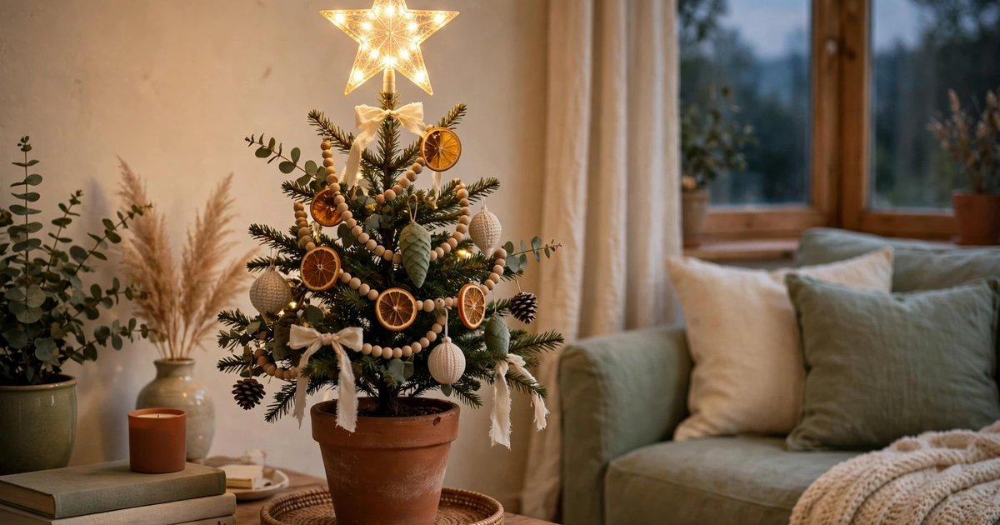
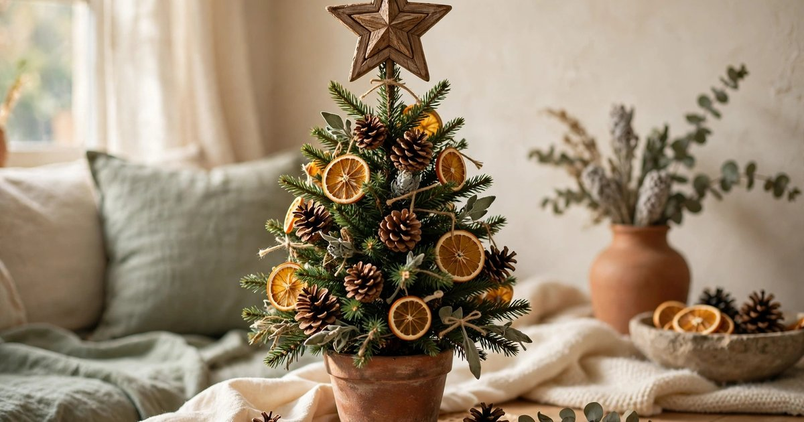
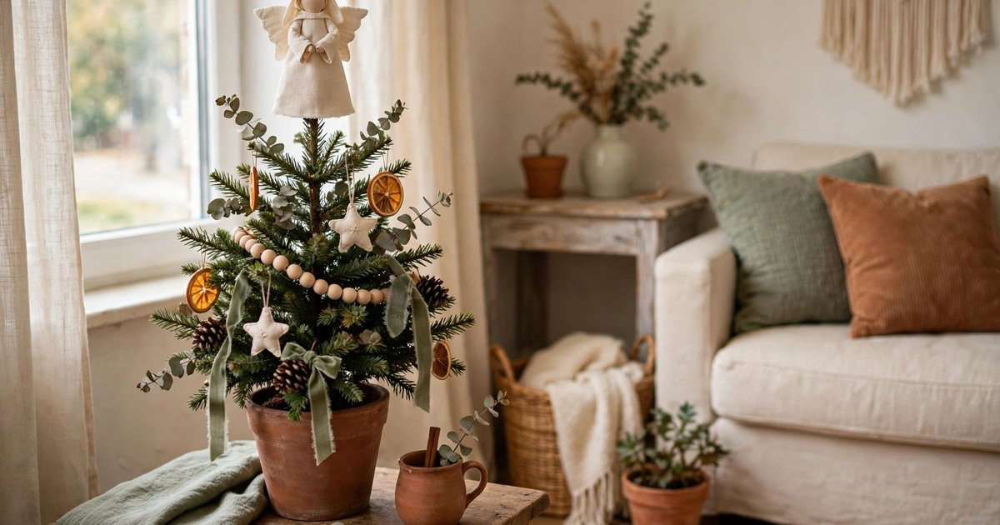
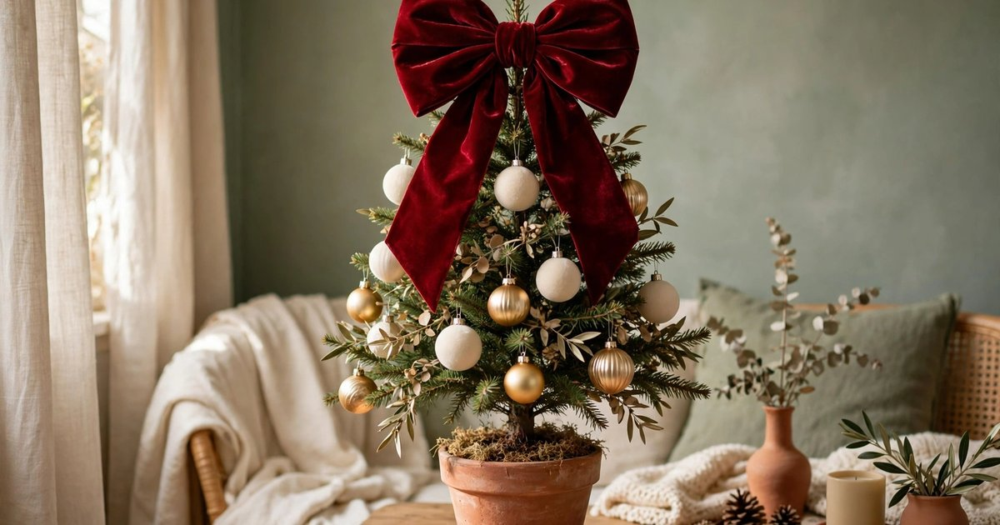
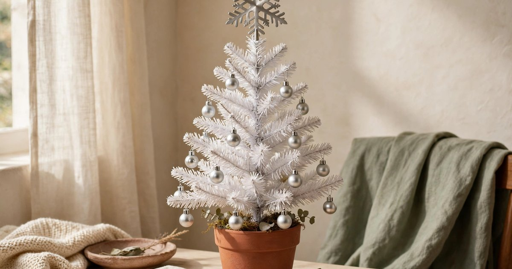
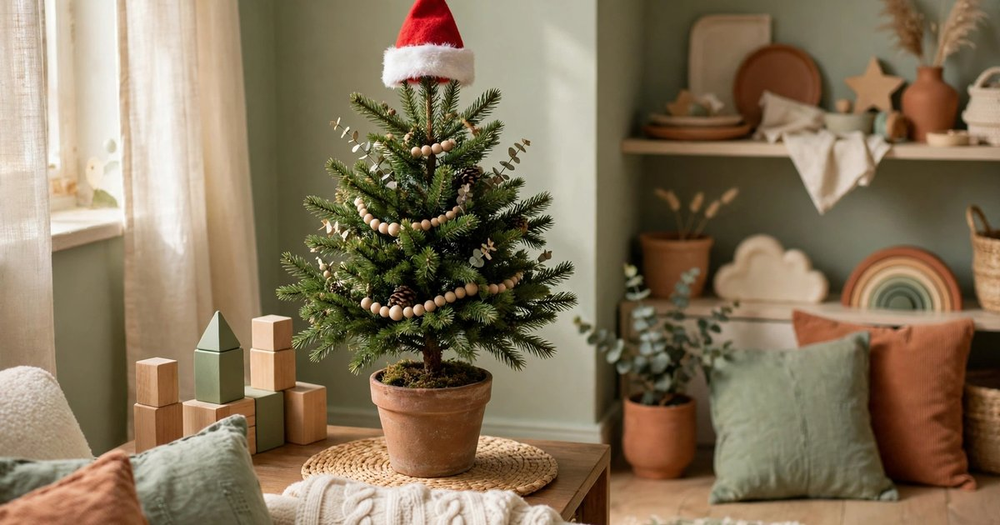
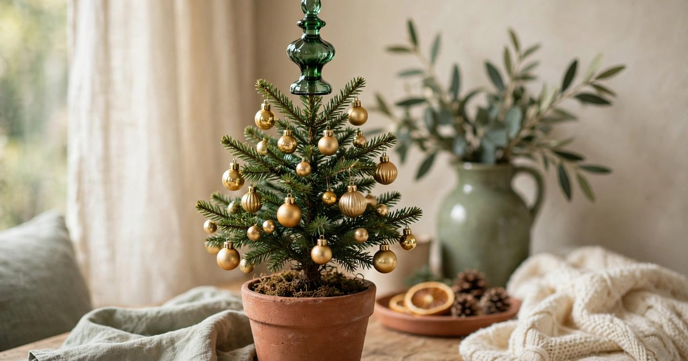
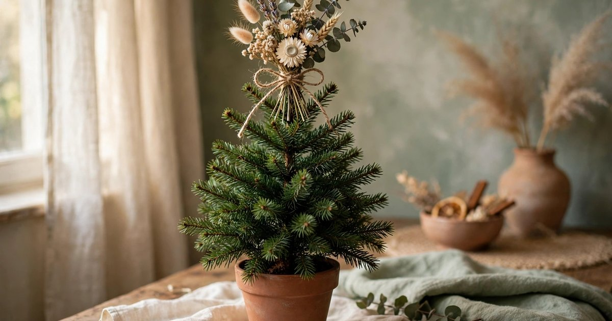

The tree topper is the last thing you put on the tree and the first thing your eye finds when you walk into the room — which is why it is worth choosing deliberately rather than grabbing whatever is left in the box. On a small or tabletop tree the topper matters even more: there is less tree to look at, so the topper carries a bigger share of the whole display, and a topper that is too big or too heavy will pull a small tree over.

Every topper below costs under $25, suits a small or tabletop tree, and is light enough not to bend the top branch. Each pick includes a why-it-works note and a where-it-fits note. If your tree is still undecided, our guide to [keeping a real Christmas tree alive in a small apartment](/keep-real-christmas-tree-alive-small-apartment-guide/) and our roundup of [battery Christmas candles](/battery-christmas-candles-small-apartments-under-20/) will help you finish the rest of the tree too.

## 1. Classic gold metal star

The classic: a five-pointed star ($8–15) in brushed or polished gold metal, light enough for a tabletop tree and bright enough to catch the fairy lights below it. A metal star is the safest choice for a small tree because it is hollow and feather-light, and the gold reads as warm rather than flashy against green branches. Look for one with a cone or clip base that grips the top branch, so it stays upright instead of listing to one side.

**Why it works:** the star is the shape everyone expects at the top of a tree, so it makes even a small tree feel finished and traditional, and the metal catches the light from the room in a way a fabric topper cannot.

**Where it fits:** any small or tabletop tree, especially one with warm-white lights and gold or cream baubles. [Shop gold metal star tree toppers](https://www.amazon.com/s?k=gold+metal+star+christmas+tree+topper+small&tag={{AMAZON_TAG}})

## 2. Light-up LED star topper

A light-up star ($12–20) has tiny LEDs built into the points, so the topper glows on its own — no need for a string of lights to reach the very top of the tree. Battery-powered versions are the best choice for a small tree, because there is no wire trailing down the branches and no plug to hide. Choose warm white rather than multicolour, and check the battery compartment is easy to reach once the star is on the tree.

**Why it works:** the glow at the top of the tree draws the eye upward and makes the whole tree look taller than it is, which is exactly what a small tree needs, and it doubles as a night light in a dark corner.

**Where it fits:** a small tree in a dark corner, a tabletop tree on a sideboard, or any tree where the lights do not quite reach the top. [Shop LED star tree toppers](https://www.amazon.com/s?k=led+light+up+star+christmas+tree+topper+battery&tag={{AMAZON_TAG}})

## 3. Rustic wooden star

A wooden star ($7–14) — unfinished pine, reclaimed-looking, or whitewashed — is the topper for a tree decorated with natural materials. It is light, it will not bend a small branch, and it suits a tree dressed with pinecones, dried oranges and cinnamon sticks far better than a shiny metal star would. Look for one with a simple slot or clip base rather than a heavy metal fitting.

**Why it works:** the matte wood texture echoes the natural decorations below it, so the whole tree reads as one coherent idea rather than a tree with a shiny afterthought on top, and it is the easiest topper to make yourself if you enjoy a small craft project.

**Where it fits:** a natural or Scandinavian-style tree, a tree in a woven basket, or a tabletop tree in a kitchen or hallway. [Shop rustic wooden star tree toppers](https://www.amazon.com/s?k=rustic+wooden+star+christmas+tree+topper&tag={{AMAZON_TAG}})

## 4. Small fabric angel

A fabric angel ($10–18) is the softest option on this list, and the kindest to a small tree: it weighs almost nothing, it cannot scratch the branches, and it will not topple the tree if it is knocked. Choose a small one — under 15cm tall — in cream or soft gold, with a simple cone base that sits over the top branch like a hat. Avoid large angels with heavy wire wings; they belong on full-size trees.

**Why it works:** the angel's soft shape contrasts with the spiky branches below it, which makes the top of the tree feel gentle rather than sharp, and the fabric reads as handmade even when it is not.

**Where it fits:** a traditional tree, a tree in a child's bedroom, or any small tree where a metal topper would feel too cold. [Shop small fabric angel tree toppers](https://www.amazon.com/s?k=small+fabric+angel+christmas+tree+topper&tag={{AMAZON_TAG}})

## 5. Oversized velvet bow

A bow ($6–12) is the most forgiving topper of all: it has no rigid shape to keep upright, no weight to balance, and it can be tied, pinned or clipped onto the top branch in seconds. An oversized velvet bow in deep red, forest green or burgundy makes a small tree look deliberately styled rather than under-decorated, and the velvet catches the light beautifully. Buy one with wired edges so you can shape the loops, or make one from a length of wide ribbon.

**Why it works:** the bow softens the top of the tree and adds a large block of rich colour where a small tree needs it most, and it is the cheapest way to make a tree look finished — a good bow costs less than lunch.

**Where it fits:** any small tree, especially one with a modern or maximalist look, or a tree where a star or angel would feel too traditional. [Shop velvet bow tree toppers](https://www.amazon.com/s?k=velvet+bow+christmas+tree+topper+red&tag={{AMAZON_TAG}})

## 6. Snowflake topper in brushed silver

A snowflake ($9–16) in brushed silver or frosted white is the topper for a winter-white or silver-themed tree. The flat, open shape is very light, so it will not bend the top branch, and the snowflake reads as winter rather than specifically Christmas — which means the tree can stay up into January without looking out of season. Look for one with a clip base and a finish that matches your baubles.

**Why it works:** the snowflake's openwork shape lets light through it, so it glows rather than blocks, and its winter theme suits the many small white and frosted trees that are popular in apartments.

**Where it fits:** a white or frosted tree, a silver-and-white scheme, or a tree in a bedroom where a star would feel too bold. [Shop snowflake tree toppers](https://www.amazon.com/s?k=snowflake+christmas+tree+topper+silver&tag={{AMAZON_TAG}})

## 7. Miniature Santa hat topper

A miniature Santa hat ($5–10) is the playful pick: a small soft hat, often with a fluffy trim and a pom-pom, that sits on the top branch like the tree is wearing it. It is the lightest topper on this list, it costs almost nothing, and it makes a small tree feel fun rather than formal. It suits a tree decorated by children, a tree in a hallway, or a tree that is more joke than heirloom.

**Why it works:** the hat's soft shape and familiar silhouette make the tree feel friendly and approachable, and it is the one topper that needs no fitting at all — it simply sits on the top branch.

**Where it fits:** a child's bedroom tree, a playful or novelty tree, or a tabletop tree in a shared flat. [Shop mini Santa hat tree toppers](https://www.amazon.com/s?k=mini+santa+hat+christmas+tree+topper&tag={{AMAZON_TAG}})

## 8. Glass finial topper

A glass finial ($14–24) — a long, tapered glass spike in deep green, gold or burgundy — is the elegant choice, and the traditional topper for a tree with glass ornaments. The narrow shape suits a small tree because it adds height without adding width, and the glass catches the fairy lights from every angle. Choose a small finial designed for tabletop trees, and handle it carefully: it is the only topper on this list that can break if it falls.

**Why it works:** the finial's vertical line extends the tree's silhouette upward, making a small tree look taller and more graceful, and the glass ties the topper to the glass baubles below it.

**Where it fits:** a tree with glass ornaments, a formal or traditional scheme, or a small tree on a sideboard where it will be seen at eye level. [Shop glass finial tree toppers](https://www.amazon.com/s?k=glass+finial+christmas+tree+topper+small&tag={{AMAZON_TAG}})

## 9. Dried flower and eucalyptus topper

A bundle of dried eucalyptus, dried flowers and a few sprigs of pine ($8–15 as a ready-made bundle, or almost nothing if you make it) tied with twine and tucked into the top of the tree is the topper for a tree that is more botanical than traditional. It weighs nothing, it smells wonderful, and it suits a tree decorated with dried oranges, cinnamon and pinecones. Tie the bundle tightly, trim the stems to one length, and wedge it into the top branches so it fans out like a crown.

**Why it works:** the dried bundle echoes the natural materials on the tree and adds a soft, organic shape at the top, and it is the only topper on this list that is also a decoration you can reuse — the bundle works in a vase all winter.

**Where it fits:** a natural or bohemian tree, a tree with dried citrus decorations, or a small tree in a plant-filled room. [Shop dried eucalyptus bundles for tree toppers](https://www.amazon.com/s?k=dried+eucalyptus+bundle+christmas+decor&tag={{AMAZON_TAG}})

## Frequently asked questions

### What size tree topper do I need for a small tree?

For a tabletop tree under 90cm, choose a topper under 15cm tall and as light as possible — fabric, wood, or hollow metal. A topper taller than 15cm will overwhelm a small tree, and a heavy one will bend the top branch or pull the tree over.

### How do I keep a tree topper from falling off a small tree?

Use the topper's clip or cone base to grip the top branch, and trim the top few centimetres of the tree so the branch is short and stiff rather than long and floppy. For a bow or a dried bundle, tie it on with twine. Never tape a topper to the tree — the tape leaves residue on the branches.

### Can I use a regular tree topper on a tabletop tree?

Usually not — most full-size toppers are too heavy and too tall. A tabletop tree needs a topper designed for small trees, or a lightweight option like a bow, a fabric angel, or a dried bundle. If you love a full-size topper, check its weight first: if it bends the branch when you hold it up, it will bend it on the tree.

### What is the cheapest tree topper that still looks good?

An oversized velvet bow, at $6–12, is the cheapest topper that looks deliberate rather than improvised. A dried eucalyptus bundle is cheaper still if you make it yourself, and a wooden star is the best value in a traditional shape.

### When should I put the tree topper on?

Last, after the lights and the baubles are on — the topper is the finishing touch, and putting it on first means reaching over it for the rest of the decorating. Take it off first when you undecorate, and store it in its own box or wrapped in tissue so it survives until next year.
