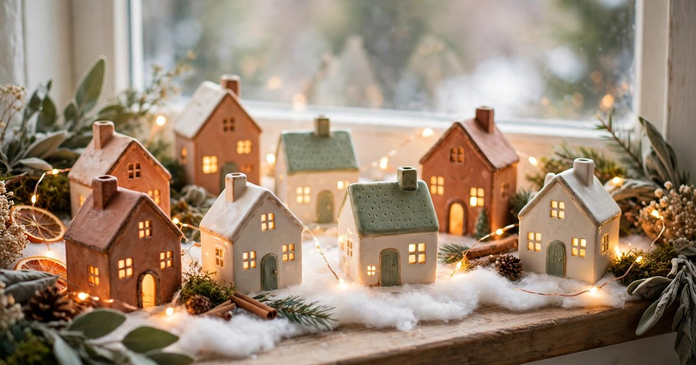
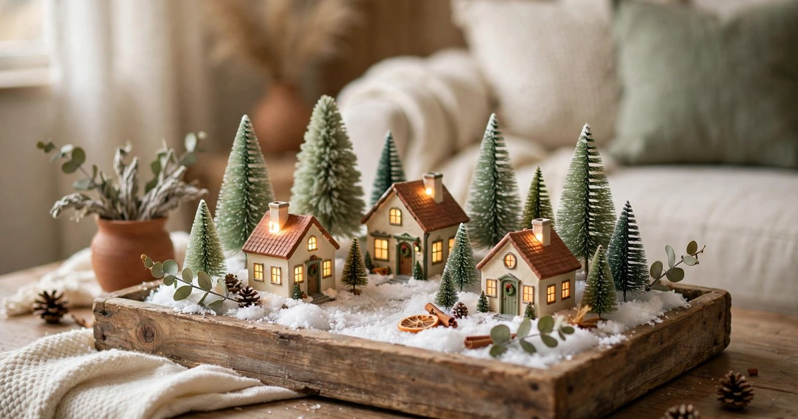
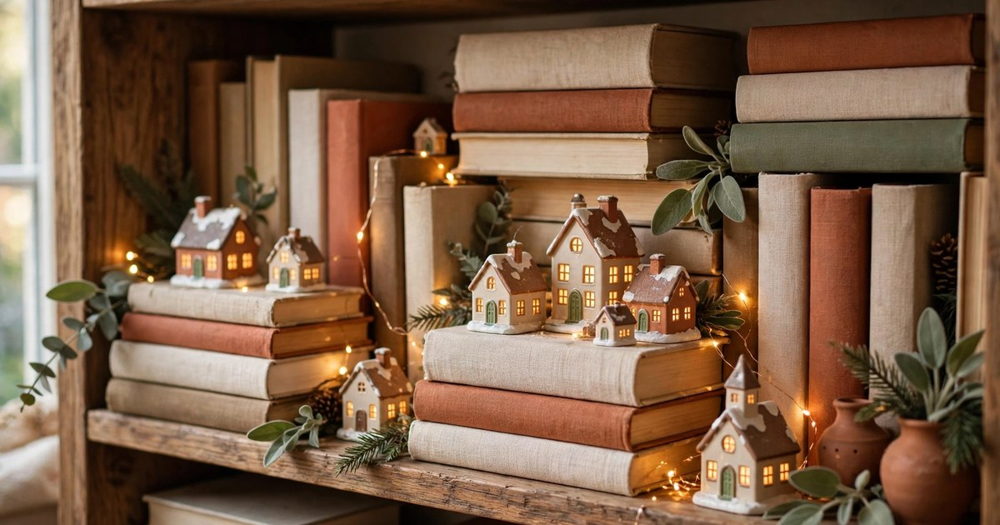
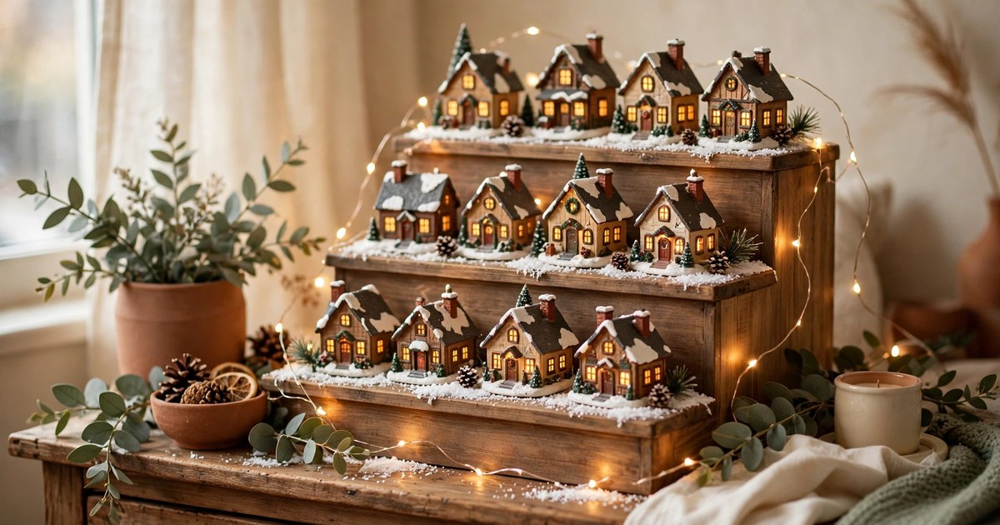
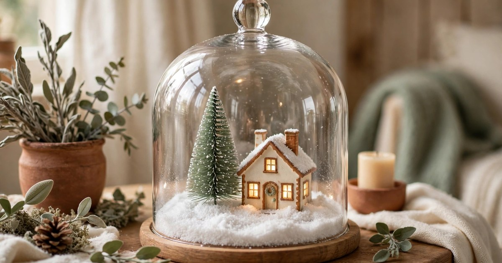
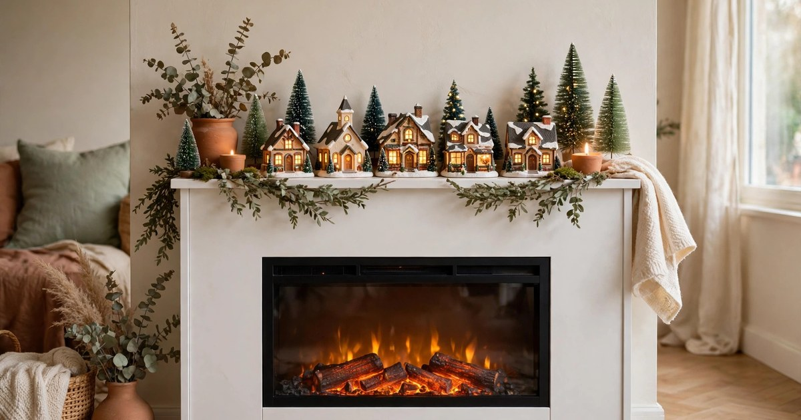
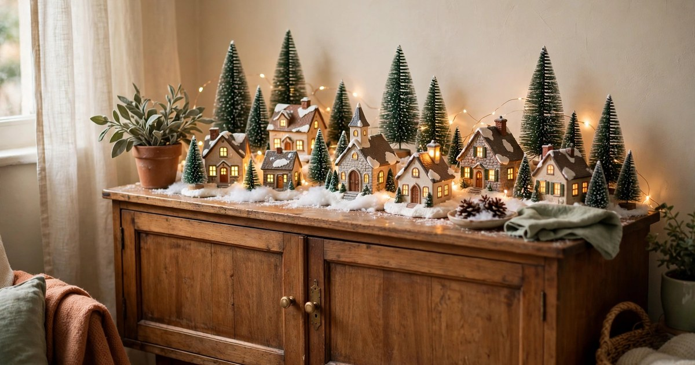
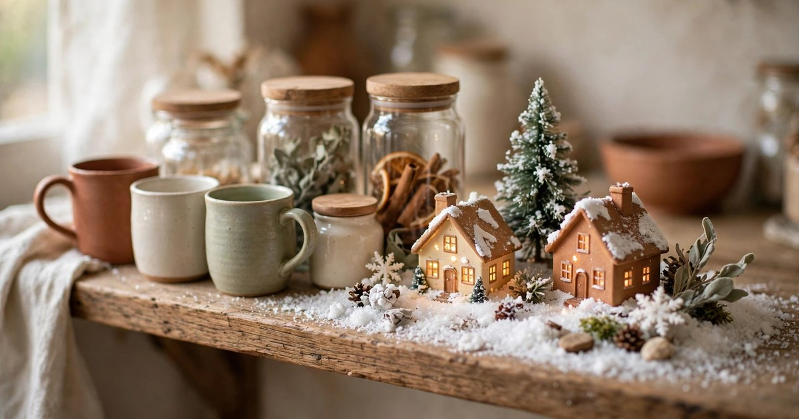
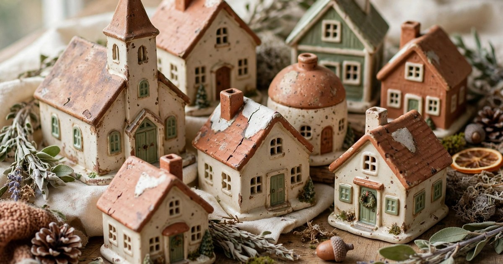
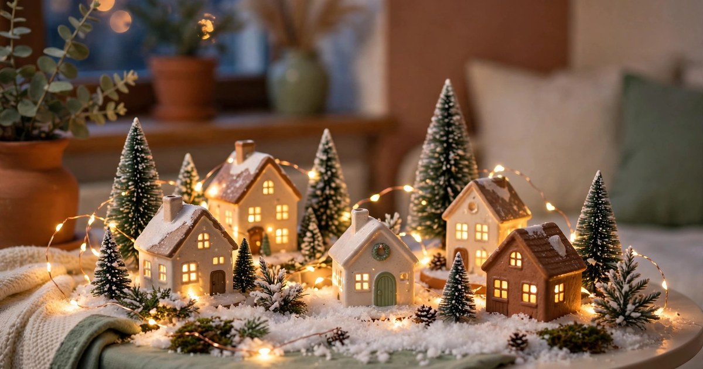

There is something quietly magical about a miniature Christmas village. Tiny lit windows, a dusting of fake snow, a little church on a hill — it turns an ordinary corner of a flat into a scene from a storybook. The trouble is that most village displays you see online sprawl across a whole dining table or a six-foot mantelpiece, and neither of those exists in a rented one-bedroom flat.

The good news is that a village does not need a grand stage. In fact, miniature houses look better when they are grouped tightly, because the eye reads a small cluster as one charming scene rather than a scattering of ornaments. A windowsill, a tray, a single shelf — each one is enough, provided you choose the right houses, the right base and the right light. Every idea below is renter-friendly, which means no nails, no screws and no damage to the walls, and budget-first, which means charity-shop finds, pound-shop lights and pieces you already own doing most of the work.

Start small, start cheap, and build your village a few houses at a time. By the second year you will have a collection that feels personal, and none of it will have cost more than a takeaway or two.

### 1. The Windowsill Village

The windowsill is the natural home for a miniature village, because it already has what a display needs: a long, narrow ledge, daylight from one side and a dark window behind it in the evening that makes every lit window glow. Begin by lining the sill with a length of white felt or a folded tea towel to stand in for snow — it also protects the paintwork from scratches and stops the little houses sliding about. Place the tallest building, usually the church or the tallest house, at one end so the eye has somewhere to land, then step the houses down in height towards the other end.

A battery string of warm-white fairy lights woven between the houses does the heavy lifting here. Because there is no plug socket near most windowsills, battery lights are the practical choice, and a set with a timer means you never have to remember to switch them off. Keep the palette simple — cream, terracotta and sage — and let the lights, not a tangle of colour, create the atmosphere. If your windowsill is narrow, choose houses no deeper than about 10 centimetres, and leave a hand's width clear at the front so you can still open the window for fresh air. For more ways to dress the glass itself, see our [Christmas window decor ideas](/christmas-window-decor-ideas/).

### 2. A Tray Village You Can Move in Seconds

A tray village is the cleverest trick in this whole list, because it solves the two problems that put renters off a village display: where to put it, and what to do with it when guests come round. Everything sits on one wooden tray — the houses, a pinch of fake snow, a few bottle-brush trees — and the whole scene lifts off the coffee table and onto a shelf in under ten seconds. A tray with a raised edge works best, since it keeps the snow and the smallest pieces contained.

Build the scene from the back forward, tallest at the back, smallest at the front, and tuck a battery light string under the snow layer so the glow seems to come from inside the scene itself. A plain wooden tray from a charity shop costs a pound or two and looks far more expensive than a plastic one once the village is on it. Choose a tray that fits your coffee table with room to spare for a mug, or one that slides neatly onto a bookshelf when the table is needed for dinner. The beauty of the tray is that the village never has to be dismantled — it simply relocates, whole and unbroken, until January.

### 3. The Bookshelf Village

A bookshelf village is the easiest display to build in a small flat, because the shelf is already there, already at eye level, and already styled. Clear one shelf of books — just one — and treat it as your village plot. Lay a strip of white felt along the shelf, then arrange five or six houses in a loose row, using a stack of books laid on their sides as a second, higher level for the church or the tallest cottage. The books themselves become part of the scenery, like little hills.

The trick is restraint. A shelf packed edge to edge looks cluttered, while a shelf with breathing room looks curated. Leave a gap at each end, and let one or two books stay upright at the sides like bookends. Battery fairy lights tucked behind the houses cast a warm glow onto the shelf above, which makes the whole bookcase feel festive without a single extra decoration. Our guide to [Christmas bookshelf styling for small apartments](/small-apartment-christmas-bookshelf-styling-ideas/) has more ideas for dressing the shelves around the village. When January comes, the houses go back in their box and the books go back on the shelf, with nothing to repair and nothing to repaint.

### 4. Stair-Step Shelves on a Spare Wall

A stair-step display is a small set of wooden steps — the kind sold for spice jars or plant pots — that turns a flat shelf into a little hillside. Each step lifts one row of houses above the one in front, so every tiny window is visible instead of hidden behind its neighbour. It is the single best buy for a village collector, and a three-tier bamboo step set costs less than a tenner online or at a discount homeware shop.

Set the steps on a sideboard, a chest of drawers or the top of a bookcase, anywhere with about 30 centimetres of depth. Put the church or the tallest house on the top step, medium houses in the middle and the smallest cottages and trees at the front. Because the steps are freestanding, there is nothing to fix to the wall — no hooks, no nails, no adhesive strips to peel off in January. A length of battery fairy lights draped along the back of the steps ties the rows together and makes the whole hillside glow after dark. If you only buy one thing for your village this year, make it the step set: it makes even three houses look like a proper scene.

### 5. A Cloche Village Under Glass

A cloche village is a whole scene under a glass dome, and it is perfect for small flats for two reasons: it keeps dust off the houses, and it turns three little buildings into a display that looks deliberate and expensive. All you need is a glass cloche — the dome-shaped cover sold for cakes and cheese — and a wooden board or a plate to sit it on. Scatter fake snow on the board, place one or two houses and a bottle-brush tree inside, and lower the dome over the top.

The glass does something lovely to the light, softening the glow of a battery tea light or a tiny fairy light tucked inside. Because the scene is sealed, it is also the safest village for homes with cats or small children, since nothing can be knocked over or chewed. Look for cloches in charity shops, where glass domes turn up regularly for a pound or two, or use a large glass vase turned upside down over a plate if you already own one. One cloche on a side table, a bedside table or a hallway console is enough — you do not need a collection of them. It is the smallest village in this list and, arguably, the prettiest.

### 6. The Mantel-Free Fireplace Village

Most rented flats have no fireplace, and those that do often have a mantelpiece too narrow or too high to use. The mantel-free village works around that entirely: it uses the top of a small electric heater, a radiator cover, a low bookcase or even the top of the television unit as its mantel. The principle is the same — a long, low ledge at roughly waist height — but the furniture is already in the room, so nothing needs buying or fixing.

Keep the display shallow, with a single row of houses and a few trees, so it never feels like it is taking over the room. A strip of felt protects the surface underneath, and a battery light string along the back edge gives the whole row a warm halo in the evening. Never place a village on a radiator that gets hot, and keep houses and lights well away from any real flame or heat source. If your flat has a decorative fireplace surround with no fire in it, the hearth itself makes a wonderful village plot — the houses sit inside the opening like a tiny street, and the surround frames them beautifully. Either way, you get the mantelpiece moment without the mantelpiece.

### 7. The Sideboard or Console Village

The sideboard is the unsung hero of small-flat Christmas decorating. It is wide, it is at the perfect height, and it is usually the first thing you see when you walk into the living room. A village along the back of a sideboard, with the front of the surface left clear for everyday things, gives you a full display without losing a single centimetre of usable space. Start with the houses at the back, add a row of bottle-brush trees in front of them, and finish with a scattering of fake snow and a few tiny figures if you have them.

Because the sideboard is furniture you already own, this display costs almost nothing beyond the houses themselves. A mirror or a framed print hung above the sideboard bounces the fairy-light glow around the room, which makes a small village feel twice as bright. If your sideboard doubles as a drinks station or a work surface at Christmas, keep the village to one end — even three houses and a tree, grouped tightly, read as a village when they are lit. The rest of the surface stays free, the village stays put, and nobody has to move it to find the remote control.

### 8. The Kitchen Shelf Village

The kitchen is the last place most people think to put a Christmas village, which is exactly why it works so well. A single open shelf above the worktop, a spare stretch of counter beside the kettle, or the top of the fridge can hold a tiny scene that greets you every morning while the kettle boils. Keep it very small — two or three houses, a tree, a pinch of snow — because kitchen surfaces earn their keep and the village must not get in the way of cooking.

Choose houses with a wipe-clean ceramic glaze rather than felt or fabric finishes, since kitchens are steamy places, and keep the display well away from the hob and the sink. Battery fairy lights are the only sensible choice here, with no trailing cables near water. A village on a kitchen shelf also solves the problem of what to do with the houses you love but cannot fit into the main display: give them their own little outpost. It costs nothing, it takes five minutes, and it makes the most-used room in the flat feel festive from the first cup of tea of the day.

### 9. The Budget Village: Charity Shops and Pound-Shop Finds

The most charming villages are rarely bought in one go. They are built slowly, one charity-shop house at a time, and they look better for it, because no two houses match and the whole scene feels collected rather than purchased. Start in November, when charity shops put out their Christmas stock: ceramic cottages, little churches and resin houses regularly turn up for one to three pounds each. Check the base of each one for a battery compartment, since lit houses are the ones that glow so beautifully after dark.

Fill the gaps with pound-shop finds: a bag of fake snow for a pound, a set of bottle-brush trees for two pounds, a string of battery fairy lights for a pound or two. The houses are the only part worth spending on, and even those can be found cheap if you are patient. Avoid buying a boxed village set all at once unless it is genuinely good value — a set of identical houses looks flat, while a mixed collection looks like a real place. Give yourself a budget of fifteen to twenty pounds for the first year, and add one or two houses each Christmas after that. In three years you will have a village nobody else owns.

### 10. Battery Fairy Lights and Easy Storage After Christmas

A village is only as good as its lighting, and in a rented flat that means battery fairy lights. They need no socket, no extension lead and no cable snaking across the floor, and a set with a built-in timer switches itself off after six hours, which saves batteries and worry. Warm white is the colour to choose — cool white looks stark against terracotta and cream — and twenty lights are plenty for a small display. Weave the string behind the houses rather than in front of them, so the glow spills out from between the buildings instead of dazzling the eye.

Storage is the part everyone forgets until Twelfth Night, so plan it now. Wrap each house in a square of tissue paper or an old tea towel, pack them upright in a sturdy box with the trees and the snow in a labelled bag, and keep the batteries out of the compartments so they cannot leak over the summer. A single shoebox holds a small village easily, and because you built the display on a tray or a felt base, the whole scene can be lifted into the box in one piece. Our guide to [storing Christmas decor in a small rental](/store-christmas-decor-small-rental-ideas/) covers the rest. Come next November, the box opens, the lights go on, and the village is back — a little bigger, if you found a new house in the meantime. For glow without any flame at all, see our [battery Christmas candles for small apartments](/battery-christmas-candles-small-apartments-under-20/).

## Frequently Asked Questions

### How many houses do I need for a small-space Christmas village?

Three to six houses are plenty for a small flat. A single church or tall house, two or three cottages and a tree or two make a complete scene on a windowsill, a tray or a shelf. Start with a few pieces and add one or two each year rather than buying a large boxed set all at once.

### Can I put a Christmas village on a windowsill without damaging the paint?

Yes, provided you protect the surface first. Lay a strip of white felt, a folded tea towel or a length of wrapping paper under the houses to stop them scratching the paint and to catch any fake snow. Battery lights mean no cables, and nothing needs to be stuck or nailed down, so the sill is exactly as you found it in January.

### Are battery fairy lights safe to leave on around a miniature village?

Battery fairy lights are the safest option for a village display, because they run cool and use no mains power. Choose LED lights on a timer so they switch off automatically, keep them away from real candles, and remove the batteries when you pack the village away so they cannot leak over the summer.

### Where can I find cheap miniature Christmas village houses?

Charity shops are the best source, with ceramic and resin houses often priced at one to three pounds each from November onwards. Pound shops and discount homeware stores sell the trees, snow and lights, while online marketplaces are useful for filling gaps — but always check that a second-hand house still has its battery compartment and working light before you buy it.

### How do I store a miniature Christmas village in a tiny flat?

Wrap each house in tissue paper or an old tea towel, pack them upright in a single sturdy box, and keep the trees, snow and lights in a labelled bag on top. Remove all batteries first, and store the box on top of a wardrobe or under the bed. A small village fits in one shoebox, so it takes up almost no space at all.
