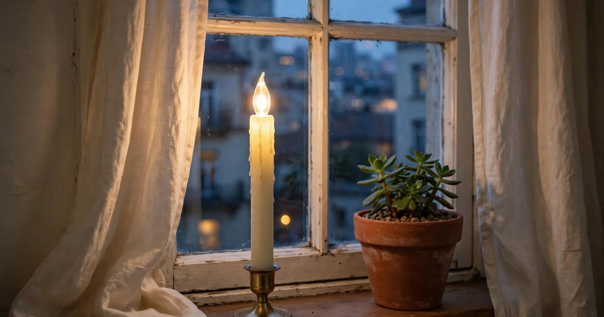
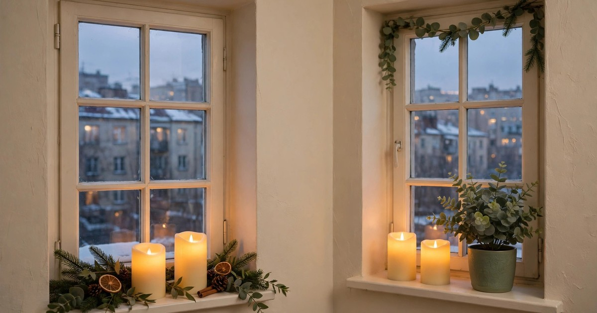
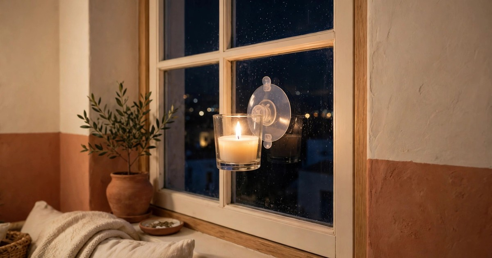
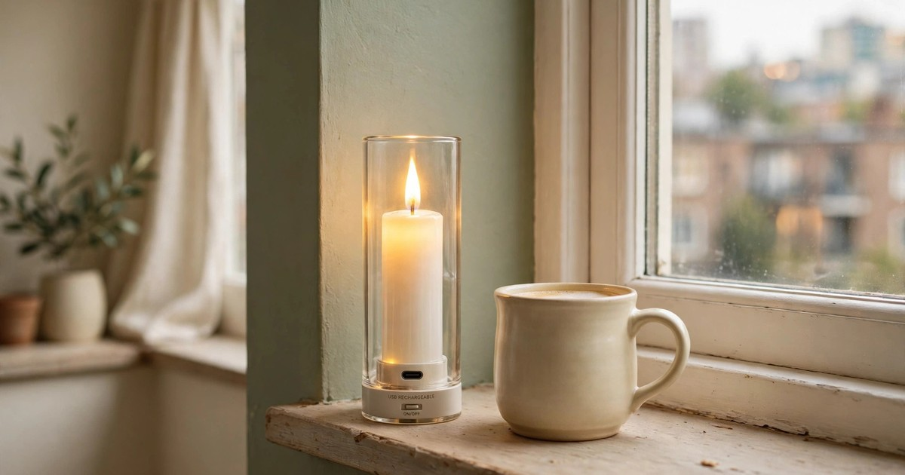

There is no faster way to make a small apartment feel like Christmas than a candle glowing in the window. One warm light in the glass turns a plain flat into the cosy house on the street, and from inside it does something just as good: it throws a soft amber glow across the room every evening, no matter how grey the weather is outside. The trick is choosing the right kind of window candle, because a real flame in a window is a terrible idea in a rented flat — curtains, draughts, a landlord's insurance clause — and that is exactly why flameless window candles exist.

Every candle below is battery-powered, flameless and under $25, which means no open flame, no wax dripping onto a painted sill, and no fixings that mark the wall. Most run on a timer, so they switch themselves on at dusk and off before bed, and most cost less than a takeaway. Each pick includes a why-it-works note and a where-it-fits note, so you buy the right candle for the right window rather than the prettiest one in the shop. If you are planning the rest of the room, our [Christmas window decor ideas](/christmas-window-decor-ideas/) show how these candles sit alongside garlands and wreaths, and our [battery Christmas candles](/battery-christmas-candles-small-apartments-under-20/) cover the pillar and taper candles that belong on shelves and tables rather than in the glass.

A note on price before you shop: window candles are sold in singles, pairs and sets of four or six, so always check whether the price is for one candle or the whole set. A set of four at $19.99 is a far better deal than a single candle at $12.99, and for most small flats a set of four covers every street-facing window you own. Buy the set, use two in the front windows, and keep the spares for the bedroom or the hallway.

## 1. Classic LED taper window candle with timer

The classic is a slim LED taper candle ($9–15 for a pair) in a warm-white finish, standing in a small base on the sill, with a built-in six-hour timer. Switch it on once at 5pm and it lights itself at the same time every evening, then switches off at 11pm while you are already asleep. No remote, no app, no remembering — the timer is the whole point, and it is the reason this is the best first window candle to buy.

**Why it works:** the taper shape reads as a real candle from the street, the warm-white LED is the closest match to a flame's colour, and the timer means the candle is lit exactly when it matters — at dusk, when people are walking past — and never left burning all night.

**Where it fits:** the living-room window that faces the street, a front-facing bedroom window, or any sill wide enough for a candle base. [Shop LED taper window candles](https://www.amazon.com/s?k=led+taper+window+candle+timer+christmas&tag={{AMAZON_TAG}})

## 2. Flameless pillar window candle set

A set of flameless pillar candles ($14–22 for four) is the value buy on this list. The pillars are short and squat, so they sit securely on a narrow sill, and the set gives you one candle per window instead of one candle you keep moving around. Many sets include a remote, so you can switch all four on from the sofa, and the pillars' wider flame reads beautifully from outside because there is more glowing surface to see.

**Why it works:** four candles for the price of two singles means every window glows, not just the front one, and the low, wide shape is the most stable candle you can put on a sill — a draught will not topple it the way a tall taper can.

**Where it fits:** flats with two or more street-facing windows, deep sills, or a wide bay window where a row of pillars looks deliberate. [Shop flameless pillar window candle sets](https://www.amazon.com/s?k=flameless+pillar+window+candles+set+christmas&tag={{AMAZON_TAG}})

## 3. Suction-cup window candle

A suction-cup window candle ($10–18 for a pair) sticks directly to the glass instead of standing on the sill, which solves the one problem every small flat has: a sill too narrow for a candle base. The suction cup holds the candle at eye level in the middle of the pane, where it is visible from the street and from the room, and it peels off in January without leaving a mark — the most renter-friendly mounting on this list.

**Why it works:** it frees the sill entirely, so the candle never competes with plants, books or a radiator cover for space, and the candle sits higher in the window, where it catches the eye of anyone walking past.

**Where it fits:** narrow sills, windows above radiators, kitchen windows, or any window where the sill is already full. Check the suction cup holds on your glass before December — clean the pane first and press firmly for thirty seconds. [Shop suction cup window candles](https://www.amazon.com/s?k=suction+cup+window+candle+christmas+led&tag={{AMAZON_TAG}})

## 4. Brass-look taper candle with a weighted base

A taper candle in a brass-look base ($12–20 for a pair) is the dressed-up version of the classic, and it is the pick for anyone whose Christmas scheme leans traditional. The brass base catches the candlelight and throws a warm glint across the sill, the weighted base keeps the candle upright even when the window is opened for air, and the whole thing looks like the candles in old Christmas films — which is exactly the feeling most of us are buying.

**Why it works:** the brass finish ties the window candle to every other warm metal in the room — picture frames, lamp bases, the kettle — so the window becomes part of the scheme instead of a lone decoration, and the weighted base is genuinely practical in a draughty flat.

**Where it fits:** living-room windows in traditional or Neo Deco schemes, windows with a garland draped along the sill, or beside a brass-framed mirror. [Shop brass base window candles](https://www.amazon.com/s?k=brass+base+led+window+candle+christmas&tag={{AMAZON_TAG}})

## 5. Remote-controlled set of four window candles

A remote-controlled set ($16–25 for four) is the lazy person's Christmas candle, and we mean that as a compliment. One small remote switches all four candles on and off, sets the timer, and often adjusts the brightness — so you never have to reach behind the curtains or climb over the sofa to switch a candle on. The remote usually works through walls, which means you can light the bedroom window from the living room.

**Why it works:** window candles live in the least reachable spots in a flat — behind curtains, behind the sofa, on a high sill — and a remote removes the daily faff entirely, which is the difference between candles you actually use all December and candles you light twice and forget.

**Where it fits:** any flat with more than two windows, high sills, or heavy curtains you do not want to disturb every evening. Keep the remote in the same spot every night or it will vanish by the second week of December. [Shop remote control window candle sets](https://www.amazon.com/s?k=remote+control+window+candles+set+of+4&tag={{AMAZON_TAG}})

## 6. Slim LED window candle for narrow sills

A slim LED window candle ($9–16 for a pair) is designed for the sills that most candles cannot stand on — the narrow ledges in older flats, the sills above radiators, the windows in converted buildings where the ledge is barely two inches deep. The base is barely wider than the candle itself, the centre of gravity is low, and the candle still gives you the full warm glow because the LED sits at the top where it can be seen.

**Why it works:** it solves a problem that stops many renters buying window candles at all — the sill is too narrow — and it does it without a suction cup or an adhesive, so there is nothing to fail and nothing to clean off in January.

**Where it fits:** narrow sills in Victorian or converted flats, windows above radiators, bathroom windows, or any ledge where a normal candle base would overhang. [Shop slim window candles narrow sill](https://www.amazon.com/s?k=slim+led+window+candle+narrow+sill&tag={{AMAZON_TAG}})

## 7. Flickering flame-effect window candle

A flickering flame-effect candle ($11–19 for a pair) is the one to buy if you have ever looked at a steady LED and thought it looked a little too perfect. The flame flickers and dances the way a real flame does, so from the street it is genuinely hard to tell the candle is electric — and from inside, the moving light makes the whole room feel alive in a way a steady glow never quite manages. Most have a steady mode too, for evenings when you want calm rather than theatre.

**Why it works:** the flicker is what sells the illusion, and the illusion is what makes a window candle feel like Christmas rather than like a light bulb — it is the single feature that most changes how the candle reads from outside.

**Where it fits:** the main street-facing window, where the flicker is most visible, or a window you can see from your favourite chair. Avoid placing it where a real draught hits it directly, or the flicker can look erratic rather than gentle. [Shop flickering flame window candles](https://www.amazon.com/s?k=flickering+flame+led+window+candle+christmas&tag={{AMAZON_TAG}})

## 8. USB-rechargeable window candle

A USB-rechargeable window candle ($15–24 for a pair) is the long-term buy. Instead of eating through AA batteries all December, it charges from any USB port — the same cable as your phone — and runs for eight to ten hours on a charge. Over a month of nightly use, that saves a surprising amount of money on batteries, and it means the candle never dims halfway through Christmas Eve because the batteries gave up.

**Why it works:** the running cost of a battery candle is the part nobody budgets for, and a rechargeable candle removes it entirely, while the USB charging means you can top it up in the same place you charge your phone, with no special charger to lose.

**Where it fits:** windows you light every single night, flats where you already charge everything by USB, or as the one premium candle in the front window while cheaper battery candles fill the rest. [Shop USB rechargeable window candles](https://www.amazon.com/s?k=usb+rechargeable+led+window+candle&tag={{AMAZON_TAG}})

## 9. Colour-changing window candle set

A colour-changing window candle set ($14–23 for four) is the playful pick, and it earns its place because it does two jobs: warm white for the classic Christmas look, and a soft red or green for the nights you want the windows to feel festive rather than formal. Most sets cycle through colours on a remote or a button on the base, so you can match the windows to the rest of your decor — red when the tree is up, warm white when the garland goes on the mantel.

**Why it works:** it is the only candle on this list that changes with the season, so the same purchase works for Christmas, for New Year, and for any winter evening when you want colour in the window — and children love choosing the colour each night, which makes it a small family ritual.

**Where it fits:** family flats, windows above the dining table, or any home where the Christmas scheme uses colour rather than neutrals. Use the warm-white setting most nights and save the colours for Christmas week, or the novelty wears off by the second weekend. [Shop colour changing window candles](https://www.amazon.com/s?k=color+changing+led+window+candle+set&tag={{AMAZON_TAG}})

## Frequently Asked Questions

### Are flameless window candles safe in a rented flat?
Yes — that is the point of them. There is no open flame, no hot wax and no smoke, so there is nothing to damage a painted sill or set off a smoke alarm. They run on batteries or USB, and they sit on the sill or stick to the glass with a suction cup, so nothing is drilled, nailed or glued to the landlord's windows.

### How long do battery window candles last each night?
Most battery window candles run for six to eight hours on a set of AA batteries, and most have a timer that switches them off automatically after six hours. A set of decent batteries lasts roughly two to three weeks of nightly use; rechargeable batteries or a USB-rechargeable candle (see pick 8) cut the running cost to almost nothing.

### Will a window candle damage my windowsill or glass?
No, if you choose the right mounting. A candle standing in its own base cannot mark a sill, and a suction-cup candle peels off clean glass without a trace. Avoid adhesive-backed candles on painted sills or old putty, and never use a real flame candle in a window — the heat can crack cold glass and the wax stains paint.

### What colour light should I choose for Christmas window candles?
Warm white, around 2700K, is the classic Christmas candle colour and the one that reads as a real flame from the street. Cool white looks modern and a little clinical in a window, and it clashes with the warm light most living rooms already have. If you buy a colour-changing set, use warm white as the default and save the red or green for Christmas week.

### How many window candles do I need for a small apartment?
One per street-facing window is the rule, and for most small flats that means two to four candles — which is why sets of four are the best value. A single candle in the front window looks intentional; a single candle in a side window nobody sees is wasted money. Start with the windows people actually walk past, then add more if the budget allows.
