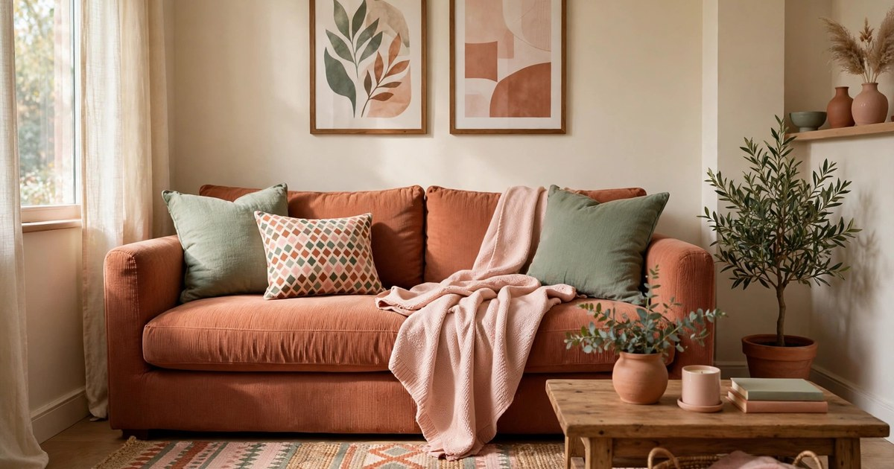
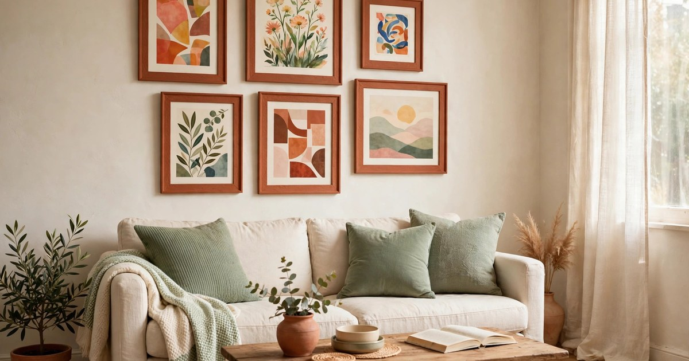
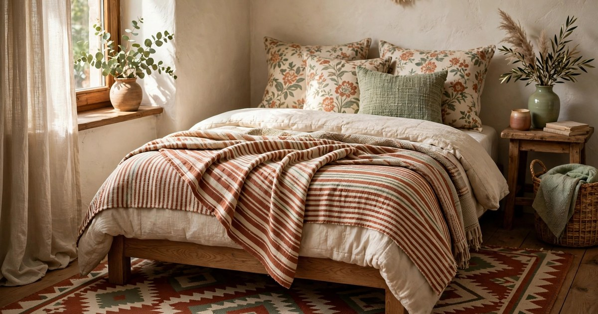
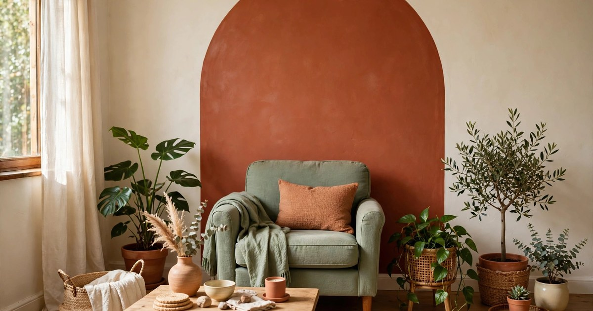
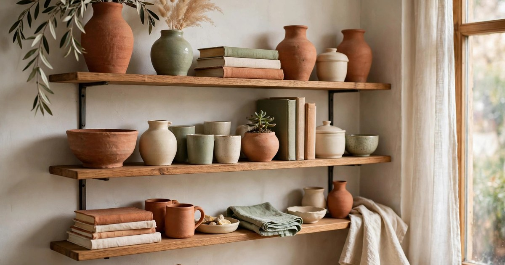
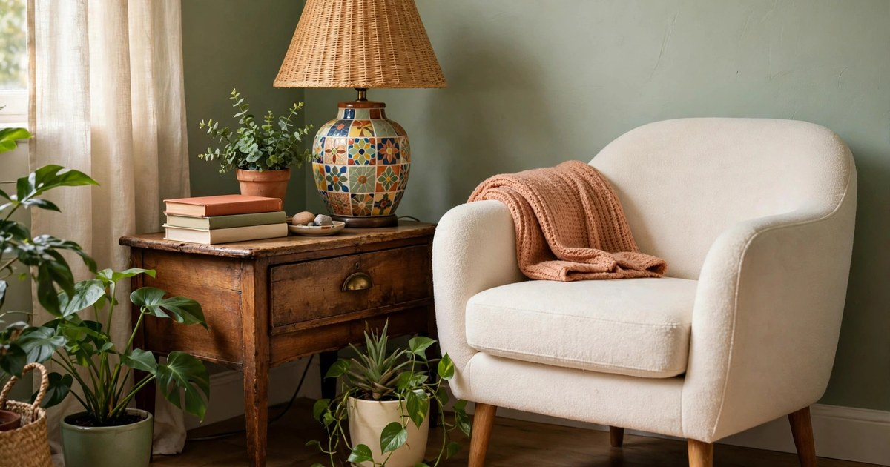
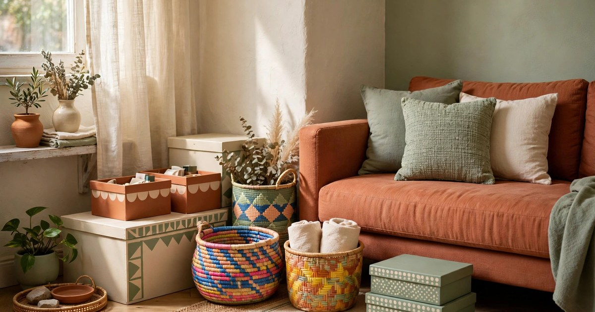
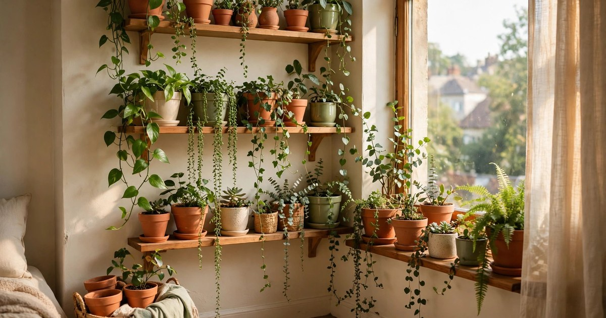
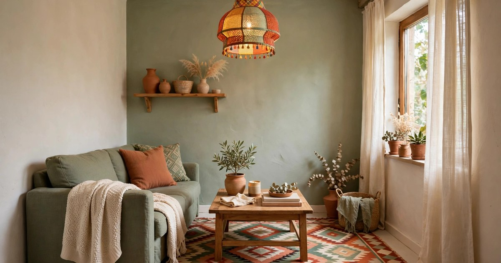
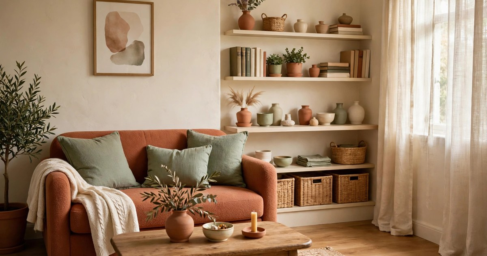

Maximalism has a reputation problem in small flats. Mention bold colour and layered pattern to a renter with 40 square metres and they will picture chaos: every surface covered, nothing matching, nowhere to put a cup of tea. Yet the most joyful small homes right now prove the opposite. When colour is chosen with intent and every object earns its place, a small apartment can be vivid, personal and still genuinely restful.

This is the heart of the FunHaus and dopamine decor movement that Pinterest Predicts 2026 flagged as a defining trend: expressive, layered colour used to lift the mood rather than to show off. It is not about buying more things. It is about letting the things you already love — the striped cushion, the charity-shop vase, the print from a holiday — take centre stage, and giving them a calm framework to sit inside. The ideas below are all renter-friendly, mostly reversible, and built around a tight budget. Start with one, live with it for a week, and add the next only if the room still feels calm.

### 1. Pick a Three-Colour Palette and Repeat It Everywhere

Maximalism only tips into clutter when every colour in the rainbow competes at once. The fix is a disciplined palette: choose three colours you love — say terracotta, sage and blush — and repeat them in different proportions all through the room. A terracotta sofa, sage cushions, a blush throw and a print that ties all three together will read as a considered collection, even when the room is full. The repetition is what makes the eye relax, because the brain stops treating each object as a new surprise and starts reading the room as one story.

This approach also makes thrifting far easier and cheaper. Instead of buying anything bright, you shop with a short list in your head and pass over the pieces that do not fit, which keeps both spending and clutter down. Charity shops, car boot sales and the clearance shelf are full of single cushions, vases and frames in exactly these warm tones, often for a few pounds each. When a new find matches your three colours, it slots straight in; when it does not, you leave it behind without a second thought, and the room stays calm.

### 2. Build a Gallery Wall With One Unifying Frame Colour

A gallery wall is the classic maximalist move, and it works beautifully in a small flat because it uses vertical space that would otherwise sit empty. The trick that keeps it calm is a single unifying element: paint every frame the same colour, or use identical slim frames throughout, and let the art inside be as wild and varied as you like. Bold prints, family photographs, postcards and a child's drawing can all hang side by side, and the matching frames hold them together like a good binding holds a messy, much-loved book.

Hang the wall with removable picture strips or small Command hooks so nothing damages the plaster, and plan the layout on the floor first. Start with the largest piece slightly off-centre at eye level, then build outward in a loose grid, leaving a consistent gap of about five centimetres between frames. That even spacing is the secret ingredient: it gives each picture breathing room and stops the wall from feeling like a jumble sale. If you are short on art, mix in a woven basket, a small mirror or a hanging plant — the frame colour still ties it all together.

### 3. Layer Pattern on Pattern, But Vary the Scale

Pattern mixing is where many maximalist rooms go wrong, and the rule that saves it is simple: vary the scale. Pair a large-scale floral cushion with a small-scale stripe, or a bold geometric rug with a fine gingham throw. When the patterns are different sizes, the eye can tell them apart and enjoy the contrast; when two busy patterns are the same size, they fight and the room feels noisy. One large pattern, one medium and one small is a reliable recipe for any small space.

Start on the soft furnishings, because they are the cheapest place to experiment and the easiest to change. A patterned throw over the arm of the sofa, two contrasting cushions and a rug with a strong motif will transform a plain rental living room for well under fifty pounds if you shop second-hand or catch a sale. Keep the sofa itself plain and let the textiles do the talking. If a combination feels too loud after a few days, swap out just the smallest pattern — a cushion cover costs little — and the whole arrangement settles down again.

### 4. Let One Bold Painted Moment Do the Heavy Lifting

You do not need to paint a whole room to get the maximalist hit. One bold painted moment — an arch behind the sofa, a single feature wall, or a stripe of colour around a doorway — gives the eye a focal point and makes everything else in the room feel deliberate. In a rental, use peel-and-stick paint-effect decals, removable wallpaper panels, or a large painted canvas leaned against the wall to get the same effect without touching the landlord's paintwork. A terracotta arch on a cream wall is a classic for a reason: it warms the room instantly and costs almost nothing.

Choose the wall the eye lands on first when you walk in, and keep the colour inside your three-colour palette so it connects with the cushions, rug and art around it. If you are using removable wallpaper, a single roll is often enough for one feature panel, and a sample pot of paint on a big canvas works just as well. The rest of the walls stay pale and plain, which is exactly what keeps the room feeling calm: one loud note, sung clearly, is far more restful than a whole chorus shouting at once.

### 5. Display Your Collections Instead of Hiding Them

Maximalism at its best is a celebration of the things you have collected, not a shopping list. If you own a set of colourful vases, a shelf of cookbooks, a stack of vinyl or a drawer of vintage scarves, stop hiding them in cupboards and give them a proper display. Group similar objects together on one shelf or one tray, rather than scattering them around the room, and the collection reads as a curated exhibit instead of clutter. A shelf of amber glass, a row of patterned plates or a cluster of small plants becomes a feature in its own right.

The grouping rule matters more than the objects themselves. Three or five items together look intentional; one item on every surface looks accidental. Use trays, small bookshelves and the tops of chests of drawers as your stages, and leave some empty space around each group so the eye can rest between them. Rotate the display with the seasons — swap in a few autumnal pieces in November, brighter ones in spring — and the room feels fresh without a single new purchase. If you are short on display space, our guide to [dopamine decor for small living rooms](/dopamine-decor-small-living-rooms/) has more ideas for making a collected look work in a tight footprint.

### 6. Mix Vintage Finds With New Basics for a Collected Feel

A room full of brand-new matching furniture looks like a showroom, while a room full of random second-hand pieces can look like a storage unit. The sweet spot is a mix: solid new basics — a plain sofa, a simple bed frame, a sturdy bookshelf — dressed with vintage finds that carry the colour and character. A thrifted lamp with a bold shade, a carved wooden side table or a set of mismatched ceramic mugs will give the room a history that no flat-pack set can fake, and each piece costs a fraction of its new equivalent.

Hunt with patience rather than urgency. Set a small monthly budget, keep a running list of the gaps in your room, and check charity shops and online marketplaces once a week instead of buying the first thing you see. A scratched wooden table can be revived with a coat of paint in one of your palette colours, and a dated lamp becomes a statement piece with a new shade. Because each vintage piece is one of a kind, the room gradually becomes unmistakably yours — the exact opposite of a catalogue, and far more interesting to live in.

### 7. Use Colourful Storage So the Practical Stuff Looks Pretty

Small flats have a storage problem, and maximalism can make it worse if every open shelf is crammed. The answer is to make the storage itself part of the decoration. Colourful baskets, painted crates, patterned boxes and bright fabric bins hide the everyday mess — cables, chargers, cleaning supplies, out-of-season clothes — while adding another layer of colour and texture to the room. When the storage looks good, you stop fighting it and start enjoying it.

Assign every basket a job and label it if that helps the household stick to the system. One basket by the door for scarves and gloves, one under the coffee table for remotes and chargers, a row of matching boxes on top of the wardrobe for the things you rarely need. Keep the colours inside your palette so the baskets read as decor rather than clutter, and choose lidded boxes for anything you do not want to see. The room stays tidy with almost no effort, which is the real secret behind every calm maximalist home: the colour is on display, and the chaos is in a box.

### 8. Bring in Plants as Living Colour

Plants are the easiest colour in maximalism because they are alive: their greens shift with the light, they soften hard edges, and they fill awkward corners that furniture cannot reach. A trailing pothos on a high shelf, a tall snake plant beside the sofa and a cluster of small pots on the windowsill add layers of green that tie a bold colour scheme together, especially against terracotta and cream. They also give the room a rhythm — the eye travels from plant to plant — which makes a busy room feel organised rather than random.

Choose plants that suit the light you actually have, not the light you wish you had, and pot them in colourful containers that match your palette. Terracotta pots are cheap, classic and endlessly reusable; a painted tin or a thrifted ceramic bowl works just as well as a cachepot. Group plants in odd numbers and at different heights — a tall plant on the floor, a medium one on a stool, a trailing one on a shelf — to build a little green landscape. If you are new to houseplants, start with three forgiving varieties and add more once they are thriving; a few healthy plants beat a dozen struggling ones every time.

### 9. Make the Ceiling and Floor Part of the Scheme

Most small rooms are decorated from the waist up, and the floor and ceiling are left as an afterthought. That is a wasted opportunity in a maximalist scheme, because the rug and the light fitting are two of the biggest surfaces in the room. A bold patterned rug anchors the seating area, defines the living zone in an open-plan flat, and pulls all your colours together in one place — it is often the single most effective purchase you can make. Above it, a colourful pendant shade or a cluster of paper lanterns draws the eye upward and makes a low ceiling feel intentional rather than cramped.

Both are renter-friendly if you choose well. A rug needs no permission at all, and a plug-in pendant or a lampshade swap takes minutes and reverses just as fast — just keep the original shade safe in a cupboard for moving-out day. Pick a rug large enough that the front legs of the sofa sit on it, and choose a light fitting in one of your palette colours so it connects with the rest of the room. Together, the floor and ceiling frame the space like the top and bottom of a picture, and everything in between suddenly looks composed.

### 10. Edit Ruthlessly Once a Month So the Joy Stays

The final idea is the least glamorous and the most important: edit. Maximalism only stays joyful when someone is in charge of it, and in a small flat that someone is you, once a month, for twenty minutes. Walk through each room with a laundry basket and remove anything that is broken, duplicated, unloved or simply in the way. If an object has not earned its place — if it does not make you smile or serve a purpose — it goes into the basket for donating, selling or storing out of sight.

This monthly edit is what separates a calm maximalist home from a cluttered one, and it costs nothing. After the edit, step back and look at each surface: if a shelf feels crowded, remove one item and see how the rest breathe. If a corner feels bare, that is where your next thrifted find belongs. The room will evolve slowly, season by season, and it will always reflect what you actually love rather than everything you have ever bought. That is the whole point of the style — a home that is full of colour, full of personality, and still a peaceful place to come back to at the end of the day.

## A Calm Kind of Colourful

Colourful maximalism in a small apartment is not a contradiction; it is a balancing act, and the balance comes from the framework, not from holding back. A tight palette, repeated patterns at different scales, one bold focal point and a monthly edit will let you layer as much colour as you like while the room stays restful. Start with the idea that excites you most — the gallery wall, the rug, the shelf of collected treasures — and build from there, one joyful layer at a time.

If you are working with a single-room layout, our [studio apartment layout ideas](/studio-apartment-layout-ideas/) will help you place the colour so the sleeping, living and working zones each get their own moment without fighting each other. And if your budget is truly tight, remember that the best maximalist rooms are built slowly: a cushion here, a print there, a plant on the windowsill. The colour is the fun part. The calm is the discipline underneath it — and that part is free.

## Frequently Asked Questions

### Does maximalism work in a really small flat?

Yes, if you give it a framework. A three-colour palette, repeated patterns at different scales and one clear focal point keep a small room feeling intentional rather than crowded. The problems start when every colour and pattern competes at once, so limit the palette and let the layers build slowly, one idea at a time.

### How do I do maximalist decor in a rental without losing my deposit?

Stick to reversible changes: removable picture strips and Command hooks for gallery walls, peel-and-stick wallpaper panels or a painted canvas for a feature moment, rugs and lampshades for colour, and freestanding shelves for display. Avoid nails, permanent paint and anything glued to the walls, and keep original fixtures safe to refit when you move out.

### How much does colourful maximalist decor cost on a budget?

It can cost very little if you build it gradually. Start with soft furnishings and thrifted finds — cushion covers, a throw, a few framed prints and a plant or two can transform a room for well under fifty pounds. Add one larger piece, such as a rug or a bold lampshade, only when the budget allows, and let charity shops and marketplaces do the heavy lifting.

### How do I stop a maximalist room from looking cluttered?

Group collections together instead of scattering them, leave empty space around each display, and edit once a month. Colourful storage hides the everyday mess, a consistent frame or palette colour ties varied objects together, and removing one item from a crowded shelf usually does more for the room than adding anything new.
