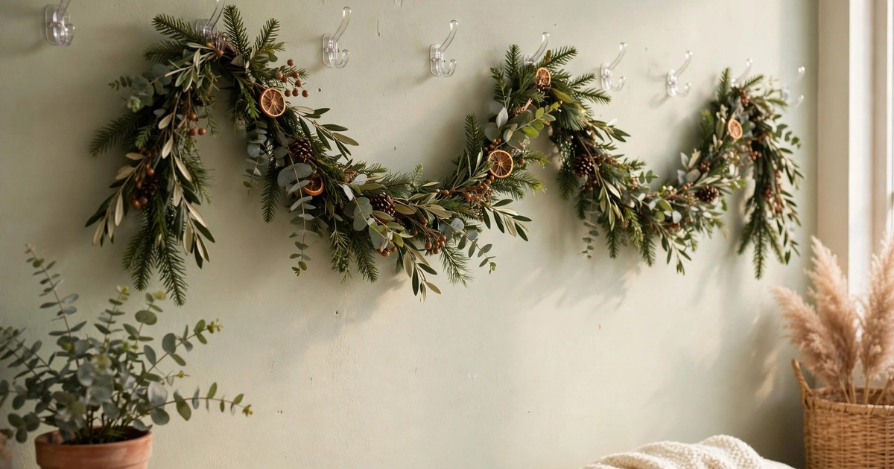
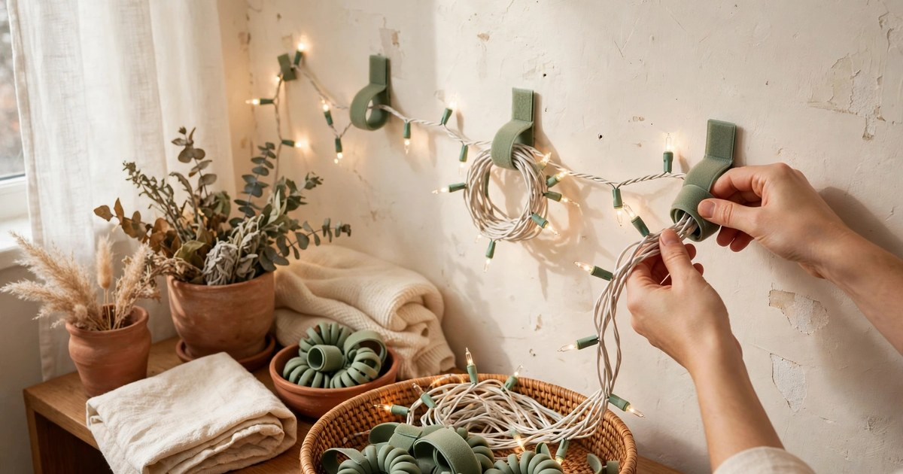

Command hooks are the renter's best friend at Christmas. They hold garlands, wreaths, stockings, and lights, they peel off cleanly in January, and they cost a fraction of the deposit you would lose from a single nail hole. But not all hooks are equal, and the wrong one — too weak for a garland, too visible under a wreath, the wrong shape for a light string — is the difference between a display that stays up all December and one that crashes down at midnight. Here are nine hook-based finds under $20 that actually work for renters.

### 1. Medium utility hooks for garlands

Why it works: a garland is heavier than it looks, especially a real one, and it needs hooks rated for real weight, spaced properly. Medium utility hooks hold around 1.5 kilograms each, which means three or four of them spaced along a wall or doorway will carry a full garland without sagging. The hook shape cradles the garland wire, so it does not slip, and the removable strip peels off cleanly in January.

Where it fits: along a doorway, across a mantel shelf, or along the top of a wall where a garland runs. Space the hooks no more than 60 centimetres apart — garlands sag between hooks that are too far apart, and a sagging garland is the fastest way to make a display look tired.

Budget tip: buy a multipack rather than singles, since you will use more hooks than you expect. A [medium utility hook multipack](https://www.amazon.com/s?k=command+medium+utility+hooks+multipack&tag={{AMAZON_TAG}}) is usually under $15, and the spare hooks will be useful all year for bags, keys, and towels.

### 2. Outdoor light clips for gutters and railings

Why it works: outdoor light clips are designed to grip a gutter edge, a railing, or a shingle without a single nail, and they hold a light string in a neat, even line instead of letting it droop. The clip shape keeps the bulbs facing outward, so the display looks intentional from the street, and the clips themselves are small enough to disappear behind the lights.

Where it fits: along a balcony railing, a porch edge, or a window frame — anywhere outside the flat where lights need to run in a straight line. In a rental, outdoor clips are the difference between lights that look professionally hung and lights that look draped in desperation.

Budget tip: light clips are sold in large packs for very little money, so one pack usually covers a whole balcony. Count your light string's bulb spacing before buying, so the clip spacing matches and the lights sit evenly.

### 3. Small wire hooks for stockings

Why it works: stockings are light, but they need a hook that holds them at the right angle — a flat hook lets a stocking slide off, while a wire hook with a proper curve cradles it. Small wire hooks are rated for about half a kilogram, which is plenty for an empty stocking and a few small treats, and they are small enough to be nearly invisible behind the stocking itself.

Where it fits: along a shelf, a mantel, or a bookcase edge — anywhere stockings hang in a flat with no fireplace. Space them evenly and hang the stockings at the same height, so the display reads as a row rather than a random collection.

Budget tip: a pack of small wire hooks is usually under $10, and they are useful all year for hanging keys, jewellery, and lightweight bags. Buy the clear or white version so they blend into the wall, and keep a spare strip or two for January rehanging.

### 4. Large picture-hanging strips for wreaths

Why it works: a heavy wreath is the decoration most likely to defeat a standard hook, and picture-hanging strips are the answer. They distribute the weight across a wide adhesive area, hold up to 7 kilograms in pairs, and remove cleanly without pulling paint. Two strips on the back of a wreath hanger, or directly on a lightweight wreath frame, will hold even a full, lush wreath all December.

Where it fits: on a front door (inside face), an interior door, or a wall where a wreath is the main display. Strips work best on smooth, clean surfaces, so wipe the area first and let it dry — dust and grease are the main reason strips fail.

Budget tip: a [large picture-hanging strip pack](https://www.amazon.com/s?k=command+large+picture+hanging+strips&tag={{AMAZON_TAG}}) is under $15 and covers several wreaths or framed prints. Keep the packaging: the weight rating and the removal instructions are worth rereading before you hang something heavy.

### 5. Clear mini hooks for fairy lights

Why it works: fairy lights are light but fiddly, and they look terrible when they sag or dangle. Clear mini hooks are almost invisible against a wall or window frame, and they hold a light string in exactly the line you want — along a window, around a mirror, or across a shelf. Because they are clear, the lights appear to float, which is a much cleaner look than a row of white hooks.

Where it fits: along window frames, mirror edges, bookshelf fronts, and door frames — anywhere a light string needs to follow a precise line. Space them about 30 centimetres apart for a taut, professional look, and run the string through the hooks rather than draping it over them.

Budget tip: mini hooks are sold in large packs for very little, and one pack covers a whole flat's worth of light strings. Buy clear, not white, if your walls are anything other than bright white — clear disappears against every colour.

### 6. Ceiling hooks for hanging stars and ornaments

Why it works: the ceiling is the most underused decorating surface in a rental, because nobody wants to drill into it. Removable ceiling hooks change that: they stick to a smooth ceiling, hold a paper star, an ornament, or a snowflake, and come down cleanly in January. Hanging decorations at different heights draws the eye upward and makes a small room feel taller, which is exactly what a low-ceilinged flat needs.

Where it fits: over a dining table, in a hallway, or in a corner where a cluster of hanging stars creates a focal point. Keep hanging decorations light — paper stars, felt ornaments, and small baubles are ideal — and never hang anything heavy or breakable over a seat or a walkway.

Budget tip: ceiling hooks are usually sold in small packs, and a little goes a long way — five or six hanging stars transform a corner. Check that your ceiling is smooth before buying; textured ceilings do not hold adhesive hooks reliably.

### 7. Cord bundlers for light-string cables

Why it works: the ugliest part of any Christmas light display is the cable — the trailing wire from the last bulb to the socket, the sagging loop between two hooks. Cord bundlers are small adhesive clips that pin the cable flat against the wall or skirting board, turning a trailing wire into an invisible line. They are the difference between a display that looks finished and one that looks half-done.

Where it fits: along skirting boards, up door frames, and behind furniture — anywhere a light-string cable runs. Use them for the power cable as well as the light string itself, and the whole display reads as intentional rather than improvised.

Budget tip: cord bundlers are among the cheapest hook products available, often under $10 for a large pack. Buy more than you think you need, since cables always take a longer route than planned, and keep spares for phone chargers and other cables all year.

### 8. Decorating clips for garlands on banisters

Why it works: a banister garland is one of the grandest Christmas looks, and it is also one of the hardest to attach without damage. Decorating clips are designed to grip a banister rail or a thick garland without nails, tape, or wire, and they hold the garland in place even when someone brushes past it on the stairs. The clip shape wraps the rail, so the garland stays put without slipping down the slope.

Where it fits: along a staircase banister, a balcony railing, or a thick handrail — anywhere a garland wraps a rail rather than hanging from a wall. Space the clips evenly and twist the garland around the rail between them, so the whole banister reads as one continuous decoration.

Budget tip: a [banister garland clip pack](https://www.amazon.com/s?k=garland+clips+for+banister&tag={{AMAZON_TAG}}) is under $15 and reusable year after year. Measure your banister's thickness before buying, since clips are sized, and a clip that is too small will not grip while one that is too large will slide.

### 9. Refill adhesive strips (the unsung hero)

Why it works: the hook is only half the product — the adhesive strip is the part that actually holds, and it is also the part that runs out. A pack of refill strips means last year's hooks work again this Christmas, a hook that fell down can be rehung immediately, and a display that needs one more hook does not need a whole new pack. Refill strips are the cheapest item on this list and the one that saves the most December frustration.

Where it fits: everywhere. Keep a pack with your Christmas decorations, and every hook you own becomes reusable indefinitely. Match the strip size to the hook — small strips for mini hooks, medium for utility hooks, large for picture strips — since a mismatched strip is the most common cause of a hook failing.

Budget tip: refill strips are usually under $10 for a large pack, and they are the single best-value purchase in this whole list. Buy them before you need them, because the day a garland falls down is never the day you want to go shopping.

## Hooks First, Decorations Second

The unglamorous truth of renter Christmas decorating is that the hooks matter more than the decorations. A beautiful garland on failing hooks is a garland on the floor; a simple garland on good hooks, spaced properly and rated for the weight, stays up all December and looks like it was always meant to be there. Buy the hooks first, match them to the weight and the surface, and the decorations almost hang themselves.

Start with a multipack of medium utility hooks and a pack of refill strips — those two purchases cover most of a small flat's Christmas — then add the specialist clips for the displays you actually plan: light clips for the balcony, mini hooks for the fairy lights, ceiling hooks for the stars. Your walls will thank you in January, and so will your deposit.

## Frequently Asked Questions

### How much weight can Command hooks hold for Christmas garlands?
It depends on the size: mini hooks hold around 225 grams, small wire hooks about 450 grams, medium utility hooks around 1.5 kilograms, and large picture-hanging strips up to 7 kilograms in pairs. For a garland, use medium utility hooks spaced no more than 60 centimetres apart, and check the rating before hanging anything heavy.

### Do Command hooks damage paint when removed?
No, when used correctly: pull the strip straight down slowly, following the instructions, and the adhesive releases cleanly. Damage usually comes from pulling the hook outward instead of the strip downward, or from using hooks on fresh paint (less than 28 days old), wallpaper, or textured surfaces. Test in a hidden spot if you are unsure about your walls.

### Can I use Command hooks outside on a balcony?
Only outdoor-rated hooks and clips, which are designed for temperature changes and moisture. Indoor strips can fail in cold or wet weather, so use outdoor light clips and outdoor hooks for anything on a balcony, porch, or exterior wall.

### How do I stop a heavy wreath falling off a Command hook?
Use large picture-hanging strips rated for the wreath's weight, apply them to a clean, dry, smooth surface, and wait an hour before hanging the wreath so the adhesive bonds fully. For very heavy wreaths, use two strips or an over-door hook instead — a wreath that falls at 2 a.m. is a wreath that wakes the whole flat.
