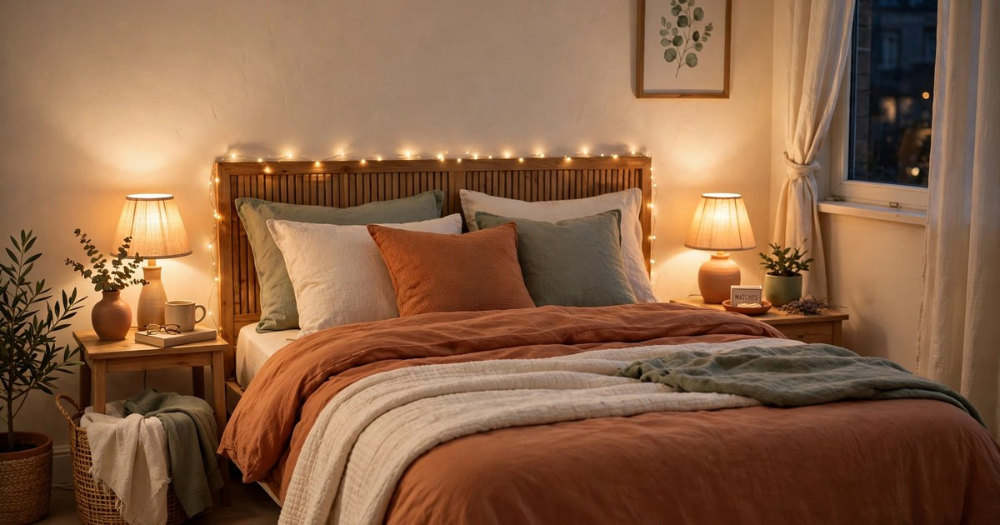
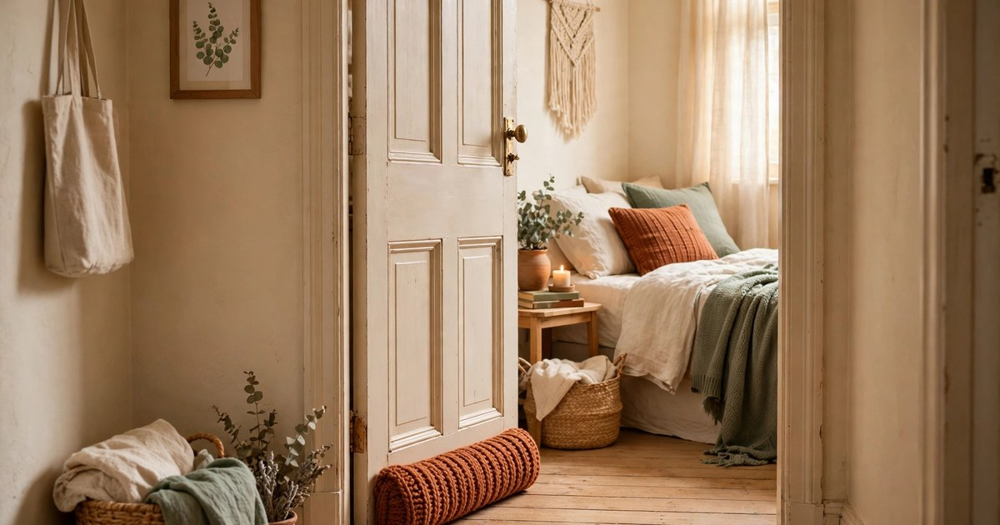
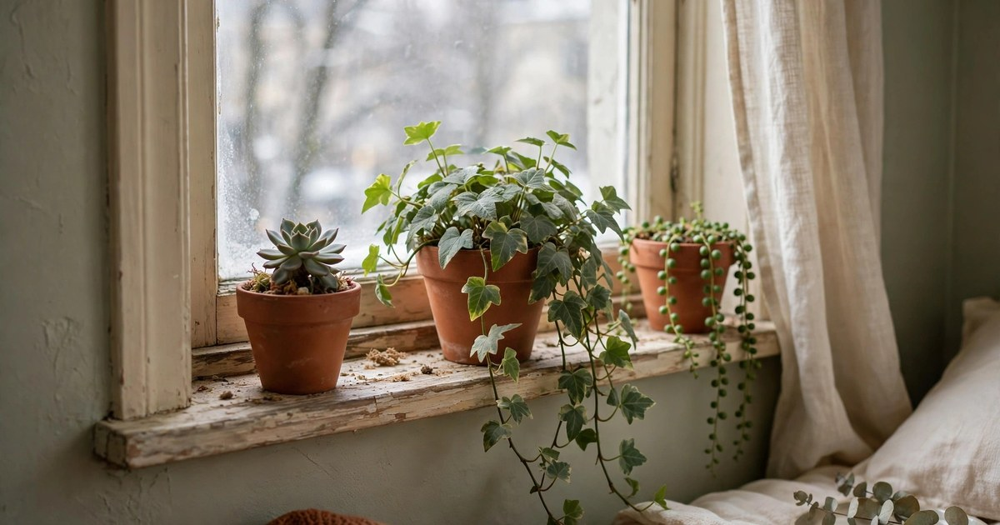

A small bedroom in winter can feel like the coldest room in the flat. The window lets in a draught, the floor is bare when your feet hit it in the morning, and the pale walls that looked bright in summer suddenly feel stark and unwelcoming. The temptation is to accept it — to tell yourself the room is just small and there is nothing to be done — but a bedroom does not need to be big to feel warm. It needs layers: softness on the bed, warmth at eye level, something cosy underfoot and a glow that makes the dark evenings feel like an invitation rather than a sentence.

Every idea below is renter-friendly and deposit-safe. Nothing here needs paint, a drill, a nail or a landlord's permission, and most of it costs under $25. The ideas are designed for the realities of a small apartment bedroom — a room that might also be your dressing room, your reading corner and your home office after dark — so storage doubles as decor, every layer earns its floor space, and everything packs into a box when you move.

### 1. Layer Your Bedding Like a Winter Outfit

The single biggest change you can make to a cold bedroom costs nothing if you already own the pieces: layer your bedding the way you layer your clothes. A fitted sheet, a flat sheet, a lightweight duvet, then a heavier throw folded across the foot of the bed, plus a warm-toned coverlet you can pull up on the coldest nights. Each layer traps a little more air between the fabrics, and each one adds another note of warm colour to a room that is usually the plainest in the flat.

Choose warm tones rather than the cool white most rentals arrive with — terracotta, warm cream, mustard, dusty rose — and mix textures the way you would on a sofa: smooth cotton sheets, a brushed cotton duvet cover, and a chunky knit or waffle-weave throw on top. A bed that looks warm invites you into it, which matters more than it sounds on a dark winter evening when the room itself feels like it is working against you. If your budget stretches to one new piece, make it a brushed cotton or flannel duvet cover in a warm tone; it changes the feel of the whole bed for the price of a takeaway.

The layering also solves a small-bedroom problem that has nothing to do with warmth: storage. A folded throw across the foot of the bed and a spare blanket draped over a chair mean you never need a separate blanket box. For more ideas on choosing warm bedding that suits a small space, see our guide to [cosy winter bedding for small apartments under $25](/cozy-winter-bedding-small-apartments-under-25/).

[Shop brushed cotton duvet cover sets](https://www.amazon.com/s?k=brushed+cotton+duvet+cover+set+terracotta&tag={{AMAZON_TAG}})

### 2. Put a Rug Beside the Bed, Not Under It

The worst moment of a winter morning in a small apartment is the first step out of bed onto a cold bare floor. A rug beside the bed fixes it, and in a small bedroom a runner or a single plush rug on the side you get out of is far more useful than a large rug hidden under the bed. You want the softness exactly where your feet land, not under furniture where nobody feels it.

Choose a high-pile or shaggy rug in a warm cream or terracotta, and let it run the length of the bed so it catches both the morning step and the evening one. A non-slip pad underneath stops it sliding on wood or laminate, which matters in a small room where you step on the same spot every single day. If your budget is tight, a single runner from a discount shop does the job — the point is warmth underfoot, not a designer label. And if the rest of the room still feels cold underfoot, our guide to [layering rugs in a small apartment for winter](/layer-rugs-small-apartment-winter-guide/) covers the two-rug trick that warms a whole floor.

[Shop plush bedside rugs](https://www.amazon.com/s?k=plush+bedside+rug+runner+cream+terracotta&tag={{AMAZON_TAG}})

### 3. Swap the Overhead Light for Warm Glow

Most rental bedrooms have one overhead light and it is almost always the wrong one: a cold, bare bulb that makes a small room feel like a waiting room. In winter, when it is dark by late afternoon, that single light defines the whole mood of the room — and the fix is to stop using it. Replace the bulb with a warm-white one at 2700K, then build your evening light from lower, softer sources instead: a bedside lamp with a fabric shade, a small clip-on reading light, and a string of warm fairy lights along the headboard or a shelf.

A lamp on each side of the bed is ideal, but in a small bedroom one good lamp on a bedside table does the job if it sits at eye level when you are sitting up in bed. The fabric shade matters more than the base — linen or cotton in a warm cream softens the light and throws a golden pool onto the wall beside the bed, which instantly makes the room feel smaller in the good way: enclosed, warm, like a cocoon. Fairy lights are the cheapest layer of all, and a single warm-white string costs less than a coffee. For the full approach to lighting a rental without touching the wiring, see our [renter-friendly winter lighting ideas](/renter-friendly-winter-lighting-ideas/).

[Shop warm white LED bulbs 2700K](https://www.amazon.com/s?k=warm+white+led+bulbs+2700k+bedroom&tag={{AMAZON_TAG}})

### 4. Hang Heavy Curtains That Keep the Heat In

The window is where a small bedroom loses most of its heat, and thin rental curtains do nothing to stop it. Hanging a pair of heavier, warm-toned curtains is the rare decor change that genuinely warms a room in both senses: the lined fabric blocks draughts and insulates the glass, while the colour warms the whole wall. Terracotta, warm gold or a deep sage all work; the aim is a colour with depth, because a flat magnolia curtain does nothing for a cold room.

Hang them on the existing curtain rod — there is no need to touch the fixings — and choose a length that just kisses the floor. Floor-length curtains add softness and a sense of height that a small room desperately needs, and they hide the cold wall below the windowsill at the same time. If your rental has blinds instead of a rod, a tension rod fitted inside the window frame takes minutes to install and leaves no marks at all. Keep the original curtains in a bag in a cupboard so you can put them back when you leave, and take the thermal ones with you — they will fit the next place too. Closing them an hour before bed traps the day's warmth in the room, which makes a real difference to how the bedroom feels at midnight.

[Shop thermal blackout curtains](https://www.amazon.com/s?k=thermal+blackout+curtains+terracotta+warm&tag={{AMAZON_TAG}})

### 5. Draught-Proof the Door and Window Gaps

No amount of cosy bedding will help if cold air is pouring under the bedroom door all night. Draught-proofing is the least glamorous idea on this list and the one that makes the most physical difference, because a small bedroom has so little air in it that a single gap can cool the whole room. A fabric draught excluder along the bottom of the door is the classic fix, and it doubles as decor when you choose one in a warm colour or a knitted texture that matches your bedding.

For the window, self-adhesive draught strips cost a few pounds and peel off cleanly when you move — stick them around the frame where you can feel cold air, and check the seal by holding a lit candle near the frame and watching the flame flicker. A thick curtain over the top, as in the idea above, hides the strips completely. If the draught is coming from a gap around a pipe or a poorly sealed skirting board, a rolled-up towel in a matching colour works as a stopgap for a single winter. For a full room-by-room approach to sealing a rental against the cold, our [winter-proofing guide for draughty rentals](/winter-proof-drafty-rental-guide/) walks through every fix that leaves no trace.

[Shop door draught excluders](https://www.amazon.com/s?k=door+draught+excluder+knitted+terracotta&tag={{AMAZON_TAG}})

### 6. Build a Cosy Reading Corner in the One Spare Chair

A small bedroom rarely has room for a reading nook, but it almost always has room for one chair — and one chair, properly dressed, is a reading corner. The trick is to give the chair a job beyond sitting: drape a chunky knit throw over its back, add a cushion in a warm texture, and put a small lamp or a clip-on light beside it so the corner has its own pool of warm light after dark. Suddenly the coldest corner of the room becomes the place you actually want to sit.

Choose the chair by what you already own — a dining chair pulled in from the kitchen, a second-hand armchair, even a sturdy floor cushion against the wall — and spend the money on the layers instead of the seat. A basket beside the chair holds the book you are reading and the throw you are not using, which keeps the corner tidy without any extra furniture. The point is not to build a magazine nook; it is to give the bedroom a warm spot that is not the bed, so the room feels like somewhere to spend an evening, not just somewhere to sleep. If you want to take the idea further, our guide to a [winter self-care corner in a small rental](/winter-self-care-corner-small-rental-ideas/) shows how to build the same feeling into any corner of the flat.

[Shop chunky knit throw blankets](https://www.amazon.com/s?k=chunky+knit+throw+blanket+terracotta+cream&tag={{AMAZON_TAG}})

### 7. Add Warmth to the Walls Without a Single Nail

A large expanse of white wall is the coldest thing in a bedroom, and a renter cannot paint it — but a renter can cover it. Warm-toned prints leaned on a shelf or a chest of drawers, a woven wall hanging on adhesive hooks, or a fabric tapestry hung from a tension rod all do the same job: they break up the blank white, add colour at eye level, and make the room feel enclosed rather than bare. Choose prints in the same palette as the rest of the room — terracotta landscapes, botanical illustrations in sage and cream, abstract art in mustard and rust — so the wall art feels like part of the scheme rather than an afterthought.

Adhesive hooks and strips are the renter's best friend here, but always check the weight limit and test one hook before hanging anything valuable. Leaning is even safer: a framed print leaned against the wall on top of a chest of drawers needs no fixings at all, and a row of three small leaning frames costs less than one large framed piece. The fabric itself helps too — a woven hanging softens the acoustics of a bare room, so the space feels quieter and more enclosed, which reads as warmth in a way that is hard to explain until you feel it.

[Shop woven wall hangings](https://www.amazon.com/s?k=woven+wall+hanging+terracotta+macrame+bedroom&tag={{AMAZON_TAG}})

### 8. Use Storage That Doubles as Decor

A small bedroom has no room for furniture that does only one job, and winter makes that worse: extra blankets, thicker jumpers, spare throws and hot-water bottles all need somewhere to live. The answer is storage that looks like decor — woven baskets under the bed, a wooden storage bench at the foot of the bed, a seagrass basket beside the wardrobe that holds your spare bedding. Each one adds a note of natural warmth that plastic storage boxes never will, and each one earns its floor space twice over.

Look for second-hand pieces first — charity shops and marketplace listings are full of solid baskets and wooden boxes for a few pounds — and keep the materials consistent. Warm oak, walnut, seagrass and rattan sit happily together, while a grey plastic box next to a wooden basket makes the whole corner look accidental. A basket that holds your throws, a box that hides charging cables, a tray on the bedside table that corrals your book, lip balm and hand cream: when a warm-toned object also does useful work, it belongs in a small room in a way that pure decoration never quite manages. Under-bed storage is the biggest win of all, because it uses floor space you were never going to see anyway.

[Shop woven seagrass storage baskets](https://www.amazon.com/s?k=woven+seagrass+storage+basket+large+lid&tag={{AMAZON_TAG}})

### 9. Warm the Air with Scent and a Hot Water Bottle

Warmth is a sense as much as a sight, and scent is the quickest way to make a cold bedroom feel cosy before your body has caught up. A candle in amber glass, a reed diffuser with a woody scent, a jar of cinnamon and clove on the bedside table — any of these tells your brain the room is warm. In winter, choose scents with depth: cinnamon, cedarwood, sandalwood, vanilla and spiced orange all read as warm, while citrus and linen read as cool and belong to summer.

If your tenancy agreement bans real flames — many do — flameless LED candles in amber glass give you the same flickering glow with none of the risk, and a plug-in wax warmer or a reed diffuser handles the scent. And do not overlook the cheapest warmth of all: a hot water bottle. Tucked into the bed ten minutes before you get in, it warms the sheets the way no amount of decor can, and a knitted hot water bottle cover in a warm colour turns it into part of the bedding rather than a clinical object. Group three candles of different heights on a wooden tray with a sprig of dried greenery, and you have a bedside centrepiece that costs under $15 and makes the whole room feel like a winter evening.

[Shop flameless LED candles amber glass](https://www.amazon.com/s?k=flameless+led+candles+amber+glass+set&tag={{AMAZON_TAG}})

### 10. Add a Living Touch That Survives Winter

The last step is the one that makes a bedroom feel alive rather than just warm: a plant. A small potted plant on the windowsill, a trailing pothos on top of the wardrobe, a cluster of tiny pots on the bedside table — living things soften hard edges, bring colour into a room that winter has washed out, and make a small space feel cared for rather than merely occupied. The trick in a bedroom is to pick varieties that forgive a cold, dim room in winter: pothos, snake plants and ZZ plants all tolerate low light and irregular watering, and they grow happily in the same warm-toned terracotta pots that tie the whole scheme together. All three are on our list of [low-light indoor plants for dark apartments](/low-light-indoor-plants-dark-apartments/).

Keep it small and keep it simple — one or two plants is enough in a bedroom, and a plant that outgrows its pot becomes a chore rather than a joy. A terracotta pot on a wooden tray catches the drips and adds another warm material to the room at the same time. If the windowsill is too cold or too dark, a small plant on the chest of drawers does the same job, and a faux trailing plant on a high shelf works when even the hardiest real plant would struggle. A room with something living in it never feels as cold as an empty one, and that is as true in December as it is in July.

[Shop terracotta plant pots small](https://www.amazon.com/s?k=terracotta+plant+pots+small+set&tag={{AMAZON_TAG}})

## A Small Bedroom Can Be the Warmest Room in the Flat

A small bedroom is not a disadvantage in winter — it is an advantage. There is less air to warm, less wall to cover and less floor to soften, which means every layer you add has a bigger effect than it would in a large room. Start with the cheapest layer that helps most, which for most renters is the lighting: swap the bulbs, add a bedside lamp, and see how different the room feels at six in the evening. Then add one layer of texture at a time — the rug beside the bed, the throw across the foot of it, the curtain that keeps the heat in — and let the warmth build the way it should: gradually, cheaply, and entirely on your terms. When spring comes, every one of these layers folds into a box and moves with you, ready for the next small bedroom.

## Frequently Asked Questions

### How can I make a small bedroom feel cosy in winter without painting?

Add warmth through textiles, lighting and colour instead of paint. Layer your bedding in terracotta, cream and mustard, hang warm-toned thermal curtains, swap to warm-white bulbs, put a plush rug beside the bed and use a woven wall hanging to cover large blank walls. Each of these is removable, landlord-friendly and costs far less than repainting.

### What is the cheapest way to warm up a small bedroom?

Start with lighting, because it costs the least and changes the most. A pack of warm-white bulbs and a single bedside lamp with a fabric shade can transform a cold white bedroom for under $20. After that, a draught excluder for the door and a hot water bottle for the bed together cost under $15 and make a real physical difference to how warm the room feels at night.

### How do I keep a small bedroom warm at night in a rental?

Layer the bed, seal the gaps and close the curtains an hour before bed. A layered duvet with a throw across the foot, a draught excluder under the door, draught strips around the window frame and heavy curtains drawn early trap the day's warmth in the room. A hot water bottle tucked into the bed ten minutes before you get in warms the sheets directly.

### What colours make a small bedroom feel warmer in winter?

Warm, deep tones: terracotta, rust, mustard, warm gold, dusty rose and deep sage, balanced with warm cream rather than cool white. Use the deeper colours in the bedding, cushions and curtains, and keep the cream for the sheets and the rug so the room feels warm without feeling dark. Avoid cool greys and stark whites in winter, because they make a small room feel colder than it is.

### Can I hang things on bedroom walls in a rental without nails?

Yes — adhesive hooks and strips, tension rods and leaning frames all work without drilling or nails. A woven wall hanging on adhesive hooks, prints leaned on a chest of drawers, and a tension rod inside a window frame are all fully removable. Always check the weight limit on adhesive products, test one hook before hanging anything valuable, and keep the original fixings so you can restore the room when you move.
