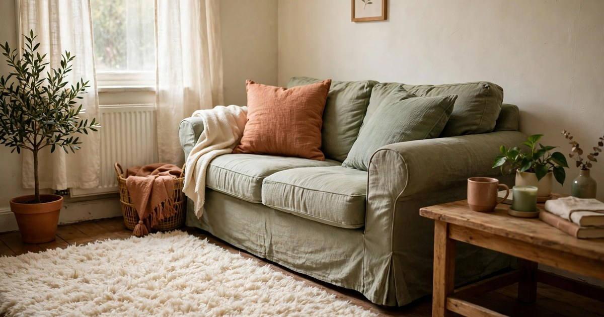
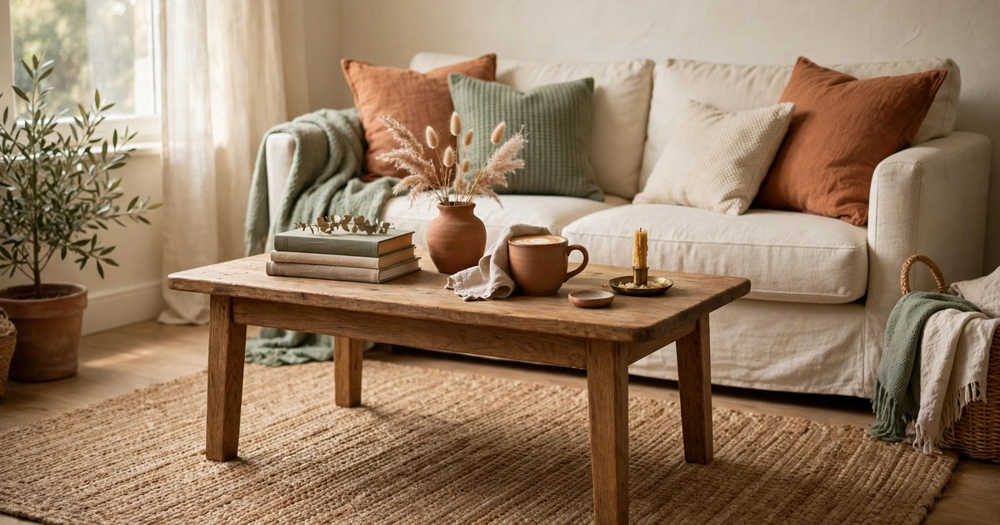
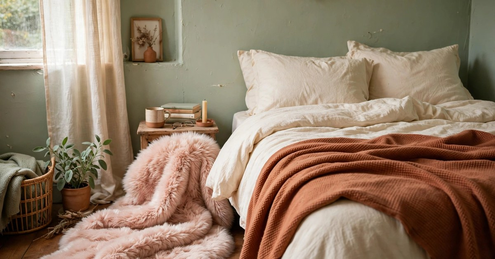
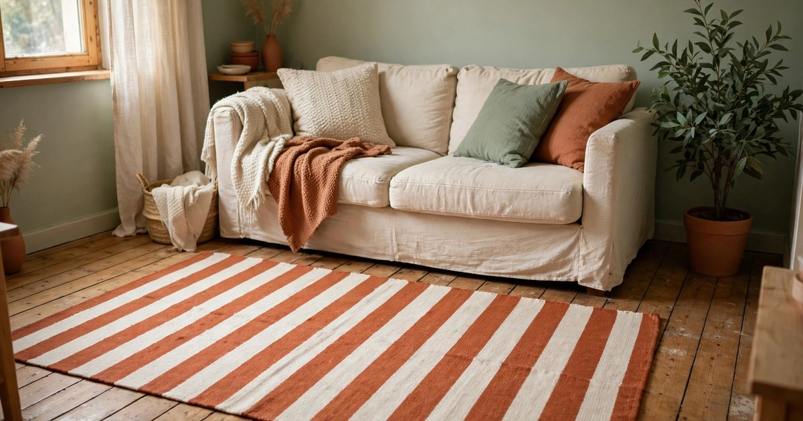
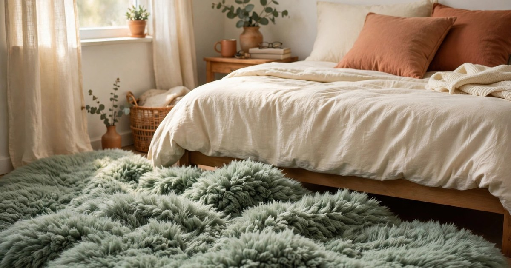
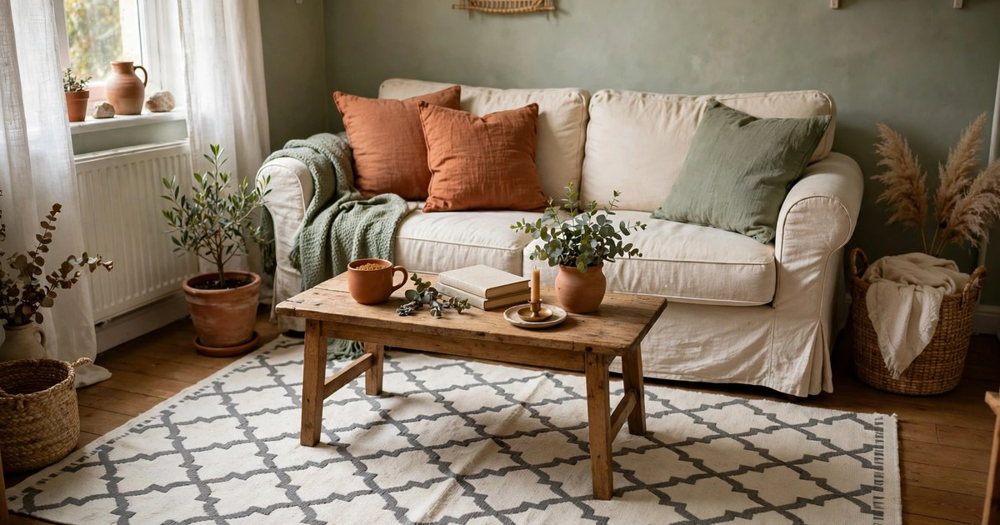
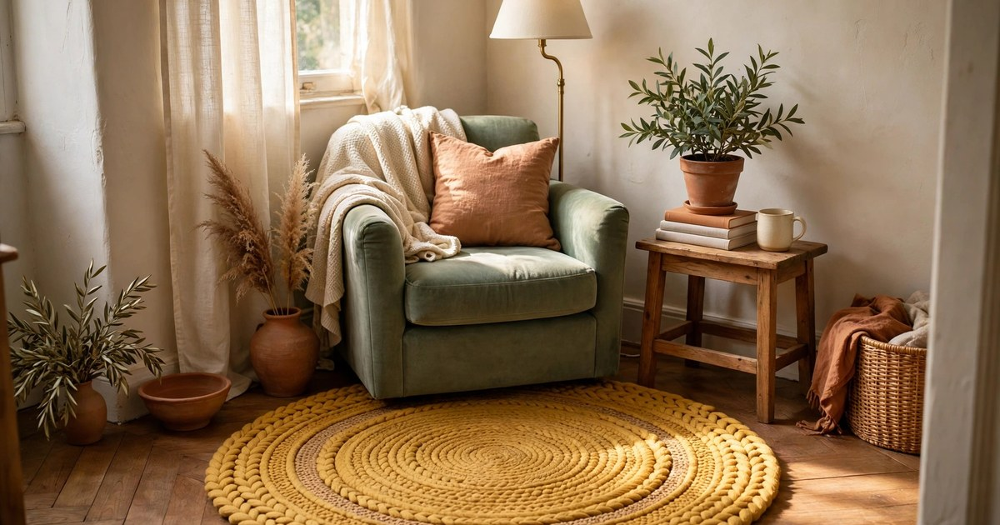
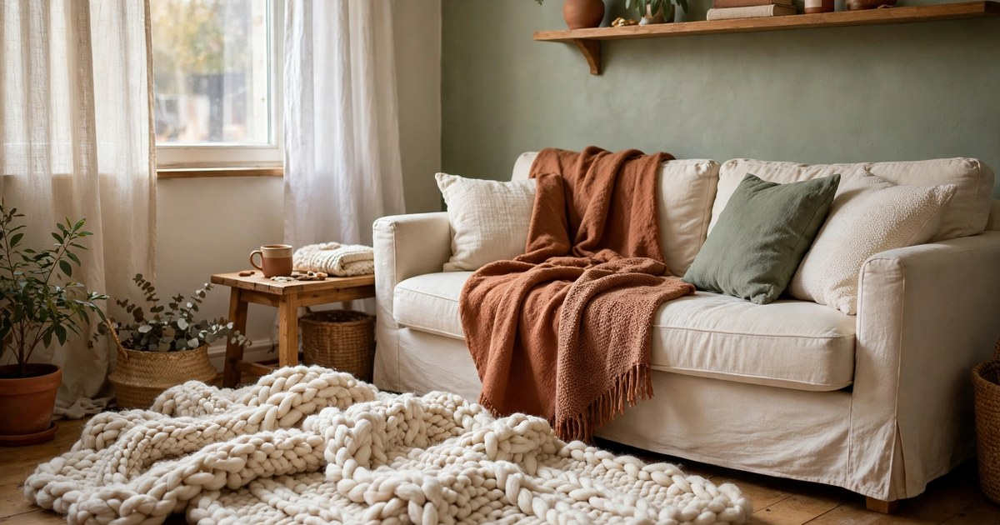
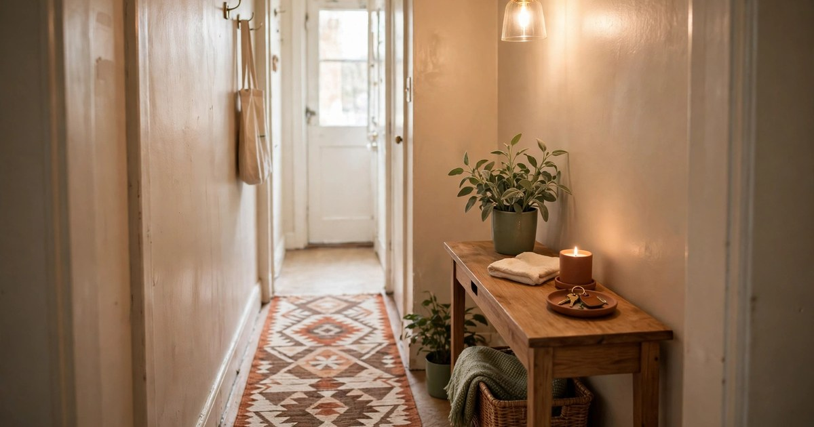

A rug is the fastest way to make a cold rental floor feel warm, and in winter it is not a luxury — it is the difference between a flat that feels cosy and one that feels like a fridge. The good news is that you do not need to spend a fortune: a small rug under $25 can transform a living room, a bedroom or a hallway, and because it is not fixed to anything, it moves with you when your tenancy ends. These nine picks are all budget-friendly, renter-safe and chosen for small spaces.

A quick note on sizing before you shop: a rug should be big enough for the front legs of your sofa or bed to sit on it, even in a small room. A rug that is too small makes the space feel chopped up, while one that is just big enough pulls the whole room together. Measure your space, check the size in the listing, and add a non-slip rug pad underneath if your floor is wood or tile — a sliding rug is an accident waiting to happen.

### 1. Plush Shaggy Rug in Cream

A cream shaggy rug is the cosiest thing you can put on a cold floor, and it works in almost any small living room because cream goes with everything. The deep pile feels warm under bare feet on a winter morning, and it softens the sound of a room with hard floors — a real bonus in a flat where every footstep echoes. Choose a low-pile shag rather than a very deep one if you have a vacuum cleaner that struggles, because deep pile traps crumbs and pet hair.

Why it works: the pale colour brightens a dark winter room, and the texture adds warmth that a flat-weave rug cannot. Where it fits: beside the sofa, so your feet land on something soft when you sit down, or beside the bed for the same reason in the morning. Keep it out of the kitchen and hallway, where spills and muddy shoes will ruin it within a week.

[Shop plush shaggy rugs](https://www.amazon.com/s?k=plush+shaggy+area+rug+cream+small&tag={{AMAZON_TAG}})

### 2. Woven Jute Rug in Natural

A jute rug brings natural texture and warmth to a small room without adding colour, which makes it the easiest rug to live with. The woven fibres feel firm underfoot rather than soft, but they insulate a cold floor surprisingly well, and the natural tone works with every colour scheme from dopamine brights to calm neutrals. Jute is also one of the cheapest rug materials, so a good-sized one fits comfortably under $25.

Why it works: the texture adds interest to a plain floor, and the neutral colour lets your cushions and throws do the colour work. Where it fits: under a coffee table in the living room, or in a hallway where its tough fibres handle foot traffic. Avoid jute in damp rooms — it does not like bathrooms — and shake it outside regularly, because it sheds a little when new.

[Shop woven jute rugs](https://www.amazon.com/s?k=woven+jute+area+rug+natural+small&tag={{AMAZON_TAG}})

### 3. Faux Fur Rug in Blush

A faux fur rug is pure winter luxury on a budget. The soft pile feels like stepping onto a cloud, the blush colour adds a gentle warmth to a bedroom, and it looks far more expensive than it is — especially beside a bed, where it is the first thing your feet touch in the morning. Faux fur rugs are light, easy to move, and simple to shake out, which makes them ideal for renters who rearrange often.

Why it works: the softness is the point — it turns a cold bedroom floor into something you look forward to stepping onto. Where it fits: beside the bed, or draped over a chair as a throw when it is not on the floor. Keep it out of high-traffic areas, because the pile flattens where people walk, and vacuum it on a low setting so you do not pull the fibres out.

[Shop faux fur rugs](https://www.amazon.com/s?k=faux+fur+area+rug+blush+pink+small&tag={{AMAZON_TAG}})

### 4. Striped Cotton Rug in Terracotta and Cream

A striped cotton rug does two jobs in a small room: it adds colour and it makes the space feel wider. Terracotta and cream stripes are the warmest choice for winter — they echo the terracotta and cream palette that runs through so much cosy decor, and they work with wood floors, grey carpets and tiled floors alike. Cotton rugs are also the easiest to clean: most can go in the washing machine, which is a lifesaver in a small flat with no outdoor space.

Why it works: the stripes give a small room direction and energy, and the washable cotton means you never have to worry about spills. Where it fits: in front of the sofa, in a hallway, or under a dining table where food lands on the floor. Choose a flat weave rather than a thick pile for dining areas, so chairs slide easily and crumbs do not hide in the fibres.

[Shop striped cotton rugs](https://www.amazon.com/s?k=striped+cotton+area+rug+terracotta+cream&tag={{AMAZON_TAG}})

### 5. High-Pile Fluffy Rug in Sage

A high-pile fluffy rug in sage green is the calm, cosy option for a bedroom or a reading corner. The deep pile insulates cold floors, the sage colour is restful without being boring, and the softness invites bare feet — which is exactly what you want on a winter morning. Sage works with wood, white walls and the warm neutrals that dominate winter decor, so it fits a room you have already decorated without clashing with anything.

Why it works: the combination of deep pile and a soft, natural colour makes a room feel like a retreat rather than a box. Where it fits: beside the bed, under a reading chair, or in a corner you have claimed as your own. Vacuum it weekly on a low setting, and rotate it every month so the pile wears evenly — high-pile rugs show footprints, and rotation keeps them looking fresh.

[Shop high-pile fluffy rugs](https://www.amazon.com/s?k=high+pile+fluffy+area+rug+sage+green&tag={{AMAZON_TAG}})

### 6. Moroccan Trellis Rug in Grey and White

A Moroccan trellis pattern is the rug equivalent of a good pair of jeans: it goes with everything and never looks out of place. The geometric pattern adds interest to a plain floor without shouting, the grey and white palette works in any small room, and the pattern hides crumbs, pet hair and the odd stain far better than a plain rug. That last point matters more than it sounds in a small flat where the rug is always on display.

Why it works: the pattern is busy enough to hide real life and calm enough to live with every day. Where it fits: the living room, where it anchors the seating area, or a hallway, where the pattern disguises muddy footprints. Choose a low-pile version for hallways and dining areas, and a plusher one for the living room, where comfort matters more than durability.

[Shop Moroccan trellis rugs](https://www.amazon.com/s?k=moroccan+trellis+area+rug+grey+white+small&tag={{AMAZON_TAG}})

### 7. Round Braided Rug in Mustard

A round rug is the secret weapon for small, awkward spaces. A round braided rug in mustard yellow softens a sharp corner, defines a reading nook, or gives a small dining table a focal point, and the round shape breaks up the rectangles that dominate every small flat. Braided rugs are tough, they lie flat, and the mustard colour is a shot of winter sunshine on a grey day. They are also easy to clean — a good shake outside and a vacuum does the job.

Why it works: the round shape and the warm colour together make a corner feel intentional instead of leftover. Where it fits: under a small round side table, in a reading corner with a chair and a lamp, or in front of a fireplace that no longer works. Measure the space first — a round rug that is too big overwhelms a corner, while one that is too small looks like a coaster.

[Shop round braided rugs](https://www.amazon.com/s?k=round+braided+area+rug+mustard+yellow&tag={{AMAZON_TAG}})

### 8. Chunky Knit-Look Rug in Ivory

A chunky knit-look rug is the textile equivalent of a favourite jumper: soft, warm and impossible to resist. The knitted texture adds a handmade, cosy feel to a small room, the ivory colour keeps the space bright through the darkest months, and the thick pile insulates a cold floor better than almost any other budget rug. It is the rug that guests always touch first, because it looks so inviting.

Why it works: the texture is the decoration — it adds warmth and softness without adding colour, so it fits any room. Where it fits: beside the sofa or the bed, where bare feet will appreciate it most. Keep it away from dining areas and pets with claws, because the knit texture can snag, and spot-clean spills immediately so they do not settle into the fibres.

[Shop chunky knit rugs](https://www.amazon.com/s?k=chunky+knit+area+rug+ivory+small&tag={{AMAZON_TAG}})

### 9. Low-Pile Geometric Rug in Warm Neutrals

A low-pile geometric rug in warm neutrals is the practical pick for the hardest-working spots in a small flat: the hallway, the kitchen doorway, the space in front of the sofa where everyone walks. Low pile means chairs slide, the vacuum glides, and dirt sits on the surface where you can see it and clean it. The geometric pattern in warm browns, creams and terracotta hides the wear and tear of daily life while still looking warm and deliberate.

Why it works: it is the rug that looks good and survives real life at the same time. Where it fits: hallways, entryways, kitchens and any spot where people walk through rather than sit down. Add a non-slip pad underneath, because low-pile rugs on hard floors are the most likely to slide, and a rug that moves under your feet is a rug you will stop using.

[Shop low-pile geometric rugs](https://www.amazon.com/s?k=low+pile+geometric+area+rug+warm+neutrals&tag={{AMAZON_TAG}})

## One Rug, One Room, One Winter

You do not need a rug in every room. Start with the room where your feet are coldest — usually the bedroom, where bare feet hit the floor first thing, or the living room, where you sit for hours. Measure the space, pick the rug from this list that fits the job, and live with it for a week. If your feet are warmer and the room feels softer, you have found the right one. A rug is the simplest winter upgrade a renter can make, and when you move, it rolls up and comes with you.

## Frequently Asked Questions

### What size rug should I buy for a small living room?

Choose a rug big enough for the front legs of your sofa and chairs to sit on it. In a small living room that usually means 120 by 180 centimetres, or 160 by 230 if the room allows. A rug that is too small makes the room feel chopped up; one that just fits the seating area pulls everything together.

### Do I need a rug pad under a rug in a rental?

Yes, especially on wood or tile floors. A non-slip pad stops the rug sliding, protects the floor underneath, and adds a little extra insulation against the cold. It also makes the rug feel plusher underfoot. Cut the pad slightly smaller than the rug so it does not peek out at the edges.

### How do I keep a budget rug looking good all winter?

Vacuum it at least once a week on a low setting, rotate it monthly so it wears evenly, and deal with spills immediately by blotting rather than rubbing. Shake smaller rugs outside when you can, and keep food and muddy shoes off rugs that are not washable.

### Can I wash a rug in a washing machine?

Some cotton and flat-weave rugs can be machine washed on a cold, gentle cycle — check the label first. Shaggy, jute, faux fur and braided rugs should not go in the machine; vacuum them and spot-clean instead. When in doubt, do not wash it: a ruined rug costs more than a professional clean.
