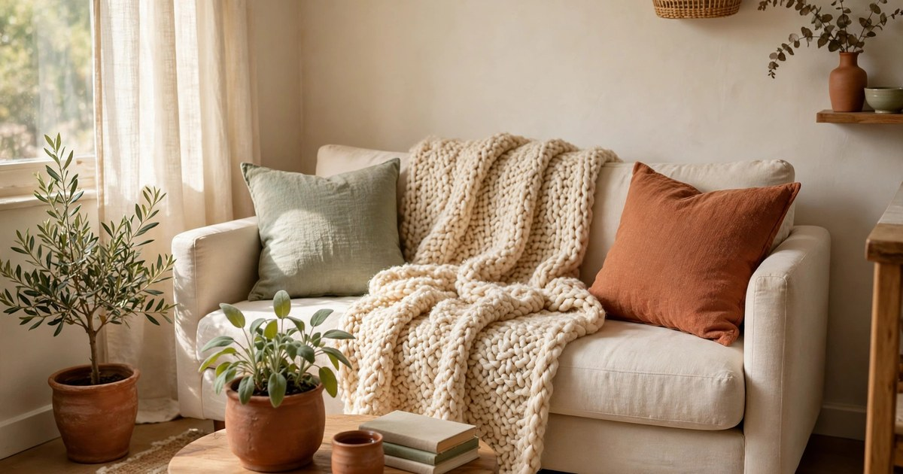
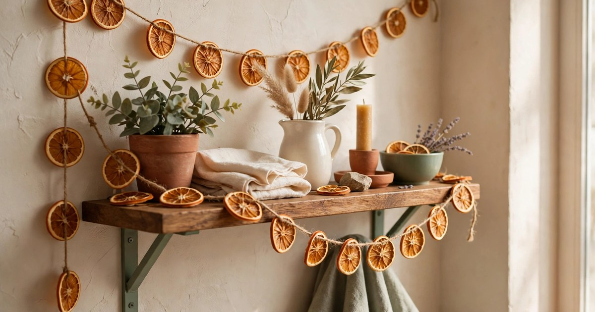
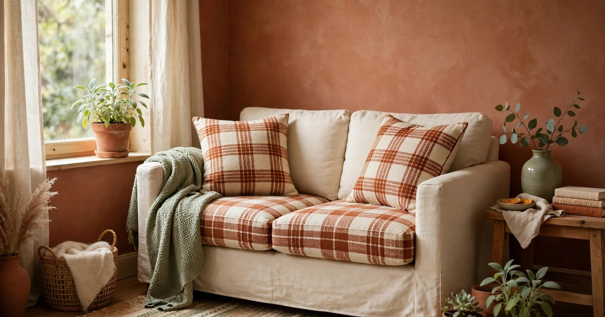
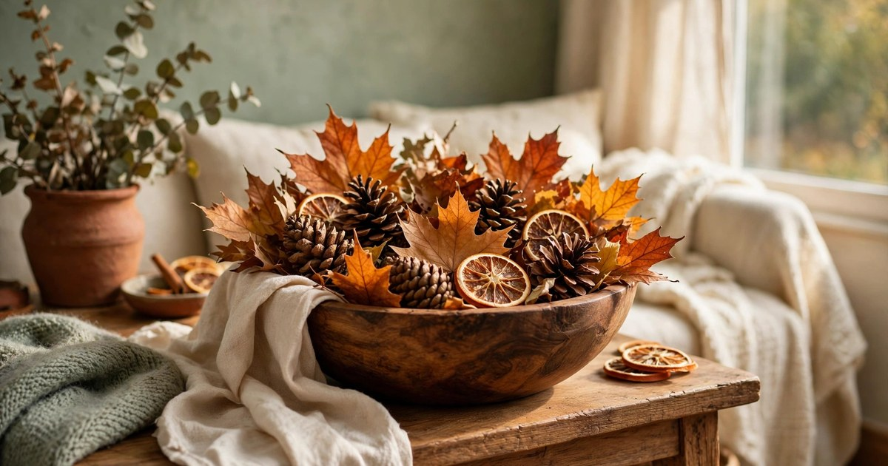
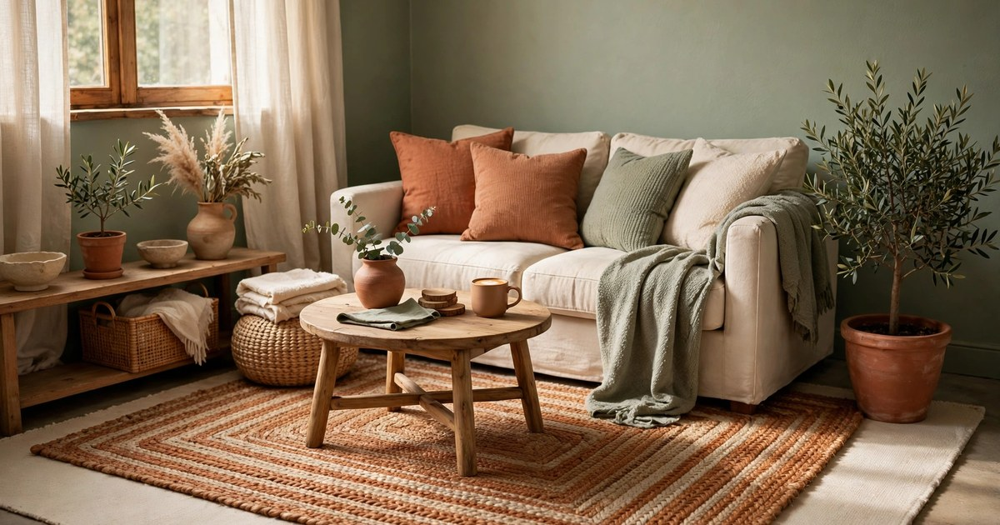
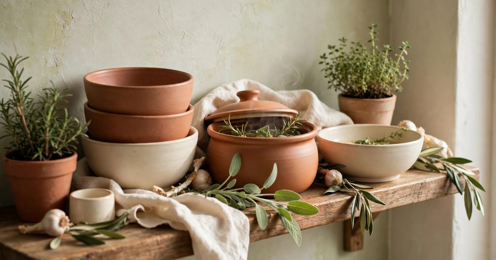
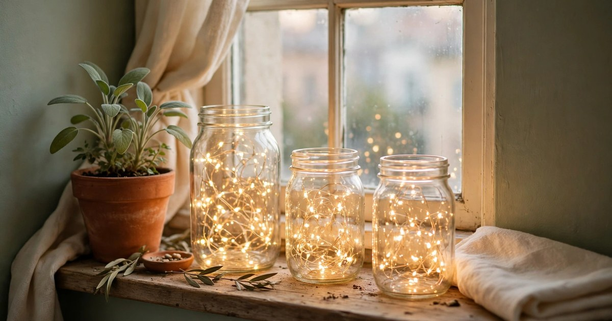
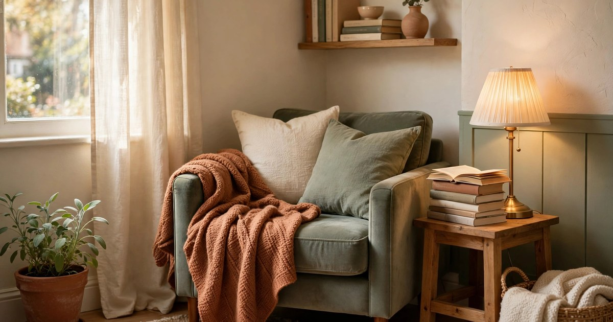
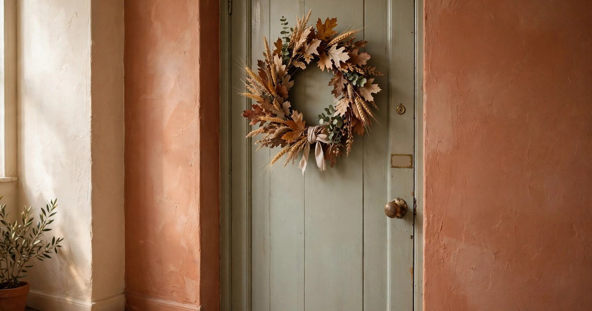

November is the awkward month for small apartments. The pumpkins have gone soft, the Christmas boxes feel premature, and the flat sits in a grey in-between that looks unfinished rather than seasonal. The fix is not more stuff — in a small space, more stuff is the problem — it is a handful of warm, autumn-into-winter touches that make the flat feel finished right now, without a single Christmas bauble. Every idea below costs little or nothing, comes down or transitions easily when December arrives, and works in a rental with no drilling, no damage, and no storage unit required.

### 1. Swap in one chunky knit throw

Nothing says November faster than a chunky knit throw folded over the sofa arm. It is the single highest-impact swap in a small flat, because it changes both how the room looks and how it feels to sit in — texture reads as temperature, and a heavy knit instantly makes a light summer sofa look winter-ready. Choose one warm neutral — cream, oatmeal, or rust — rather than a loud pattern, so the throw works with everything else you already own and survives the move into December without clashing with Christmas colours.

In a small apartment, one good throw beats three mediocre ones. Drape it over the arm of the sofa or the back of your favourite chair, not folded in a basket on the floor where it eats precious square footage. If you already own a warm throw, this idea costs nothing at all: wash it, fold it visibly over the sofa, and let it do the work it was already doing, only on display. For renters, throws are the perfect decor because they leave no trace — no holes, no adhesive, no argument with a landlord — and they pack into one bag when spring comes.

### 2. Build a candlelight evening ritual

November evenings arrive early, and a small flat lit by one overhead bulb feels like an office after dark. Switch the ceiling light off and light candles instead — three pillar candles of different heights on a tray on the coffee table, or a cluster of tealights along a shelf. The tray matters: it corrals the candles into one deliberate display, protects the surface underneath, and lets you move the whole arrangement in one lift when you need the table.

Warm white light is the whole trick. Cool white bulbs make a small room feel clinical, while candlelight and warm fairy lights make it feel like a place you want to stay in. If your tenancy restricts open flames, battery-operated pillar candles with timers give you the same glow and switch themselves on every evening at the same time — one less thing to remember in the dark months. Keep the ritual simple: same candles, same time, every evening, and November starts to feel cosy on purpose rather than dark by accident.

### 3. Hang a dried orange garland

A dried orange garland is November decor at its best: it looks autumnal now, it looks festive in December, and it costs almost nothing to make. Slice oranges thin, dry them low in the oven, and thread them on twine with cinnamon sticks and a few sprigs of rosemary. Drape the garland along a shelf, a mirror frame, or a curtain rail — anywhere it catches the light, because dried orange slices glow like stained glass when the sun hits them.

In a small flat, a garland is decor that takes up no surface at all, which is exactly why it works. It uses vertical space you were not using, it adds colour and scent without a single new object on a table, and it comes down in one lift. Make it now and it is already done for December too: the same garland moves to the mantel, the doorway, or the tree without a second thought. If you would rather buy than bake, dried orange garlands are widely sold in autumn — but the homemade version smells better, and the scent is half the point.

### 4. Switch to plaid cushion covers

Cushion covers are the cheapest room transformation a renter can buy, and November is the month to switch them. Swap light summer covers for plaid in rust, cream, and deep green, and the sofa changes season without a single piece of furniture moving. Plaid reads as autumn instantly — it carries the whole harvest feeling in one pattern — and unlike a novelty print, it still looks right in January when the Christmas decor has come down.

Two covers are enough in a small apartment; a sofa buried in cushions leaves nowhere to sit, which defeats the point of a small living room. Keep the rest of the cushions plain so the plaid has room to breathe, and store the summer covers in the same bag the plaid came in — one in, one out, no storage creep. This is also the rare November swap that costs under $20 for the pair and changes the room more than anything else on this list.

### 5. Fill a bowl with autumn leaves and pinecones

The simplest November centrepiece is also the oldest: a bowl of autumn. Gather pinecones, interesting leaves, and a few dried orange slices on a walk, and arrange them in a wooden or ceramic bowl on a side table or windowsill. It costs nothing, it takes five minutes, and it brings the outside in at exactly the moment the outside turns beautiful and then cold.

The trick is restraint. One bowl, well filled, looks intentional; three bowls scattered around a small flat look like clutter that fell off a tree. Choose one spot — the coffee table, the entryway console, or the dining table — and let the bowl be the only autumn display in that room. Swap the leaves for fresh greenery in December and the same bowl carries you through Christmas without a new purchase, which is the small-apartment way: one vessel, four seasons.

### 6. Layer a warm rug over what you have

Cold floors are the first thing you notice in November, and in a rental you cannot change the flooring — but you can layer over it. A warm woven or wool-blend rug laid over your existing rug or bare floor instantly insulates the room visually and literally, and it defines the living area in a studio flat where the boundaries between sleeping, sitting, and eating blur into one another.

Layering works best when the top rug is smaller than the one beneath it, with a border of the base layer showing all around — that contrast is what makes it look deliberate rather than accidental. Choose warm tones — rust, terracotta, or deep gold — and a texture you can feel through socks, because November is the month bare feet meet cold floors. In spring the top rug rolls up into a closet, and the flat breathes again. One rug, one season, no landlord permission needed.

### 7. Style the kitchen for soup season

November is soup season, and a small kitchen can celebrate it without a single decorative purchase. Stack your prettiest bowls on an open shelf, put a wooden board and a jar of dried herbs where you can see them, and keep a simmer pot — water, orange peel, cinnamon, cloves — on the stove in the evenings. The kitchen starts to look like a place where good food happens, because it is one, and the scent does the decorating for you.

This is decor that earns its place, which matters in a small kitchen where every object competes for counter space. A bowl stack is storage that looks like styling; a herb jar is an ingredient that looks like decor; a simmer pot is dinner preparation that smells like a candle. Nothing here is purely ornamental, so nothing here wastes space — the small-apartment test every November idea should pass.

### 8. Put fairy lights in jars

Fairy lights in jars are the small-apartment answer to November darkness: all of the glow, none of the commitment. Drop a battery-operated string into a mason jar, a large glass vase, or any clear container you already own, and you have a lamp that needs no socket, no drilling, and no surface bigger than the jar itself. Line three along a windowsill or cluster them on a shelf, and the room glows at exactly the height where you sit.

Timer strings are worth the small extra cost, because they switch on at dusk and off at bedtime without you touching them — the flat lights itself while you are still cooking dinner. In December the same jars move to the table as a centrepiece or flank the doorway, so this is another November idea that does double duty. Keep the lights warm white: cool white in a jar looks like a science experiment, warm white looks like candlelight.

### 9. Carve out a reading corner

November is the month a small flat finally rewards staying in, and a reading corner gives that instinct a place to land. You do not need a spare room — you need a chair, a lamp, and a blanket, arranged so they face each other rather than the television. Pull an armchair into the corner by the window, add the chunky throw from idea one, stack two or three books on a stool beside it, and angle a warm lamp over the chair's shoulder.

The corner works because it is a destination inside a small space: a place with one job, which makes the whole flat feel bigger by giving each zone a purpose. It also makes November evenings feel chosen rather than endured — a chair, a book, a blanket, and rain on the window is a November evening done right. When guests come in December, the same corner becomes the quiet seat at the party, which is a second life for the same three objects.

### 10. Hang a November wreath that is not Christmas

A wreath on the door says the season has arrived, and November deserves its own — not a Christmas wreath hung a month early, but an autumn one made of dried leaves, wheat stems, and seed heads in gold and rust. Hang it with a removable adhesive hook or over-the-door hanger, both renter-safe, and the hallway instantly feels seasonal without a single bauble in sight.

The November wreath has a practical advantage too: it buys you time. With the door dressed for autumn, there is no pressure to rush the Christmas decorating, and when December does arrive, the wreath comes down and the Christmas one goes up in the same hook — one hook, two seasons, no new holes. Choose dried materials over fresh for November, because a fresh wreath hung now will be brown before Thanksgiving, while dried leaves and wheat look the same on day thirty as on day one.

## November Is a Season, Not a Waiting Room

November decor fails when it tries to be early Christmas or leftover Halloween. It works when it leans into what November actually is: the month of warm light, heavy textiles, and food cooked slowly. Pick three or four ideas from this list — a throw, a candle ritual, a garland, a bowl of autumn — and the flat will feel finished all month, with nothing to undo when December arrives except to add the Christmas boxes on top of a home that already feels warm.

## Frequently Asked Questions

### When should I start decorating for November?

Early November is ideal — the first weekend of the month gives you a full month of enjoyment before Christmas decorating begins. November decor is about warmth and autumn, so it never looks early the way Christmas decor can in November.

### How do I decorate a small apartment for November without clutter?

Choose decor that uses vertical space or replaces something, rather than adding to surfaces: garlands on shelves, cushion covers swapped for plaid, a throw on the sofa. One bowl of autumn per room, not three, keeps the flat feeling styled rather than crowded.

### Can November decor transition into Christmas?

Yes — dried orange garlands, fairy lights in jars, warm rugs, and candle rituals all work through December unchanged. Only the explicitly autumn items, like the leaf bowl and the November wreath, need swapping when Christmas arrives.

### Is November decor renter-friendly?

Everything on this list is: throws, cushion covers, candles on trays, garlands on removable hooks, and rugs layered over existing floors. None of it requires drilling, nailing, or landlord permission.
