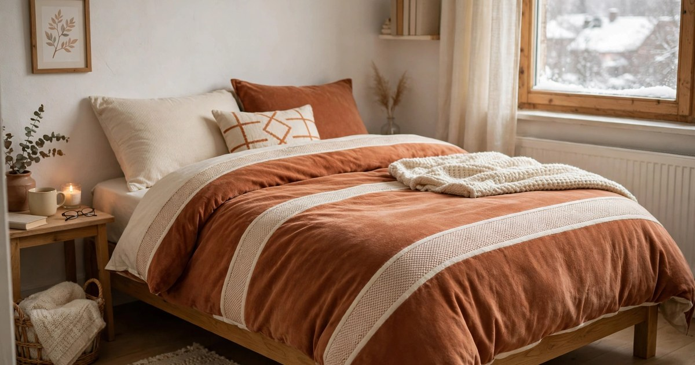
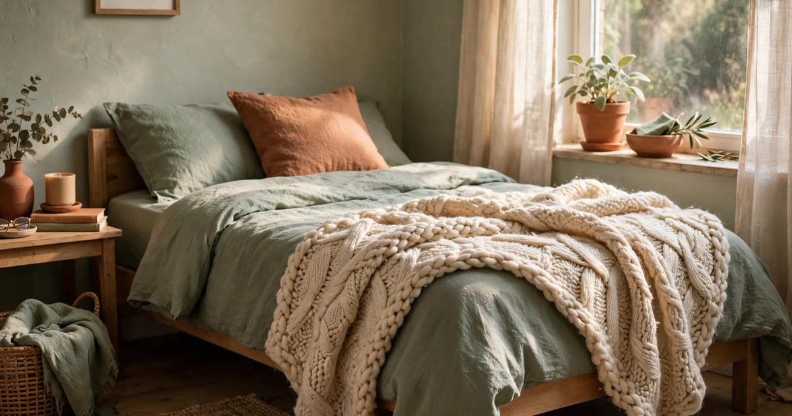
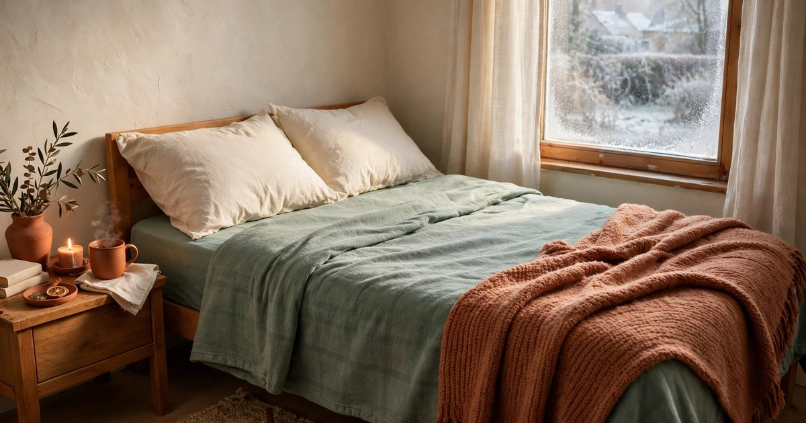
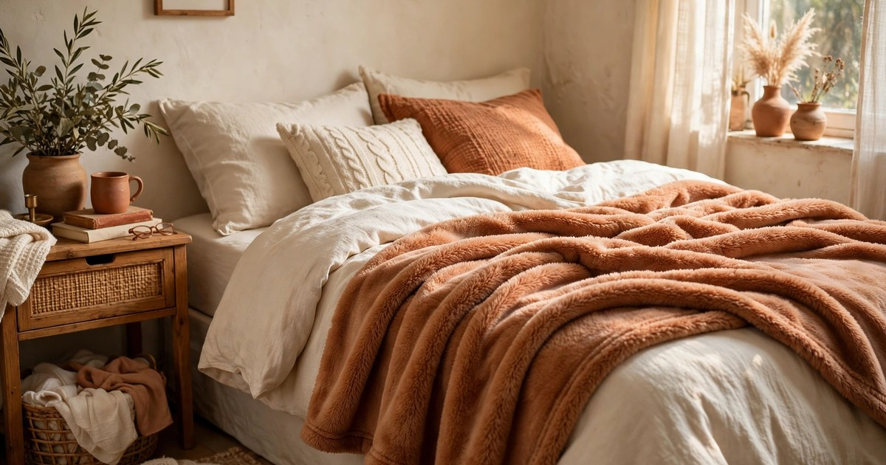
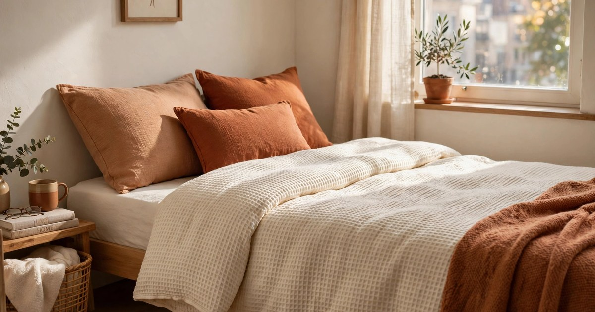
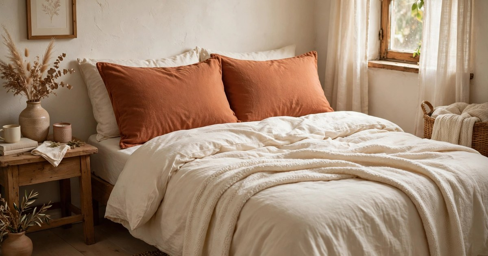
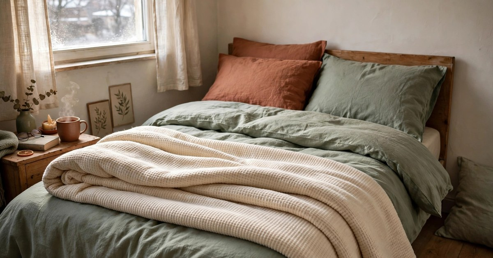
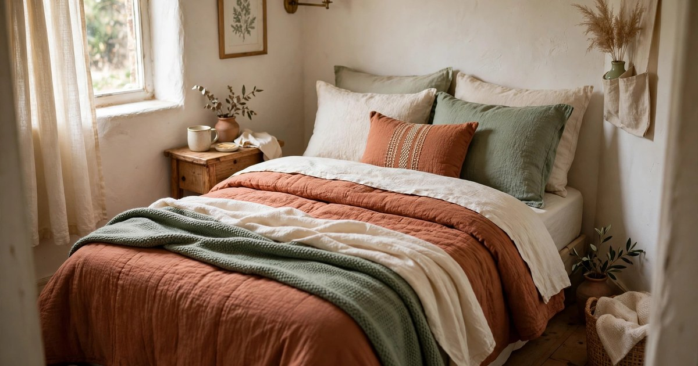

Winter in a small apartment has a particular kind of cold. The bedroom is often the draughtiest room in the flat, the radiator (if there is one) sits under a window that leaks, and there is nowhere to store a second, bulkier duvet for the cold months. The good news is that you do not need to spend a fortune or buy a whole new bed setup to sleep warm. For under $25 a piece, you can layer your way to a bed that feels like a cocoon, and every single find below is renter-friendly: nothing to install, nothing to damage, nothing that needs a bigger bed or a bigger flat.

The trick with small-bedroom winter bedding is layering, not bulk. One heavy duvet takes up the whole storage cupboard and looks like a marshmallow on a small double bed. Three lighter layers — a warm sheet, a mid-weight cover, and a throw you can fold to the foot of the bed — trap just as much heat, look better, and let you peel a layer off on milder nights. It also means you can buy one piece at a time, under $25 each, and build the warmest bed you have ever owned without a single big purchase. Here are the nine finds that do the most work for the least money.

### 1. Brushed microfibre duvet set

Why it works: brushed microfibre feels like flannel's smoother cousin — soft, slightly fuzzy, and warm from the first night, with no break-in period. Unlike a plain cotton cover, it traps a thin layer of warm air against your body, so a standard duvet underneath suddenly feels a tog or two warmer. Sets usually include the duvet cover plus pillowcases, which means one purchase refreshes the whole bed, and microfibre dries fast on a drying rack, which matters when you have no tumble dryer.

Where it fits: on a small double or single bed in a studio or box room, where one coordinated set makes the whole sleeping corner look intentional. Choose a warm solid — terracotta, cream, or sage — rather than a busy print, because a calm colour makes a tiny bedroom feel bigger and calmer, and it pairs with any throw you already own.

Budget tip: look for sets that include two pillowcases rather than one, and check the duvet cover closes with buttons or a zip rather than an open flap, so your duvet stays put. A [brushed microfibre duvet set](https://www.amazon.com/s?k=brushed+microfibre+duvet+set&tag={{AMAZON_TAG}}) is often cheapest in a plain colour, and plain colours also hide the wear of weekly washing better than white.

### 2. Chunky knit throw

Why it works: a chunky knit throw is the single most effective warmth-per-dollar purchase on this list. Draped over the foot of the bed, it adds a heavy, insulating layer exactly where your feet get cold, and because it is only a throw, you can pull it up over yourself on a freezing night or fold it away on a mild one. Knit textures also read as instantly cozy, so the bed looks warmer before you even get into it.

Where it fits: folded across the foot of any small bed, or draped over an armchair by day and moved to the bed at night, which is exactly the kind of double duty small flats demand. In a studio, a throw in a warm cream or terracotta also works as a visual divider, marking the sleeping zone without a single piece of furniture.

Budget tip: a throw does not need to be huge — a standard throw size covers the foot of a small double perfectly, and smaller throws cost less and store more easily. Wash it in a laundry bag so the knit does not snag, and it will last several winters.

### 3. Flannel flat sheet

Why it works: if you have ever climbed into a bed with cold cotton sheets on a winter night, you know the shock. Flannel fixes it completely: the brushed surface feels warm on contact, so there is no cold-sheet shiver, and it holds heat through the night instead of letting it escape. A flat sheet is also the cheapest way to get the flannel effect, since you are buying one layer rather than a full fitted set.

Where it fits: as the layer closest to your body, tucked under the mattress on a small double or single bed. Because a flat sheet is not fitted, one size works across bed sizes, and it doubles as an extra blanket on the sofa on the coldest evenings. In a rental where the mattress is thin or old, a flannel sheet also adds a soft buffer between you and a lumpy mattress.

Budget tip: buy the flat sheet in the same warm palette as your duvet cover so the layers look deliberate rather than thrown together. A [flannel flat sheet](https://www.amazon.com/s?k=flannel+flat+sheet&tag={{AMAZON_TAG}}) in cream or sage pairs with almost everything and will not show fading the way a bright colour does.

### 4. Fleece blanket layer

Why it works: fleece is the workhorse of winter layering — light, very warm for its weight, and almost impossible to damage. A fleece blanket between your sheet and your duvet adds serious insulation without any bulk, and because it is so light, it never makes the bed feel heavy or restrictive. It is also the layer you will reach for on the sofa, which makes it the hardest-working item in the flat.

Where it fits: sandwiched in the middle of your bedding stack, where it stays put all night, or folded at the foot of the bed for easy grabbing. In a tiny bedroom with no linen cupboard, a fleece blanket folds down to almost nothing, so it can live on a shelf, in a basket, or even under the bed without taking up real storage.

Budget tip: fleece is one of those fabrics where the budget versions perform almost identically to the expensive ones, so do not pay for a brand name. A plain fleece blanket in a warm neutral is usually under $25 and will survive years of weekly washing without losing its softness.

### 5. Waffle-weave duvet cover

Why it works: waffle weave is the texture trick of winter bedding. The little raised squares trap air in their pockets, which adds warmth without adding weight, and the texture looks expensive — like something from a boutique hotel — even at a budget price. It also breathes better than a flat microfibre cover, so you stay warm without waking up clammy, which is a real problem in small, stuffy bedrooms.

Where it fits: as your main winter duvet cover on a small double bed, where the texture adds visual interest to a room that has no space for decorative cushions or a headboard display. A waffle cover in cream or terracotta looks beautiful against a simple wooden bed frame and does not need any other styling to look finished.

Budget tip: waffle covers often come as a cover-only purchase, so check whether pillowcases are included before you buy — and if they are not, your existing cream pillowcases will match perfectly. Wash on a gentle cycle and skip the fabric softener, which flattens the waffle texture over time.

### 6. Warm pillowcase pair

Why it works: your face is the one part of you that stays outside the covers all night, so cold pillowcases are a surprisingly big comfort problem. Brushed or flannel pillowcases feel warm against your cheek from the moment you lie down, and they stop that clammy feeling you get from cold cotton on a winter night. It is a tiny purchase that changes how the whole bed feels.

Where it fits: on every pillow on the bed, including the spare one you prop up for reading. In a small bedroom, matching pillowcases are also the fastest visual upgrade there is — two matching cases in a warm colour make an unmade-looking bed look dressed, even when the rest of the bedding is simple.

Budget tip: pillowcase pairs are often sold for a few dollars, so this is the easiest win on the list. Buy two pairs if you can, so one is always in the wash, and choose a brushed finish rather than satin, which feels cold in winter no matter how luxurious it looks.

### 7. Quilted bedspread for studio beds

Why it works: in a studio, the bed is also the sofa, the [reading nook](/cozy-reading-nook-small-apartment-guide/), and the backdrop of every video call, so it needs to look good all day and feel warm all night. A quilted bedspread does both jobs: by day it is a tidy, made-bed look that hides your duvet, and by night it is an extra insulating layer on top of everything else. Quilting also stops the filling shifting around, so it stays evenly warm.

Where it fits: spread over the whole bed in a studio or bedsit, where it turns the sleeping area into a daybed with one move — add two cushions and it reads as a sofa. Choose a warm, earthy tone that matches your room, because in a studio the bedspread is effectively the largest single colour block in the flat.

Budget tip: a lightweight quilted bedspread costs far less than a heavy quilt and does more jobs. Look for one that is machine washable and reversible, so you get two colour options for the price of one and can flip it when one side fades.

### 8. Heated-style (non-electric) thermal blanket

Why it works: this is the no-plug answer to an electric blanket. Modern thermal blankets use dense, brushed fibres that reflect your own body heat back at you, so they feel heated without any electricity, any wiring, or any worry about leaving something switched on. For renters, that last point matters — no landlord permission, no fire-risk anxiety, and no added electricity bill.

Where it fits: as the top layer of your bedding stack on the coldest nights, or wrapped around you on the sofa while you wait for the flat to warm up. Because it needs no power, it also works in a bedroom with no free sockets near the bed, which is a common small-flat problem. Folded, it is compact enough to live in a basket by the bed.

Budget tip: check the weight before you buy — a good thermal blanket feels noticeably heavier than a fleece one of the same size, and that density is what traps the heat. Avoid anything marketed as "electric-style" that actually needs a plug; the whole point is that this one does not.

### 9. Layering set for small double beds

Why it works: if buying piece by piece feels overwhelming, a layering set bundles the whole system — usually a cover, a blanket, and pillowcases — in one coordinated package sized for a small double. Everything matches, everything fits the bed, and you skip the guesswork of pairing colours and sizes yourself. For a first flat or a first winter in a rental, it is the simplest route to a warm bed.

Where it fits: on a small double bed in a flat where the bedroom is also the office or the guest room, because a coordinated set makes the bed look finished even when the room is doing three jobs. It is also the best option if you are buying for someone else, like a student child or a friend moving into their first rental.

Budget tip: compare the set price against buying the pieces separately — sets are usually cheaper, but only if you actually need every piece. If you already own a good duvet cover, buy the blanket and pillowcases on their own instead. And always check the set is sized for a small double rather than a king, or you will be tucking in metres of spare fabric every night.

## Building your warm bed for under $25 a piece

The real secret of winter bedding in a small apartment is that warmth comes from layers, not from one expensive purchase. Start with the layer closest to you — a flannel sheet or warm pillowcases — then add a fleece or thermal blanket in the middle, and finish with a cover or throw that looks as good as it feels. Each piece costs under $25, each one works on its own, and together they make a bed that stays warm through the coldest nights without a bigger duvet, a bigger bed, or a bigger flat. Pick the two or three finds that fix your coldest problem first, and add the rest as the winter goes on.

## Frequently Asked Questions

### How can I make my bed warmer in winter without buying a new duvet?
Layer instead of replacing. Add a flannel flat sheet closest to your body, a fleece or thermal blanket in the middle, and a throw at the foot of the bed. Three light layers trap more warm air than one heavy duvet, cost far less, and let you adjust to milder nights by removing a layer.

### What is the warmest budget bedding material for a small apartment?
Brushed microfibre and flannel are the warmest budget options, because their fuzzy surfaces trap warm air and feel warm on contact. Fleece is the best mid-layer for its weight, and a waffle-weave cover adds warmth through its air-trapping texture. Avoid plain flat cotton in winter — it feels cold and lets heat escape.

### Do I need an electric blanket to stay warm in a rental?
No. A non-electric thermal blanket reflects your own body heat and feels heated without a plug, a socket, or any landlord permission. Layered with a flannel sheet and a fleece blanket, it keeps most people warm even in a [draughty](/winter-proof-drafty-rental-guide/) rental bedroom, with no added electricity cost.

### How do I store extra winter bedding in a small apartment?
Choose layers that fold small — fleece and thermal blankets compress to almost nothing. Store them in a basket by the bed, under the bed in a flat box, or on top of a wardrobe in a vacuum bag. A throw folded at the foot of the bed needs no storage at all, which is why it is such a good small-space buy.
