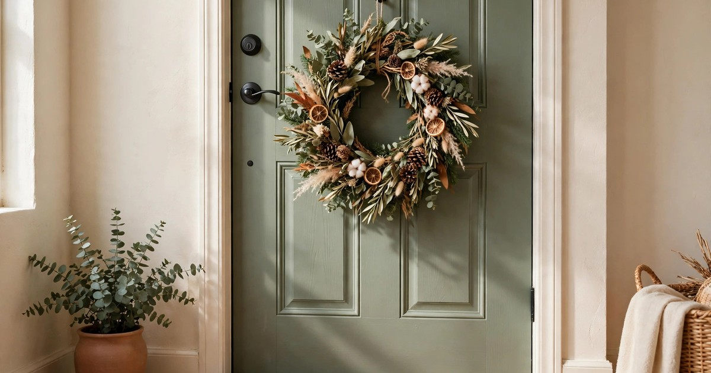
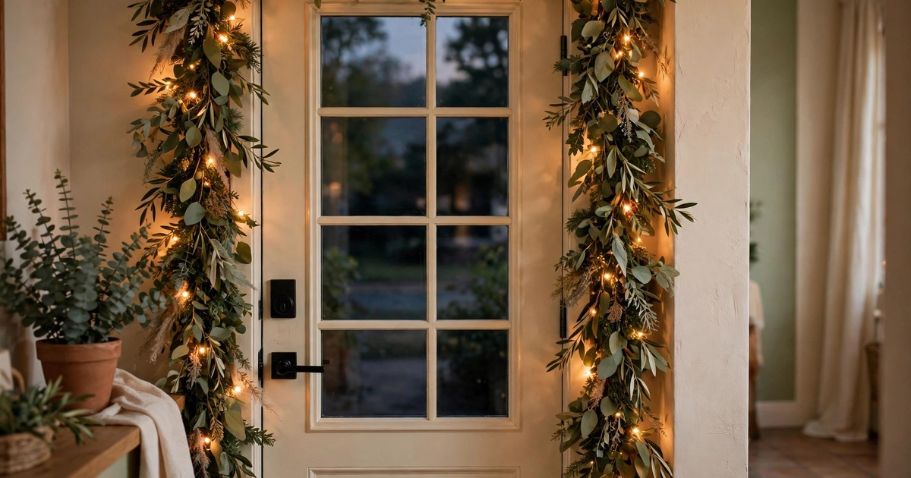
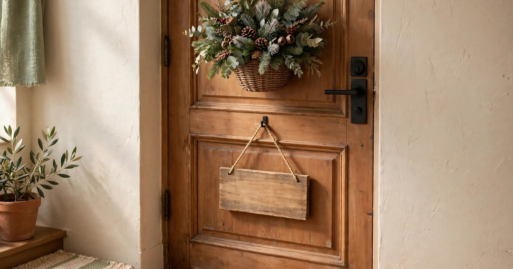

The front door is the first Christmas decoration anyone sees, and for renters it is also the easiest one to get wrong. A nail in the door, a screw in the frame, a wreath hanger that scratches the paint — any of them can cost you part of your deposit in January. The good news is that a rental front door can look properly festive with nothing more than adhesive hooks, an over-door hanger and a few battery lights, and every single piece can come down in January without leaving a mark. This guide walks you through the whole project in seven steps, from checking what your lease allows to the takedown, so your door is the warmest on the street and your deposit stays intact.

Start with the big picture: a decorated rental door needs four layers, and you can add them in any order. A wreath is the centrepiece. A garland frames the door. Lights add the evening glow. And a doormat grounds the whole thing. You do not need all four — a wreath and a mat alone look finished — but together they make a doorway that feels deliberate rather than decorated by accident. If you already have a wreath sorted, our guide to [hanging a Christmas wreath with no drilling](/no-drill-christmas-wreath-hanging-renters/) covers the fixings in detail, and our [renter-friendly Christmas doormats](/renter-friendly-christmas-doormats-under-25/) roundup has options under $25.

### Step 1. Check the lease and measure the door

Before you buy anything, read the lease. Most rental agreements say nothing about door decorations, but some forbid anything attached to the outside of the door, and a few — usually in blocks of flats with a management company — restrict what can go in shared hallways and on communal doors. A two-minute check now saves an awkward conversation with a letting agent later. If the rules are unclear, a quick message to the agent is worth it; landlords almost always say yes to damage-free decorations, and asking creates a paper trail that protects you.

Measure the door while you are there. Note the width, the height, and the thickness of the door itself, because an over-door wreath hanger that fits a standard 35mm interior door will not fit a 44mm exterior door, and a wreath that looks generous on a narrow flat door will look lost on a wide one. A wreath of 45 to 60 centimetres suits most front doors; go larger only if the door is wide. Also check which way the door opens and whether anything — a porch light, a letterbox, a door number — will collide with a wreath or a garland. Photograph the door before you start, so you have a record of its original condition.

### Step 2. Hang the wreath without a single hole

The wreath is the centrepiece, and the over-door hanger is the renter's best friend. A metal hanger hooks over the top of the door and holds the wreath from a hook on the outside face — no nails, no screws, no adhesive, and it comes off in seconds. Choose one with a felt or rubber backing where it touches the door, and check the weight rating: a full artificial wreath with baubles can weigh a kilo or more, and a hanger rated for two kilos gives you comfortable margin.

If your door is metal, magnetic wreath hangers are even simpler: a strong magnetic hook on the outside face holds the wreath directly, with nothing over the top of the door at all. For a lighter wreath, a large adhesive hook rated for outdoor use works too, but only if the door surface is smooth and clean — textured or painted wood can defeat adhesive, so test it for a day before trusting it with your best wreath. Hang the wreath at eye level, roughly in the centre of the door, and step back to check it from the street rather than from inside the hallway. If your door is inside a shared hallway, keep the wreath slim so it does not block the corridor or catch on neighbours passing by.

### Step 3. Frame the door with a garland

A garland turns a wreath into a doorway. Drape a pre-lit or plain artificial garland along the top of the door frame and down both sides, and the whole entrance reads as one finished piece. The fixings are the same ones you used for the wreath: adhesive hooks rated for outdoor use, spaced every thirty to forty centimetres along the frame, with the garland's wire or ribbon looped over each hook. Small adhesive cable clips work just as well and are nearly invisible once the garland is in place.

Keep the garland light. A heavy garland pulls adhesive hooks off painted frames, especially in cold weather, so choose a slim garland rather than a thick one, and add fullness with a few wired sprigs of eucalyptus or pine tucked in rather than a second garland. If you are decorating a door inside a shared hallway, a garland across the top only — no side drops — keeps the corridor clear and still looks finished. For more garland ideas that come down without a trace, our [renter-friendly Christmas garland ideas](/renter-friendly-christmas-garland-ideas/) have ten options.

### Step 4. Add battery lights around the frame

Lights are what make a front door glow after dark, and battery lights are the renter's only sensible option — no extension lead through a window, no cable under a door, no argument with the landlord about outdoor sockets. A string of warm white fairy lights woven through the garland, with the battery pack tucked behind the garland at the top corner, gives you the glow with none of the wiring. Choose lights with a built-in timer: six hours on, eighteen off, switched on once and forgotten until January.

Check the battery pack's position before you commit. It should sit where rain cannot reach it — under the porch roof, behind the garland, or inside a small waterproof pouch — and where you can reach it easily to change the batteries. Outdoor-rated battery lights cost a little more and are worth it; indoor fairy lights left outside will fail after the first damp night. Keep the light colour warm white throughout: a single string of cool white lights against a warm wreath and garland will look like a mistake, while warm white ties the whole doorway together.

### Step 5. Layer the doormat

The doormat is the bottom layer of the doorway, and layering it is the cheapest upgrade on this list. A large patterned outdoor rug — a simple buffalo check, a muted stripe, a plain jute mat — laid flat first, with a smaller coir Christmas doormat on top, gives you a doorway that looks styled rather than merely functional. The layered look also solves a practical problem: a thin Christmas mat on its own slides around on a smooth porch, while the rug underneath grips it and catches the mud and salt that would otherwise come inside.

Size the bottom rug generously: it should be at least as wide as the door, and long enough that the top mat sits comfortably inside it with a visible border all round. Avoid anything with a thick pile, which holds water and freezes in cold weather, and keep the top mat flat and low so the door still opens over it. A coir mat shakes clean with a single lift, and because both layers are loose-laid, they go back in the cupboard in January with nothing to remove from the wall or the door.

### Step 6. Add one personal touch, not five

A doorway with a wreath, a garland, lights and a layered mat is already complete, and the temptation now is to keep adding. Resist it. One personal touch — a small hanging basket of winter greenery beside the door, a wooden sign with a short greeting, a pair of small lanterns flanking the step — is what makes the doorway yours rather than a catalogue copy. Five touches make it a jumble.

Choose the one that suits your door. A narrow doorway suits a hanging basket, which adds greenery without taking floor space. A wide porch suits a pair of lanterns, which frame the door and echo the lights in the garland. A door inside a shared hallway suits a small sign, which adds personality without taking up any corridor space at all. Whatever you pick, fix it the same damage-free way as everything else: an adhesive hook for the basket, a ribbon over the door for the sign, and nothing that needs a nail.

### Step 7. Plan the January takedown before you put anything up

The takedown is where deposits are lost, and planning it now is what separates a good rental decoration from an expensive one. Adhesive hooks come off by pulling the tab straight down along the wall, never by yanking them outward — pull the tab slowly, keep the hook pressed to the wall, and the strip releases cleanly. Over-door hangers lift off in seconds. Battery packs come out of the garland before the garland comes off the hooks, so you are never wrestling with a wired garland at arm's length.

Photograph the door again once everything is down, and compare it with the photograph you took in step one. Any mark you find, deal with immediately: a Magic Eraser on a scuff, a damp cloth on adhesive residue, a touch of white paint only if the landlord has already approved it. Then store everything in one labelled box — wreath in a bag, garland coiled loosely, lights with the batteries removed — so next December you start from a box rather than from scratch. A rental front door that goes up without damage and comes down without damage is a decoration you can repeat every year, and that is the real budget win.

## Frequently Asked Questions

### Will an over-door wreath hanger damage my door?
No, if you choose one with a felt or rubber backing and the right weight rating. The hanger sits over the top of the door and rests against the outside face; it leaves no mark. Check that the door still closes fully with the hanger in place before you hang the wreath.

### Can I use adhesive hooks outside in winter?
Yes, if they are rated for outdoor use and the surface is clean, dry and smooth. Cold and damp weaken adhesive, so apply hooks on a dry day and give them an hour before hanging anything. Textured or flaking paint will defeat adhesive — use an over-door hanger instead.

### What if my front door is in a shared hallway?
Keep everything slim and contained: a flat wreath rather than a deep one, a garland across the top only, no lanterns or baskets on the floor. Check the building's rules first — some management companies restrict hallway decorations — and keep the corridor clear at all times.

### How do I stop a wreath from scratching the door?
Use a hanger with a padded backing, or stick a small piece of felt to the back of the wreath where it touches the door. A wreath that swings in the wind will scuff paint over a month, so make sure it hangs still: a second small adhesive hook at the bottom, or a ribbon tied to the letterbox, stops the movement.
