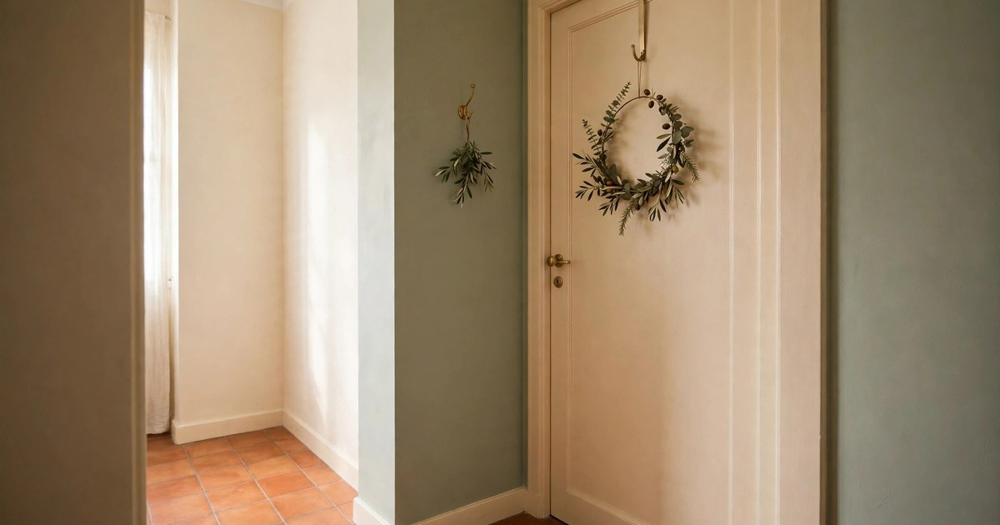
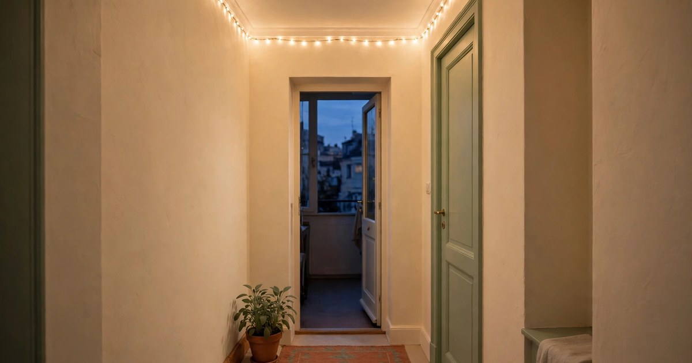
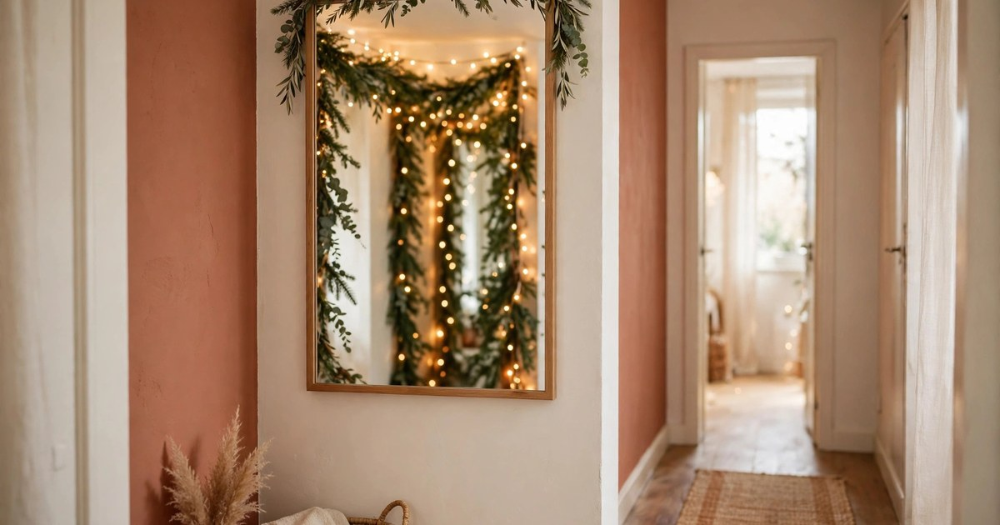
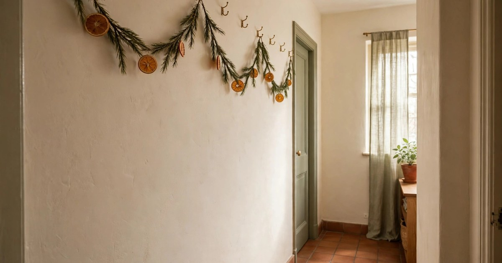
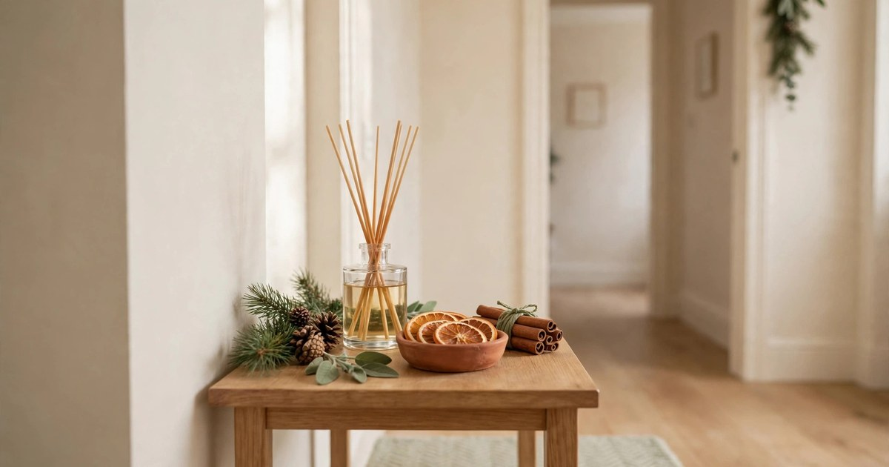
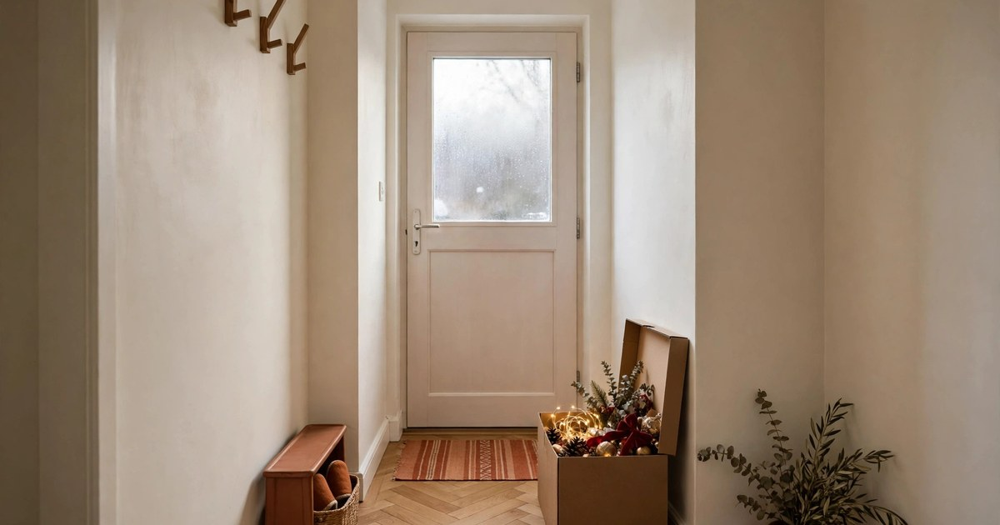

The hallway is the most overlooked room at Christmas, and in a small apartment it is often the only room guests actually walk through. It is also the narrowest, busiest space in the flat: coats, shoes, keys, bags and people all pass through it daily. That is exactly why it deserves a little festive attention — a decorated hallway sets the tone the moment someone steps inside — and exactly why most hallway decor fails, by blocking the path it is meant to welcome people down.

The rules for a small hallway are simple. Nothing on the floor that trips anyone. Nothing on the walls that damages them. Everything either flat, high, or tucked into a surface that already exists. Follow those three rules and you can make even a metre-wide corridor feel like Christmas. Here is how, step by step.

### 1. Start with the entry: one hook, one wreath

Begin at the door, because that is where the hallway starts and where the first impression lands. Hang one wreath on the inside of the front door using an over-door hook — no nails, no adhesive, no damage, and it comes down in January without a trace. Choose a slim wreath rather than a deep, bushy one: in a narrow hallway, a wreath that sticks out 20 centimetres will brush every shoulder that passes.

Beside the door, swap your everyday key hook for a festive one, or hang a small sprig of greenery from the existing hook with twine. This is the whole entry sorted in five minutes, and it is deliberately restrained. The hallway is a passage, not a destination, so one confident gesture at the door beats a dozen small ones competing for attention. If you have a console table or a shoe bench by the door, that is your next surface — but the door itself is step one, and for a very small hallway it may be all you need.

### 2. Run lights along the ceiling line, not the walls

[Fairy lights](/hang-christmas-lights-rental-guide/) are the hallway's best friend because they decorate the one part of the corridor nobody walks through: the ceiling line. Run a single warm-white string along the top of the wall where it meets the ceiling, using removable adhesive clips, and the whole hallway glows without losing a centimetre of width. Battery-operated lights with a timer are ideal here, since hallways rarely have a spare socket.

The ceiling line matters because eye level in a narrow hallway is already busy with coats, mirrors and door frames. Lights up high draw the eye upward, which makes a low, narrow corridor feel taller and more open. Keep to one string and one colour — warm white — rather than draping multiple strands or mixing colours, which quickly reads as clutter in a tight space. One neat line of light, switched on at dusk, transforms a dark corridor into the warmest part of the flat.

### 3. Dress the console table or shelf

If your hallway has a console table, a floating shelf or even a wide [windowsill](/winter-windowsill-garden-guide/), that surface is your display case. Style it the way you would a mantel: a small cluster of candles at one end, a sprig of greenery or a mini tree in the middle, and one personal touch — a framed photo, a favourite ornament — at the other end. Keep the arrangement to the back half of the surface so the front stays clear for keys, post and bags.

The key discipline here is restraint. A console table in a hallway is a working surface first and a display second, and the moment it becomes too precious to use, it stops being useful. Three objects, maximum, in a tight colour palette — cream, terracotta and green work beautifully against the warm palette of a small flat. If you have no console table, a single floating shelf above the shoe bench does the same job, and a small tray on the shelf corrals the display into one liftable unit.

### 4. Use the mirror: double the light for free

Most small hallways have a mirror, and at Christmas it becomes your hardest-working decoration. A mirror doubles whatever light and greenery is already in the hallway, so a string of fairy lights reflected in it looks like two strings, and a sprig of greenery on the console looks like a fuller display. Position matters: hang or lean the mirror opposite the lights or the console display, not beside them, so the reflection actually captures something worth doubling.

Dress the mirror itself lightly, if at all. A thin [garland](/renter-friendly-christmas-garland-ideas/) draped along the top edge, or a single sprig tucked into the frame's corner, is plenty — anything more and the mirror stops reflecting the room and starts competing with it. In a narrow hallway, the mirror's real job is spatial: it makes the corridor feel wider and brighter, and at Christmas it does that job twice over by bouncing candlelight down a space that rarely gets any natural light.

### 5. Lay a festive runner on the floor

A hallway runner is the one floor decoration that is safe in a narrow space, because it lies flat and defines the path rather than blocking it. Swap your everyday runner for a festive one — deep red, a simple plaid, or a cream runner with a woven border — and the whole corridor changes character the moment you step onto it. Choose a low-pile runner with a non-slip backing so it stays put underfoot, and keep it the full length of the hallway so it reads as intentional rather than a stray mat.

The runner also solves a practical problem: December brings wet shoes, grit and pine needles into the hallway, and a washable runner takes the beating so your floor does not have to. Buy one you can throw in the washing machine, and it will survive the season and come back next year. If a full runner feels like too much, a festive [doormat](/renter-friendly-christmas-doormats-under-25/) just inside the door gives the same welcome in miniature — but a runner, running the length of the hall, is what turns a corridor into a Christmas entrance.

### 6. Hang a garland high on the wall, not at head height

Garlands belong in hallways, but at the wrong height they become a hazard — brushing faces, catching on coats, shedding needles onto shoulders. The fix is height: run a slim garland along the top of the wall, just below the ceiling line, where it frames the corridor without entering anyone's personal space. Use removable adhesive hooks every 30 centimetres or so, and let the garland dip gently between hooks for a soft, swagged look.

Keep the garland slim and simple. A thin pine or eucalyptus garland, undecorated or with a few dried orange slices woven in, looks elegant and stays put. Skip the heavy baubles and thick, bushy garlands — they pull hooks off the wall and shed constantly in a high-traffic space. If your hallway has a doorway arch or a picture rail, that is the natural place for the garland to sit, and a single swag across the arch is often more effective than a garland running the full length.

### 7. Scent the hallway, don't clutter it

The hallway is the first thing guests smell, and scent is the one decoration that takes up no space at all. A reed diffuser in cinnamon, pine or spiced orange on the console table, a simmer pot on the stove before guests arrive, or a sachet of dried spices hung on the door handle will make the whole flat smell like Christmas from the moment the door opens. In a small apartment, scent travels fast, so one diffuser is enough for the entire hallway and beyond.

This matters more than it sounds, because the hallway is where the festive feeling either lands or does not. Guests form their impression in the first three seconds inside the door, and scent is doing most of that work before they have even looked at the decorations. Choose one scent and stick to it through the whole flat — clashing fragrances from different rooms are worse than none at all. A diffuser is the safest choice for a hallway, since it needs no flame and no supervision, and it keeps working all day.

### 8. Plan the January takedown now

The final step happens before you put anything up: decide where it all goes in January. A hallway's decorations should fit in one small box, stored on top of a wardrobe or under the bed, and every piece should come down without a trace — adhesive hooks peeled off, the runner rolled up, the wreath back on its hook in the cupboard. If a decoration cannot be removed cleanly, it does not go up in a rental hallway.

This planning is what makes hallway decorating sustainable year after year. Label the box, keep the adhesive hooks with it so you are not hunting for new ones next December, and note what worked — the ceiling-line lights, the slim garland — and what did not. The hallway is the first space you decorate and the last one you think about, but a takedown that takes twenty minutes instead of two hours is the difference between decorating again next year and deciding it is not worth the effort.

## A Hallway That Welcomes, Not Blocks

A small apartment hallway decorated for Christmas should feel like an entrance, not an obstacle course. The formula is simple: one gesture at the door, light along the ceiling line, one styled surface, a mirror working overtime, a runner underfoot, greenery kept high, scent doing the invisible work, and a takedown plan decided in advance. Nothing on the floor, nothing that damages the walls, nothing that blocks the path.

Start with the wreath and the lights — those two alone will change how the hallway feels — and add the rest only if the space genuinely allows it. The best hallway Christmas decor is the kind guests notice in the first three seconds and never trip over once.

## Shop this look: hallway Christmas in a small space

- **Over-door wreath hanger** — a wreath with no holes in the door. [Shop wreath hangers](https://www.amazon.com/s?k=over+door+wreath+hanger&tag={{AMAZON_TAG}})
- **Adhesive wall hooks** — hold lights and garlands, come off clean. [Shop adhesive hooks](https://www.amazon.com/s?k=adhesive+hooks+for+christmas+lights&tag={{AMAZON_TAG}})
- **Battery fairy lights** — no outlet needed along the ceiling line. [Shop battery fairy lights](https://www.amazon.com/s?k=battery+operated+fairy+lights&tag={{AMAZON_TAG}})
- **Hallway runner rug** — a festive strip that protects the floor. [Shop hallway runners](https://www.amazon.com/s?k=christmas+hallway+runner+rug&tag={{AMAZON_TAG}})
- **Flameless tea lights** — safe glow for a console shelf. [Shop flameless tea lights](https://www.amazon.com/s?k=flameless+tea+lights+with+timer&tag={{AMAZON_TAG}})

## Frequently Asked Questions

### How do I decorate a narrow hallway for Christmas without blocking it?
Keep everything high, flat or tucked into existing surfaces. Run lights and garlands along the ceiling line, style only the back half of a console table, and use a flat runner on the floor. Nothing should stick out into the walking path at head or shoulder height, and nothing should sit on the floor except the runner itself.

### What Christmas decorations are safe for a rented hallway?
Anything hung from removable adhesive hooks, over-door hooks or existing picture rails is renter-safe, as long as it comes down cleanly. Battery-operated lights avoid socket problems, and a reed diffuser gives you festive scent without a flame. Avoid nails, screws and anything heavy enough to pull paint off the wall when removed.

### How much should I budget for hallway Christmas decor?
A wreath, a string of fairy lights, a festive runner and a diffuser can be bought for $50 to $75, and most of it lasts for years. If you already own a runner and lights, the hallway can be dressed for under $25 with a wreath and a diffuser alone. Start with lights and the door, then add one piece a year.

### When should I decorate a hallway for Christmas?
Late November or the first weekend of December is ideal — early enough that the hallway feels festive for the whole season, but late enough that the greenery and scent last through Christmas. Take it down in the first week of January, while the motivation is still there, and store everything in one labelled box.
