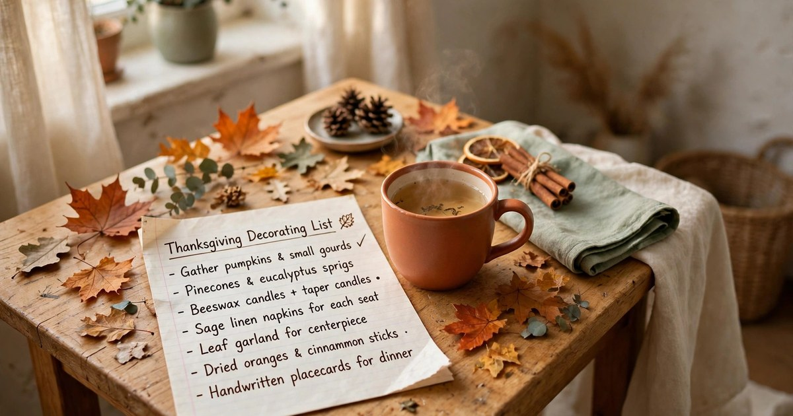
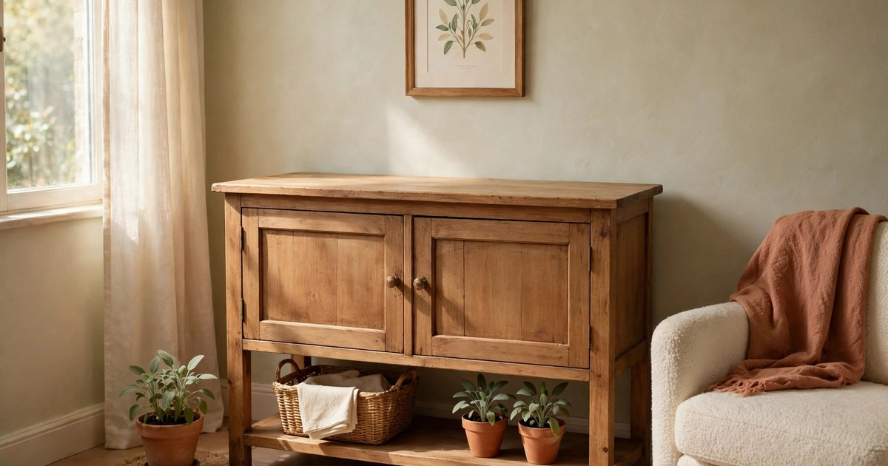
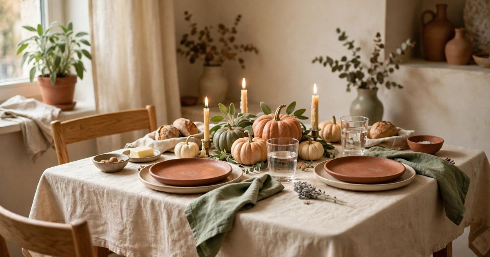
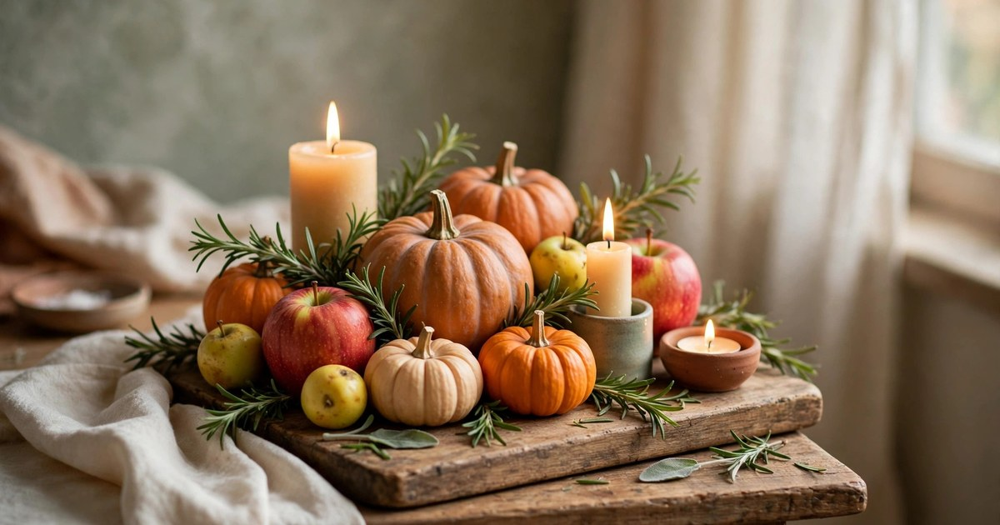
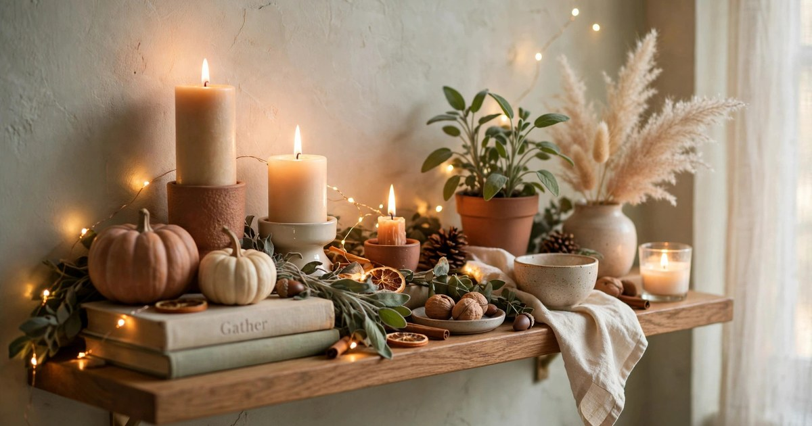
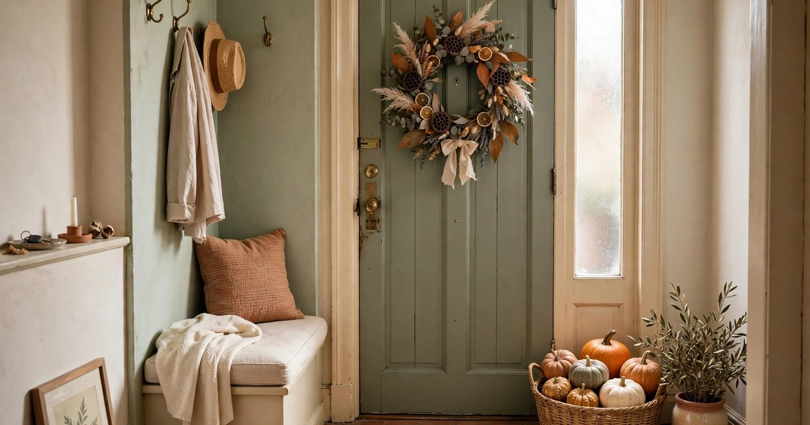
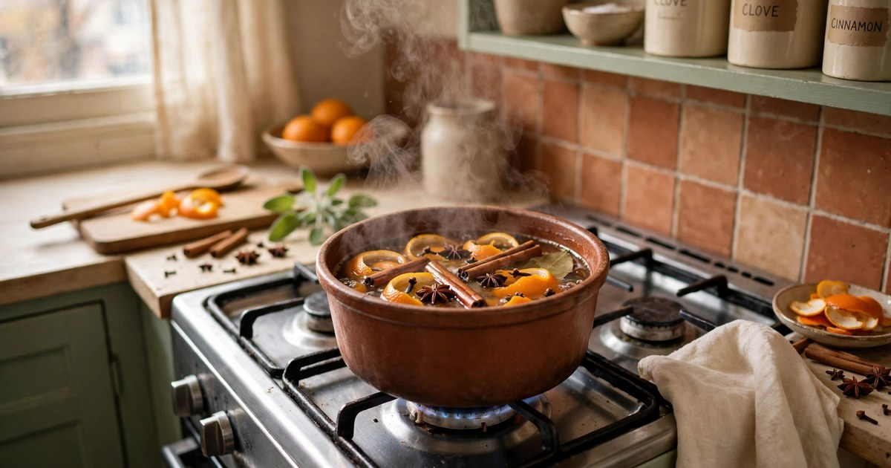
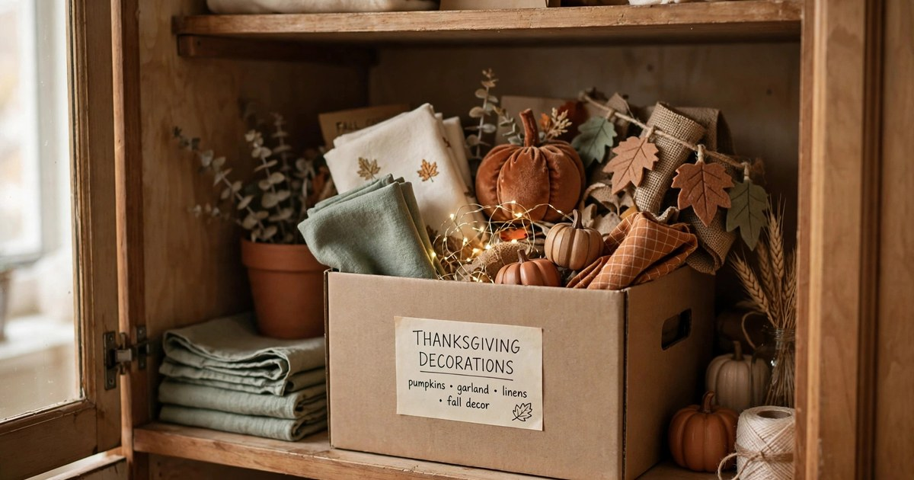

Thanksgiving in a small apartment does not need a big budget, a big table or a big house. It needs a plan, a few warm layers and one room that smells like cinnamon when guests walk in. Fifty dollars, spent in the right order, will dress a whole flat: the table, the entry, a shelf or two, and the scent that does the rest. The trick is to decorate where people actually look — the table, the front door and the kitchen counter — and to leave the rest of the flat alone.

This guide works in order, so follow it from step one to step eight and you will be finished in an afternoon, with money left over for the turkey. Every step is renter-friendly, nothing needs a nail or a drill, and everything packs away into one box when the weekend is over. Start a week before the day if you can, but even the night before is enough if you keep the list short and the plan simple.

### 1. Set the Budget and Make the List

Before you buy anything, decide what fifty dollars has to cover and write it down. A good split is twenty dollars for the table, fifteen for the entry and shelves, and fifteen for candles and scent — the things that make the flat feel like Thanksgiving rather than just look like it. Write the list on paper, not in your head, because a written list is the only thing standing between you and a trolley full of glittery pumpkins you do not need.

Walk through the flat with the list and cross off anything you already own. Most renters already have the bones of Thanksgiving decor without knowing it: a plain tablecloth, a few candles, a wooden chopping board, a basket, a linen napkin or two. What you are really buying is the seasonal layer on top — a few pumpkins, some dried leaves, a bunch of eucalyptus, a roll of kraft paper for a table runner. Shop the kitchen first, the pound shop second, and the homeware aisle last, because the homeware aisle is where budgets go to die.

### 2. Clear One Surface Before You Add Anything

Thanksgiving decor fails in small flats for one reason: it gets added on top of everyday clutter instead of replacing it. Before a single pumpkin appears, clear the dining table, one shelf and the kitchen counter completely. Put the everyday things — the post, the keys, the phone charger, the half-read book — into a box and slide it into a cupboard for the weekend. You are not tidying for guests; you are making a blank canvas, and a blank canvas is what makes cheap decor look expensive.

A clear surface also tells you how much room you actually have, which in a small flat is always less than you think. A table that seats four has room for a centrepiece about as wide as a dinner plate and no wider, and a shelf holds three objects before it looks crowded. Once the surfaces are clear, stand back and look at the room as a guest will see it. The empty spaces are not a problem to fill — they are the breathing room that makes the decorated spots stand out.

### 3. Build the Table First

The table is where Thanksgiving happens, so decorate it first and let everything else follow its lead. Start with a tablecloth or a runner in a warm, plain colour — cream, rust, deep green — and iron it or shake it out properly, because a creased cloth undoes everything else. If you do not own a tablecloth, a flat bed sheet in a warm tone works, or a length of kraft paper down the middle as a runner with the table underneath left bare and clean.

Set the table the night before, even if the food is not ready. Plates, glasses, cutlery and napkins, all in place, make the room feel prepared and save a panicked half hour on the day. Fold each napkin simply and tuck a sprig of rosemary or a dried leaf into it — free, and it looks like you planned it for weeks. Keep the centrepiece low so guests can see each other across the table: a row of small pumpkins, a few candles and a scatter of leaves beats one tall arrangement every time in a small flat.

### 4. Make a Centrepiece from the Kitchen

The best Thanksgiving centrepiece in a small apartment costs almost nothing, because it is made from things that were already in the kitchen. A wooden chopping board or a baking tray becomes the base. On it, arrange three small pumpkins or squash, a handful of apples or pears, a few sprigs of rosemary or sage from the supermarket herb aisle, and two or three candles of different heights. That is the whole centrepiece, and it will photograph better than anything you could buy.

Work in odd numbers and in layers: tall at the back, low at the front, and a little height in the middle. Tuck dried autumn leaves or a few sprigs of eucalyptus between the pumpkins to fill the gaps, and put the candles on small plates or jar lids so wax never reaches the board. The centrepiece should smell faintly of herbs and look like food, because Thanksgiving is a food holiday and a centrepiece you could almost eat feels right in a way that plastic leaves never will. When dinner is over, the pumpkins go into soup and the apples get eaten — nothing wasted.

### 5. Add Warmth with Candles, Not Clutter

In a small flat, candlelight does more decorating than any object you can buy. Three or four candles of different heights on the table, one on the windowsill and one by the front door will make the whole flat glow, and warm light flatters a small room in a way that bright overhead light never does. Turn the ceiling light off when guests arrive and let the candles and one low lamp do the work — the room will feel bigger, warmer and more expensive in seconds.

Use battery candles if your lease bans open flames or if you are nervous about candles near a tablecloth, and group real candles on plates or inside jam jars so drips never reach a surface. Keep candles away from curtains, paper decorations and the edge of the table where a sleeve might catch them. One scented candle is enough for the whole flat — cinnamon, clove or baked apple — because two competing scents just smell like a candle shop. Light the scented one an hour before guests arrive so the flat smells like Thanksgiving before the oven even starts.

### 6. Dress the Entryway in Thirty Seconds

The entryway is the first thing guests see and the last thing most renters decorate, which is a shame, because it takes thirty seconds and costs almost nothing. Hang a small wreath on the inside of the front door with a removable adhesive hook, or lean one against the wall by the door if hooks are banned. Put a basket or a crate by the door with two or three pumpkins in it, and lay a folded throw over the back of the nearest chair. That is the whole entryway, and it tells guests they have arrived somewhere that cares about the day.

If your landlord controls the outside of the door, keep everything inside and it still works — guests see it the moment they step in. A doormat in a warm colour helps too, and a small chalkboard or a piece of kraft paper on the wall with "Happy Thanksgiving" written on it costs nothing and makes children smile. Keep the hallway clear, though: guests arrive with coats and bags, and a decorated hallway they have to squeeze through is worse than a plain one they can walk through.

### 7. Make the Flat Smell Like Thanksgiving

Scent is the cheapest decoration there is, and in a small flat it works better than in a big house because there is less air to fill. An hour before guests arrive, put a small pan of water on the hob with orange peel, a cinnamon stick, a few cloves and a star anise, and let it simmer gently with the lid off. The flat will smell like baking and spice within twenty minutes, and the pan costs less than a dollar to make. Keep it simmering on the lowest heat while guests are there, topping up the water when it gets low.

If you would rather not watch a pan, bake something. A tray of roasted squash, a pan of cinnamon rolls or even a loaf of bread from a packet mix will fill the flat with the right smell and give guests something to eat while the turkey rests. Open the windows for five minutes before guests arrive to clear out cooking smells, then close them and let the good scent build. Scent is the decoration guests remember after the plates are cleared, and it is the one no photograph can capture, which is exactly why it matters.

### 8. Plan the Pack-Away Before the Day Ends

The last step of decorating is planning how it all comes down, because in a small flat, decorations that linger become clutter by Monday. Before guests arrive, put an empty box or a large bag in a cupboard and label it "Thanksgiving". When the evening ends, everything seasonal — the pumpkins, the leaves, the wreath, the runner — goes into the box in ten minutes, and the flat is back to normal before bed. The candles stay out, because candles are not seasonal, and the tablecloth goes in the wash.

Keep a note in the box of what you bought, what it cost and what worked, so next year you shop from the box instead of from scratch. The pumpkins and leaves compost, the squash gets cooked, and the things you keep — the runner, the wreath, the candle holders — are the start of next year's decor. A fifty-dollar Thanksgiving that leaves you with a box of reusable decorations and no clutter is a better investment than a two-hundred-dollar one that leaves you with bags of glitter and a flat you have to clean for a week.

## Frequently Asked Questions

### How much should I spend decorating a small apartment for Thanksgiving?

Fifty dollars is plenty for a whole flat: about twenty for the table, fifteen for the entry and shelves, and fifteen for candles and scent. Shop your kitchen and cupboards first — most renters already own the tablecloth, candles and boards that do the heavy lifting — and buy only the seasonal layer on top.

### How do I decorate for Thanksgiving without damaging a rental?

Use removable adhesive hooks for wreaths, lean things against walls instead of hanging them, and keep candles on plates or in jars. Nothing in this guide needs a nail, a screw or a drill, and everything packs into one box when the weekend ends.

### What is the best Thanksgiving centrepiece for a small table?

A low one you make from the kitchen: a chopping board or tray with three small pumpkins, a few apples, herb sprigs and two or three candles of different heights. Keep it about as wide as a dinner plate so guests can still see each other across the table.

### When should I start decorating for Thanksgiving?

Start the weekend before if you like, but the whole flat can be dressed in one afternoon, and the table can be set the night before. Light the scented candle and start the simmering spice pan an hour before guests arrive — scent is the decoration that works fastest.
