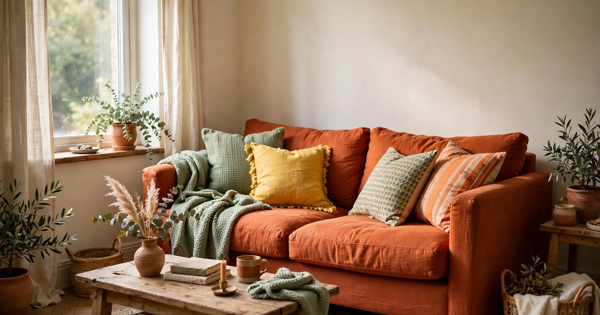
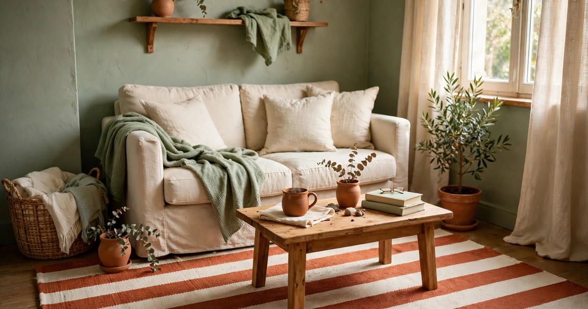
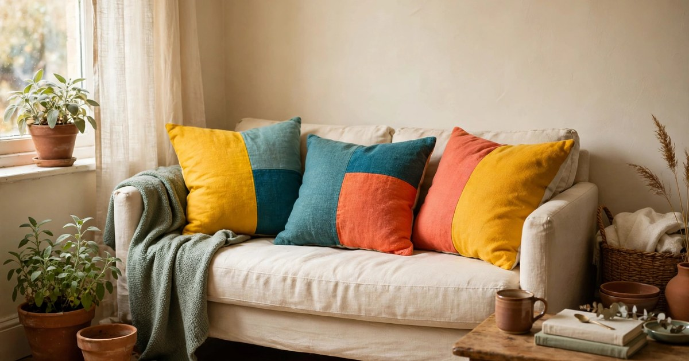
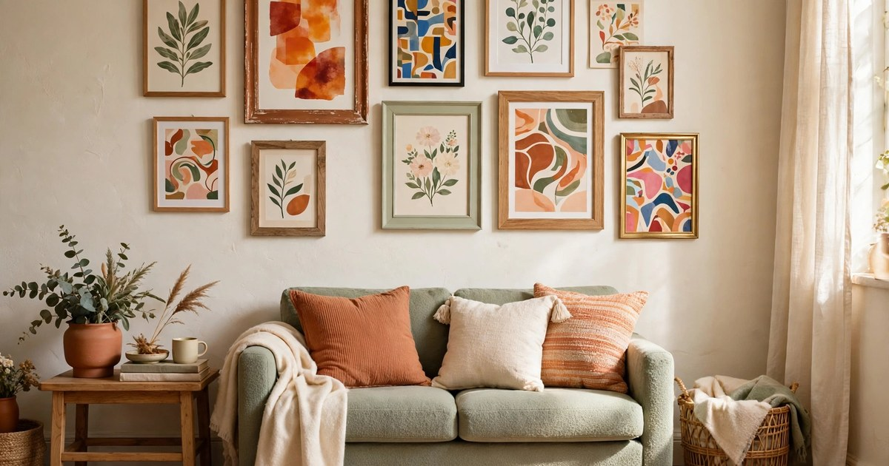
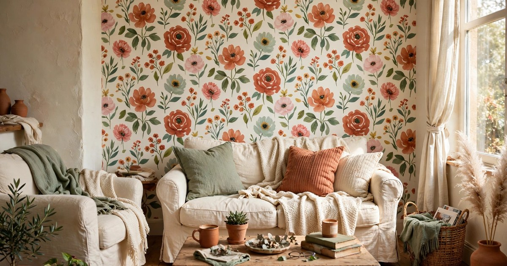
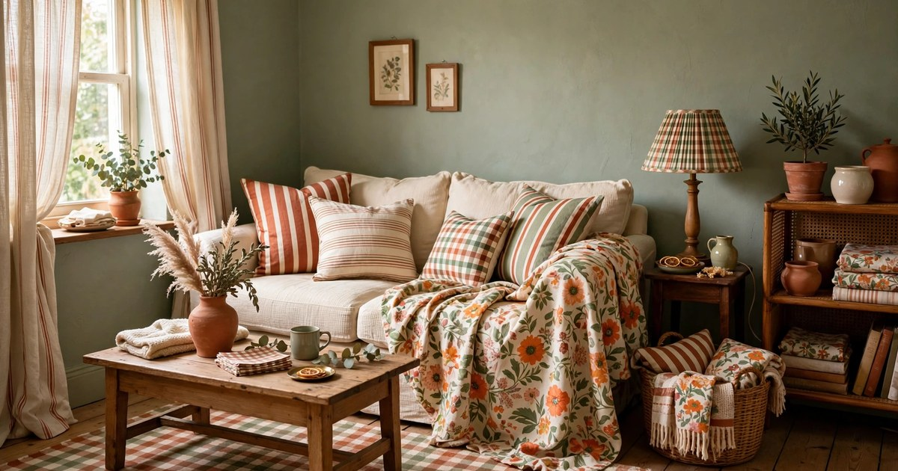
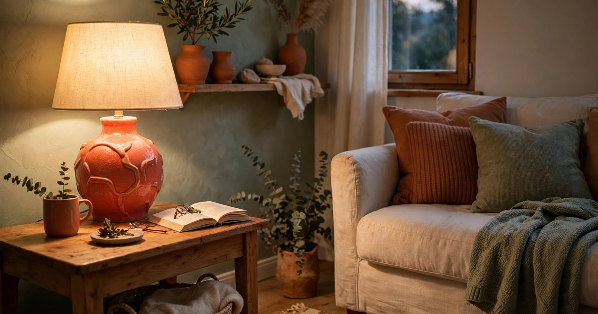
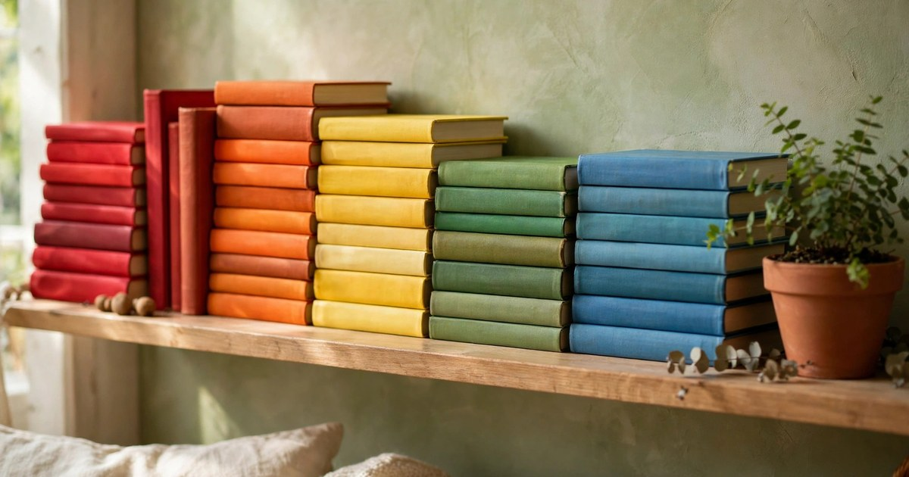
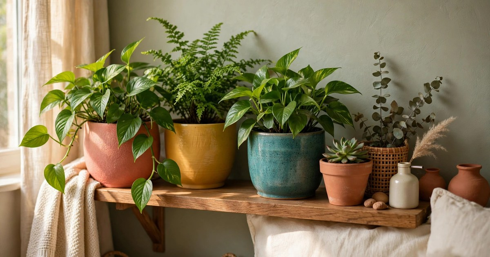
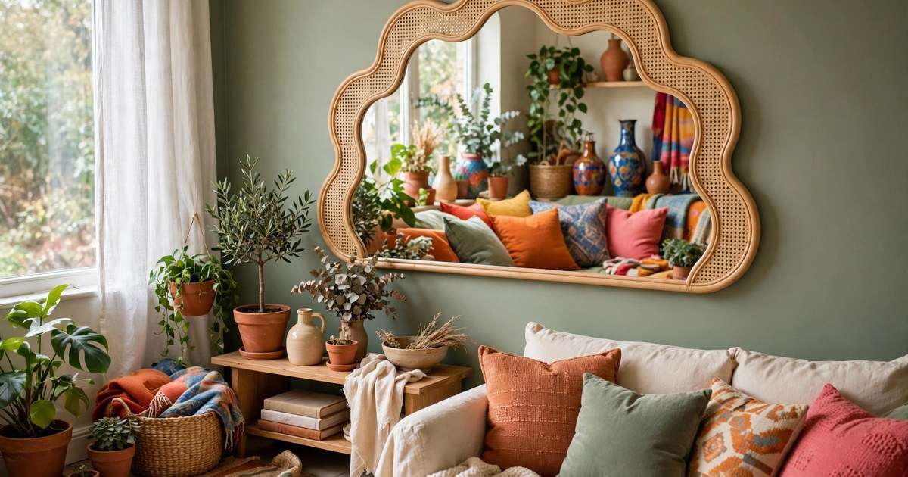

Dopamine decor is the antidote to the grey-beige flat. It is the idea that your living room should make you smile when you walk in — not because it is expensive, but because it is full of colour, pattern and things you love. A small apartment is actually the perfect place for it: a little colour goes a long way in a small room, and a bold choice that might overwhelm a big open-plan space feels just right in a cosy lounge. The trick is joy with intention — every bright thing earns its place, and the room still works for real life.

These ten ideas are all renter-friendly and budget-first. Nothing here needs a drill, a landlord's permission or a big spend. Most of them cost less than a takeaway, and several cost nothing at all if you shop your own home first. Pick one or two to start with — dopamine decor works best when it grows slowly, one happy thing at a time, rather than arriving all at once in a single shopping trip.

### 1. One Big Colourful Sofa Moment

A colourful sofa is the fastest way to make a small living room feel joyful. You do not need to buy a new one — a bright throw draped over the back and arms, or a fitted slipcover in a bold colour, does the same job for a fraction of the price. Mustard, teal, terracotta or a deep berry all work beautifully against cream walls, and in a small room one strong colour reads as confident rather than overwhelming. The sofa is the biggest object in the room, so when it is colourful, the whole room feels colourful.

Keep everything else calm for the first week and see how the colour makes you feel. If you love it, add a cushion in a second bright colour. If it feels like too much, fold the throw over one arm instead of the whole sofa. The point of dopamine decor is that it makes you happy — if a colour does not lift your mood, it is the wrong colour for you, no matter how trendy it is. Your sofa, your rules.

### 2. A Striped Rug That Does the Talking

A striped rug is dopamine decor in its simplest form: one purchase, instant energy. Wide stripes in two or three colours — think terracotta and cream, or sage and mustard — give a small living room a focal point and make the floor feel like part of the design instead of an afterthought. Stripes also have a practical bonus in a small space: horizontal stripes make a narrow room feel wider, which is exactly what a small flat needs.

Choose a rug that is big enough for the front legs of your sofa and chairs to sit on it, even in a small room — a rug that is too small makes the space feel chopped up. A flat-weave cotton rug is the budget pick: it is cheap, easy to wash, and light enough to roll up and move when you rearrange. If stripes feel too loud, start with a rug that is mostly cream with one bold stripe running through it.

### 3. Colour-Blocked Cushions in Odd Numbers

Cushions are the cheapest way to experiment with dopamine decor, and odd numbers are the secret. Three or five cushions in different solid colours — say, mustard, teal and coral — look playful and deliberate, while a matching pair looks like a furniture showroom. Mix one pattern in with the solids, such as a stripe or a small floral, to keep the arrangement from feeling flat. The colours do not need to match anything else in the room; they just need to make you happy when you see them together.

Shop your own home before you buy anything: cushions migrate between rooms, and the ones on your bed might be exactly what the sofa needs. When you do buy, look for cushion covers rather than whole cushions — covers are cheaper, easier to store, and you can swap them with the seasons. A set of bright covers costs less than one new cushion and completely changes the mood of the room.

### 4. A Gallery Wall of Pure Joy

A gallery wall is where dopamine decor gets personal. Instead of matching prints in matching frames, fill the wall with things that genuinely make you smile: a postcard from a holiday, a child's drawing, a print in a colour you love, a photo of your favourite place. The mix is the point — a gallery wall of pure joy does not follow a theme, it follows your mood. In a small living room, one full wall of happy art makes the room feel curated rather than cluttered.

Use removable adhesive strips to hang everything, so the wall stays damage-free and you can rearrange whenever the mood strikes. Start by laying the frames on the floor and playing with the arrangement until it feels right, then transfer it to the wall one piece at a time. Leave a little breathing room between frames — a few centimetres of wall showing through keeps the wall feeling joyful rather than chaotic.

### 5. A Bold Accent Wall Without Paint

An accent wall is the boldest dopamine decor move, and renters can do it without a drop of paint. Peel-and-stick wallpaper in a bold print — big florals, stripes, or a playful geometric — goes up in an afternoon and peels off cleanly when you move out. One wall is enough: the wall behind the sofa is the classic choice, because it frames the room and gives the eye somewhere joyful to land. Choose a print with a cream or white background so the room still feels bright.

If wallpaper feels like too much commitment, try a fabric wall hanging or a large tapestry in a bold colour instead. It covers the same wall, adds softness and texture, and hangs from a single removable hook. Either way, the rule is the same: one bold wall, calm furniture, and let the colour do the work. Your landlord never needs to know, and your deposit stays safe.

### 6. Mismatched Pattern Play

Dopamine decor loves pattern — but the trick is to mix patterns that share a colour, not patterns that match. A striped cushion, a floral throw and a checked lampshade can all live happily together if they share one colour, such as terracotta or sage. The shared colour is the thread that ties the room together, and the different patterns are what make it feel alive. Start with two patterns and add a third only when the first two feel settled.

Scale matters in a small room: mix one large pattern, one medium and one small, so the eye has somewhere to rest. A big floral on the curtains, a medium stripe on the cushions and a small check on a lampshade is a classic combination that works in almost any small living room. If it starts to feel busy, remove one patterned thing rather than adding a plain one — dopamine decor is about editing, not just adding.

### 7. A Statement Lamp in a Happy Colour

A lamp is a small object with a big job in dopamine decor: it adds colour by day and warm light by night. A table lamp with a bright ceramic base — coral, cobalt, mustard — or a shade in a bold colour turns a plain side table into a focal point. In a small living room, one statement lamp is enough; it becomes the jewel of the room, especially in the evening when it glows. Look in charity shops and car boot sales first, because a bright lamp is one of the easiest second-hand finds.

Pair the lamp with a warm-toned bulb rather than a cool white one. Warm light makes bright colours look rich and inviting, while cool light makes them look harsh. If your lamp has a plain white shade, swap it for a coloured one — a shade costs less than the lamp and changes the whole look. A happy lamp on a timer, switching on before you get home, is the cheapest mood boost a small flat can buy.

### 8. Books Stacked by Colour

Stacking books by colour is free dopamine decor, and it works on any shelf, side table or windowsill. Pull your books off the shelf, sort them into colour groups, and stack them in rainbow order — reds together, then oranges, yellows, greens and blues. The result looks intentional and joyful, and it turns a plain bookshelf into a piece of art. It also makes you look at your books differently: you will rediscover titles you forgot you owned.

You do not need a full rainbow to make it work. Even three colour groups — warm reds and oranges, greens, and blues — create the same cheerful effect. Mix horizontal stacks with a few upright books to keep the shelf from looking too uniform, and tuck a small plant or a bright object between the stacks. The books are still readable and reachable; they just look happier now.

### 9. Plants in Bright Pots

Plants are already joyful, but bright pots double the effect. A trailing pothos in a coral pot, a snake plant in a mustard pot, a fern in a teal pot — the colour of the pot is as much a part of the display as the plant itself. In a small living room, three plants in three bright pots on one shelf create a focal point that costs almost nothing, especially if you paint plain terracotta pots yourself with leftover paint or sample pots.

Painting pots is a perfect rainy-afternoon project: one coat of bright paint, a day to dry, and a plain pot becomes a piece of dopamine decor. Keep the plants themselves easy — pothos, snake plants and spider plants thrive on neglect and low light, which is exactly what a small flat offers. The combination of green leaves and bright colour is the happiest thing you can put on a shelf.

### 10. A Fun Mirror That Bounces Light and Colour

A mirror is the final piece of dopamine decor because it does two jobs at once: it bounces light around a small room, and it reflects all the colour you have added, doubling the effect. Choose a mirror with a playful shape — an arch, a wavy edge, a scallop, or a sunburst — rather than a plain rectangle, because the shape itself is part of the joy. Hang it opposite a window if you can, so it catches the daylight, or opposite your brightest wall so it reflects the colour.

In a rental, hang the mirror with a heavy-duty removable hook rated for its weight, and always check the weight limit before you trust it. A mirror above the sofa or leaning against the wall on a sideboard both work in a small room. The moment you hang it, the room feels bigger, brighter and more colourful — which is the whole point of dopamine decor in a small apartment.

## Start With the Thing That Makes You Smile

Dopamine decor is not a style you buy in one trip; it is a feeling you build one happy thing at a time. Start with the idea on this list that made you smile while reading it — the striped rug, the bright lamp, the books sorted by colour — and live with it for a week. If it still makes you happy on day seven, add the next one. A small living room does not need all ten ideas to feel joyful; it needs two or three that are truly yours. The colour, the pattern and the playfulness are just the tools. The happiness is the point.

## Frequently Asked Questions

### What is dopamine decor?

Dopamine decor is a style built around colour, pattern and objects that make you feel happy. It takes its name from dopamine, the brain chemical linked to pleasure and reward. In practice it means bold colours, playful patterns, personal objects and joyful layers — the opposite of minimal, all-grey interiors.

### Does dopamine decor work in a small apartment?

Yes — small rooms are ideal for it. A little colour goes a long way in a small space, so one bold sofa throw or one striped rug has more impact than it would in a large room. The key is to keep one or two calm surfaces, such as plain walls or a neutral floor, so the colour has somewhere to rest.

### Is dopamine decor renter-friendly?

It can be. Every idea in this list avoids drilling and permanent changes: peel-and-stick wallpaper, removable hooks, throws, cushions, rugs and lamps all come with you when you move. Avoid paint and anything that needs screws, and your deposit stays safe.

### How do I stop dopamine decor from looking cluttered?

Pick a shared colour that runs through the room, and leave some plain space — a clear shelf, a bare patch of wall, a neutral sofa. Edit as you add: for every new bright thing, remove or move something else. Joyful does not mean full; it means everything in the room earns its place.
