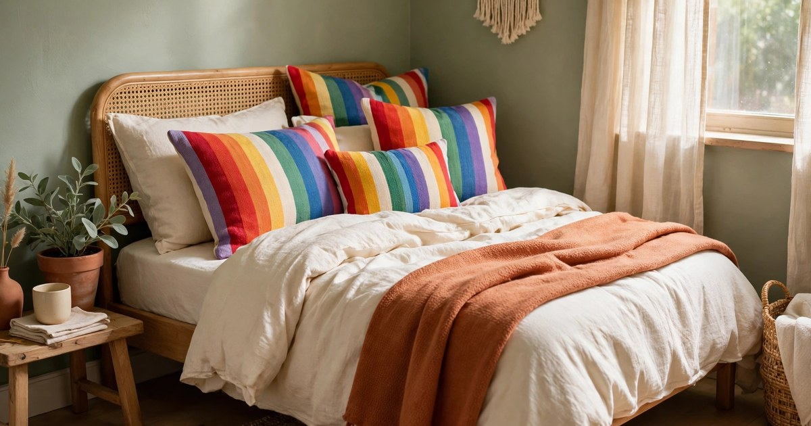
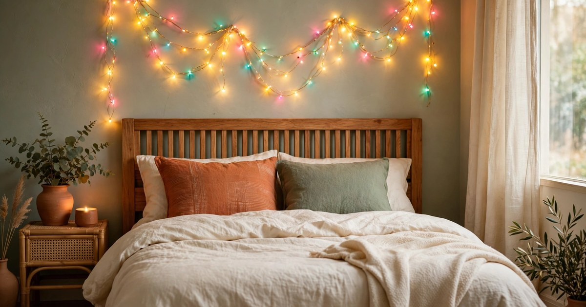
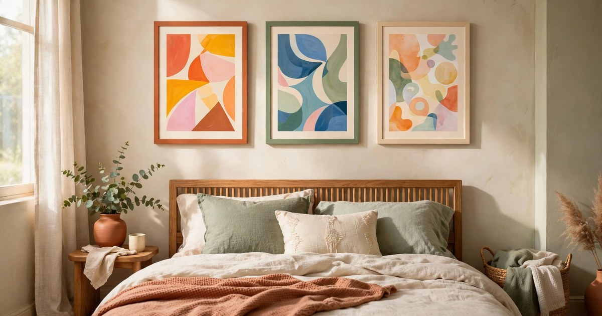
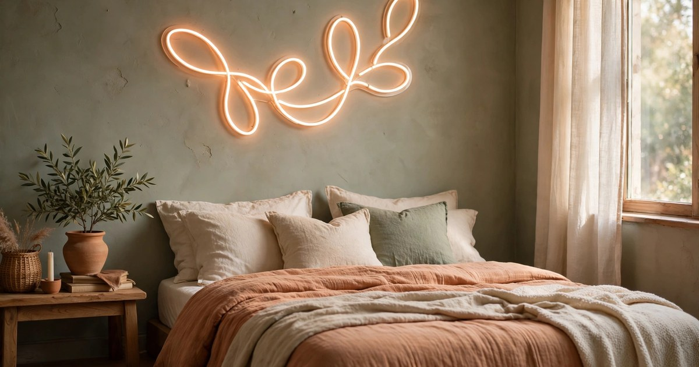
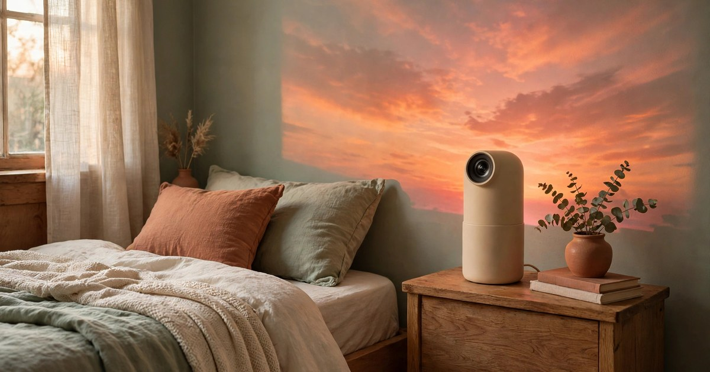
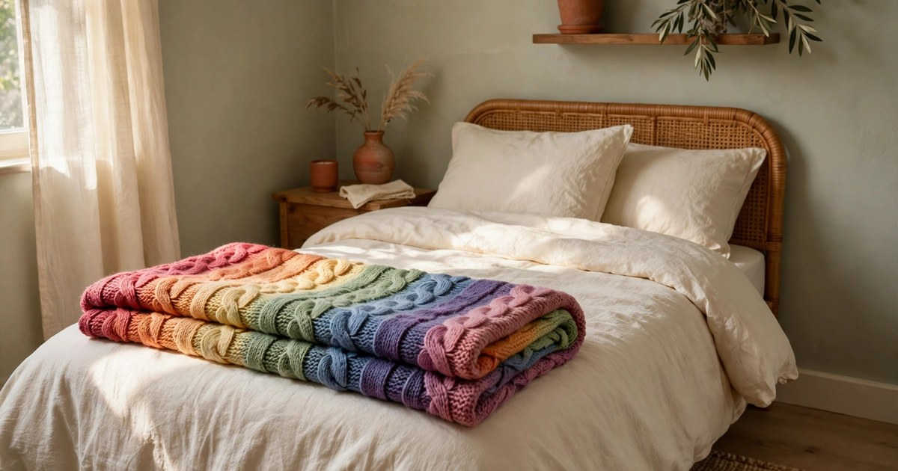
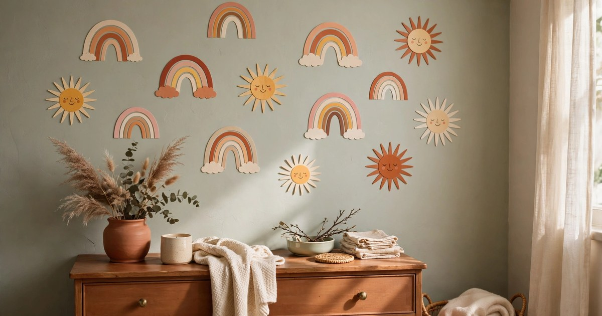
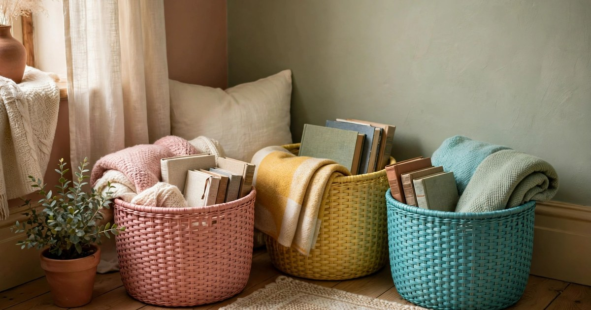
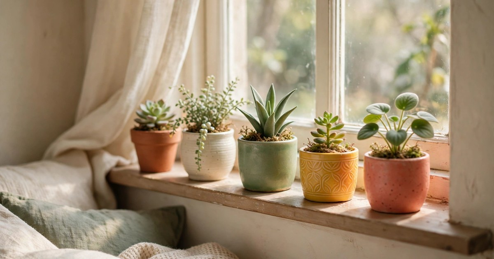

Dopamine decor is the feel-good trend taking over small bedrooms — and it is exactly what it sounds like: color, pattern and playful pieces chosen purely because they make you smile when you walk in. No rules about matching, no beige minimalism, no waiting until you own a home. Just joyful color, layered in small, affordable doses, in the room where you start and end every day.

Small bedrooms are actually the perfect place for dopamine decor. A big room can swallow color; a small one lets a single bright pillow, a rainbow print or a glowing neon sign do the work of a whole redesign. And because the style is built from small, movable pieces — textiles, prints, lights, little accents — it is made for renters. Nothing here needs a drill, a paintbrush or your landlord's permission. Everything moves with you when you move.

The secret is choosing color on purpose. Dopamine decor is not random clutter; it is one or two happy colors repeated in a few places so the room feels cheerful instead of chaotic. Pick your palette first — sunny yellow and coral, rainbow brights, or pink and orange — then let these nine finds, all under $25, bring it to life.

## Why dopamine decor works in a small bedroom

Color affects mood more than almost any other decor choice, and in a bedroom you feel it twice a day: the first thing you see in the morning and the last thing you see at night. A bright, cheerful bedroom makes waking up easier and winding down warmer. Studies of color and mood consistently find that warm, saturated colors lift energy, while a room full of grey and white can feel flat — especially in a small rental with plain walls and builder-grade lighting.

Small bedrooms also forgive bold color in a way living rooms sometimes do not. You are the only audience. If a rainbow throw blanket makes you happy, it belongs on your bed. And because every piece below is small and cheap, you can experiment without commitment: swap a pillow cover, move a print, change the fairy lights and the whole mood of the room shifts in ten minutes.

## How to pick your dopamine palette

Before you shop, choose two or three colors you genuinely love. The easiest dopamine palettes for small bedrooms are:

- **Sunny citrus:** yellow, orange and coral on a cream base — warm, energizing, and flattering in morning light.
- **Rainbow brights:** pink, turquoise, yellow and green in small doses — playful and maximal, best kept to accents.
- **Pink and peach:** blush, coral and soft gold — cheerful without shouting, and the easiest to live with long-term.

Whichever palette you pick, repeat each color at least twice in the room — a pillow and a print, a throw and a lamp — so the color feels intentional rather than accidental. Keep your bedding and walls light and let the color live in the accents. That is the whole formula.

### 1. Rainbow throw pillow covers (set of 2)

Start with the fastest mood lift in the room: your bed. A pair of rainbow-striped or color-block throw pillow covers ($12–18 for two) turns plain cream bedding into a cheerful focal point in under a minute. Buy covers, not whole pillows — you almost certainly already own inserts, and covers are cheaper, washable and easy to swap when your mood changes.

**Why it works:** the bed is the biggest surface in a small bedroom, so anything on it sets the tone for the whole room. Bold color on the pillows reads as deliberate design, and stripes or color blocks give the eye a happy pattern to land on first thing in the morning.

**Where it fits:** front and center on the bed, layered over your sleeping pillows. Pair with solid-color bedding in cream or white so the pillows pop — never with another loud pattern competing for attention. [Shop rainbow throw pillow covers](https://www.amazon.com/s?k=rainbow+throw+pillow+covers+colorful+striped&tag={{AMAZON_TAG}})

### 2. Colorful LED fairy string lights

Nothing says dopamine decor quite like fairy lights. A warm or multicolor LED string ($8–14) draped along a headboard, window frame or shelf edge adds instant glow and magic, and the battery or USB versions need no outlet near the bed. Look for copper-wire strands — they bend easily, hide well and look delicate even in daylight.

**Why it works:** light is mood. Soft, warm fairy lights make a small bedroom feel cozy and a little bit enchanted, and multicolor strands add the playful dopamine hit the style is named for. They also fix the worst thing about rental bedrooms: one harsh overhead light and nothing else.

**Where it fits:** along the headboard, around a mirror, or draped over a bookshelf. Hang with removable adhesive clips — zero holes, zero damage, full glow. [Shop colorful LED fairy string lights](https://www.amazon.com/s?k=colorful+LED+fairy+string+lights+bedroom+battery&tag={{AMAZON_TAG}})

### 3. Bright abstract art print set

Blank rental walls are the biggest missed opportunity in a small bedroom, and a set of bright abstract art prints ($12–20 for a set of three or four) is the cheapest fix. Choose bold shapes in your palette — rainbow arches, sunburst shapes, color-block abstracts — and frame them in simple light-wood or white frames you may already own.

**Why it works:** art gives a small room a focal point above eye level, which draws the eye up and makes the room feel taller. Colorful prints also do the heavy lifting for your whole palette: pick your pillow and throw colors straight from the prints and the room instantly looks coordinated.

**Where it fits:** above the bed, over a dresser, or as a mini gallery on the one wall you see from the door. Hang with removable adhesive strips rated for the frame weight — no nails, no spackle at move-out. [Shop bright abstract art prints](https://www.amazon.com/s?k=bright+abstract+art+prints+colorful+bedroom+set&tag={{AMAZON_TAG}})

### 4. Neon-style LED word sign

A neon-style LED sign ($15–24) with a happy word — "good vibes," "dream big," "hello sunshine" — is the dopamine decor centerpiece. Modern LED versions are lightweight, cool to the touch, USB-powered and a fraction of the price of real glass neon, and they double as a soft night light.

**Why it works:** a glowing word is part art, part affirmation and part lamp. It gives the room a personality in one piece, and the warm glow flatters everything around it — skin, bedding, plants — in a way no overhead bulb ever will.

**Where it fits:** above the bed, on the wall opposite the door so it greets you when you walk in, or propped on a dresser. USB power means it can run from a phone charger or power bank, so no electrician and no new outlet needed. [Shop neon LED word signs](https://www.amazon.com/s?k=neon+LED+sign+good+vibes+bedroom+USB&tag={{AMAZON_TAG}})

### 5. Sunset projection lamp

A sunset projection lamp ($14–22) throws a warm orange-and-pink glow across your wall that looks like golden hour, any hour. It is the single most-photographed dopamine decor piece for a reason: one small lamp transforms a plain rental wall into a sunset, and it costs less than a takeaway dinner.

**Why it works:** warm, saturated light is the fastest way to make a small room feel cozy and expensive. The sunset glow adds color to the walls without a single drop of paint, and it photographs beautifully — which is half the point of a dopamine bedroom.

**Where it fits:** on a nightstand or dresser, aimed at the wall behind the bed or the ceiling. Use it in the evening as a wind-down light, and switch it off when you want a calmer, darker room for sleep. [Shop sunset projection lamps](https://www.amazon.com/s?k=sunset+projection+lamp+bedroom+warm+light&tag={{AMAZON_TAG}})

### 6. Rainbow knit throw blanket

A rainbow or multicolor knit throw ($18–25) folded at the foot of the bed ties the whole room together — it echoes the pillow covers from pick #1 and adds a layer of texture and warmth you will actually use on cold mornings. Look for soft acrylic or cotton-blend knits that wash well, since a throw on a bed gets real use.

**Why it works:** repeating one color story in two places (pillows plus throw) is the oldest designer trick in the book — it creates rhythm, and rhythm reads as expensive. A throw also softens the hard edges of a small room and makes the bed look inviting rather than just functional.

**Where it fits:** folded across the foot of the bed, draped over a reading chair, or rolled in a basket by the door for movie nights. Choose a size that covers the foot of the bed without pooling on the floor — in a small room, oversized throws eat floor space. [Shop rainbow knit throw blankets](https://www.amazon.com/s?k=rainbow+knit+throw+blanket+colorful+bedroom&tag={{AMAZON_TAG}})

### 7. Peel-and-stick wall decals

Peel-and-stick wall decals ($9–16 a pack) are dopamine decor's secret weapon for renters: rainbows, suns, stars, dots or arches that stick to the wall, peel off cleanly and leave no mark. They are the closest thing to painting without paint, and you can rearrange them until the composition feels right.

**Why it works:** decals add color and pattern at exactly the scale a small bedroom needs — big enough to notice, small enough not to overwhelm. A cluster of rainbow arches above a dresser or a scatter of suns and stars over the bed gives the room a custom, hand-finished feeling for the price of a lunch.

**Where it fits:** above the headboard, around a mirror, or framing a window. Test one decal in a hidden spot first, and always peel slowly at move-out — most quality decals come off clean, but a slow peel is the renter's insurance policy. [Shop peel and stick wall decals](https://www.amazon.com/s?k=peel+and+stick+wall+decals+rainbow+colorful+bedroom&tag={{AMAZON_TAG}})

### 8. Colorful storage baskets (set of 2–3)

Small bedrooms have a storage problem, and dopamine decor solves it in color: a set of bright woven or fabric storage baskets ($14–22 for two or three) corrals blankets, books, chargers and clutter while adding pops of pink, yellow or turquoise to a corner that would otherwise be dead space.

**Why it works:** clutter kills a cheerful room faster than anything, and baskets hide it in plain sight. Colorful baskets do double duty — they organize and they decorate — which is exactly the kind of hard-working piece a small bedroom needs. A tidy room with bright baskets feels joyful; the same room with piles on the floor feels stressful.

**Where it fits:** beside the bed for chargers and books, under a window for extra throws, or in a closet as open shelf storage. Choose foldable fabric baskets if you move often — they pack flat and weigh nothing. [Shop colorful storage baskets](https://www.amazon.com/s?k=colorful+woven+storage+baskets+bedroom+set&tag={{AMAZON_TAG}})

### 9. Mini faux plants in colorful pots

Finish with life — the kind that never dies. A set of mini faux plants in brightly colored pots ($12–20 for three) adds green and a hit of color to a windowsill, nightstand or shelf, with zero watering, zero sunlight requirements and zero guilt when you forget about them for a month.

**Why it works:** green is the balancing color in a dopamine palette — it calms the brights and makes the whole room feel alive. Colorful pots repeat your palette one more time, and the plants add a layer of texture that soft textiles and flat prints cannot. In a bedroom with no window light, faux plants are the only plants that thrive.

**Where it fits:** windowsill, nightstand, dresser top, or a floating shelf. Mix pot colors with your palette — pink, yellow and turquoise pots echo the pillows and throw and pull the whole room together. [Shop mini faux plants colorful pots](https://www.amazon.com/s?k=mini+faux+plants+colorful+pots+set+bedroom&tag={{AMAZON_TAG}})

## How to style them together (without overdoing it)

Nine colorful pieces could overwhelm a small bedroom, so here is the formula: pick one statement (the neon sign or the sunset lamp), two textiles (pillow covers plus throw), and two or three small accents (prints, decals, baskets, faux plants). That is five or six pieces — plenty for a small bedroom, and each one earns its place.

Keep the palette tight: two or three happy colors on a light base, repeated in at least two places each. If a piece does not fit the palette, it does not come home — that is the entire rule. And give the color somewhere to rest: plain cream bedding, a light rug and clear surfaces let the bright pieces shine instead of competing with each other.

Start with the bed (pillows and throw), add one light (fairy lights or sunset lamp), then one wall moment (prints or decals). Live with those three layers for a week before adding more. Dopamine decor works best when it grows with you — the room should feel like you, not like a store display.

## Frequently Asked Questions

### What is dopamine decor?

Dopamine decor is a joyful, color-forward decorating style built around pieces chosen because they make you happy — bright colors, playful patterns, cheerful lights and fun shapes. The name comes from dopamine, the brain's feel-good chemical: the idea is that surrounding yourself with color and things you love genuinely lifts your mood.

### Is dopamine decor expensive?

It does not have to be. The style is built from small, affordable pieces — pillow covers, prints, string lights, decals and baskets — rather than furniture. Every pick on this list costs under $25, and a convincing starter set (pillow covers, fairy lights and one art print set) costs under $50 total.

### Does dopamine decor work in a small bedroom?

Small bedrooms are the best place for it. A small room lets one or two bright pieces do the work of a whole redesign, and the style is made of small, movable accents rather than big furniture, so nothing overwhelms the space. Keep the palette to two or three colors and the room will feel cheerful, not cluttered.

### Is dopamine decor renter-friendly?

Yes — every idea here is fully renter-friendly. Nothing requires drilling, painting or permanent changes. Prints and fairy lights hang with removable adhesive strips and clips, decals peel off cleanly, and textiles, baskets and lamps simply sit in the room and move with you when you move out.

### How do I keep dopamine decor from looking cluttered?

Pick a tight palette of two or three colors and repeat each one at least twice, keep your bedding and walls light, and limit yourself to one statement piece plus a few small accents. Color needs breathing room: plain surfaces between the bright pieces are what make the color look intentional instead of chaotic.

### Can I mix dopamine decor with my existing furniture?

Absolutely — that is the point. Dopamine decor is a layering style, not a matched set. The pillow covers, throws, prints and lights on this list work with plain IKEA furniture, hand-me-down wood pieces and standard rental walls. Start with textiles and one light; they are the lowest-commitment entry points and the biggest mood lift per dollar.
