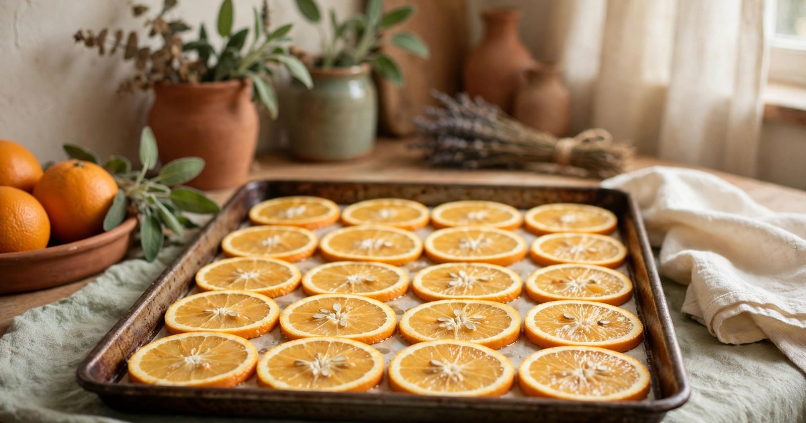
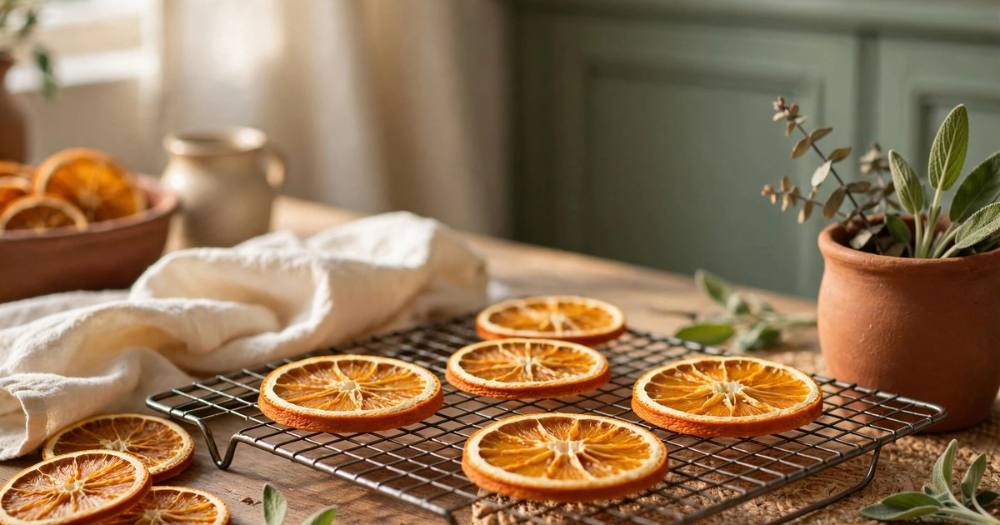
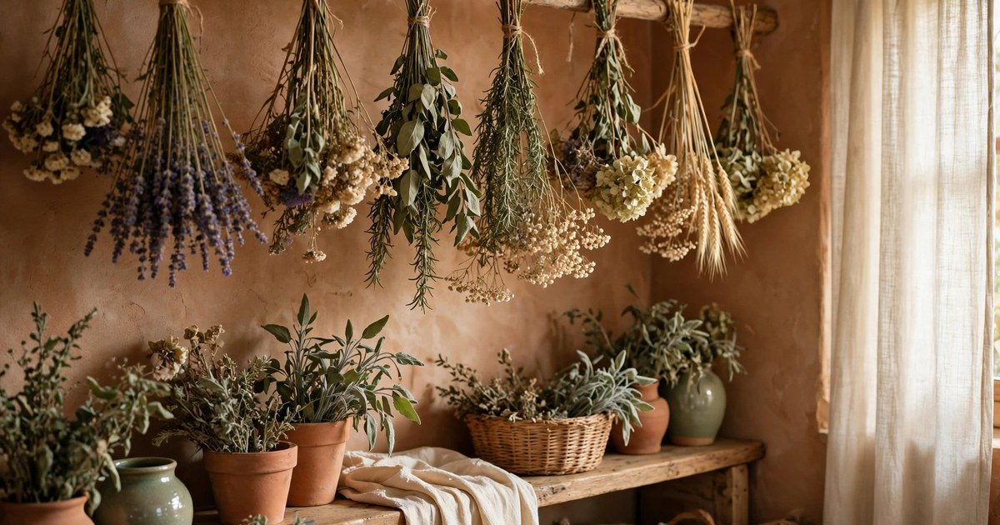
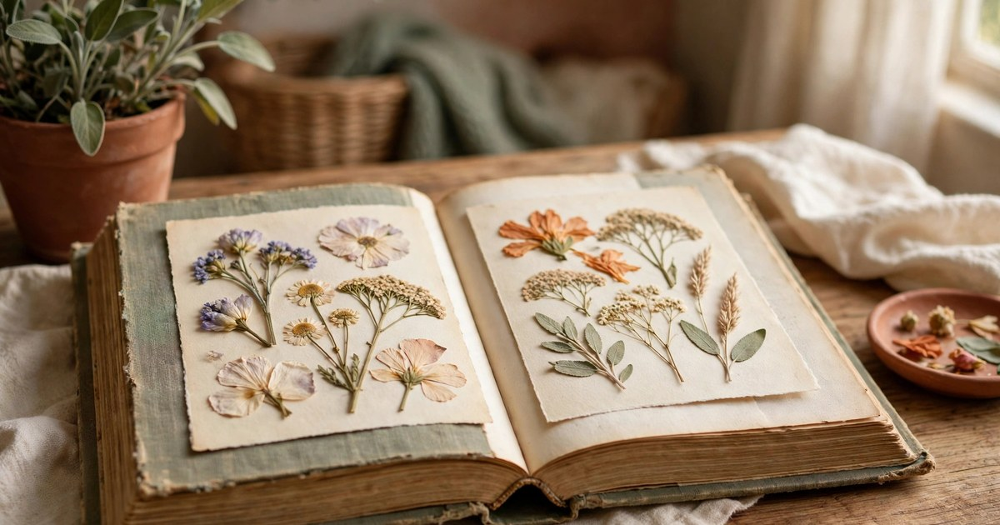
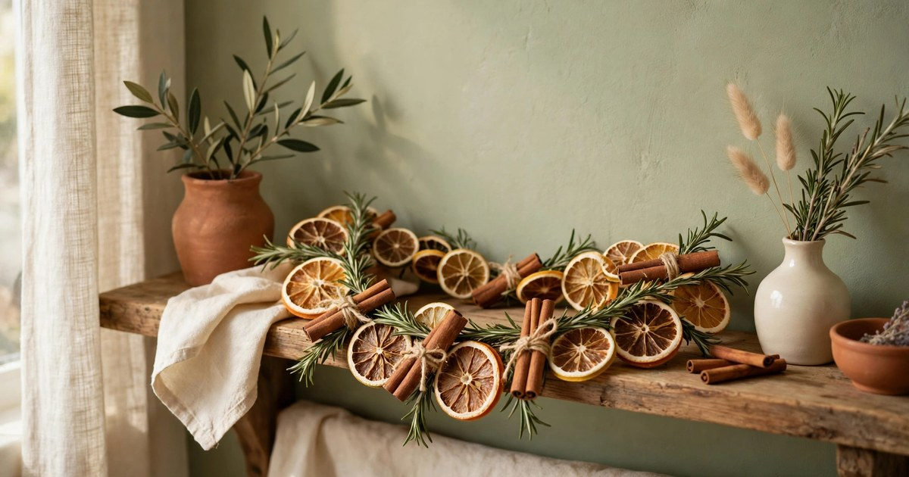
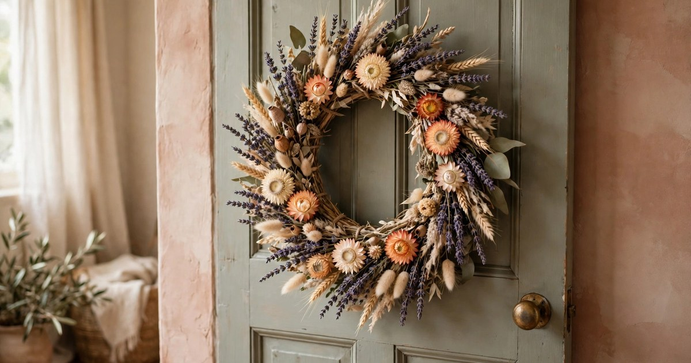
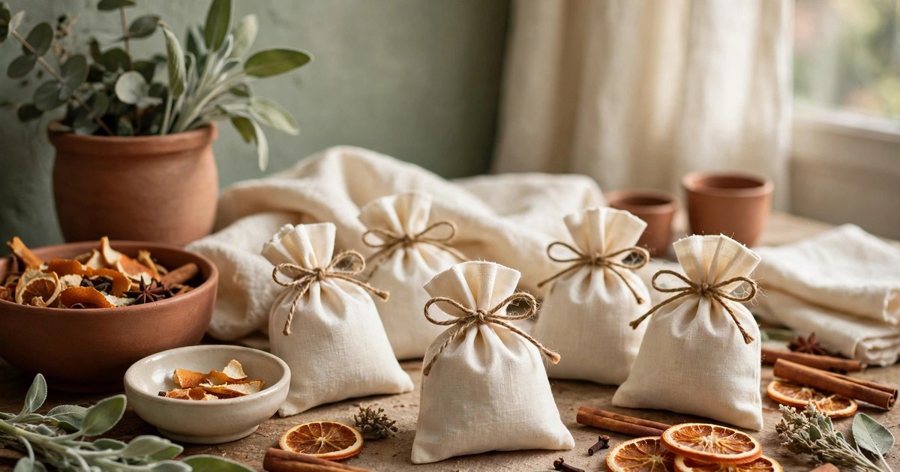
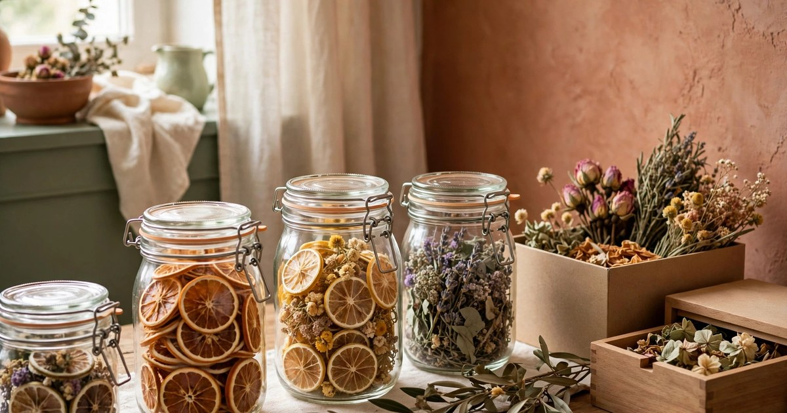

Dried citrus and flowers are the hardest-working winter decor there is: they cost almost nothing, they last for months, they smell wonderful, and they suit every style from rustic to minimal. A garland of dried orange slices glows like stained glass in a window; a jar of dried lavender scents a whole room; a pressed flower in a frame looks like a shop bought it. The techniques are simple, but the details matter — slice thickness, oven temperature, and drying time are the difference between translucent amber slices and burnt crisps. Here is every method that actually works, in the order to try them.

### 1. Slice citrus thin and evenly

Everything starts with the slice. Cut oranges, lemons, or grapefruit into slices about 5 millimetres thick — roughly the width of a pencil — and keep them as even as you can, because uneven slices dry unevenly: thin edges burn while thick centres stay wet. A sharp knife and a steady hand beat a mandoline here, since citrus slips on a mandoline blade and the slices come out ragged. Pat each slice dry with a kitchen towel before it goes anywhere near heat; surface moisture is the main cause of sticky, darkened slices.

Choose fruit that is firm and heavy for its size, which means more juice and better colour after drying. Blood oranges dry to a deep ruby that looks spectacular in a garland, lemons dry pale gold, and grapefruit makes large dramatic slices for wreaths. One orange yields about eight good slices, so a garland for a shelf needs two oranges and a garland for a doorway needs four — buy one extra, because a slice always tears or burns.

### 2. Oven-dry citrus low and slow

The oven method is the most reliable way to dry citrus, and it takes about three hours of mostly unattended time. Lay the slices in a single layer on a wire rack over a baking tray — the rack is essential, because slices dried flat on a tray steam on the underside and stick. Set the oven to its lowest temperature, ideally 90–100°C, and prop the door open a crack with a wooden spoon so moisture escapes instead of condensing back onto the fruit.

Flip the slices every 45 minutes and check from the two-hour mark: they are done when they feel dry and papery, with no soft or sticky patches, and the edges have just started to curl. Pull them before they darken — a slice that looks perfect in the oven darkens further as it cools, so take them out a shade lighter than you want. Cool completely on the rack before using them; warm slices feel dry but are still holding moisture that will make a garland go soft in a week.

### 3. Air-dry flowers upside down

Flowers dry best the slow way: tied in small bunches and hung upside down in a warm, dark, dry room. Darkness preserves colour — light bleaches dried flowers to straw within days — and small bunches dry faster and more evenly than big ones, because air circulates between the stems. Tie each bunch with twine, hang it from a hook or a clothes hanger, and leave it for two to three weeks. Lavender, roses, statice, strawflower, and baby's breath all air-dry beautifully; dahlias and other fleshy flowers usually do not, and are better pressed or skipped.

Check the bunches after a week: stems shrink as they dry, so a tie that was snug on day one may be loose by day seven, and a bunch that slips falls apart. Re-tie anything loose, and discard any stem that smells musty — one damp stem in a bunch spreads mould to the rest. Dried flowers are ready when they feel papery and crisp, and the stems snap rather than bend.

### 4. Press flowers flat for frames and gifts

Pressing is the method for flowers too delicate to hang — pansies, violas, ferns, and small wildflowers — and the results belong in frames, on cards, and on gift tags. Lay each flower face-down on blotting paper or plain newspaper, cover it with another sheet, and press it under a heavy book or a flower press for two to four weeks. Change the paper after the first week if it feels damp, because trapped moisture is what turns a pressed flower brown instead of preserving its colour.

Press flowers at their freshest, ideally the day they are picked or bought, and press them flat without overlapping petals — a petal folded under another petal dries as a dark crease that shows in the frame. Once fully dry, pressed flowers are fragile but stable: handle them with tweezers, glue them with the smallest dot of clear craft glue, and keep finished pieces out of direct sunlight, which fades them faster than anything else.

### 5. String a dried citrus garland

A garland is the classic use for dried citrus, and stringing one takes about twenty minutes. Thread a needle with sturdy twine, and pass it through the top edge of each slice, alternating orange with lemon, a cinnamon stick, or a sprig of dried rosemary for rhythm. Leave a few centimetres of twine between slices so the garland drapes rather than clumps, and knot the twine behind each slice if the garland will hang somewhere it gets brushed — unknotted slices slide together into a bunch at the lowest point.

Hang the garland where light passes through it: a window, a mirror frame, or a shelf facing a lamp. Translucent citrus glows when backlit, which is the whole magic of the material — a garland hung against a dark wall looks flat, while the same garland in a window looks like stained glass. One garland lasts the whole winter if kept dry; if a slice softens in humidity, swap that one slice rather than remaking the garland.

### 6. Build a dried flower wreath

A wreath turns dried flowers from a bunch into a display, and a grapevine or wire wreath base makes it easy. Work in small bundles — three or four stems tied together — and attach each bundle to the base with florist wire, overlapping each new bundle over the stems of the last so no wire shows. Work in one direction around the ring, and keep turning the wreath as you go, because a wreath that looks full from the front and bare from the side disappoints on a door that gets seen from an angle.

Mix textures for a wreath that looks professional: something tall and airy (lavender or wheat), something round and solid (strawflower or dried roses), and something trailing (dried ivy or amaranthus) to soften the edge. Hang the finished wreath indoors or under a covered porch — rain and direct sun are the two things that destroy dried flowers fastest, and a wreath on an exposed door will be faded and shedding within a month.

### 7. Make simmer-pot sachets from the offcuts

Drying always produces offcuts: end slices too thick to dry evenly, broken slices, loose petals, and citrus peel. Do not throw them away — they are simmer-pot sachets waiting to happen. Fill small muslin bags or squares of cheesecloth with dried peel, a cinnamon stick, a few cloves, and a pinch of dried lavender or rose petals, tie them with twine, and you have a drawer sachet, a gift tag decoration, or a simmer-pot refill that scents a whole flat for an evening.

Sachets are also the answer to the question of what to do with a drying batch that partly failed: slices that darkened too much for a garland still smell wonderful in a sachet, and petals that lost their colour still scent a drawer. Label each sachet with its contents if you make several kinds — a sachet that smells of lavender and a sachet that smells of clove look identical, and you will want the right one in the right drawer.

### 8. Store dried decor so it lasts until spring

Dried citrus and flowers last for months, but only if stored dry, dark, and still. Humidity is the enemy: a garland stored in a damp loft goes soft and mouldy, and flowers stored in sunlight fade to straw. After winter, pack garlands in tissue paper in a rigid box — never a bag, which crushes slices — and store flowers in airtight jars or boxes with a silica gel packet, in a dark cupboard. Handle dried flowers as little as possible, because every touch sheds petals and breaks stems.

Properly stored, dried citrus lasts a full year and often longer, which means this winter's garland can come back next November without a second oven session. Dried flowers last a year too, though their colour softens — lavender keeps its scent long after its purple fades, and roses keep their shape long after their red dulls. When a piece finally sheds too much to display, it still has one last life: crumbled into a simmer pot, where looks no longer matter and scent is everything.

## Start with One Orange

Drying sounds like a project, but it starts with a single orange, a baking tray, and an oven on its lowest setting. Three hours later you have eight amber slices that glow in a window, scent a room, and cost less than a coffee. That is the whole appeal of dried decor: it turns the cheapest materials in the house into the most personal decorations in it, and it does so without a single purchase, a single hole in the wall, or a single thing that needs storing in a loft until next year.

## Frequently Asked Questions

### How long do dried orange slices last?

Stored dry and out of direct sunlight, dried orange slices last a year or more. On display in a dry room, a garland lasts the whole winter; in a humid bathroom or kitchen, slices may soften within weeks and need replacing.

### Why did my dried oranges turn brown instead of amber?

Usually the oven was too hot or the slices were too thick. Dry at 90–100°C with the door cracked open, slice no thicker than 5 millimetres, and remove slices when they are a shade lighter than you want — they darken as they cool.

### Which flowers dry best for winter decor?

Lavender, roses, statice, strawflower, baby's breath, and wheat all air-dry well and hold their shape. Fleshy flowers like dahlias and tulips usually go mouldy when hung, and are better pressed flat or skipped for drying.

### Can I dry citrus without an oven?

Yes — a food dehydrator works beautifully at around 60°C, and in a very dry climate slices air-dry on a rack in about a week. In humid climates, air-drying citrus usually ends in mould before it ends in dried slices, so the oven is the safer method.
