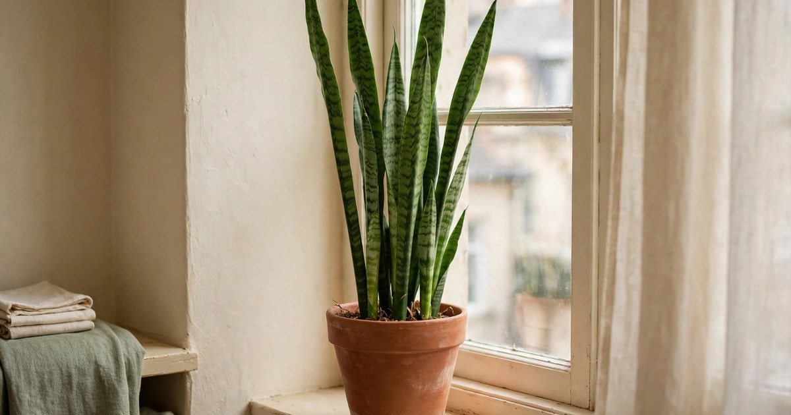
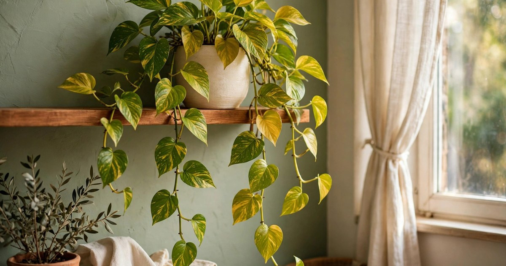
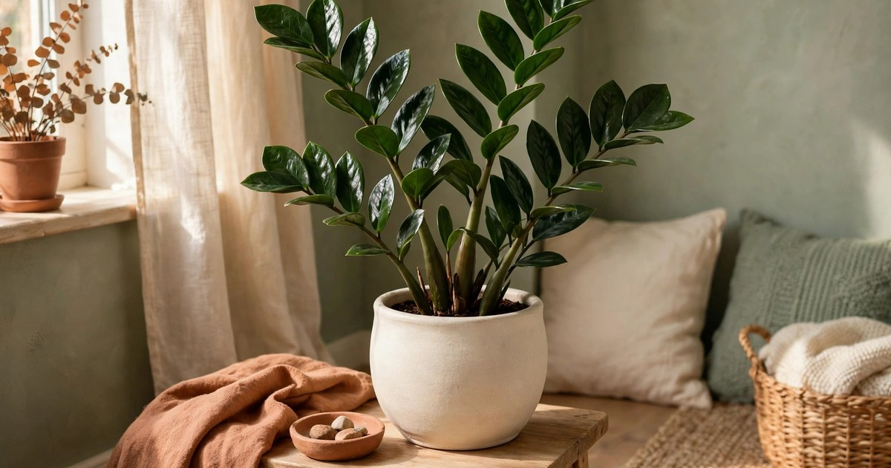
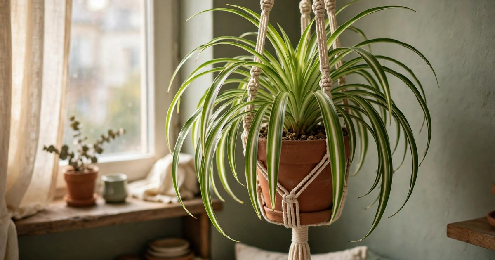
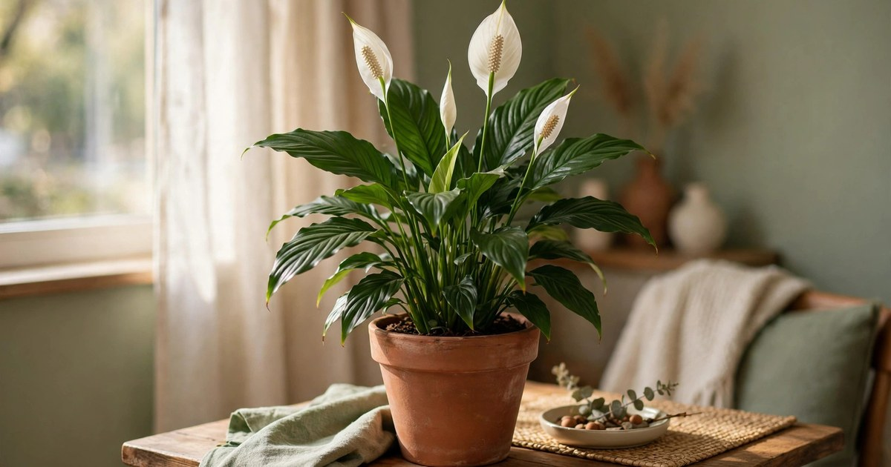
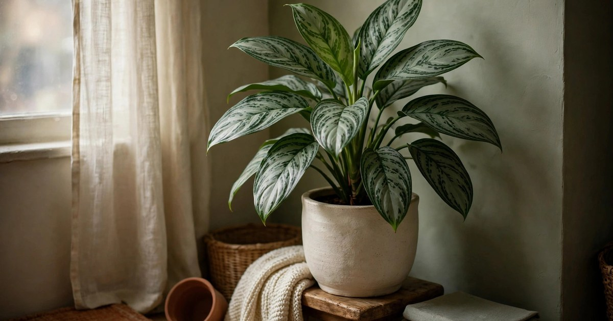
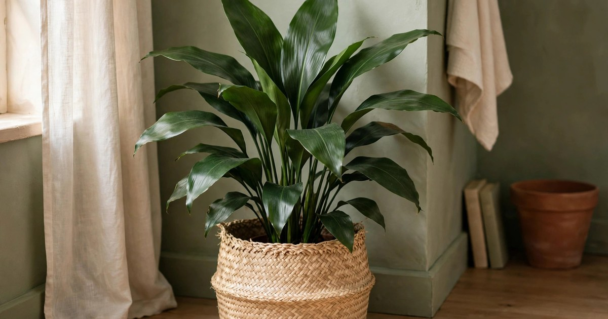
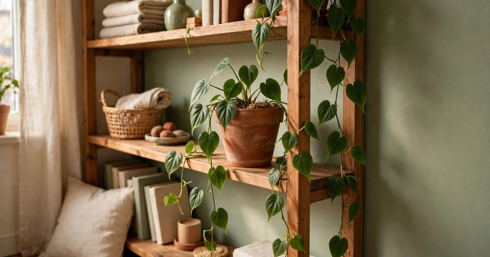
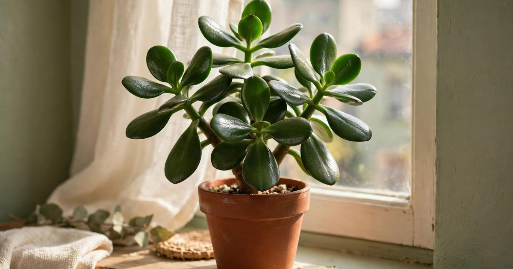

Most first houseplants do not die from neglect. They die from too much love — watered every other day, moved from window to window, repotted before they have settled in. And the second most common killer is wrong light: a sun-hungry plant stuck in a north-facing studio, slowly fading while its owner wonders what went wrong.

The nine plants below solve both problems at once. Every one of them forgives a missed watering (or three). Every one tolerates the imperfect, indirect light that most small apartments actually have. Every one stays compact enough for a windowsill, a bookshelf, or a corner of a kitchen counter. And every one can be bought as a small starter plant for under $25 — most for $10 to $20, leaving room in the budget for a decent pot and a bag of potting mix.

These are not rare collector plants or fussy tropicals that need a humidifier and a strict schedule. They are the plants that plant-shop staff recommend to nervous first-timers, the ones that survive dorm rooms, offices, and rental apartments with radiators blasting in winter and one small window in summer. Start with one or two, learn their rhythm, and add more once you trust yourself. A small apartment full of thriving green costs less than one takeaway dinner — and it keeps paying you back every day you walk through the door.

One honest note before the list: "under $25" means a small starter plant in a 4-inch or 6-inch pot, which is the size you should buy anyway. A tiny plant in a small apartment grows into its space; a huge plant bought on impulse usually ends up crowding the room and stressing you out. Buy small, let it grow, and enjoy watching it fill the corner you picked for it.

## The 9 easiest houseplants

### 1. Snake plant

The snake plant is the closest thing to an unkillable houseplant, and it is the first plant most beginners should buy. Its tall, upright, sword-shaped leaves look sculptural and expensive — like something from a design magazine — but the plant itself asks for almost nothing. It stores water in its thick leaves, so it can go two or three weeks between waterings without complaint. It tolerates low light, bright light, dry air, drafts, and the occasional forgotten month. If you have ever killed a plant, start here and rebuild your confidence.

Where it fits: a snake plant is perfect for the spots other plants hate. Tuck one beside the sofa, in a dark hallway corner, or on the floor next to your bed — it even releases oxygen at night, which makes it a genuinely good bedroom plant. Its vertical shape takes up almost no floor space, which matters when every square foot counts. A 6-inch pot on a plant stand or directly on the floor works beautifully, and the plant's clean lines suit terracotta, cream ceramic, or a woven basket equally well.

Why it works for beginners: there is almost no way to kill a snake plant except by watering it too often. Root rot from soggy soil is the one real threat, and it is entirely avoidable — water only when the soil is completely dry, and always use a pot with a drainage hole. In winter, that might mean watering once a month. The plant grows slowly, so you will not be repotting every season, and its leaves stay tidy with nothing more than an occasional wipe to remove dust.

Care in one line: water every 2–3 weeks (monthly in winter), any light from low to bright indirect, and never let it sit in water.

[Shop snake plants](https://www.amazon.com/s?k=snake+plant+live+small&tag={{AMAZON_TAG}})

For winter-specific snake plant advice, see our [snake plant care ideas](/snake-plant-care-ideas-small-apartments-winter/).

### 2. Pothos

Pothos is the plant that turns one $12 purchase into a whole apartment full of green. It grows fast, trails beautifully from shelves and hanging planters, and propagates in a glass of water — snip a stem, drop it in water, wait for roots, pot it up. Within a year, a single pothos can become three or four plants, which makes it the best value on this list by a wide margin. The heart-shaped leaves, often splashed with gold or cream variegation, brighten a room instantly.

Where it fits: pothos belongs up high, where its vines can trail. A bookshelf, the top of a wardrobe, a hanging planter by the window, or a wall-mounted shelf in the kitchen — anywhere the stems can drape down a foot or two. It also works on a desk or side table if you let it climb a small trellis or trail along a shelf edge. In a small apartment, vertical greenery like this adds life without eating into floor space, which is exactly the trade-off renters need.

Why it works for beginners: pothos is communicative. Its leaves droop slightly when it is thirsty, then perk up within hours of watering — so the plant literally tells you what it needs, and it forgives you quickly when you get it wrong. It tolerates low light (the variegation fades a little, but the plant keeps growing), handles irregular watering, and bounces back from a missed week without drama. It is also one of the easiest plants to propagate, which means every mistake becomes a learning opportunity rather than a loss.

Care in one line: water when the top inch of soil is dry (about weekly), low to bright indirect light, and trim trailing stems to keep it bushy.

[Shop pothos plants](https://www.amazon.com/s?k=pothos+plant+live&tag={{AMAZON_TAG}})

### 3. ZZ plant

The ZZ plant looks like it was designed in a studio: glossy, dark-green leaflets arranged in perfect symmetry along upright stems. It also happens to be one of the toughest houseplants you can buy. Underground rhizomes store water like a camel stores fat, so a ZZ plant can go a month without water and look exactly the same. It thrives in offices lit only by fluorescent tubes, which tells you everything you need to know about how little light it requires.

Where it fits: the ZZ plant is ideal for a side table, a desk, or a low shelf — anywhere you want a plant that looks polished with zero effort. Its neat, upright habit suits modern and minimalist apartments, and a 6-inch ZZ in a cream or sage ceramic pot looks far more expensive than it is. Because it grows slowly and stays compact, it will not outgrow a small apartment in a season. Put it in the spot where you want greenery but keep forgetting to water — the ZZ will not hold it against you.

Why it works for beginners: the ZZ plant's only real enemy is overwatering, and its watering schedule is so infrequent that the risk is low if you simply leave it alone. Yellowing leaves usually mean too much water, not too little, so the correct response to a struggling ZZ is almost always to water less. It needs no misting, no fertiliser schedule worth worrying about, and no pruning. Buy the size you want to see, because it grows slowly — a 6-inch plant is a good starting point.

Care in one line: water every 3–4 weeks, low to bright indirect light, and let the soil dry out completely between waterings.

[Shop ZZ plants](https://www.amazon.com/s?k=zz+plant+live&tag={{AMAZON_TAG}})

### 4. Spider plant

The spider plant is the cheerful overachiever of the beginner plant world. Its arching green-and-white striped leaves look full and lush from day one, and within months it starts producing baby plantlets — little "spiderettes" dangling from long stems — that you can snip off and pot up for free. One spider plant becomes a whole collection, and the plantlets make lovely gifts for friends who are also starting out. It is also one of the few plants on this list that is non-toxic to cats and dogs, which matters in a pet-friendly rental.

Where it fits: spider plants look best where their arching leaves can drape — a hanging planter, a high shelf, or a plant stand near a window. They also work on a kitchen counter or bathroom shelf, where they enjoy the occasional humidity from a shower. The striped leaves add visual texture that contrasts nicely with the solid green of snake plants and ZZ plants, so a spider plant is a great second or third plant once you have the architectural ones in place.

Why it works for beginners: spider plants are famously forgiving. They tolerate low light, bounce back quickly from underwatering, and their only common complaint — brown leaf tips — is cosmetic and usually caused by tap water chemicals or dry air, not by anything you did wrong. Switch to filtered water or let tap water sit out overnight, and the tips stay green. They grow fast enough that you see progress, which is motivating when you are learning, and they rarely suffer from pests indoors.

Care in one line: water weekly when the top inch of soil is dry, bright indirect light (tolerates low light), and hang or elevate it so the leaves can arch.

[Shop spider plants](https://www.amazon.com/s?k=spider+plant+live&tag={{AMAZON_TAG}})

### 5. Peace lily

The peace lily is the only flowering plant on this list, and that alone makes it worth a spot. Its elegant white blooms — technically spathes, not flowers — appear even in low light, which is rare among houseplants, and they last for weeks. The deep-green leaves are lush and glossy, and the plant has a wonderful habit: it droops dramatically when thirsty, then perks up within hours of watering. You will never have to guess whether a peace lily needs water. It tells you, loudly, and then forgives you completely.

Where it fits: a peace lily belongs somewhere you will see it every day — a dining table, a coffee table, a bedside table, or a plant stand by the sofa. It likes a little more water than the others on this list, so it suits the person who actually enjoys the ritual of watering. It also appreciates the humidity of a bathroom with a window, where it will reward you with more frequent blooms. A 6-inch peace lily in a terracotta or cream pot is a classic for a reason: it looks calm, elegant, and intentional.

Why it works for beginners: the droop-and-recover cycle is the best built-in watering reminder in the plant world. Instead of guessing, you water when the leaves droop, and the plant recovers so fast that you learn the rhythm within a few weeks. Peace lilies tolerate low light better than almost any flowering plant, and they do not need pruning, staking, or special feeding. One caution: peace lilies are mildly toxic to pets if chewed, so keep them out of reach if you have a curious cat.

Care in one line: water when the leaves droop or the top inch of soil is dry (about weekly), low to bright indirect light, and wipe leaves monthly to keep them glossy.

[Shop peace lilies](https://www.amazon.com/s?k=peace+lily+plant+live&tag={{AMAZON_TAG}})

### 6. Chinese evergreen

The Chinese evergreen is the most decorative low-light plant a beginner can buy. Its broad leaves are patterned in silver, cream, and green — some varieties look almost painted — which means it brightens a dark corner visually even when the light itself is poor. It is one of the few plants that genuinely prefers low light to bright light, so it thrives in exactly the conditions that kill fussier plants. If your apartment has one dim corner that feels dead, a Chinese evergreen is the fix.

Where it fits: put a Chinese evergreen in the dark corner itself — the north-facing bedroom corner, the shady side of the living room, the spot behind the sofa where nothing else grows. It stays compact and bushy, so it works on a side table, a low shelf, or directly on the floor in a decorative pot. The patterned leaves pair beautifully with plain terracotta or cream pots, and the plant's soft, rounded shape contrasts nicely with the sharp lines of a snake plant nearby.

Why it works for beginners: Chinese evergreens are slow, steady, and undemanding. They tolerate low light, low humidity, and irregular watering, and they rarely attract pests indoors. They grow slowly, so you will not be repotting often, and they do not need pruning — just remove an old yellowing leaf at the base now and then. Their one dislike is cold drafts, so keep them away from a draughty window in winter and they will be happy for years.

Care in one line: water when the top inch of soil is dry (every 1–2 weeks), low to medium indirect light, and keep away from cold drafts.

[Shop Chinese evergreen plants](https://www.amazon.com/s?k=chinese+evergreen+plant+live&tag={{AMAZON_TAG}})

### 7. Cast iron plant

The cast iron plant earned its name in Victorian parlours lit by gaslight, where it survived dust, drafts, darkness, and owners who forgot it existed. That is still its superpower today. Its broad, dark-green leaves are tough and leathery, its growth is slow and steady, and it is unbothered by almost everything a rental apartment throws at it — dry air from radiators, a draughty window, a dark hallway, a month of neglect. It is harder to find than a pothos, but worth the hunt.

Where it fits: the cast iron plant is a floor plant for dark corners. Put it in a woven basket or a large terracotta pot in the corner that gets the least light in your apartment, and let it quietly fill the space. It also works on a low plant stand beside a bookshelf or in a hallway, where its broad leaves soften hard edges. Because it grows so slowly, a cast iron plant bought today will look almost the same in a year — which is a feature, not a flaw, when you want a plant that simply stays beautiful without demanding attention.

Why it works for beginners: there is almost nothing you can do wrong with a cast iron plant except overwater it, and even then it is more forgiving than most. It does not need bright light, it does not need humidity, it does not need frequent feeding, and it does not attract pests. Its main requirement is patience — it grows slowly, so do not expect dramatic changes month to month. Think of it as furniture that happens to be alive: reliable, handsome, and always there.

Care in one line: water every 2–3 weeks, low to medium indirect light, and dust the broad leaves every month or two.

[Shop cast iron plants](https://www.amazon.com/s?k=cast+iron+plant+live&tag={{AMAZON_TAG}})

### 8. Heartleaf philodendron

Heartleaf philodendron is pothos's softer, more delicate cousin — same trailing habit, same tolerance for low light, but with smaller, heart-shaped leaves and a slightly more romantic feel. It trails gracefully from shelves, climbs happily if you give it something to hold onto, and mixes beautifully with pothos on the same shelf for varied texture with identical care. If pothos feels a little too bold for your space, heartleaf philodendron is the gentler alternative.

Where it fits: heartleaf philodendron shines on a bookshelf, where its vines can weave between books, or trailing from a wall-mounted shelf above a desk. It also looks lovely in a hanging planter in a bedroom, where its soft green leaves add calm without demanding attention. Like pothos, it turns vertical space into greenery, which is the smartest way to add plants to a small apartment. Let the vines grow long, or trim them back and propagate the cuttings in water for free plants.

Why it works for beginners: heartleaf philodendron asks for the same simple care as pothos — water when the top inch of soil is dry, give it whatever indirect light you have, and it grows. It tolerates low light well, recovers quickly from a missed watering, and propagates in water within a couple of weeks. Its leaves are a little more delicate than pothos, so it appreciates being kept out of harsh direct sun, but in a typical apartment that is rarely a problem. Note that, like pothos, it is toxic to pets if chewed, so hang it out of reach if you have cats.

Care in one line: water when the top inch of soil is dry (about weekly), low to bright indirect light, and trim or propagate trailing stems as they grow.

[Shop heartleaf philodendron plants](https://www.amazon.com/s?k=heartleaf+philodendron+live+plant&tag={{AMAZON_TAG}})

### 9. Jade plant

The jade plant is the succulent for people who think they cannot keep succulents alive. Its thick, glossy, coin-shaped leaves store water for weeks, its woody stems give it the look of a tiny tree, and it is famously long-lived — jade plants are passed down through families and can live for decades with minimal care. In many cultures it is considered a symbol of good luck, which is a nice bonus for a first plant. A small jade in a terracotta pot on a sunny windowsill is one of the most satisfying sights in a small apartment.

Where it fits: jade plants want your brightest windowsill — a south- or west-facing window is ideal, and they are one of the few plants on this list that genuinely enjoy a few hours of direct sun. That makes them perfect for the one sunny spot in your apartment, the windowsill that gets too hot for other plants. They stay compact for years, growing slowly into a small tree shape, and they look wonderful in a plain terracotta pot, which also helps the soil dry out between waterings.

Why it works for beginners: a jade plant's care is simple and infrequent — water deeply, then wait until the soil is completely dry before watering again, which in winter might mean once a month. Its thick leaves tell you when it needs water: plump and firm means happy, slightly wrinkled means thirsty. It needs no misting, no special soil beyond a well-draining cactus mix, and no pruning except the occasional shaping. The main mistake is overwatering, so when in doubt, wait another week.

Care in one line: water every 2–3 weeks (monthly in winter), bright light with some direct sun, and use a pot with drainage and well-draining soil.

[Shop jade plants](https://www.amazon.com/s?k=jade+plant+live+small&tag={{AMAZON_TAG}})

## How to spend your first $25

If you are starting from zero, here is the smartest way to spend it. Buy one snake plant in a 6-inch pot (usually $12–$18) and one pothos in a 4-inch pot (usually $8–$12). That is two plants, two very different looks, and two different watering rhythms to learn from — and both are nearly impossible to kill. Add a bag of general potting mix if you need to repot, and use any pot with a drainage hole; a plain terracotta pot costs a few dollars and suits every plant on this list.

Once those two are thriving after a month or two, add a ZZ plant or a spider plant for variety. By the time you have three or four plants alive and growing, you will know your apartment's light, your watering habits, and which plants suit your life. That is the moment to try a peace lily or a Chinese evergreen — and by then, your pothos cuttings will have given you free plants to trade with friends.

If your apartment has almost no natural light at all, start with the toughest low-light picks — snake plant, ZZ plant, and cast iron plant — and read our guide to [plants for apartments with no windows](/plants-for-apartments-with-no-windows/) for placement ideas that actually work in windowless rooms.

## Frequently Asked Questions

### Which houseplant is the easiest for a complete beginner?

The snake plant, by a wide margin. It needs water only every two to three weeks, tolerates almost any light, and its only real enemy is overwatering. Pothos is a close second because it tells you when it is thirsty by drooping slightly, then recovers within hours of watering. Start with one of those two and you will build confidence fast.

### Can I keep houseplants alive in a small apartment with almost no light?

Yes, if you pick the right plants. Snake plants, ZZ plants, cast iron plants, and Chinese evergreens all tolerate genuinely low light — a north-facing window or a spot several feet from a window. No plant thrives in zero light forever, so for a windowless room, rotate plants to a brighter spot every few months or add an inexpensive full-spectrum grow bulb in a regular lamp.

### How often should I water beginner houseplants?

Less often than you think. Most plants on this list want water every one to three weeks, not every few days, and overwatering kills far more houseplants than underwatering. The reliable test is to push your finger an inch into the soil: if it feels damp, wait; if it feels dry, water thoroughly until it drains from the bottom, then empty the saucer.

### Are these plants safe for cats and dogs?

It depends on the plant. Spider plants and cast iron plants are non-toxic to pets. Snake plants, pothos, ZZ plants, philodendrons, peace lilies, and jade plants are toxic if chewed, so keep them on high shelves or in hanging planters if you have curious pets. When in doubt, check the ASPCA's toxic plant list before buying.

### How much should I expect to spend on my first houseplant?

A small starter plant in a 4-inch or 6-inch pot typically costs $8 to $20, and every plant on this list can be found under $25 in that size. Add a few dollars for a pot with drainage and a bag of potting mix if you need them. Buying small is the smart move — the plant grows into your space, and you learn its care rhythm before investing in a larger specimen.

### Why do my houseplants keep dying even though I follow the instructions?

The most common reason is overwatering, especially in low light where plants drink slowly. The second is a pot without drainage, which leaves roots sitting in water. The third is buying a plant that needs bright light for a dark apartment. Fix those three things — water only when the soil is dry, always use drainage, and match the plant to your light — and most "black thumb" problems disappear.

Start small, water less than you think, and let these nine forgiving plants teach you the rhythm. Your apartment will feel greener, calmer, and more like home within weeks — and every one of them cost less than $25 to bring home.
