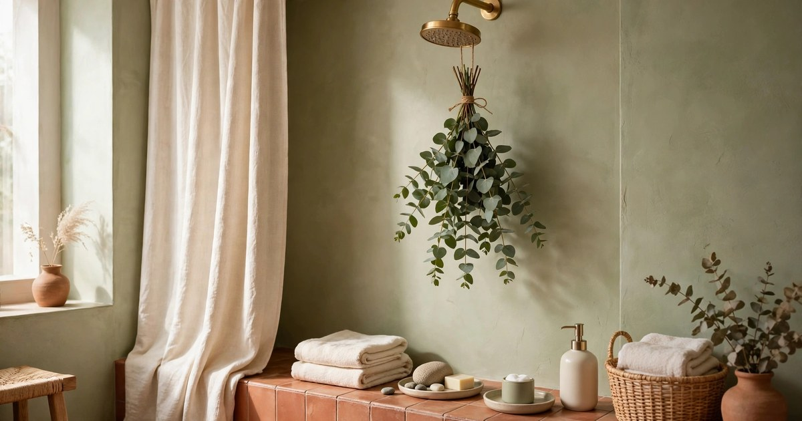
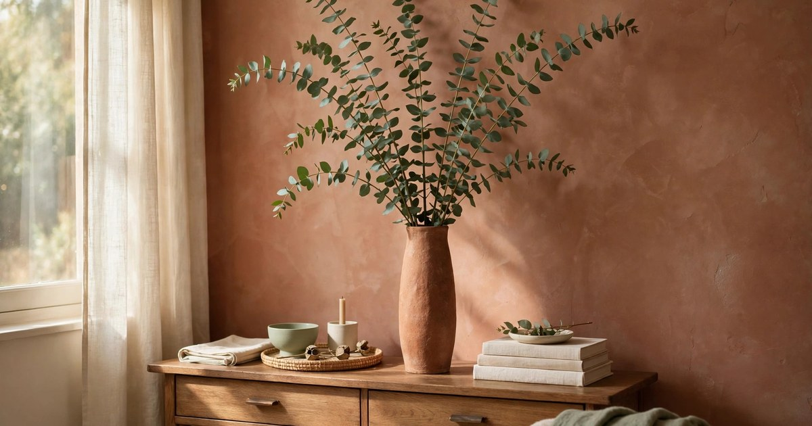
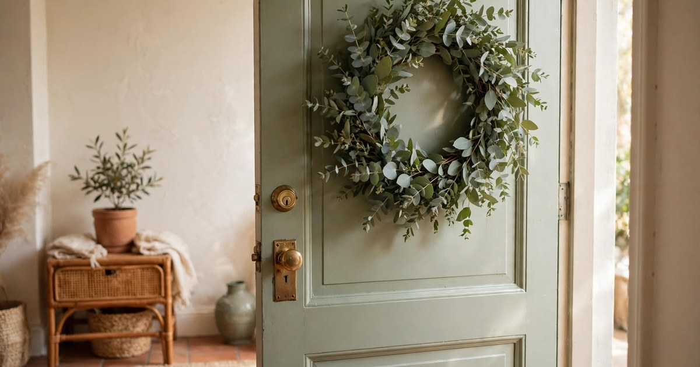
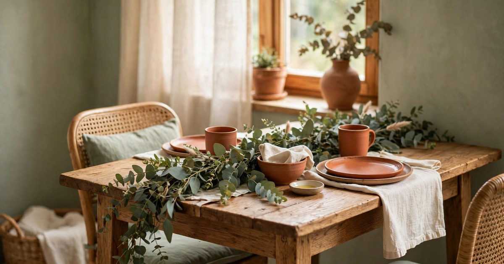
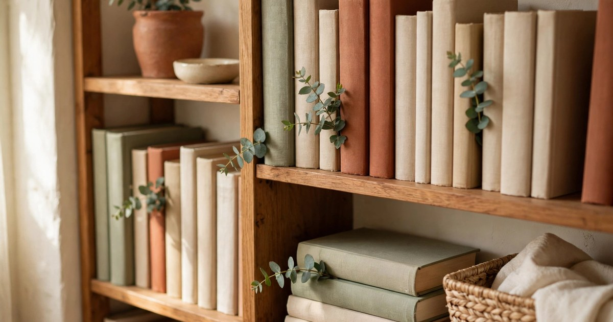
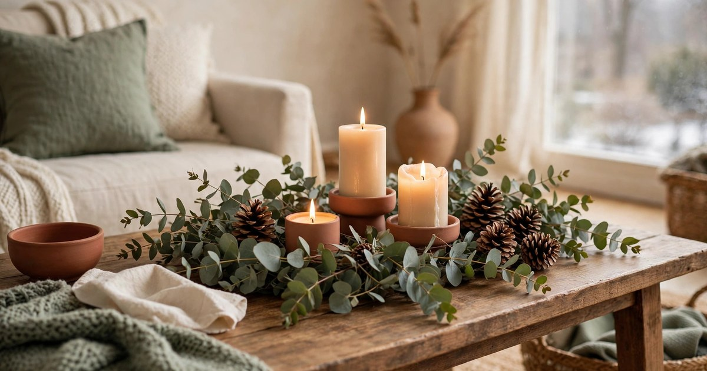
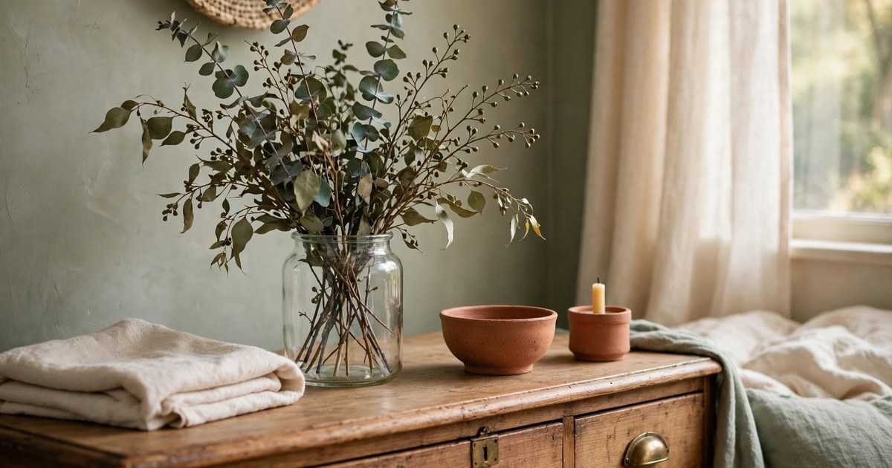
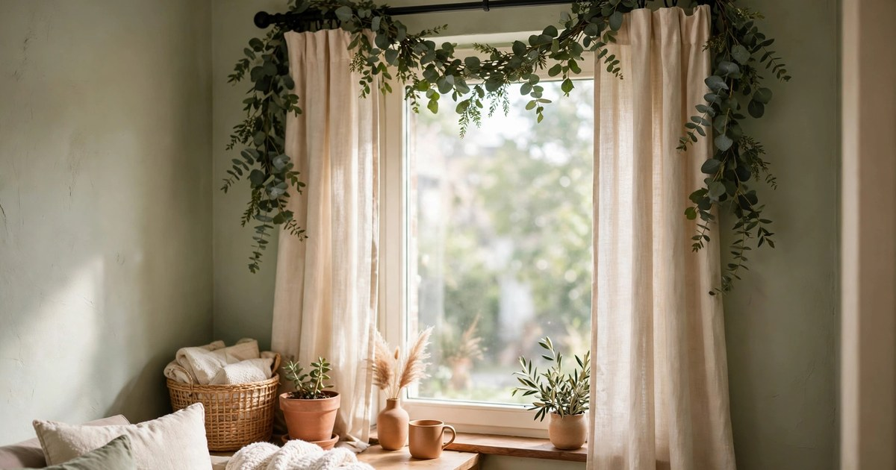
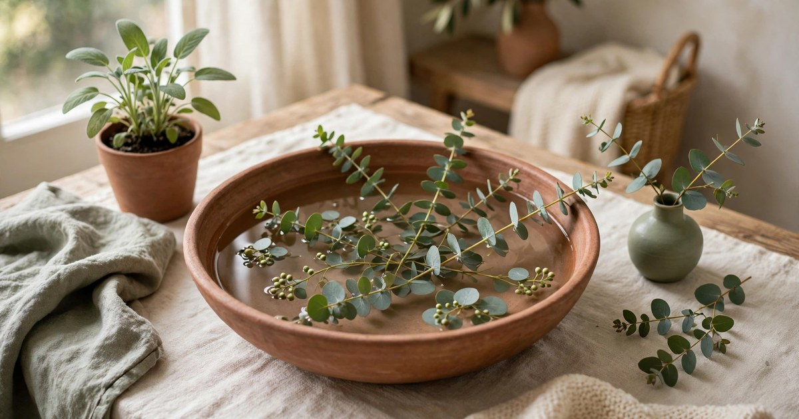
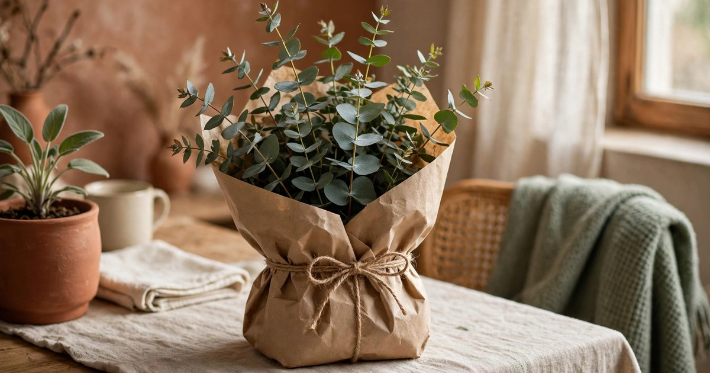

Eucalyptus is winter's easiest luxury. A bunch costs a few pounds or dollars, it lasts for weeks fresh and months dried, it smells clean and calm without a candle in sight, and its soft blue-green colour flatters every interior from white minimal to dark maximal. In a small apartment, eucalyptus earns its place twice over: it is decor and it is fragrance, and it asks for nothing more than a jar of water or a hook on the wall. These ten ideas use the whole bunch, in every room, without a single florist skill required.

### 1. Hang a eucalyptus bundle in the shower

The shower bundle is the idea that made eucalyptus famous, and it deserves the fame. Tie a bunch of fresh eucalyptus to the shower head or a hook, away from the direct water stream, and the steam releases its scent every time you shower — a spa ritual that costs less than a bottle of shower gel. The heat and humidity do the work; you just breathe in.

Use fresh eucalyptus, not dried, for the shower — dried stems release far less scent, and the point here is fragrance, not looks. Replace the bundle every two to three weeks, or when the scent fades, and hang the old bundle to dry for another life as dried decor elsewhere in the flat. Keep the bundle out of the direct spray, because constant soaking makes stems slimy rather than fragrant, and check that nobody in the household is sensitive to strong herbal scents before committing to a whole bunch.

### 2. Fill a tall vase with long stems

The simplest eucalyptus arrangement is also the most elegant: long stems in a tall vase, nothing else. No filler flowers, no arranging skill, no colour matching — the stems' natural arch and soft colour do all the work. A tall cylindrical or slightly flared vase suits eucalyptus best, because it lets the stems fan out at the top while holding them upright at the base.

In a small apartment, a tall vase on a console, a sideboard, or a windowsill adds height to a room without adding bulk — vertical greenery draws the eye up and makes low ceilings feel higher. Change the water weekly and trim the stem ends each time, and fresh eucalyptus lasts three to four weeks in a vase. When the stems finally dry in the vase, leave them there: dried eucalyptus in a vase is a second arrangement you did not have to make.

### 3. Make a eucalyptus wreath for the door

A eucalyptus wreath is the winter door display for people who find Christmas wreaths too much — soft, green, fragrant, and right from November through February. Start with a wire or grapevine wreath base, and wire small bundles of eucalyptus around it in one direction, overlapping each bundle over the last one's stems. The round leaves of silver dollar eucalyptus make the fullest wreath; the longer leaves of willow eucalyptus make a wilder, more trailing one.

Hang the wreath with a removable adhesive hook or an over-the-door hanger, both renter-safe, and keep it under cover if your door faces weather — rain fades eucalyptus fast, but a covered porch or an indoor hallway wall keeps it beautiful for months. A wreath made fresh in November dries gracefully in place, so it transitions from fresh green to soft grey-green without ever looking dead — it just looks like winter deepening.

### 4. Lay a eucalyptus table runner

A eucalyptus runner is the easiest festive table there is: lay stems end to end down the centre of the table, overlapping them so no gaps show, and add candles or a few [dried orange slices](/dry-citrus-flowers-winter-decor-guide/) if you like. There is no arranging, no florist foam, no water to spill on the tablecloth — just greenery, laid flat, looking like you hired someone.

For a small dining table, a runner beats a centrepiece because it uses no height and no width beyond the table's centre line — plates, glasses, and elbows all fit around it. Fresh stems last a dinner party and several days after; dried stems last the whole season and shed less on the table. Either way, the runner comes off the table in one lift when the meal is over, and the table is a table again.

### 5. Tuck sprigs into a bookshelf

A [bookshelf](/small-apartment-christmas-bookshelf-styling-ideas/) is the most overlooked place for greenery, and eucalyptus sprigs are the perfect shelf plant because they need no pot, no soil, and no watering. Tuck a short sprig upright between books, lay one across a stack of horizontal books, or stand a small bunch in a jar on a shelf end. The soft green breaks up rows of book spines and makes a shelf look styled rather than merely stored.

This is also the best use for the short offcuts left over from bigger arrangements — the stems too short for a vase become shelf sprigs, so one bunch decorates the bathroom, the table, and the bookshelf. Replace shelf sprigs when they dry out completely and start shedding, which takes about a month, and keep them away from open flames, because dried eucalyptus is flammable and a candle on the same shelf is a bad combination.

### 6. Add eucalyptus to a winter centrepiece

Eucalyptus is the backbone of a winter centrepiece because it pairs with everything winter offers: candles, pinecones, dried oranges, fairy lights, and bare branches. Start with a low tray or bowl, lay eucalyptus as the base layer, and add two or three other elements on top — a pillar candle, a handful of pinecones, a string of fairy lights woven through the stems. The eucalyptus fills the gaps, softens the hard edges, and ties the whole arrangement together with its colour and scent.

Keep the centrepiece low in a small apartment, where a tall arrangement blocks conversation across a coffee table or dining table. A low, wide centrepiece reads as generous without dominating the room, and it moves off the table in one lift when the space is needed. Refresh the eucalyptus every few weeks if fresh, or leave it dried all winter if dried — both versions look intentional, and the dried version needs no maintenance at all.

### 7. Dry a bunch for a bedroom jar

A bedroom wants scent without a flame and greenery without maintenance, and dried eucalyptus in a jar is exactly that. Hang a fresh bunch upside down in a dark room for two weeks until fully dry, then stand the stems in a jar, a bottle, or a small vase on a dresser or nightstand. The scent is gentler than fresh eucalyptus — a soft herbal background rather than a spa blast — which is exactly right for a room you sleep in.

Dried eucalyptus lasts for months in a bedroom, sheds very little if undisturbed, and costs nothing beyond the original bunch. Keep the jar away from direct sunlight, which fades the colour to straw, and away from radiators, which make dried stems brittle. When the scent finally fades after several months, the stems still look beautiful — and a single drop of eucalyptus oil on the stems revives the fragrance for another few weeks.

### 8. Wrap eucalyptus around a stair rail or curtain rod

In a small flat with no mantel and no staircase, the curtain rod is the garland spot — and [eucalyptus garland](/renter-friendly-christmas-garland-ideas/) on a curtain rod frames a window in soft green that no curtain can match. Wire or tie small bunches along a length of twine to make a garland, then drape or wrap it along the rod, letting the ends trail slightly at each side. The window light shines through the leaves, and the whole window looks dressed even with the curtains open.

The same technique works on a stair rail, a shelf edge, or a bed frame in a flat that has them. Fresh garland lasts about two weeks before it starts to dry — and drying on the rod is fine, because dried eucalyptus garland looks just as good as fresh, only greyer. This is the idea to try when you want a room to feel festive without a single Christmas decoration in sight.

### 9. Float eucalyptus sprigs in a bowl of water

A shallow bowl of water with eucalyptus sprigs floating in it is the most minimal centrepiece on this list, and the most striking for it. The water magnifies the leaves, the sprigs drift slowly, and the whole arrangement looks like something from a spa — for the price of a few stems and a bowl you already own. Add a floating candle or two if you like, but the sprigs alone are enough.

Change the water every two or three days to keep it clear, and use a wide, shallow bowl rather than a deep one, so the sprigs sit on the surface instead of sinking. This arrangement suits a bathroom, a hallway console, or a dining table where a low, watery centrepiece feels calm rather than cluttered. It lasts about a week fresh, and when the sprigs fade, they go straight into the shower bundle pile for their second life.

### 10. Gift a wrapped bunch with twine and a tag

A bunch of eucalyptus wrapped in brown paper, tied with twine, and finished with a handwritten tag is a winter gift that looks thoughtful, costs very little, and never duplicates what anyone else brings. It suits hosts, neighbours, teachers, and anyone whose home you visit in winter — a gift that is also decor, and that the recipient can use immediately in a vase, a shower, or a wreath.

Wrap the stems in damp paper towel inside the brown paper if the bunch will travel, so it arrives fresh, and choose a bunch with long stems and full leaves — the gift is the greenery, so the greenery should be generous. A small bunch given well beats a large gift given thoughtlessly, and eucalyptus has the rare quality of making the giver look like they understand both beauty and restraint. In a season of excess packaging, a paper-wrapped bunch is a quiet statement.

## One Bunch, Ten Rooms

The real lesson of eucalyptus is not any single idea on this list — it is that one bunch, divided thoughtfully, decorates a whole flat. Shower, vase, shelf, table, door, bedroom jar: six places from one purchase, each taking a few stems and a few minutes. Buy the bunch this week, while it is fresh and cheap, and let winter smell like you meant it to.

## Frequently Asked Questions

### How long does fresh eucalyptus last?

In a vase with weekly water changes, fresh eucalyptus lasts three to four weeks. In a shower bundle it lasts two to three weeks before the scent fades, and as a [table runner](/small-apartment-christmas-table-setting-ideas/) it stays fresh-looking for about a week before drying gracefully in place.

### Is eucalyptus safe around pets?

Eucalyptus can be toxic if ingested by cats and dogs, so keep arrangements out of reach of pets that chew plants, and avoid shower bundles in bathrooms pets drink from. If a pet eats eucalyptus, contact a vet promptly.

### Can I dry eucalyptus myself?

Yes — hang a fresh bunch upside down in a warm, dark, dry room for about two weeks until the stems feel crisp and papery. Dried eucalyptus keeps its shape and a gentle scent for months, and works in wreaths, jars, and garlands.

### What is the best type of eucalyptus for decor?

Silver dollar eucalyptus, with round leaves, makes the fullest wreaths and bouquets; baby blue eucalyptus is more compact and fragrant; willow eucalyptus, with long narrow leaves, gives a wild, trailing look. All three dry well and suit small spaces.
