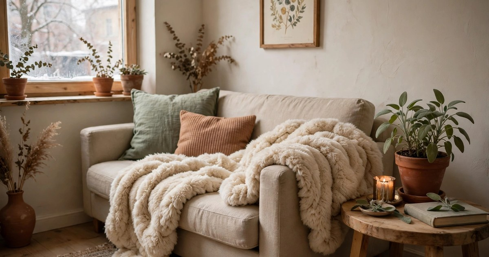
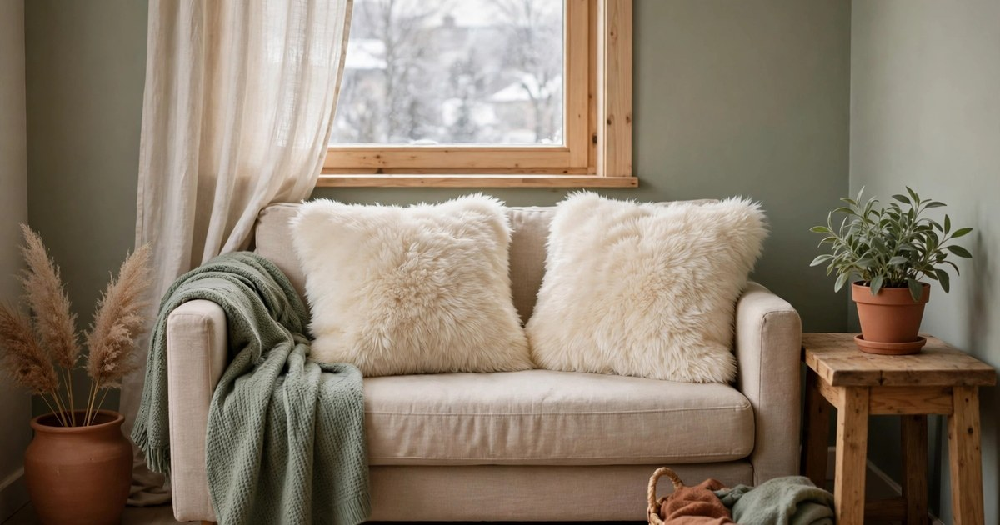
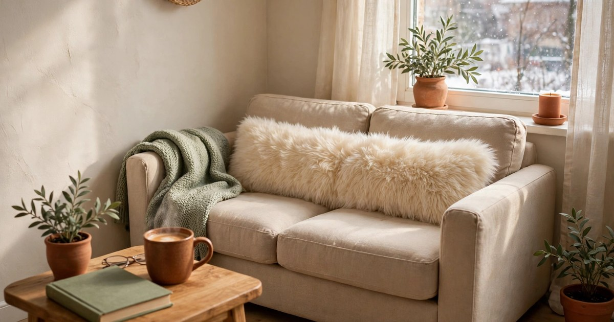
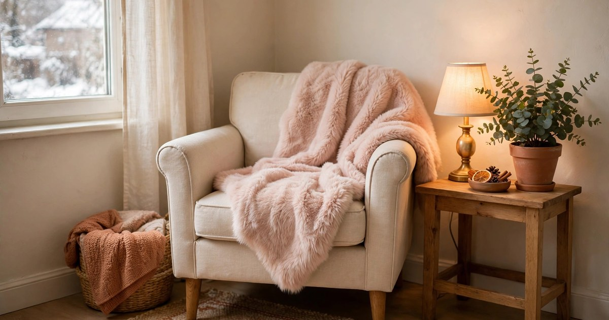
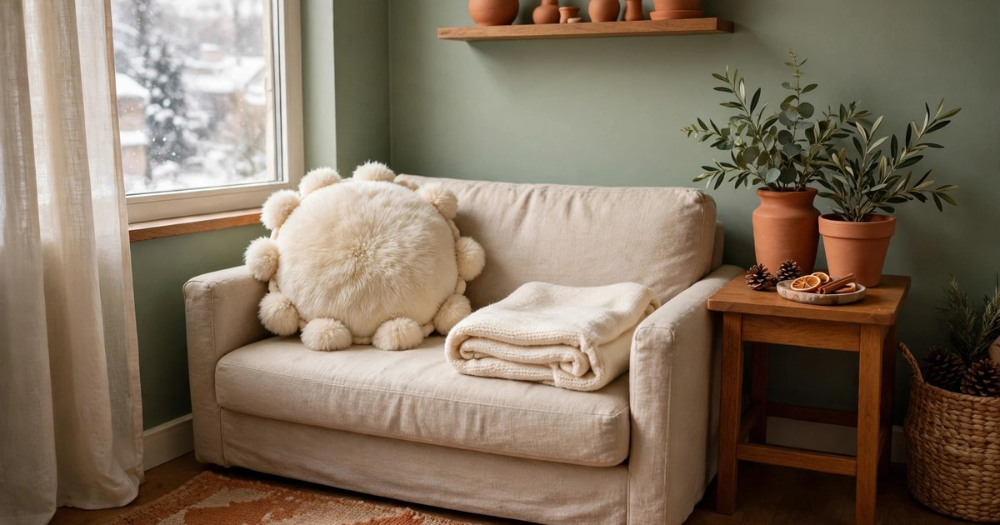
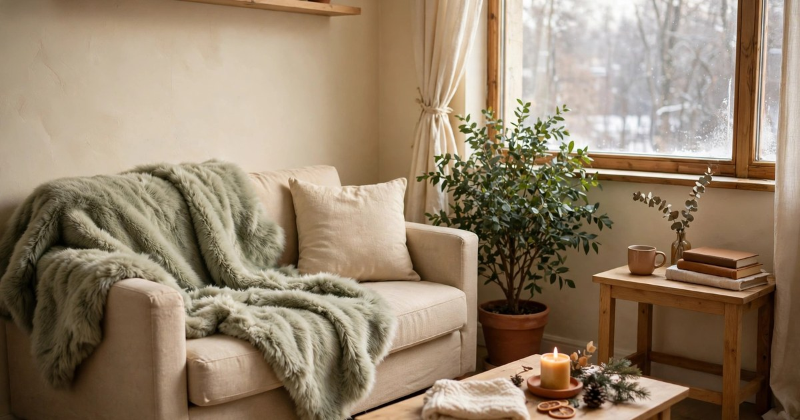
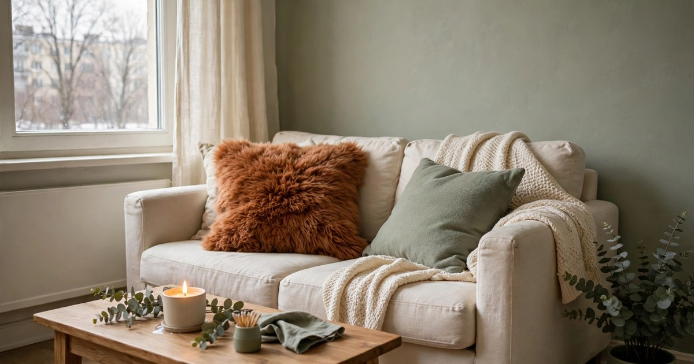
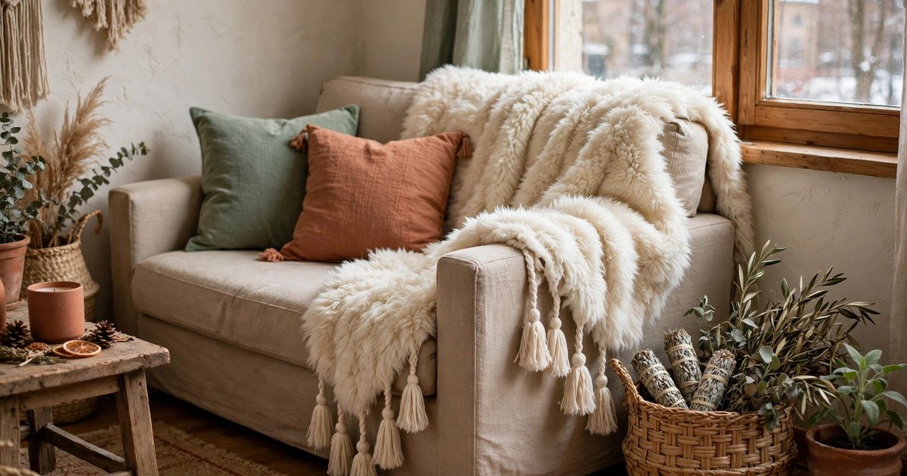
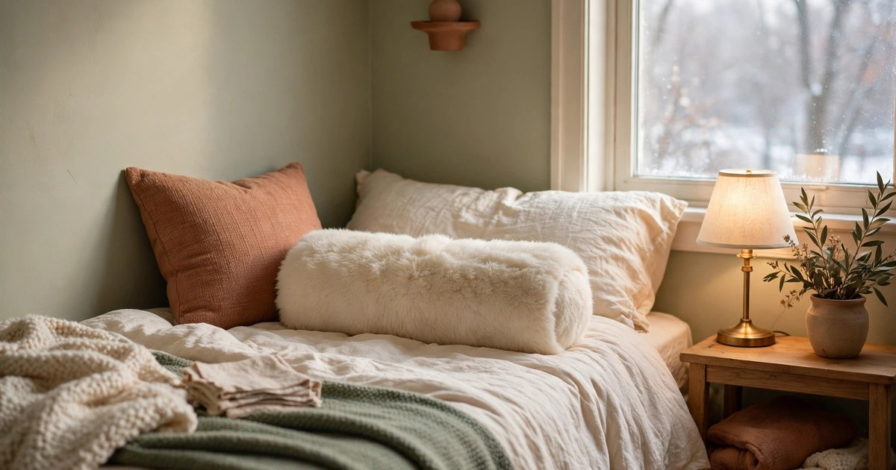

There is a particular kind of cold that only a small rented flat knows. The radiators are on, the windows are shut, and yet the sofa still feels like the coldest seat in the house. You cannot add insulation, you cannot change the windows, and you certainly cannot justify a new sofa for a flat you might leave next year. What you can do, for under $25, is bury that sofa under faux fur.

Faux fur is the renter's shortcut to a cabin. It looks warm before you even touch it, it feels warm the second you do, and it photographs like a boutique hotel — which matters when your living room is also your video-call background, your reading nook and your dining room. A single throw over the arm of a sofa changes the whole room's temperature, in both senses of the word, and a couple of faux fur cushions finish the job for less than the cost of a takeaway.

Every pick below costs under $25, and every one is chosen with small flats in mind: nothing oversized, nothing that swallows a two-seater sofa, nothing that needs dry cleaning or a storage unit in summer. They are all machine-washable or spot-cleanable, they all fold away into a single drawer or basket when the weather turns, and they all move with you to the next flat. If you have already started layering your living room for winter, our roundup of [cozy throw blankets for renters under $25](/cozy-throw-blankets-renters-under-25/) covers the knits and sherpas — this list is purely about the fluffy stuff. And if the bedroom needs the same treatment, our [cosy winter bedroom ideas for small apartments](/cosy-winter-bedroom-ideas-small-apartments/) will help you carry the warmth through the whole flat.

A quick word on shopping: faux fur quality varies wildly at this price, so check the listing photos for a dense, even pile rather than thin, stringy fibres, and read the reviews for mentions of shedding. A good budget faux fur sheds a little on the first wash and then settles; a bad one sheds forever. Stick to the colours below — cream, blush, sage, terracotta — and your throws will work with the warm palette of your flat instead of fighting it. Buy one throw and one cushion to start, live with them for a week, and then decide whether the room wants more.

### 1. Chunky faux fur throw in cream

The cream chunky faux fur throw is the one to buy first, because it does the most work for the least money. At roughly $20–25 for a standard 50x60 inch size, it is the softest thing in most flats, and it has a trick no other throw on this list can match: it makes a tired sofa look brand new. Draped over the back or folded across the arm, the thick pile catches the light and adds a layer of depth that flat fabrics simply cannot. Cream is the safest colour here — it brightens a dark corner, it goes with every wall colour a landlord has ever chosen, and it makes a small room feel larger because light bounces off it instead of being absorbed.

Where it fits is almost everywhere, which is exactly why it earns the top spot. Keep it on the sofa for film nights, carry it to the bed on the coldest evenings, and fold it into a basket by the door when guests arrive so the room looks styled rather than cluttered. The care note matters: wash it cold on a gentle cycle, inside a laundry bag if you have one, and let it air-dry rather than tumble-drying it — heat is what turns soft faux fur into a matted rug. Shake it out while it is still slightly damp and the pile springs back beautifully.

[Shop chunky faux fur throw cream](https://www.amazon.com/s?k=chunky+faux+fur+throw+blanket+cream&tag={{AMAZON_TAG}})

### 2. Faux fur cushion covers, set of 2

Cushion covers are the smartest buy on this list, because you are not paying for the filling. A set of two faux fur covers, usually $12–18, slips over the cushions you already own — including the flat, tired ones that came with a landlord's sofa — and instantly makes them look like they belong in a styled home. The hidden zip is the detail to check before buying: a good zip sits flush and invisible, while a cheap one shows a hard line across the back of the cushion. Choose covers a touch smaller than your inserts, around 18 inches for a standard cushion, and the fur will sit plump instead of sagging.

This is also the most renter-friendly pick of the nine, because it changes nothing permanently and costs less than a pizza. Swap the covers in November, swap them back out in April, and the sofa has a whole new personality twice a year. Keep a lint roller nearby for the first week — new faux fur sheds a little — and wash the covers inside out on cold, then air-dry. They will survive a whole winter of daily use and still look soft in spring, which is more than can be said for most budget cushions.

[Shop faux fur cushion covers set of 2](https://www.amazon.com/s?k=faux+fur+cushion+covers+set+of+2+cream&tag={{AMAZON_TAG}})

### 3. Faux fur lumbar cushion

A lumbar cushion is the grown-up's throw pillow: long, low and genuinely useful. A faux fur lumbar, typically $15–22, sits along the back of a sofa or across the middle of a bed and does two jobs at once — it supports your lower back while you read or scroll, and it gives a small sofa a finished, styled look that a pile of square cushions never quite achieves. In a small flat, where the sofa is also the office chair and the reading chair, that lower-back support is not a luxury; it is the difference between an evening on the sofa and an evening with a sore back.

Where it fits best is the centre of a two-seater, where it stops the sofa looking like two separate seats and turns it into one inviting stretch. It also works brilliantly at the head of a bed, propping you up for reading without the usual stack of flattening pillows. Choose a neutral cream or grey so it works in both rooms, and check that the insert is included — some listings at this price sell the cover only, which is a nasty surprise. Spot-clean small marks with a damp cloth and a drop of mild detergent, and give it a good shake outside once a week to keep the pile fluffy.

[Shop faux fur lumbar cushion](https://www.amazon.com/s?k=faux+fur+lumbar+cushion+pillow+cream&tag={{AMAZON_TAG}})

### 4. Faux fur throw in blush pink

Blush pink faux fur is the romantic of the list, and it earns its place because it warms up a room in a way cream cannot. Where cream brightens, blush softens: it takes the edge off harsh white walls, it flatters warm wood tones, and it adds a gentle rosy glow that makes a small living room feel like a cocoon rather than a box. At $18–25, a blush throw is also the best way to try a colour without committing to it — if you fall out of love with pink, you have spent twenty dollars, not two hundred, and the throw still works beautifully folded at the foot of a bed.

The trick with blush is balance. One blush throw plus cream cushions looks deliberate and calm; blush on everything looks like a sweet shop. Keep the rest of the room neutral and let the throw be the single soft pink note, ideally near a lamp so the warm light catches the pile in the evening. Blush shows marks more than cream, so treat spills quickly and wash cold on gentle — never hot, which can dull the colour. Folded neatly over an armchair, it is the throw guests always reach for first.

[Shop blush pink faux fur throw](https://www.amazon.com/s?k=blush+pink+faux+fur+throw+blanket&tag={{AMAZON_TAG}})

### 5. Faux fur pom-pom cushion

Every small flat needs one playful piece, and the pom-pom cushion is it. A round or square faux fur cushion trimmed with soft pom-poms, usually $12–20, adds texture and a touch of fun to a sofa that might otherwise look too serious — especially in a rental where the furniture is sensible and the walls are magnolia. The pom-poms catch the eye and give the room a focal point, which is a useful trick in a small space where there is nowhere to hide a boring corner.

It fits best as an accent rather than the main event: one pom-pom cushion among plainer cream or sage cushions, on an armchair or at the end of a bed. Children love them, guests comment on them, and they photograph beautifully if your sofa ever appears on social media. The care note is simple but important — pom-poms tangle in a washing machine, so spot-clean the cushion and hand-wash only if you must, then reshape the pom-poms while they are damp and let them air-dry. Treated gently, it will last several winters.

[Shop faux fur pom-pom cushion](https://www.amazon.com/s?k=faux+fur+pom+pom+cushion+pillow&tag={{AMAZON_TAG}})

### 6. Faux fur throw in sage green

Sage green is the colour of the moment for a reason: it calms a room down. A sage faux fur throw, around $18–25, brings the plant-and-earth palette indoors even if you own no plants, and it pairs with wood tones, cream walls and terracotta accents without ever clashing. In a small flat where every object is visible all the time, a calming colour earns its keep — sage reads as a deliberate design choice rather than a random purchase, and it makes the whole room feel more considered.

This is the throw to choose if your flat already has plants, because the green echoes the foliage and ties the room together. Drape it over the sofa arm nearest the window, where it catches the daylight, or fold it across the bed as a decorative layer that actually gets used on cold nights. Sage is also forgiving with marks — it hides pet hair and dust far better than cream — which makes it the practical choice for a daily-use throw. Wash cold and gentle, air-dry, and shake it out well; the pile recovers best when it is not squashed into a tumble dryer.

[Shop sage green faux fur throw](https://www.amazon.com/s?k=sage+green+faux+fur+throw+blanket&tag={{AMAZON_TAG}})

### 7. Faux fur cushion in terracotta

Terracotta is the warmest colour in the small-apartment palette, and a single terracotta faux fur cushion, usually $12–20, is the fastest way to bring that warmth onto a neutral sofa. It is the accent-colour trick that interior designers use and renters can steal for almost nothing: one strong, warm cushion changes the whole colour story of a room without a single painted wall or new piece of furniture. Against cream, beige or grey, terracotta pops; against wood tones, it glows.

Where it fits is wherever your sofa needs rescuing. A grey landlord sofa with one terracotta cushion suddenly looks intentional; a cream sofa with two terracotta cushions looks styled. Buy one first and see how it behaves in your light — terracotta shifts with the time of day, reading rusty in the morning and almost burnt orange by lamplight, which is part of its charm. The fur hides crumbs and pet hair well, so it is a good choice for a cushion that gets daily use. Spot-clean as needed and wash the cover cold inside out when the season ends.

[Shop terracotta faux fur cushion](https://www.amazon.com/s?k=terracotta+faux+fur+cushion+pillow+cover&tag={{AMAZON_TAG}})

### 8. Faux fur throw with tassels

Tassels are a small detail that makes a throw look twice its price. A faux fur throw with tasselled edges, around $19–25, has a relaxed, bohemian feel that suits small flats perfectly — it looks collected rather than bought, and the tassels add movement and texture that a plain edge cannot. Draped over a sofa back with the tassels hanging, it gives the room a soft, finished edge; folded at the foot of a bed, it looks like something from a boutique hotel rather than a budget listing.

The tassels do need a little care, which is the only downside: they tangle if you throw the blanket in the wash loose, so use a laundry bag or wash the throw by hand, and comb the tassels out gently while they are still damp. Keep it on the sofa or the reading chair rather than the floor, where tassels pick up dust, and it will stay looking smart all winter. This is the throw to pick if your flat leans boho or layered — it plays beautifully with woven baskets, macramé and warm wood.

[Shop faux fur throw with tassels](https://www.amazon.com/s?k=faux+fur+throw+blanket+tassels+cream&tag={{AMAZON_TAG}})

### 9. Faux fur bolster cushion

The bolster is the most versatile cushion on this list, and the one most people forget to buy. A cylindrical faux fur bolster, typically $14–22, works as a sofa armrest, a reading prop, a bed pillow and even a footrest, and it rolls neatly into a corner when you need the space back — which, in a small flat, is often. It also solves a specific small-sofa problem: the gap at the end of a two-seater where a square cushion falls down and a throw slides off. A bolster fills that gap and stays put.

Its best home is probably the bedroom, where it sits across the pillows as a decorative layer by day and becomes a proper reading support by night, but it is equally happy on a window seat or a deep armchair. Choose a colour that matches your throw — cream bolster with a cream throw looks intentional, while a terracotta bolster against a sage throw adds a confident pop. The round shape means it rarely needs washing all over; spot-clean marks, air it outside on a dry day, and give the fur a brush with a soft clothes brush to keep the pile even.

[Shop faux fur bolster cushion](https://www.amazon.com/s?k=faux+fur+bolster+cushion+pillow+round&tag={{AMAZON_TAG}})

## How to style faux fur in a small flat without the clutter

Faux fur is generous, and generosity can tip into clutter fast in a small room. The rule is simple: one throw and two or three cushions per seating area, no more. Pick a single base colour — cream is the easiest — and let one other colour be the accent, whether that is terracotta, sage or blush. Mix textures rather than colours: faux fur next to a woven basket, a linen cushion or a knit throw reads layered and intentional, while five different faux fur colours reads like a sale rail.

Storage matters too, because summer will come. A lidded basket or a vacuum bag under the bed holds a whole winter's worth of faux fur, and washing everything before you pack it away means it comes out fresh in November instead of smelling of a cupboard. Fold throws rather than rolling them, keep the tassels free, and store cushions with their zips closed so the fur does not catch. If you follow the one-throw rule and buy quality over quantity, your $25 finds will outlast several winters — which is the real budget win.

## Frequently Asked Questions

### Is faux fur actually warm, or is it just decorative?

It is genuinely warm. The dense pile traps air against your body, which is what insulation actually is, and a thick faux fur throw is noticeably warmer than a thin cotton or linen throw of the same size. It will not replace a duvet on the coldest night, but for sofa evenings and extra bed layers it is one of the warmest budget options, especially the chunky pile throws in picks one and six.

### How do I wash faux fur throws and cushions without ruining them?

Wash cold on a gentle cycle, ideally inside a laundry bag, and air-dry rather than tumble-drying — heat mats the fibres and is very hard to reverse. Skip fabric softener, which coats the pile and reduces softness over time. For small marks, spot-clean with a damp cloth and mild detergent. Pom-pom and tasselled pieces are best hand-washed or spot-cleaned only, since trims tangle in a machine.

### Does faux fur shed a lot?

A good budget faux fur sheds a little when new and then settles after the first wash; a poor one sheds forever. Check reviews for the word shedding before you buy, and expect to use a lint roller for the first week. Washing inside a laundry bag and shaking the piece outside while it is still slightly damp both help the pile settle faster.

### Will faux fur cushions work on a small sofa without overwhelming it?

Yes, if you keep the count low. Two or three cushions on a two-seater is the sweet spot — one lumbar or bolster plus one or two squares — and a single throw folded rather than spread. The trick is to let the fur be the texture and keep the colours calm: cream plus one accent colour, never four competing shades on one small sofa.

### Are faux fur throws and cushions renter-friendly?

Completely. Nothing here touches a wall, needs a tool or leaves a mark: throws drape, cushions sit, and everything folds into a bag when you move out. They are also one of the cheapest ways to hide a landlord's sofa you did not choose, and they move with you to the next flat, which makes the under-$25 price a genuine investment rather than a sunk cost.
