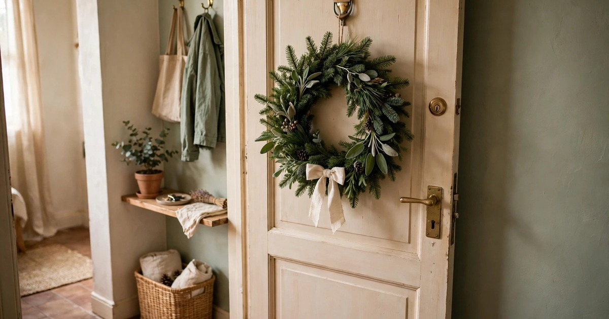
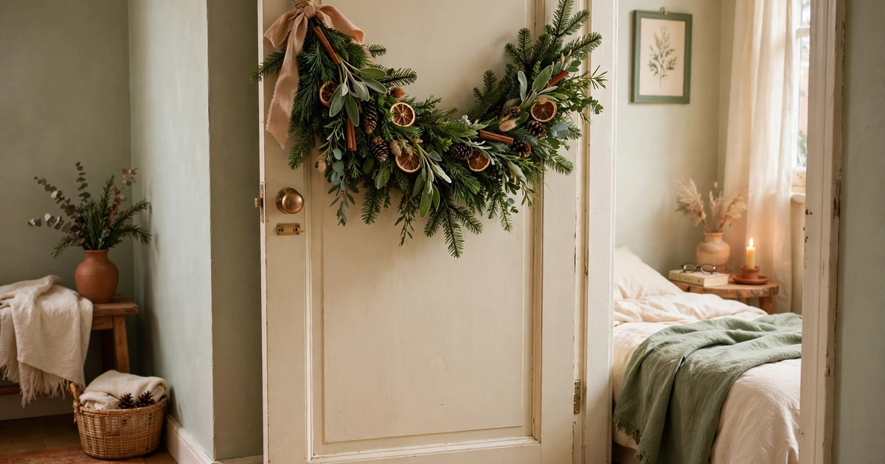

Fresh evergreen branches are the most underrated Christmas decoration in a small apartment. A single bunch of pine, fir or cedar from the florist costs a few pounds, smells like a forest, and can be split across half a dozen displays around the flat — which is more greenery, in more places, than a single tree ever gives you. Branches take no floor space, need no stand, and when they drop in January they go in the compost, not down the stairs in a bin bag.

The trick is to use branches the way a florist does: as a material, not as a tree substitute. Cut them, bend them, tuck them into vases, lay them along shelves, wire them into garlands. Ten ideas follow, each one using a handful of branches and nothing you do not already own. Buy one generous bunch, keep the stems in water, and work through the list over a weekend — by Sunday evening the whole flat will smell of pine, and you will have spent less than the price of a takeaway.

### 1. The Sideboard Garland

Lay a long, loose garland along the top of your sideboard, side table or bookcase, and you have the easiest festive display in the flat. Take three or four branches, lay them end to end with the stems overlapping, and tie them loosely together with twine at the joints. The garland should look relaxed and a little wild, not stiff and symmetrical — the charm of fresh greenery is that it looks gathered, not manufactured. Tuck in a few pinecones, a short string of battery fairy lights, and two or three candles at different heights, and the sideboard is dressed.

Keep the garland away from the candles themselves, and never let a flame touch dry foliage. A garland on a sideboard lasts two to three weeks if you mist it every couple of days, and it is the display your guests will see first, because the sideboard is usually the largest flat surface in a small living room. When the branches start to drop, replace the worst one rather than the whole garland — a single fresh branch revives the entire arrangement.

### 2. The Single-Stem Vase

One tall, beautiful branch in a slim vase is the minimalist's Christmas decoration, and it is also the cheapest. Choose the best branch in your bunch — long, straight, with even needles — and stand it in a tall glass or ceramic vase with water. Hang two or three miniature ornaments from it, or leave it completely bare, and place it on a shelf, a windowsill or a bedside table. The single stem reads as a deliberate design choice, not as a lack of decorations, and it brings the pine scent into rooms that would otherwise go undecorated.

The vase matters as much as the branch: a clear glass vase shows the water and the stem, which suits a modern flat, while a terracotta or cream ceramic vase suits a warm, rustic room. Change the water every three or four days and trim the stem by a centimetre each time, and a single branch will stay fresh for three weeks. It is the perfect decoration for a bedroom or a bathroom, the two rooms most Christmas decor forgets.

### 3. The Window Swag

A swag across the top of a window is the branch idea with the biggest visual impact for the least effort. Take two or three branches, tie the stems together with twine, and hang the bundle from two removable adhesive hooks so it drapes in a shallow curve across the window. The swag frames the view, reads as festive from the street, and gives you a lit backdrop in the evenings when you add a string of fairy lights along the frame. Dried orange slices tied on with ribbon add colour and scent for pennies.

Use hooks on the wall or the window frame, never tape on double-glazed seals, and keep the swag light — two or three branches are enough, and a heavy swag will pull a hook off the paint. A window swag also solves the problem of a window that faces a brick wall or a neighbour's window: instead of looking at the view, you look at the greenery. For more on dressing windows for Christmas, see our guide to [making a small apartment feel like Christmas without a tree](/small-apartment-christmas-without-tree-guide/).

### 4. The Stair Banister Runner

If your flat has stairs, the banister is a ready-made display rail. Tie short branches along the banister with ribbon or twine, spacing them evenly and letting the ends overlap, so the whole rail becomes a garland. Add a few pinecones or small ornaments, and a string of battery lights woven through the branches, and the staircase becomes the most festive part of the flat. The branches are at hand height, so the pine scent greets you every time you go up or down.

Keep the ties loose enough that the branches do not slide, but tight enough that they do not droop onto the steps, which is a trip hazard. In a flat with no stairs, the same technique works on a curtain rod, a picture rail or the top of a wardrobe — any long horizontal line in the room becomes a place to hang greenery. A banister garland uses more branches than any other idea on this list, so save it for the bunch with the longest stems.

### 5. The Quick Wreath

A wreath does not need a wire frame or a floristry course. Bend a long, flexible branch into a circle, tie the ends together with twine, and then tuck shorter branches into the circle until it looks full, wiring or tying each one in place. The whole thing takes twenty minutes, costs nothing beyond the branches, and hangs on the inside of your front door on a removable adhesive hook — the outside is the landlord's problem, the inside is yours. Add a bow, a few dried orange slices, or a cluster of pinecones, and you have a wreath that looks handmade because it is.

Hang the wreath where you will see it every day, because a wreath on a door you never use is a wasted wreath. The inside of the front door is ideal, but a bedroom door, a wardrobe door or a blank wall all work. Mist the wreath every couple of days, and it will last until New Year. When it dries out, the branches make excellent kindling or compost, and the twine goes in the recycling.

### 6. The Table Runner Base

Lay branches flat down the centre of your dining table, stems overlapping, and you have a living table runner that doubles as a centrepiece. It costs nothing beyond the branches, it smells wonderful while you eat, and it needs no vase, no foam and no arrangement skills — the table does the supporting, and the branches just lie there looking beautiful. Tuck in a few candles in sturdy holders, a scattering of pinecones, and a handful of clementines, and the table is dressed for Christmas dinner.

Protect the table first: lay a runner or a folded tea towel underneath the branches, because pine sap and water will mark wood. Keep the branches away from the plates so nobody is eating pine needles with their dinner, and trim any stems that stick out past the end of the table. The branches will last a week or two lying flat, and when they dry out they look just as good — dried evergreen is a decoration in its own right, and it keeps its shape for months.

### 7. The Door Swag

A door swag is a small bundle of branches tied together and hung from a hook, and it is the fastest way to bring greenery into a room that has no spare surface. Tie three or four short branches together at the stems, fan the ends out slightly, and hang the bundle from a removable hook on a bedroom door, a bathroom door or a wardrobe. Add a ribbon bow at the tie point and a couple of small ornaments, and the door is decorated in five minutes.

Door swags are the branch idea that scales best: make three or four from one bunch, hang one on every door in the flat, and the whole place feels decorated even though you have used less greenery than a single garland. They are also the easiest to maintain — lift the bundle off its hook, dunk the stems in water for an hour, and hang it back up. A door swag is the decoration for the rooms that never get decorated: the bedroom, the bathroom, the hallway.

### 8. The Candle Surround

Arrange short branches in a circle around a candle on a tray, and you have a centrepiece that takes two minutes and looks like it took twenty. Use a tray or a large plate to catch falling needles, place a candle in a sturdy glass holder in the middle, and tuck the branches around the base so the candle rises out of the greenery. The branches frame the flame, the flame lights the needles from below, and the whole thing glows in the evening. Add a few cranberries or small pinecones for colour.

Safety first: the branches must never touch the flame, and the candle must be in a holder tall enough that the flame sits well above the foliage. Battery candles are the safe choice for this display, and they look convincing from across a room. A candle surround works on a coffee table, a dining table or a windowsill, and it is the branch idea most likely to be photographed — which is a genuine consideration if your Christmas table ends up on social media.

### 9. The Gift Wrap Topper

A small sprig of evergreen tucked under the ribbon of a wrapped present is the cheapest luxury in Christmas decorating. Cut the smallest, prettiest tips from your branches, tuck one under each ribbon, and add a dried orange slice or a cinnamon stick if you have them. The gifts look like they came from a boutique rather than a kitchen table, the pine scent fills the room when the presents are opened, and the sprigs cost nothing because they are the offcuts from every other idea on this list.

This is the branch idea that uses the waste: the tips you trimmed off the garland, the short stems left over from the wreath, the odd branch too small for a vase. Nothing goes unused. A sprig on a gift also tells the recipient that the present was wrapped by hand, with care, which is a nicer message than any shop-bought bow. Keep the sprigs in water until wrapping day, and wrap the presents the night before so the greenery is still fresh on Christmas morning.

### 10. The Wall Hanging

A wall hanging made of branches tied to a wooden dowel is the most artistic idea on this list, and it suits a flat that leans bohemian or Scandinavian. Tie a length of twine to each end of a dowel or a straight branch, hang it from a removable hook, and then tie short branches to the dowel at different lengths, so they hang down like a fringe. The longest branches go in the middle, the shortest at the edges, and the result is a green, living wall hanging that moves gently in the draught and smells of pine.

Add a few hanging ornaments, dried orange slices or small pinecones tied to the branches, and the wall hanging becomes a full decoration. It takes up no floor space, needs one hook, and comes down in seconds. When the branches dry out, the wall hanging still looks good — dried evergreen keeps its shape and colour for months — so this is the one branch decoration you can leave up well into January. It is also the easiest to make with children, because the tying is simple and the result is forgiving.

## Frequently Asked Questions

### How long do fresh evergreen branches last indoors?

Cut pine, fir and cedar branches last two to three weeks indoors if the stems sit in water and you mist them every couple of days. Keep them away from radiators, which dry them out fast, and replace individual stems as they drop rather than the whole arrangement.

### Where can I buy fresh evergreen branches cheaply?

Florists and garden centres sell loose branches for a pound or two in December, and many will sell offcuts cheaply if you ask. A Christmas tree lot will often give you the lower branches they trim off the trees for free.

### Which evergreen is best for indoor decorating?

Fir holds its needles longest and has the classic Christmas scent. Cedar is soft, feathery and lasts well. Pine is the cheapest and the most fragrant, but drops needles faster. Eucalyptus is not a true evergreen but lasts longest of all and dries beautifully.

### How do I keep cut branches fresh without a vase?

Stand the stems in water whenever possible, mist the foliage every couple of days, and keep arrangements away from radiators and direct heat. Branches laid flat on a table last a week or two, and dried branches keep their shape for months.

### Are fresh evergreen branches safe around pets?

Pine, fir and cedar are mildly toxic if eaten in large quantities, so keep branches out of reach of cats and dogs that chew plants, and sweep up fallen needles promptly. If your pet is a keen chewer, use branches high on shelves or behind closed doors.
