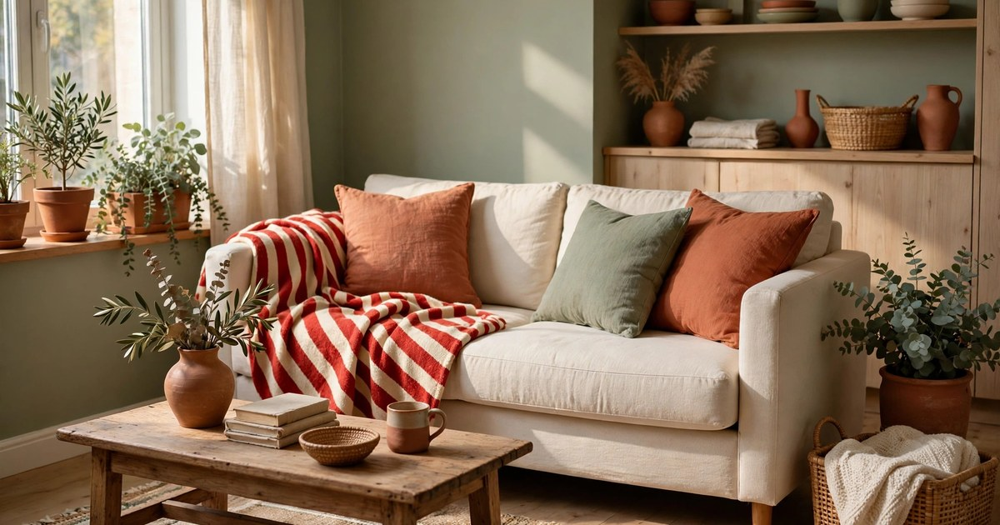
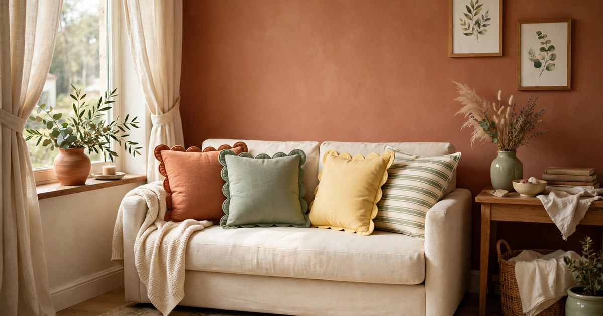
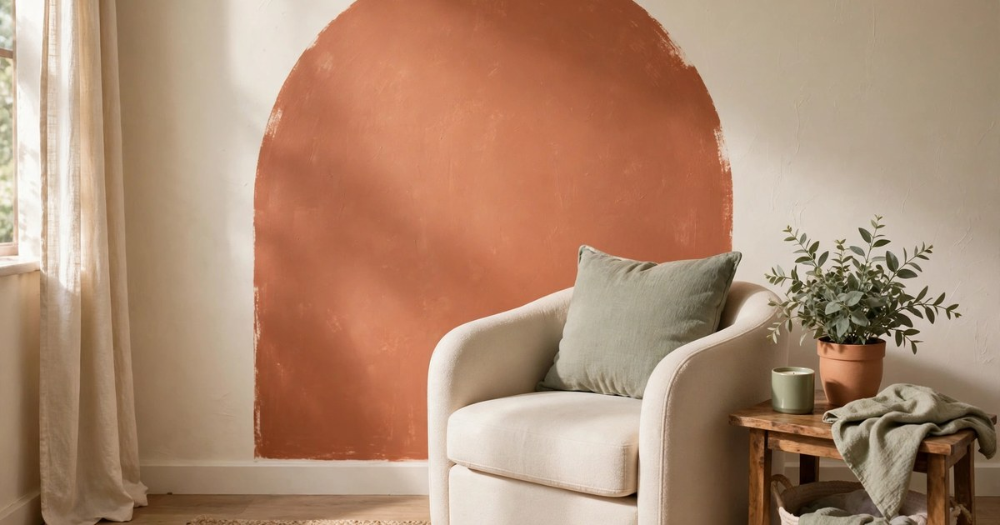
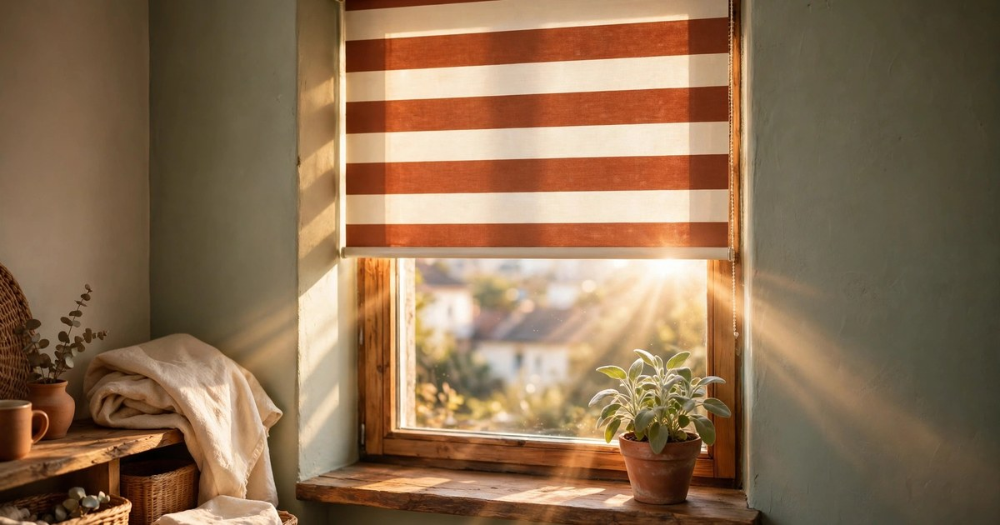
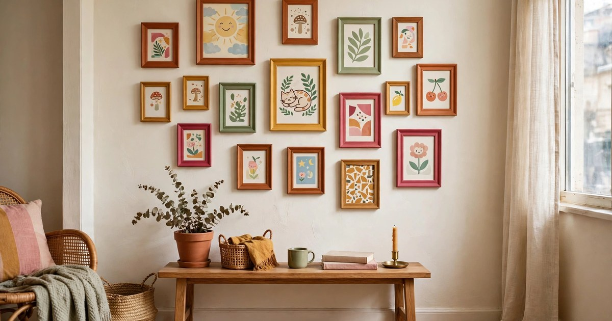
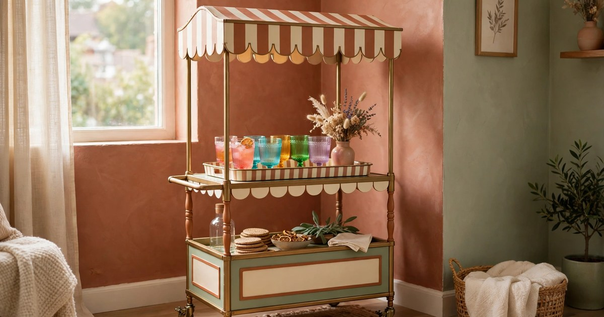
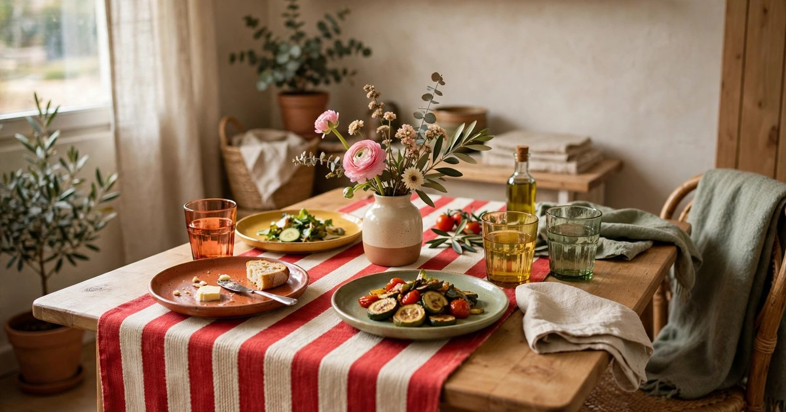
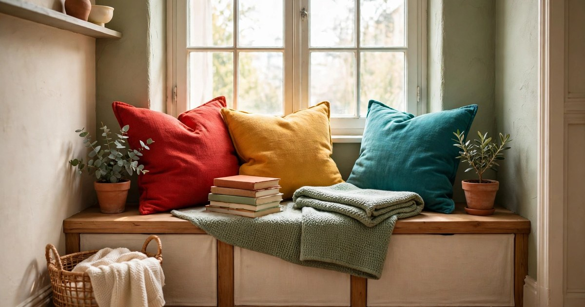
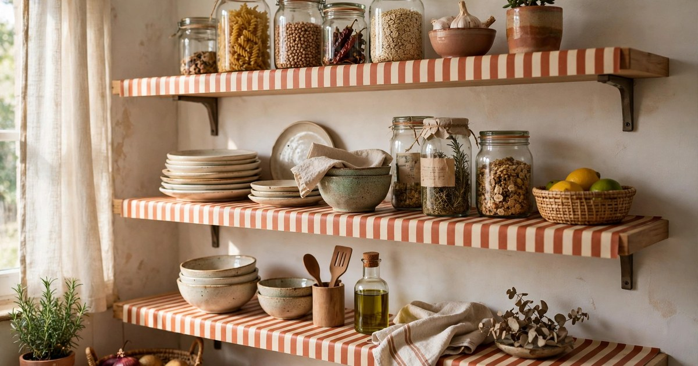
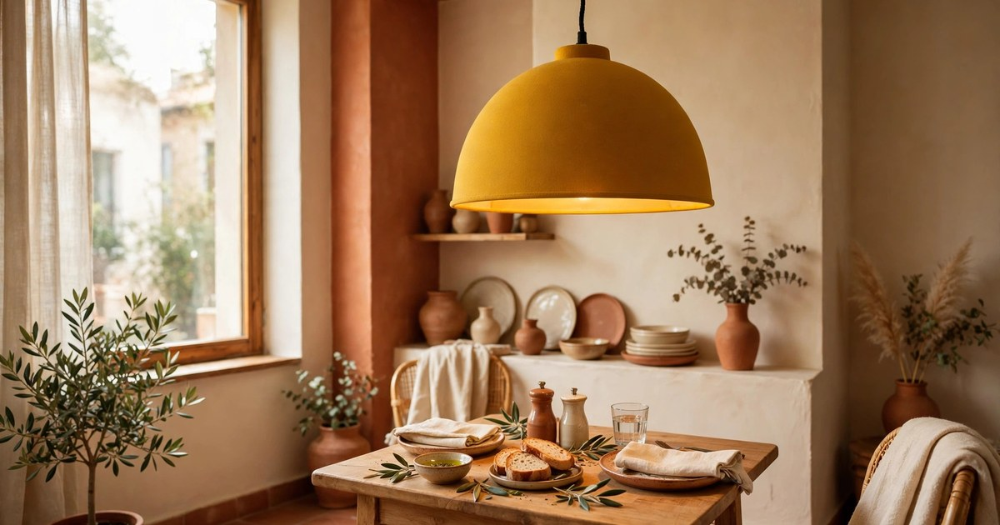

FunHaus is the name Pinterest Predicts 2026 gives to a very particular kind of maximalism: circus-inspired, stripe-obsessed, unapologetically playful. Think bold red-and-cream awnings, candy-striped cushions, painted arches, scalloped edges, fairground colour and a sense that the room is smiling at you. It sounds like the opposite of what a small rented flat needs — and that is exactly why it works. A small room decorated timidly, all beige and bare, often ends up feeling like a box you are waiting to leave. A small room decorated with intent, colour and pattern feels like a place, and FunHaus is the fastest way to give a rental that sense of place without spending a fortune or touching a wall.

The trick is that FunHaus is not about buying a circus. It is about choosing one bold gesture per corner and letting the rest of the room stay calm. A striped throw on a plain sofa does more than a whole room of pattern ever could, because the plain sofa gives the stripes somewhere to land. That is the rule that keeps these ideas joyful rather than chaotic: one loud thing, one quiet thing, repeat around the room. Every idea below follows it, and every one of them is renter-friendly and budget-first. No drilling, no painting over landlord white, no permanent changes and nothing that risks your deposit. Most of them cost under $25, and all of them can be undone in an afternoon when you move out.

If maximalism in general appeals to you, our guide to [colourful maximalist small apartment ideas](/colourful-maximalist-small-apartment-ideas/) covers the wider look — how to layer pattern without clutter, and where to spend versus where to save. FunHaus is maximalism's funniest cousin, and it is a particularly good fit for renters, because so much of it lives in textiles, paper and things you can hang from a hook.

### 1. A Candy-Striped Throw Over a Plain Sofa

Nothing says FunHaus faster than a bold stripe, and a throw is the cheapest, lowest-commitment way to get one into a room. Drape a red-and-cream or pink-and-cream striped throw over the arm of a plain sofa and the whole seating area changes character in seconds. The stripe does the visual work, the sofa underneath stays neutral, and the room suddenly has a focal point that costs less than a takeaway for two.

Choose a throw that is big enough to drape properly — a skimpy one looks like an afterthought, while one that folds over the back and pools a little on the seat looks deliberate. Cotton or a cotton blend is best for a small flat: it breathes, it washes well, and it does not shed the way cheap acrylic can. If your sofa is dark, go for a cream-based stripe; if it is pale, a bolder red or teal stripe will pop. One throw is enough. Resist the urge to add striped cushions, a striped rug and striped curtains at the same time, or the room tips from joyful into a fairground stall.

[buy on Amazon](https://www.amazon.com/s?k=striped+throw+blanket+red+cream&tag={{AMAZON_TAG}})

### 2. Scalloped-Edge Cushion Covers

Scallops are FunHaus in miniature: the curved edge of a circus awning, shrunk down to sofa size. A set of cushion covers with a scalloped trim — in terracotta, sage or a cheerful butter yellow — softens a boxy rented sofa and adds a handmade, playful feel without a single permanent change. Because they are covers, not new cushions, you can swap them in over the inserts you already own, which keeps the cost down to a few pounds per cushion.

Mix one scalloped cover with one plain velvet cover and one striped cover, all in the same warm palette, and the sofa looks styled rather than matched. That mix is the whole secret of FunHaus in a small space: pattern and texture doing the talking while the colours stay friendly with each other. A set of two or four covers usually costs under $25, and when you move, they fold flat into a suitcase. Look for covers with a hidden zip so the scalloped edge sits cleanly, and wash them inside-out so the trim keeps its shape.

[buy on Amazon](https://www.amazon.com/s?k=scalloped+edge+cushion+covers&tag={{AMAZON_TAG}})

### 3. A Painted Arch on Removable Wallpaper

The circus tent arch is the single most recognisable FunHaus shape, and you do not need paint to get one. A large arch decal, or a panel of peel-and-stick wallpaper cut into an arch, stuck to the wall behind an armchair or a bed, creates an instant feature wall that peels off cleanly when you leave. It frames the furniture, adds height to a low-ceilinged room, and gives a plain white rental wall a sense of architecture it never had.

Pick a warm terracotta, mustard or deep pink for the arch, and keep the furniture in front of it simple so the shape can breathe. A small armchair, a floor plant and a side table are all the staging an arch needs. Measure twice before you stick: an arch that is too narrow looks like a doorway, while one that is wider than the furniture in front of it looks like a stage set. Most removable decals are made for smooth painted walls, so test a small corner first, and never stick them over textured wallpaper. When it is time to move out, warm the edges gently with a hairdryer and peel slowly for a clean removal.

### 4. Striped Roller Blind or Curtain Panel

Windows are the biggest blank canvas in a rented flat, and a striped blind or curtain panel turns them into the room's loudest feature without touching a wall. A cream-and-terracotta or cream-and-sage striped roller blind reads like an awning from the street and like a fairground canopy from inside, and it costs far less than reupholstering anything. In a bedroom, the same trick works beautifully overhead — our [striped ceiling bedroom rental guide](/striped-ceiling-bedroom-rental-guide/) shows how renters use stripes above the bed without a single nail.

Hang curtain panels from a tension rod inside the window frame if your landlord will not allow drilling, or use a no-drill adhesive rod on a smooth surface. A roller blind usually fits the existing brackets, so you may not need to change any fixings at all. Keep the stripe scale generous: narrow pinstripes disappear at a distance, while a bold 8–10 cm stripe reads clearly from across the room. One striped window per room is the limit; dress the other windows in plain cream so the stripe stays special rather than overwhelming.

### 5. A Cluster of Mismatched Colourful Frames

FunHaus loves a gallery wall, but not the kind where every frame matches. A cluster of small frames in different colours — terracotta, mustard, sage, deep pink — hung with removable adhesive strips turns a bare rental wall into a personal exhibition, and the mismatch is the point. It looks collected rather than bought in one go, which is exactly the feeling that makes a rented flat feel like a home.

Start with five or six frames in a loose arrangement around one larger print, and keep the art inside light-hearted: vintage circus posters, fruit prints, simple line drawings, postcards from places you love. Use adhesive picture-hanging strips rated for the frame weight, and never hang a heavy frame from a single strip. The beauty of this idea is that it grows over time: add a frame when you find one you love, and the wall gets better instead of messier. If you want more ideas for colour that lifts a mood, our [dopamine decor living room ideas](/dopamine-decor-living-room-ideas-small-apartments/) show how the same joyful-colour logic works across a whole living room.

### 6. A Fairground-Style Bar Cart or Drinks Trolley

A bar cart is the FunHaus furniture piece: small, mobile, and made for display. Style a compact trolley with colourful glasses, a striped tray, a small vase of dried flowers and a couple of cheerful bottles, and it becomes a piece of theatre in a corner that would otherwise hold nothing but a dead plant. Because it is on wheels, it is also the most renter-friendly furniture you can own — it moves when you need floor space and needs no fixing to anything.

You do not need a vintage brass cart to pull this off. A simple two-tier trolley in black or gold, dressed with a striped runner and a few bright accessories, does the job for well under $25 of styling on top of the cart itself. Keep the top tier for display and the bottom tier for practical storage, so the cart earns its floor space twice over. In a studio flat it can double as a room divider, marking where the living area ends and the sleeping area begins, which is a useful trick when one room has to do two jobs.

### 7. Bold Striped Table Runner and Mismatched Tableware

The dining table is where FunHaus gets to be most playful, because tableware is small, cheap and easy to change. A bold striped table runner down the centre of a small table, plus plates and glasses in different colours rather than a matching set, turns an ordinary weeknight dinner into something that feels like an occasion. It is maximalism at its most practical: everything on the table gets used, nothing is purely decorative, and the whole look packs away into a drawer.

Start with the runner, then build the tableware slowly — one terracotta plate here, one sage bowl there, a set of mismatched glasses picked up from a charity shop or a sale. The colours should share a warm undertone so the mix feels intentional rather than random; terracotta, mustard, cream and sage all play nicely together. A striped runner costs around $10–$15 and washes easily, which matters when it is doing daily duty in a small kitchen-diner. Keep the centrepiece low and simple — a small vase with a few stems — so the stripes stay the star.

### 8. Circus-Bright Cushions on a Reading Nook

Every small flat has a corner that is too awkward for furniture and too good to waste — the end of a bed, a wide windowsill, the space beside a bookcase. Turn it into a reading nook with a pile of circus-bright cushions, and that dead corner becomes the best seat in the house. Red, mustard and teal against a warm cream base give the FunHaus fairground feeling in a space no bigger than a square metre.

Layer the cushions by size, largest at the back, and add a small folded throw so the nook invites you to sit down rather than just look pretty. A battery-operated fairy light or a small clip-on lamp makes it usable in the evening without any wiring, and a stack of books on a nearby stool completes the picture. This is also one of the cheapest ideas on this list: two or three cushion covers in bold colours, swapped onto inserts you already own, can transform the corner for under $25. It works in a bedroom, a living room or even a hallway wide enough for a floor cushion.

### 9. Playful Patterned Peel-and-Stick Shelf Liners

Open shelving in a rented kitchen or living room is often the dullest surface in the flat: plain white boards holding plain white plates. Peel-and-stick shelf liner in a playful stripe, gingham or scallop pattern changes that in an afternoon, for the price of a roll of wrapping paper. It lines the back of a shelf or the shelf surface itself, so every time you open a cupboard or glance at the shelves you get a flash of colour.

Measure each shelf before you cut, and leave a few millimetres of margin so the liner does not bunch at the edges. Smooth it down from the centre outward to avoid air bubbles, and choose a wipe-clean vinyl so kitchen splashes do not ruin it. Because it peels off cleanly, it is one of the safest renter-friendly changes you can make, and it is invisible to a landlord until you point it out. It works just as well inside drawers, on the back panel of a bookcase, or lining a tray — anywhere a small flash of pattern will make you smile when you see it.

### 10. A Statement Pendant Shade in a Bold Colour

Lighting is the fastest way to change a room's mood, and a pendant shade in a bold colour is the FunHaus version of that change. Swap the plain white shade that came with the flat for a mustard, terracotta or deep pink pendant — most shades hang from a simple hook or a ceiling rose, so the swap takes minutes and the original goes back up when you move out. The colour washes the whole room in warm light, and the shade itself becomes a piece of sculpture hanging in the middle of the space.

Choose a shade that suits the room size: a small flat needs a shade around 30–40 cm across, big enough to notice but not so big it dominates a low ceiling. Paper and fabric shades are the budget picks and give a soft, diffused glow, while a painted metal shade gives a sharper, more theatrical light. Keep the bulb warm white so the colour of the shade reads as cosy rather than harsh, and always check that the fitting is compatible before you buy. If your landlord's ceiling rose is unusual, take a photo of it to the shop — or just stick to a shade that clips onto the existing bulb holder, which fits almost anything.

## Frequently Asked Questions

### What exactly is FunHaus decor?

FunHaus is the circus-inspired maximalist trend named in Pinterest Predicts 2026. It takes its cues from fairgrounds and big-top tents: bold stripes, scalloped edges, candy colours, arches, playful pattern and a sense of theatre. Unlike some maximalist styles it is deliberately joyful rather than luxurious, which makes it a natural fit for small rented flats, where textiles, decals and accessories can carry the whole look without any permanent changes.

### Will bold FunHaus colour make my small flat feel smaller?

Not if you follow the one-loud-thing rule. A single bold stripe, one bright shade or one patterned wall, balanced against plain furniture and pale walls, actually makes a small room feel bigger, because it gives the eye a focal point and a sense of depth. What shrinks a room is pattern on every surface at once. Keep the loud elements to one per corner, let the rest of the room stay calm, and the colour will open the space up rather than close it in.

### Is FunHaus decor renter-friendly?

Yes, almost all of it. Every idea in this list uses textiles, peel-and-stick products, adhesive hooks or freestanding furniture — nothing is drilled, painted or glued permanently. The few things that touch the wall, like arch decals and adhesive picture strips, are designed to peel off cleanly. Always test a small hidden patch first, keep the original light shades and blind fittings to put back, and photograph the flat when you move in so you can return everything to how it was.

### How much does a FunHaus look cost in a small apartment?

Far less than most people expect. A striped throw, a set of cushion covers, a table runner and a pendant shade can transform a living room for well under $100 in total, and you can start with a single $25 piece — the throw or the cushion covers — and add one item a month. Charity shops and sale sections are excellent for mismatched tableware and frames, which are the heart of the look. The expensive version of FunHaus is a choice, not a requirement.

### Can FunHaus work alongside other styles I already have?

Yes, and it works best that way. FunHaus is a seasoning, not a whole meal. If your flat already leans Scandinavian, boho or minimalist, one striped throw or one scalloped cushion cover adds the playful note without fighting the rest of the room. The warm terracotta, cream and sage palette at the heart of FunHaus sits comfortably with natural wood, rattan and linen, so it blends with most existing furniture — you are adding colour and pattern, not replacing everything you own.
