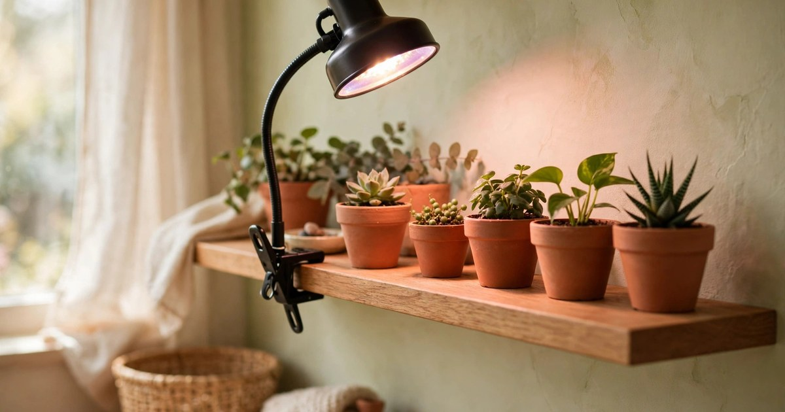
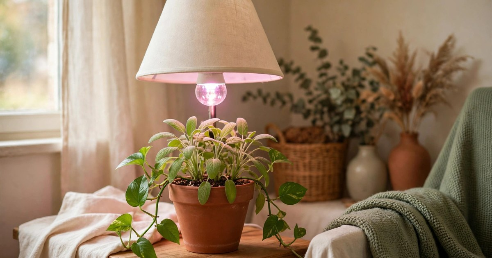
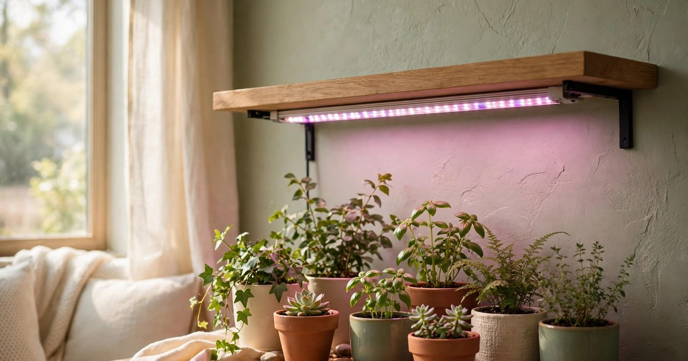
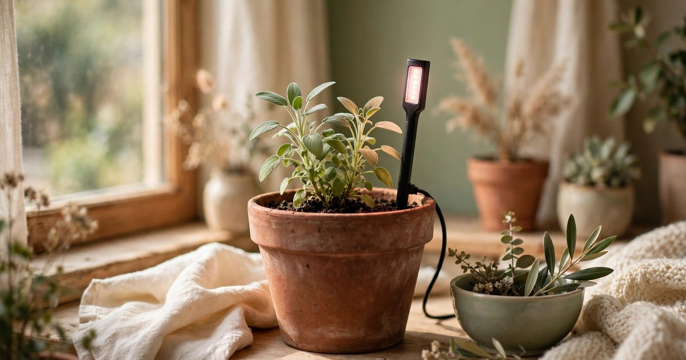
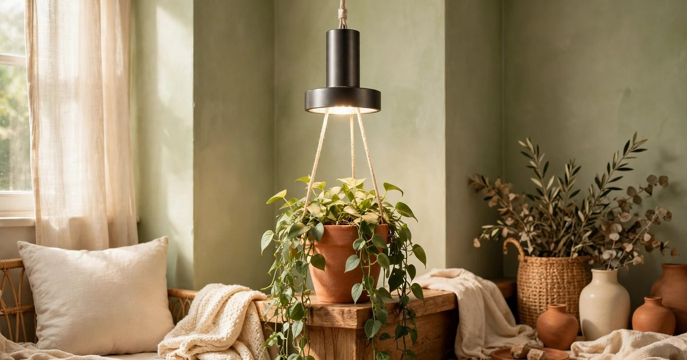
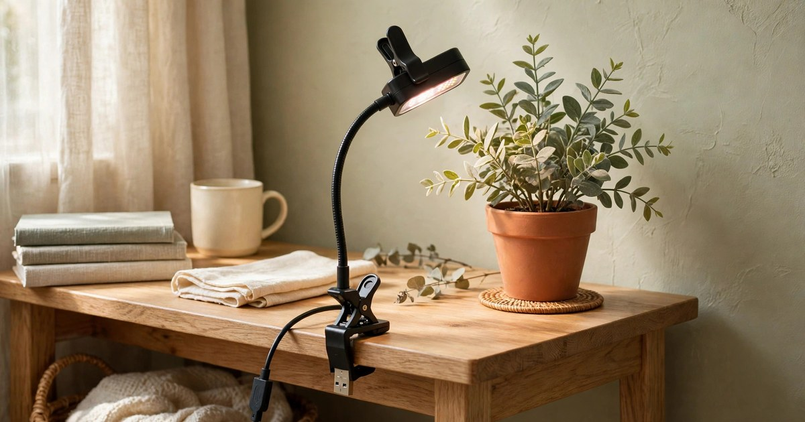
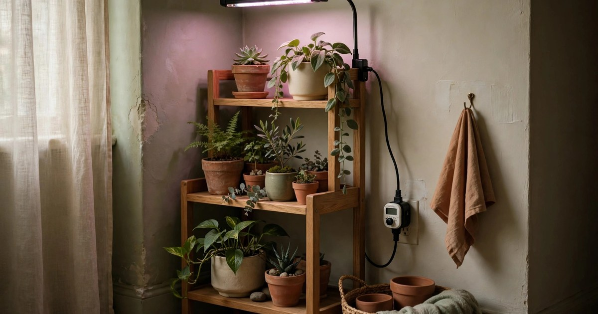
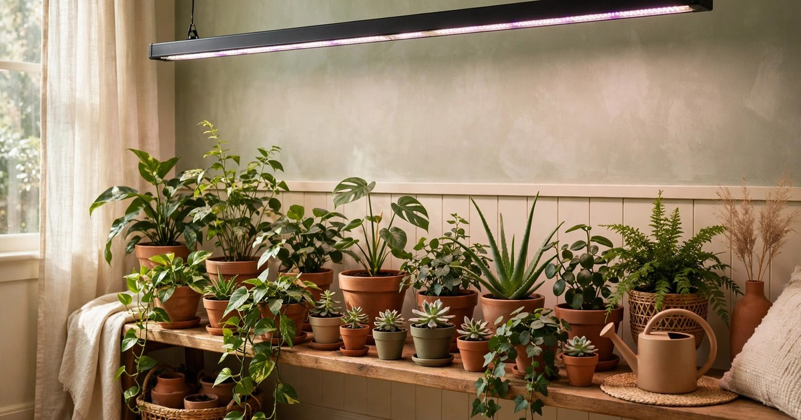
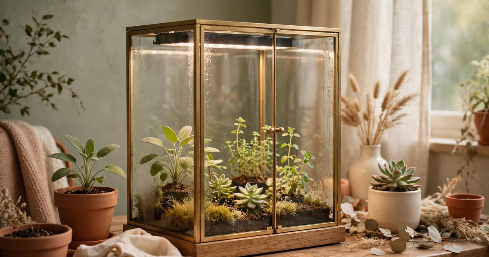

Winter is when houseplants die, and it is rarely the cold that kills them — it is the dark. Short days, weak sun, and north-facing windows leave plants starving for light from November to February, and no amount of watering fixes a light problem. A grow light does, and it does not need to cost much or look like laboratory equipment. Every light below is under $25, works in a rental with no rewiring, and fits a small apartment. If your plants are stretching, dropping leaves, or simply stalling, light — not water — is probably what they are missing.

### 1. Clip-on grow lamp

Why it works: a clip-on lamp clamps to any shelf, desk edge, or pot rim, and aims light exactly where your plants are — no drilling, no installation, no new furniture. Most clip-ons have a flexible gooseneck, so you can angle the light over a whole shelf of plants, and many include a timer and dimmer, which means the light runs itself on a winter schedule.

Where it fits: on a bookshelf of plants, clamped to a desk beside a struggling monstera, or on a windowsill shelf where the daylight never quite reaches. In a small flat, the clip-on is the grow light that leaves no trace: unclip it in spring and there is no hole, no mark, no evidence it was ever there.

Budget tip: look for [clip-on grow lamps](https://www.amazon.com/s?k=clip+on+grow+light+plants&tag={{AMAZON_TAG}}) with a built-in timer, because a light you have to switch on manually is a light you will forget. A 12-hour timer setting matches a winter day well, and a dimmer lets you run it lower for plants that only need a boost.

### 2. Grow light bulb in a lamp you own

Why it works: a grow light bulb screws into any standard lamp socket, which means the lamp you already own becomes a grow light. No new hardware, no extra cables, no ugly equipment on display — just a bulb swap. Full-spectrum bulbs give plants the blue and red wavelengths they use for growth, while looking like ordinary warm light to human eyes.

Where it fits: in a table lamp beside a plant, a floor lamp behind a plant shelf, or a pendant over a plant corner. This is the best option for renters who want grow lights that do not look like grow lights, because the lamp stays the lamp — only the bulb changes, and it changes back in spring.

Budget tip: buy the bulb, not a whole new lamp, and check the wattage equivalent before buying — a bulb rated for plant growth is usually brighter than a standard household bulb. Search for [full-spectrum grow light bulbs](https://www.amazon.com/s?k=full+spectrum+grow+light+bulb&tag={{AMAZON_TAG}}) that fit a standard E26 socket, which is the socket most table and floor lamps already have.

### 3. LED grow light strip under a shelf

Why it works: a light strip sticks to the underside of a shelf and washes the plants below in even light, which is exactly how plants on a shelf want to be lit — from above, across the whole row, with no shadows. Strips are slim, adhesive-backed, and linkable, so one strip lights a shelf and two strips light a whole bookcase.

Where it fits: under a bookshelf, a kitchen shelf, or a plant stand's upper tier. In a small flat, shelf strips are gloriously invisible: the light appears to come from nowhere, the strip itself is hidden by the shelf above it, and the plants look like they are thriving on daylight alone. Use removable mounting clips rather than the adhesive backing if you want zero residue on a landlord's shelves.

Budget tip: measure your shelf before buying, because strips come in fixed lengths and linking two short strips costs more than one long one. Look for [LED grow light strips](https://www.amazon.com/s?k=led+grow+light+strip&tag={{AMAZON_TAG}}) with a timer, and run them 12 to 14 hours a day in deep winter.

### 4. Stake grow light for a single pot

Why it works: a stake light pushes into the soil of a single pot and shines directly on that plant, which is perfect when only one plant is struggling. It is the smallest, cheapest grow light you can buy, it needs no shelf or lamp, and it runs on USB, so it plugs into a phone charger or a laptop port.

Where it fits: in the pot of a fiddle-leaf fig, a monstera, or any single statement plant on a windowsill or a side table. This is the light for the plant you care about most, not the whole collection — one stake, one plant, one problem solved.

Budget tip: stake lights are often sold in pairs or packs of four, so one purchase can rescue several plants for under $25. Check the height before buying — a stake that is too short ends up lighting the soil instead of the leaves. Search for [stake grow lights for potted plants](https://www.amazon.com/s?k=stake+grow+light+potted+plants&tag={{AMAZON_TAG}}) with an adjustable height if your plant is tall.

### 5. Hanging pendant grow light

Why it works: a pendant grow light hangs from a hook or a tension rod and shines down on a plant from above, which is the most natural direction for light and the most flattering to look at. Pendant lights suit trailing plants and hanging planters beautifully, because the light follows the plant's shape instead of fighting it.

Where it fits: over a hanging planter in a corner, above a plant stand, or in a window where a pendant can hang from a tension rod without a single hole. In a rental, a removable adhesive ceiling hook or a tension rod across a window frame holds a lightweight pendant with no damage at all.

Budget tip: pendants are usually sold singly, so buy one for your most light-hungry hanging plant rather than trying to light a whole room with them. Look for [hanging pendant grow lights](https://www.amazon.com/s?k=hanging+pendant+grow+light&tag={{AMAZON_TAG}}) with a long cord, because ceiling height varies and a short cord limits where the light can go.

### 6. USB desk grow light

Why it works: a USB grow light is tiny, cheap, and plugs into anything — a laptop, a phone charger, a USB hub — which makes it the perfect light for a desk plant or a single small pot. Most have a clip or a small stand, a flexible neck, and a timer, so they run themselves while you work.

Where it fits: on a desk beside a succulent, on a bedside table for a small fern, or on a kitchen counter for a herb pot. This is the grow light for the plant that lives where you live — the one on your desk that you actually look at all day — and it keeps that plant alive through the darkest weeks without any setup at all.

Budget tip: USB lights are the cheapest category here, often under $15, so they are the right first grow light if you have never bought one. Search for [USB grow lights for small plants](https://www.amazon.com/s?k=usb+grow+light+small+plants&tag={{AMAZON_TAG}}) with a timer, and keep the light 15 to 30 centimetres from the leaves for the best effect.

### 7. Grow light with a timer plug

Why it works: plants need a consistent day length, and a timer plug gives any grow light a consistent schedule without you touching it. Plug the light into the timer, set 12 to 14 hours, and the light switches itself on and off every day, which is exactly the routine plants need to grow rather than merely survive.

Where it fits: anywhere a grow light already lives — a shelf, a plant corner, a windowsill — because the timer plug is an upgrade to a light you own, not a new light. This is also the best fix for the most common grow light mistake, which is running the light irregularly: plants respond to routine, and a timer is how you give them one.

Budget tip: a mechanical timer plug costs a few pounds or dollars and works with any light, so it is the cheapest upgrade on this list. If your grow light already has a timer, you do not need this; if it does not, a [timer plug for grow lights](https://www.amazon.com/s?k=outlet+timer+plug+grow+light&tag={{AMAZON_TAG}}) is the single purchase that makes every other light on this list work better.

### 8. Full-spectrum grow light bar

Why it works: a light bar is a long, slim fixture that covers a whole row of plants with even, full-spectrum light — the closest thing to a window in a box. Bars are brighter and more even than strips, they mount under a shelf or on a stand, and they suit a serious collection: a row of plants along a wall, a plant shelf, or a propagation station.

Where it fits: over a long plant shelf, above a row of pots on a sideboard, or on a plant stand in a dark corner. In a small flat, one bar can replace three or four small lights, which means fewer cables, fewer plugs, and a tidier setup — one bar, one timer, one row of happy plants.

Budget tip: bars are the priciest category here, but several good ones still come in under $25, especially shorter lengths. Measure your shelf or row before buying, and look for [full-spectrum grow light bars](https://www.amazon.com/s?k=full+spectrum+grow+light+bar&tag={{AMAZON_TAG}}) with a timer and a dimmer, so one purchase covers both light-hungry and light-shy plants.

### 9. Mini greenhouse with a built-in light

Why it works: a mini greenhouse combines a grow light with humidity, which is the other thing winter plants miss. The enclosed space traps moisture, the built-in light provides the day length, and small plants — propagations, seedlings, ferns, small tropicals — thrive inside while the flat outside is dry and dark. It is a whole growing environment in a box the size of a bread bin.

Where it fits: on a desk, a shelf, or a kitchen counter, wherever you have a small flat surface and a plug. This is the best option for propagations and humidity-loving plants, because it solves light and humidity in one purchase, and it looks like a design object rather than equipment.

Budget tip: mini greenhouses with lights vary widely in price, but the small tabletop versions are regularly under $25. Check the size before buying — some are barely bigger than a shoebox — and look for [mini greenhouses with grow lights](https://www.amazon.com/s?k=mini+greenhouse+with+grow+light&tag={{AMAZON_TAG}}) with a vent, because even humidity-loving plants need occasional airflow.

## Light Is the Winter Plant Care You Forgot

Most winter plant problems are light problems wearing a watering disguise. Before you water more, fertilise, or repot a struggling plant, ask whether it has had a proper day's light this week — and if the answer is no, a grow light under $25 is the fix. Start with the cheapest option that fits your space — a bulb in a lamp you own, a clip-on for a shelf, a USB light for a desk plant — put it on a timer, and give it two weeks. Plants respond to light faster than to almost anything else, and by the time spring arrives, yours will be the ones that never stopped growing.

For more winter plant care, see our guides to [low-light plants for dark apartments](/low-light-indoor-plants-dark-apartments/) and [winterising indoor plants](/winterize-indoor-plants-renter-guide/) — light is the foundation, and everything else builds on it.

## Frequently Asked Questions

### How long should I run a grow light in winter?
Twelve to fourteen hours a day, on a timer, so plants get a consistent day length. A timer plug or a built-in timer makes this automatic — plants respond to routine, and irregular lighting is the most common grow light mistake.

### How close should a grow light be to my plants?
Most small grow lights work best 15 to 30 centimetres from the leaves. Too close can scorch leaves; too far and the light is too weak to help. Start at 30 centimetres and move closer if the plant still stretches toward the light.

### Can I use a regular LED bulb instead of a grow light?
A regular bright LED helps, but a full-spectrum grow bulb is better, because it provides the blue and red wavelengths plants use most for growth. A grow bulb costs little more than a standard bulb and screws into the same lamp.

### Do grow lights work in a rental without damaging anything?
Yes — every light on this list is renter-friendly: clip-ons, bulbs in existing lamps, adhesive strips with removable clips, stake lights in pots, and pendants on tension rods. Nothing needs drilling, wiring, or a landlord's permission.
