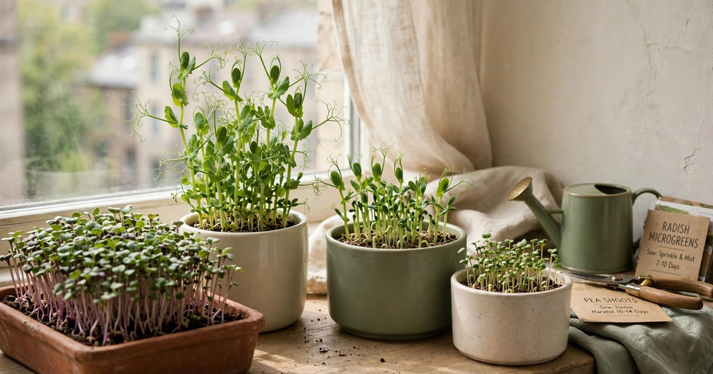
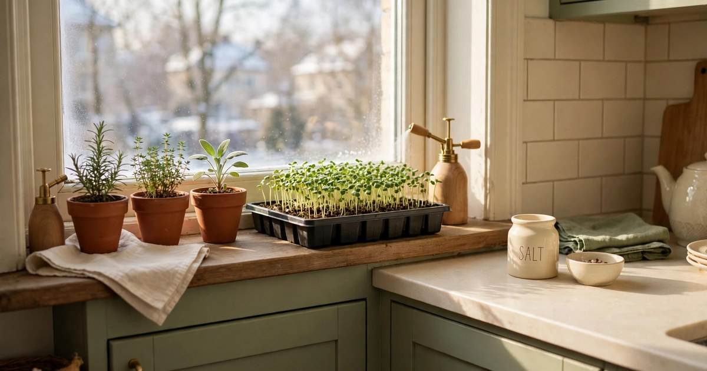
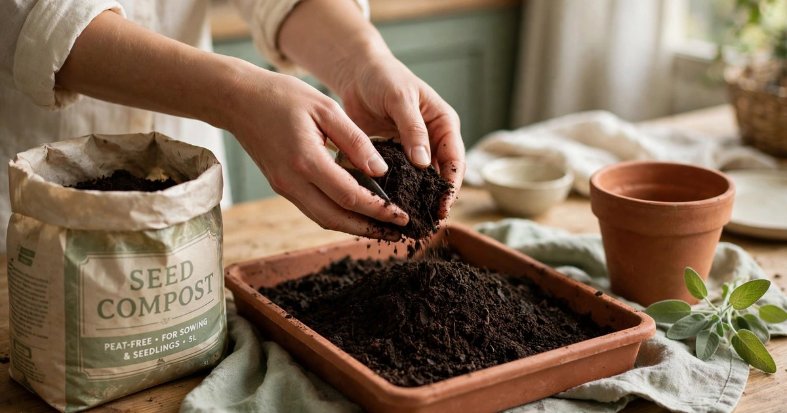
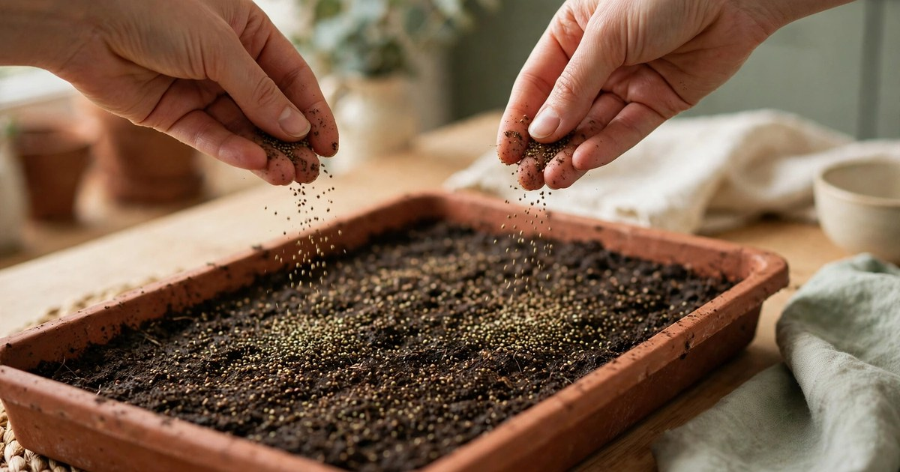
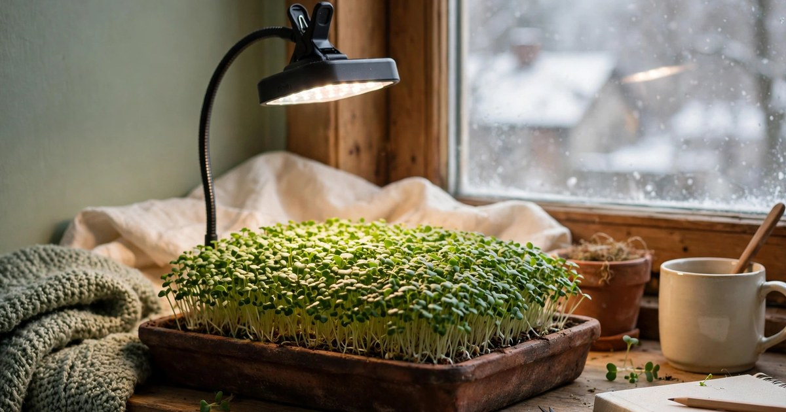
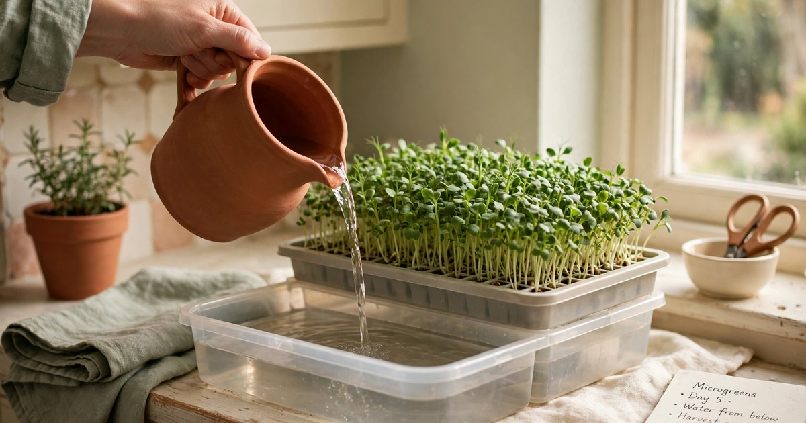
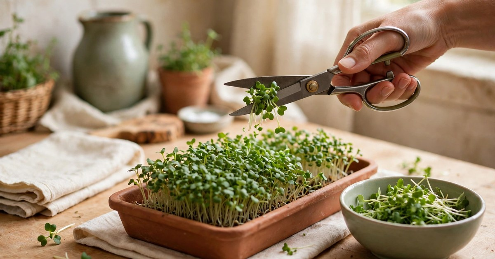
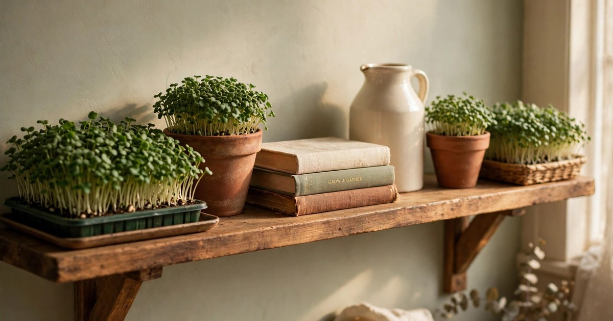

There is a particular kind of grey that settles over a small apartment in December. The days end before you have finished work, the windowsill plants sulk, and the fresh herbs you bought in October have mostly given up. Microgreens are the answer to that grey, and they are the cheapest, fastest win in indoor gardening. A tray of radish microgreens goes from dry seed to a dense mat of bright green in about a week. A tray of pea shoots takes a little longer and gives you a crop you can snip for stir-fries, salads and sandwiches. And while they grow, they look wonderful: a neat, vivid green carpet sitting on the windowsill, doing the job of a houseplant and a vegetable patch at the same time.

That double role is what makes microgreens such good winter greenery for renters. They are food and decor in one tray, they cost almost nothing, and they ask for no permanent changes to the flat — no drilling, no shelving, no grow tent taking over the living room. A windowsill, a shelf near a window, or the top of a bookcase with a small light is all the space you need. If you have ever felt that your flat is too small or too dark for an indoor garden, microgreens are the place to start, because they are the one crop that genuinely thrives on a winter windowsill.

Microgreens are simply the young seedlings of vegetables and herbs — radish, broccoli, kale, pea, sunflower, mustard, basil — harvested when they are a few centimetres tall, usually between seven and fourteen days after sowing. They are not sprouts, which are grown in water in a jar; microgreens grow in soil or a growing mat, in the light, which is why they develop those deep green leaves and proper flavour. A radish microgreen tastes like radish, only sharper. A pea shoot tastes sweet and fresh, like spring in a mouthful. And because you grow them in a shallow tray, a single windowsill can hold three or four trays at once, giving you a rolling harvest all winter.

### 1. Pick the Right Seeds for Winter Microgreens

The single most important decision in this whole guide is which seeds you buy, so do not grab the first packet labelled "microgreens" and hope for the best. Some varieties are fast, forgiving and tasty in low winter light; others are fussy, slow or prone to going mouldy in a cool flat. The beginner-friendly trio is radish, broccoli and pea shoots. Radish is the fastest of all — you can be snipping it in seven days — and its bright pink stems and peppery bite make it the most rewarding first crop. Broccoli microgreens are mild, reliable and packed with flavour, and they grow evenly even on a cloudy windowsill. Pea shoots are the slowest of the three at ten to fourteen days, but they are the most generous: they regrow after cutting, they taste sweet and fresh, and their tendrils look beautiful trailing slightly over the edge of a tray.

Sunflower and mustard are good second crops once you have one harvest under your belt. Sunflower microgreens are chunky, nutty and satisfying, but the seeds need soaking overnight and a heavier weight on top while they germinate. Mustard is as fast as radish and adds a proper kick to sandwiches, though its flavour is strong enough that a little goes a long way. Basil is the one to leave until spring: it loves warmth, germinates slowly in a cool flat, and will sulk on a draughty windowsill in January. Whatever you choose, buy seeds sold specifically for microgreens or sprouting — they are tested for germination and untreated with the fungicides sometimes applied to garden seed. A 100 g bag of radish seed costs around $4–$5 and will sow roughly ten trays, which works out at about 40–50 cents of seed per tray. If you are just starting out, a [microgreen seed starter kit](https://www.amazon.com/s?k=microgreen+seed+starter+kit&tag={{AMAZON_TAG}}) with four or five varieties is the easiest way to find out which flavours you actually like before you commit to big bags.

### 2. Choose Trays and a Spot That Suit a Renter

Microgreens need almost no kit, and that is half the charm. The standard setup is a shallow tray about 25 × 35 cm — roughly the size of a baking tray — with drainage holes, sitting inside a second, solid tray that catches the water. This two-tray system is the one to copy: it lets you water from below, it keeps the windowsill dry, and it means nothing leaks onto a landlord's paintwork. You can buy proper [microgreen growing trays](https://www.amazon.com/s?k=microgreen+growing+trays+with+drainage+holes&tag={{AMAZON_TAG}}) for a few dollars each, or you can improvise with a takeaway container punched with holes, sitting inside its lid. Either works, as long as water can drain out of the top tray and the bottom one catches it.

Where the trays live matters more than what they are made of. Your brightest window is the priority, and in winter that almost always means south-facing, or east-facing for the morning sun. A tray needs four to six hours of decent light a day to grow stocky and green rather than pale and leggy. If your only window is north-facing or shaded by the building opposite, the trays will still grow, but more slowly and with thinner stems — which is where a small grow light earns its keep, as we will get to in step five. Whatever the direction, keep the trays off the glass itself: a cold window on a frosty night can chill the soil and stall growth, so leave a couple of centimetres of air between tray and pane, and keep them away from radiators, which dry the soil out and scorch the leaves. A kitchen windowsill is ideal if you have one, because the room is warm, humid from cooking, and you will see the trays every day — which means you will actually remember to water them. If the windowsill is too narrow, a small shelf, a stool pulled up to the window, or the top of a bookcase near the glass all work just as well. Nothing here needs a screw or a nail, so your deposit is safe.

### 3. Soil, or No Soil? Set Up Your Trays

You have two choices for what the seeds grow in: fine seed compost, or a soil-free growing mat. Compost is cheaper, more forgiving, and what most people start with. A bag of fine seed or multipurpose compost costs a few dollars and will fill dozens of trays. Fill the tray with three to four centimetres of compost, press it down gently with the flat of your hand or the base of another tray until it is level and firm, and then mist the surface with water until it is damp all the way through — not soggy, just evenly moist, like a wrung-out sponge. A lumpy or uneven surface gives patchy germination, because seeds sitting in hollows stay too wet and seeds on ridges dry out, so take a moment to get it flat.

Growing mats — usually made from hemp, coconut coir or jute — are the tidy, soil-free alternative, and they are worth knowing about if you hate the idea of compost on your kitchen worktop. You cut the mat to fit the tray, soak it in water, lay it flat, and sow directly onto it. There is no mess, no soil under your fingernails, and harvesting is clean because there is no compost clinging to the stems. Mats cost more per tray than compost, around $1 per tray, but they are compostable afterwards, and many renters prefer them for a kitchen setup. Hemp mats are the most popular because they hold water well and resist mould. Whichever you choose, the setup is the same: a flat, damp growing surface in a tray with drainage, ready for seed. One practical tip: label each tray with the variety and the sowing date on a strip of masking tape. When you have three trays at different stages, you will be glad you did.

### 4. Sow, Cover, and Wait for Germination

Sowing microgreens feels wrong the first time you do it, because you sow far more thickly than you would ever sow in a garden. The seeds should sit close together, almost touching, in a single even layer across the whole surface — around 10–15 g of radish or broccoli seed per tray, and about 80–100 g of pre-soaked pea seed. This density is what gives you that lush, carpet-like mat; sow too thinly and you get a sparse, straggly crop that looks sad and yields little. Scatter the seed as evenly as you can, then press it gently into the compost with a flat hand or the base of a tray so every seed has good contact with the damp surface. Mist the seeds lightly, then cover the tray.

Covering is the step most beginners skip, and it is the one that makes the biggest difference. In the dark, seeds germinate faster and grow stronger roots, because they think they are still underground. Put another tray upside down over the top, or a piece of cardboard, and then add a little weight — a couple of books, a full water bottle, or a second tray filled with something heavy. The weight presses the seeds into the compost and encourages strong, even rooting. Leave the tray covered for two to four days, lifting the cover once a day to mist the surface if it looks dry. Radish will usually show its first pale shoots within two days; peas take a little longer. When the seedlings are about two centimetres tall and pushing hard against the cover, it is time to take it off and move the tray into the light. That moment — lifting the cover to find a dense mat of pale, hopeful shoots — is the best part of the whole process.

### 5. Light: Making the Most of a Short Winter Day

Once the seedlings are uncovered, light becomes everything. In December, a south-facing windowsill might give you only a few hours of weak sun, and microgreens grown in too little light stretch tall, thin and pale as they reach for the window — a problem called legginess that you can spot a mile off. The fix is simple: put the trays as close to the brightest window as you can, turn them a quarter turn every day so they grow straight instead of leaning, and keep them out of the shadow of curtains, blinds and tall plants. If you are growing on a shelf rather than a windowsill, pull the tray to the front edge so it is not sitting in the shade of the shelf above it.

For many small flats, especially those with north-facing windows or a tall building opposite, a small [LED grow light](https://www.amazon.com/s?k=small+LED+grow+light+clip+on&tag={{AMAZON_TAG}}) is the single best purchase in this guide. A slim clip-on bar or a small panel that clamps to a shelf costs around $15–$20, uses very little electricity, and run on a plug-in timer for twelve to fourteen hours a day, it gives your trays a consistent day length no matter what the weather is doing outside. Hang or clip it about 15–20 cm above the seedlings and raise it as they grow, so the light stays close without touching the leaves. If you already have a grow light for your [winter windowsill garden](/winter-windowsill-garden-guide/), the microgreen trays can simply share it — they are happy under the same light as your [herbs](/keep-herbs-alive-indoors-winter-guide/). Without extra light, expect your winter trays to take a few days longer than the packet promises; with it, they will hit the stated harvest times even in January.

### 6. Water Without Drowning Them

Watering microgreens is a balancing act, and it is where most first crops go wrong. Too little water and the seedlings wilt and stall; too much, especially from above, and the damp, crowded leaves become a breeding ground for mould — the grey, fuzzy growth that is the microgreen grower's main enemy. The rule is to water from below whenever you can. Lift the growing tray, pour a centimetre or two of water into the solid bottom tray, and set the growing tray back in. The compost or mat draws the water up from underneath, the roots get what they need, and the leaves stay dry. After about ten minutes, tip away any water that has not been absorbed so the tray is never sitting in a puddle.

How often you need to do this depends on your flat: a warm room with the heating on may need watering once a day, while a cool kitchen might need it only every other day. If you are going away for a few days, the same bottom-watering approach works for your other plants too — see our guide to [watering houseplants while you travel](/water-houseplants-holiday-travel-guide/) — but for microgreens, sow your next tray when you get back rather than leaving one to dry out. Check the trays every morning by lifting the top tray and feeling the weight of it — a light tray is a thirsty tray — and look at the seedlings themselves. If they are standing upright and the leaves are firm, they are fine. If they are flopping over, they need water now. Always use room-temperature water, not cold water straight from the tap, and water in the morning so the trays have the whole day to use it. If you do spot mould, do not panic and do not throw the tray away immediately: increase the airflow by moving the tray to a spot with a little draught, cut back on watering for a day, and snip out the worst-affected patch. Good airflow is the best mould prevention there is, which is one more reason not to cram trays tightly together on a crowded sill.

### 7. Harvest, Store, and Keep the Tray Going

Harvest day is the payoff, and it is satisfyingly simple. Most varieties are ready when they are five to eight centimetres tall and have their first pair of true leaves — the second set of leaves, which look like miniature versions of the adult plant, as opposed to the smooth seed leaves that appear first. Radish is usually ready in seven to ten days, broccoli in eight to twelve, peas in ten to fourteen. Harvest in the morning, when the leaves are crisp and full of water, using clean kitchen scissors. Snip just above the soil line, a small handful at a time, and hold the cuttings over a bowl or a colander so nothing scatters across the worktop. Do not pull the seedlings up by the roots — you want a clean cut, and you want the compost to stay in the tray.

A single tray yields roughly 100–150 g of cut greens, which is enough for several salads, a week of sandwich toppings, or a generous garnish on a few dinners. Rinse the cuttings gently in cold water, spin or pat them dry, and store them in a container lined with a piece of kitchen paper in the fridge, where they will keep for four to five days. Pea shoots are the generous exception to the one-harvest rule: if you snip them above the lowest node, they will regrow, and you can often get a second, smaller harvest a week later. Radish and broccoli do not regrow, so once you have cut them, the tray is done — tip the spent compost and roots into the compost bin or the food waste, wash the tray with hot soapy water, and sow again. That is the rhythm that keeps a small flat in fresh greens all winter: sow a new tray every three or four days, and you will always have one ready to cut, one growing, and one just sown.

### 8. Style the Trays So They Look Like Decor, Not a Science Experiment

Here is the part most growing guides skip: microgreens are going to be sitting in your living space for two weeks, so they might as well look good. A black plastic tray on a windowsill reads as a science experiment; the same tray slipped inside a [terracotta planter](https://www.amazon.com/s?k=terracotta+planters+small&tag={{AMAZON_TAG}}), a woven seagrass basket, or a cream ceramic dish reads as intentional decor. The trick is to treat the growing tray as an insert and dress it up with a container you already own. A shallow wooden crate, a pretty baking tray, or a large soup bowl all work — anything that hides the plastic and catches any drips. Just make sure the outer container has room for a little airflow underneath, and never let the growing tray sit in standing water inside it.

Style the trays the way you would style any plant display. Group two or three trays at different heights — one on the sill, one on a stack of books — rather than lining them up in a row like a laboratory. Pair the bright green of the seedlings with warm materials: terracotta, natural wood, cream linen, a brass watering can left casually beside them. The contrast between the vivid green and a warm, cosy palette is what makes the display feel like winter greenery rather than a kitchen chore. Once a tray is ready to harvest, move it to the kitchen worktop and replace it on the sill with a younger tray, so the display always looks lush. And when friends ask about the green carpet on your windowsill — they will — you get to say you grew it yourself, in a flat, in the middle of winter, for a few dollars a tray.

## The Cost of a Tray, Honestly Counted

Microgreens are often sold as almost free to grow, and they nearly are — but it is worth counting the cost properly, because the numbers are genuinely impressive. A basic setup costs very little: two trays for around $5, a bag of compost for $4, and a packet of seed for $4–$5. After that, each tray costs roughly $1–$1.50 in seed and compost, or around $2 if you use growing mats instead of compost. Compare that with a 50 g punnet of microgreens from a supermarket or deli, which often sells for $3–$4, and a single home-grown tray producing 100–150 g is worth $6–$12 at shop prices for about $1.50 of inputs. Even with a $15–$20 grow light added in, the light pays for itself within a few weeks of regular growing, and it keeps working for your other plants too. For a renter on a budget, there is hardly a better return on a windowsill in the whole of winter gardening.

## A Windowsill That Feeds You All Winter

Microgreens will not replace your weekly shop, and nobody should pretend they will. What they do is smaller and, in the middle of a dark winter, more valuable: they put something alive and green on your windowsill, they give you a fresh, peppery handful for tonight's dinner, and they prove that a small rented flat can grow real food in January. The whole cycle takes about ten days, costs about a dollar or two, and asks for nothing more than a bright window, a tray, and a few minutes of attention each morning. Sow your first tray this weekend, keep the next one ready behind it, and by Christmas you will have a rolling harvest — and a windowsill that looks, smells and tastes like spring.

## Frequently Asked Questions

### How long do microgreens take to grow indoors in winter?

Most varieties are ready in 7–14 days in winter. Radish is the fastest at 7–10 days, broccoli takes 8–12 days, and pea shoots take 10–14 days. Growth is a little slower in winter than in summer, because the days are shorter and the light is weaker — a small grow light on a timer for 12–14 hours a day brings harvest times back to the packet's promise.

### What is the cheapest way to start growing microgreens in a small apartment?

Start with one shallow tray with drainage holes sitting inside a solid tray, a bag of fine seed compost, and a packet of radish or broccoli seed sold for microgreens. The first tray costs around $10–$12 including the trays, and every tray after that costs roughly $1–$1.50 in seed and compost. A takeaway container with holes punched in the bottom works as a free tray if you want to spend nothing at all.

### Do microgreens need a grow light in winter?

Not always, but it helps a lot. On a bright south-facing windowsill, microgreens will grow without extra light, just a few days more slowly. On a north-facing window or in a flat shaded by other buildings, a small LED grow light is the difference between stocky, green seedlings and pale, leggy ones. Clip it 15–20 cm above the trays and run it for 12–14 hours a day on a timer.

### Why are my microgreens going mouldy?

Mould is almost always caused by too much water on the leaves, poor airflow, or seed sown too thickly. Water from below so the leaves stay dry, leave a little space between trays for air to circulate, and tip away any water left in the bottom tray after ten minutes. If mould appears, increase the airflow, ease off watering for a day, and snip out the affected patch — the rest of the tray is usually fine.

### Can I grow microgreens without soil?

Yes — hemp, coconut coir or jute growing mats replace soil entirely. Cut the mat to fit the tray, soak it, sow directly onto it, and water from below in the usual way. Mats cost around $1 per tray, they are compostable, and harvesting is cleaner because there is no compost on the stems. Many renters prefer them for a kitchen setup because there is no mess.
