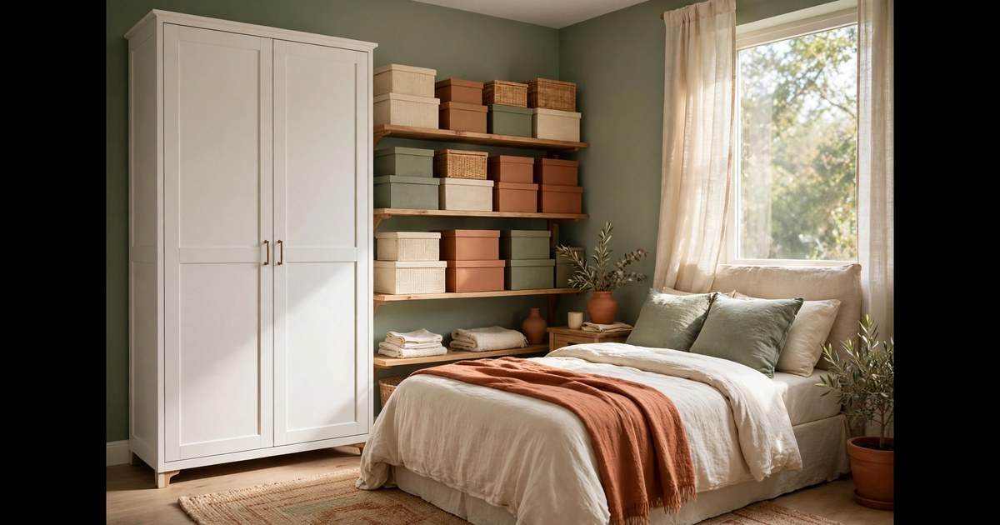
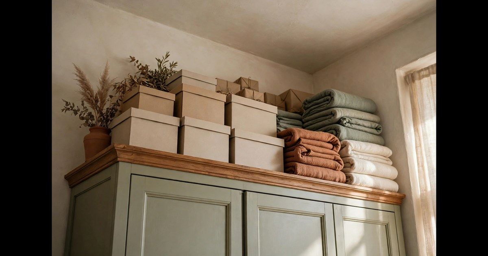
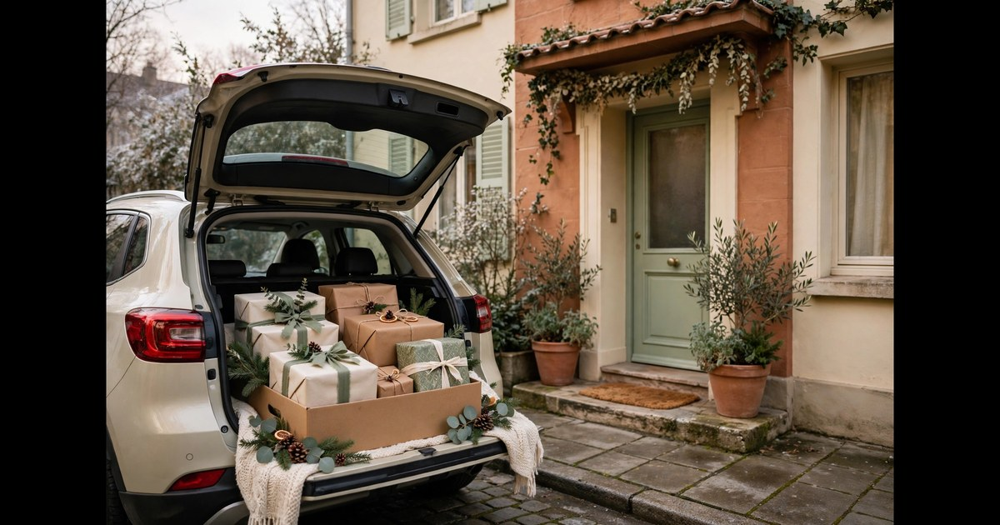
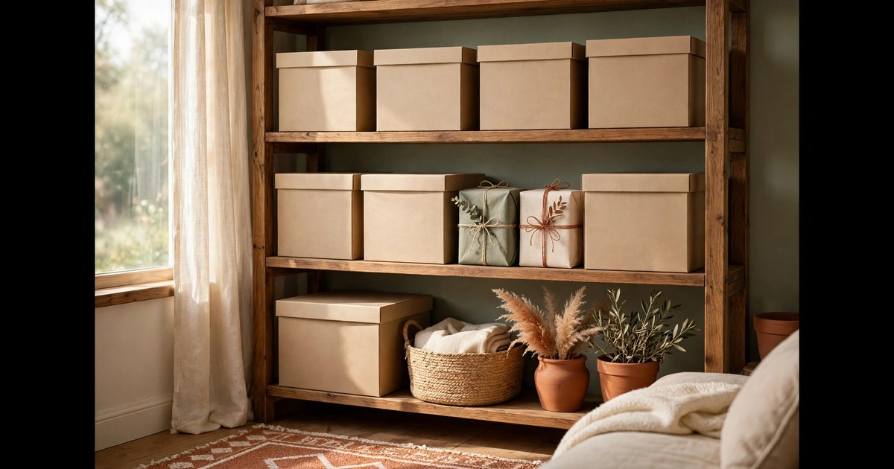
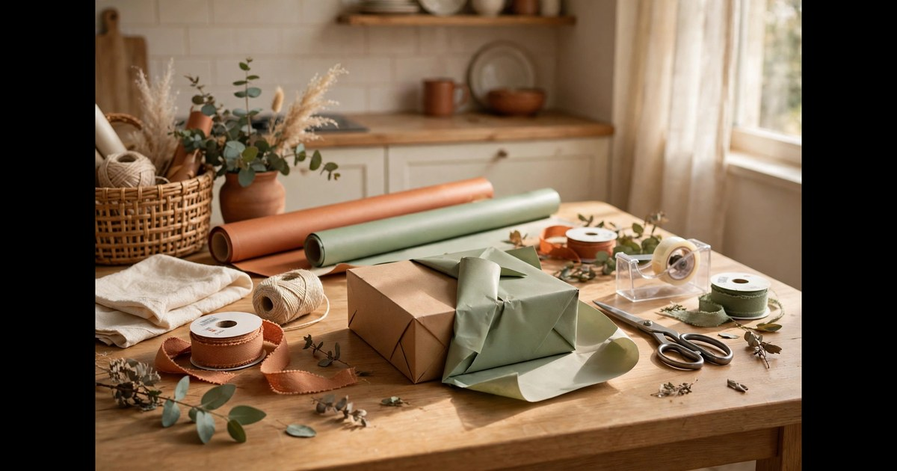

There is a special kind of panic that only happens in a small flat in December. You come home with a bag full of presents, and suddenly every cupboard, shelf and drawer you own looks exactly like what it is: too small, too obvious, and already full. The wardrobe is full of coats, the under-bed space is full of shoes, and the person you are buying for is sitting six feet away, pretending not to notice the bag. In a one-bedroom flat, there is nowhere to hide anything — and that is exactly the problem this guide solves.

Hiding presents in a small apartment is not about having more space. It is about using the space you already have differently, and about being a little bit cleverer than the people looking for the gifts. Renters have one advantage: a deposit-safe flat is usually full of boxes, storage furniture and multipurpose corners, and every one of those can become a hiding place. None of the ideas below needs a drill, a nail or any special equipment, and most of them cost nothing at all. What they need is a system, so that on Christmas Eve you can find every gift without tearing the flat apart.

### 1. Audit Your Hiding Spots Before You Buy Anything

Before you buy a single present, walk around your flat with fresh eyes and list every place that is hard to reach, rarely opened or naturally boring. The top of the wardrobe, the back of the airing cupboard, the space behind the winter coats, the bottom drawer that holds the spare bedding — these are your hiding spots, and you need to know what they are before the shopping starts.

Measure the awkward spots too. A present that does not fit in its hiding place ends up on top of the wardrobe in plain sight, so check the height of the gap above the wardrobe, the depth of the under-bed boxes and the width of the shelf in the hallway cupboard.

Be honest about who you are hiding things from. Children look low and in the obvious places — under beds, in drawers, behind sofa cushions — while adults look high and in the boring places. If you are hiding from both, you need two tiers of spots: easy ones for small gifts, and properly awkward ones for the big surprise.

### 2. Use the Top of the Wardrobe — and Make It Look Boring

The top of the wardrobe is the classic hiding spot for a reason: it is above eye level, awkward to reach without a chair, and nobody opens it casually. The mistake is putting the presents up there in a neat row of brightly wrapped parcels. The trick is to make the top of the wardrobe look so boring that nobody ever looks at it twice.

Push the presents to the very back, behind the things that already live up there — the spare duvet, the out-of-season clothes, the suitcase you never use. Then pull one or two genuinely dull items to the front: a folded blanket, a stack of old magazines, a box labelled "spare light bulbs" or "old cables". A person glancing up sees clutter, not presents, and clutter is the best camouflage a renter has.

If the wardrobe top is visible from the bed, drape a plain sheet or a folded throw over the whole stack. It looks like you are protecting the bedding from dust, and it turns a pile of presents into a shapeless lump that nobody investigates. It costs nothing and takes thirty seconds.

### 3. Suitcases, Storage Boxes and the "Boring Box" Trick

Every small flat has suitcases, and a suitcase is one of the best present safes ever invented. It locks, it is heavy enough that a child cannot drag it out and open it casually, and it looks completely innocent sitting on top of a wardrobe or under a bed. Pack presents inside with a layer of clothes on top, zip it shut, and it becomes just another piece of luggage.

The "boring box" trick is the same idea applied to any storage box you already own. Take a sturdy cardboard box or plastic crate and label it with the dullest thing you can think of: "Tax papers 2019", "Old phone chargers", "Curtain spares". Fill the bottom half with the actual boring thing, put the presents in the middle, and cover them with another layer of the boring thing. Then put the box somewhere it belongs — on a shelf, in the hallway cupboard, under the stairs. A box labelled "tax papers" has never been opened by a curious child in the history of Christmas.

You do not need special hiding furniture — just labels, a marker pen and the willingness to make your storage look uninteresting. Charity shops sell sturdy boxes for a pound or two if you need an extra one.

### 4. The Car Boot or a Trusted Neighbour's Spare Shelf

Sometimes the best hiding spot in a small flat is not in the flat at all. If you have a car, the boot is a brilliant overflow stash: it is locked, it is outside the house, and nobody in the family goes looking in the boot for fun. Put the presents in a bag or a box in the boot, and bring them in one or two at a time when the flat is empty. Avoid anything that hates the cold — chocolate, candles and anything with a battery should stay indoors.

If you do not have a car, a trusted neighbour is the next best thing. Offer a swap: you keep a box of their presents on your top shelf, and they keep a box of yours on theirs. It costs nothing, it completely removes the gifts from the people they are for, and it is exactly the sort of neighbourly favour that builds a good relationship in a block of flats. Label the box with your name and "do not open", and agree to collect it on Christmas Eve morning.

Pick the right neighbour: someone you trust, at home most of the day, whose flat is not full of the same curious kids. A retired neighbour with a spare cupboard is ideal.

### 5. Hide in Plain Sight: Decoy Boxes and Mislabelled Storage

The cleverest hiding spots are the ones nobody thinks to search, because they are right in front of everyone. A present hidden in plain sight is safer than one in the obvious secret place, because that is the first place anyone looks.

Wrap a few empty boxes in cheap wrapping paper and leave them somewhere slightly visible — on top of the wardrobe, on a shelf in the living room. Anyone who finds them, opens them and discovers nothing will stop looking, because they think they have found the stash and it was a dud. Meanwhile the real presents are in the box labelled "cleaning supplies" under the sink, or in the bag of "old clothes for the charity shop" by the front door.

Mislabelled storage works the same way in the kitchen and bathroom, two rooms that present-hunters rarely search properly. A gift in a tea towel inside a large cooking pot, or a small present tucked into the box of spare toilet rolls, survives because nobody expects presents in a room full of practical things. If you are short on storage ideas, our guide to [storing Christmas decor in a small rental](/store-christmas-decor-small-rental-ideas/) has more tricks for making the most of every cupboard and shelf.

### 6. Wrap as You Go — or Wrap at a Friend's House

Unwrapped presents are the hardest thing to hide in a small flat, because a gift in its shop bag or original box is instantly recognisable. Wrapped presents, on the other hand, are just parcels — and parcels can live anywhere. The single best habit you can build in December is to wrap each present the day you buy it, or at least the same evening, so that nothing sits around in its packaging waiting to be spotted.

Keep a small wrapping kit — paper, tape, scissors and ribbon — in a bag on top of the wardrobe, ready to pack away in five minutes. Wrap on the kitchen table after the kids are in bed, or in the bedroom with the door shut, and put each wrapped gift straight into its hiding spot.

If even that feels too risky — if your partner works from home, or your kids are old enough to notice the scissors — wrap at a friend's house instead. Take the gifts round in a shopping bag, wrap them at the kitchen table over a cup of tea, and bring them home already wrapped and ready to stash. It turns a chore into a social evening, and the paper, offcuts and ribbon never appear in your own bin. For more ways to keep the festive season organised in a small space, see our [Christmas countdown ideas for renters](/christmas-countdown-ideas-rental-guide/).

### 7. Keep a Present Log So Nothing Gets Lost or Forgotten

The most common Christmas disaster in a small flat is not a present being found — it is a present being lost. Hidden so well that nobody, including you, can find it. A present log stops that happening, and it takes about two minutes to set up.

Use a note on your phone, a small notebook, or a spreadsheet — whatever you will actually check. For each present, write down four things: who it is for, what it is, where it is hidden, and whether it is wrapped. Update the note the moment you hide something, not later, because "later" is when the detail disappears from your memory.

The log also saves you money. Without one, it is easy to forget you already bought someone a gift and buy them a second one. With one, you can see at a glance who is done, who still needs something, and how much you have spent in total. A quick check of the log before every shopping trip stops duplicate buys, and the total at the bottom keeps your spending honest. Keep the log locked on your phone if you share devices.

### 8. The Christmas Eve Reveal: Staging Gifts Without the Mess

Christmas Eve is the moment your hiding system pays off, and it is also the moment it can fall apart. The temptation is to pull everything out at once, pile it under the tree, and deal with the wrapping paper and empty boxes afterwards — which leaves a flat that looks like a delivery warehouse exploded in it. A little staging turns the reveal into a moment rather than a mess.

Bring the presents out in batches, one hiding spot at a time, and check each one against your log as you go. Tick it off, unwrap nothing, and place it under the tree or in the stocking pile in a neat arrangement. Group gifts by person — a small pile each, biggest gift at the back — so Christmas morning is not a treasure hunt. If you skipped a tree this year, our guide to a [small-apartment Christmas without a tree](/small-apartment-christmas-without-tree-guide/) has ideas for where the presents go instead.

Keep a bin bag beside you as you stage, and put every empty box, spare bit of wrapping paper and stray bit of tape straight into it. The flat should look tidy when you go to bed, because a tidy room makes Christmas morning feel calm. Then do a final sweep: open every cupboard, check the car boot, check the neighbour's box. The only thing worse than a present found early is one found in March.

## Shop this look: Present-hiding supplies

- **Plastic storage boxes** — the "boring box" trick starts with a sturdy box. [Shop plastic storage boxes](https://www.amazon.com/s?k=plastic+storage+boxes+with+lids&tag={{AMAZON_TAG}})
- **Wrapping paper** — wrap each present the day you buy it, so nothing sits around recognisable. [Shop wrapping paper](https://www.amazon.com/s?k=christmas+wrapping+paper+roll&tag={{AMAZON_TAG}})
- **Ribbon** — finish the wrap so parcels can live anywhere. [Shop ribbon](https://www.amazon.com/s?k=ribbon+roll+gift+wrapping&tag={{AMAZON_TAG}})
- **Tape** — part of the five-minute wrapping kit on top of the wardrobe. [Shop tape](https://www.amazon.com/s?k=clear+tape+gift+wrapping&tag={{AMAZON_TAG}})
- **Scissors** — keep them in the kit, ready to pack away in five minutes. [Shop scissors](https://www.amazon.com/s?k=scissors+craft+household&tag={{AMAZON_TAG}})
- **Marker pen** — label the boring boxes so nobody ever opens them. [Shop marker pens](https://www.amazon.com/s?k=marker+pen+permanent+black&tag={{AMAZON_TAG}})

## Frequently Asked Questions

### Where is the best place to hide Christmas presents in a small flat?

The top of the wardrobe is the most reliable spot, because it is above eye level, awkward to reach and easy to camouflage with boring items in front. Suitcases, the back of the airing cupboard and a box labelled with something dull like "old cables" are the next best options. The real secret is layering: use two or three spots, so that even if someone finds one, the rest stay safe.

### How do I hide presents from my partner in a one-bedroom flat?

Hide presents outside the flat if you can — in the car boot, or in a box at a trusted neighbour's. Inside the flat, use spots your partner never touches: the back of a cupboard they never open, a suitcase on top of the wardrobe, or a mislabelled box among the cleaning supplies. Wrap gifts the day you buy them, and keep a log on your phone so you always know where everything is.

### Can I hide presents in the loft or garage if I rent?

Only if you have exclusive access to it and your tenancy agreement allows storage there. Many renters share a loft or a garage, which makes it a poor hiding spot — and a damp or freezing loft can damage gifts, especially chocolate, candles and electronics. If you do have a private, dry storage space, it is an excellent hiding spot, but check the space is secure and that your landlord is happy for you to use it.

### How do I stop kids finding the presents before Christmas?

Use height and boredom. Children search low and in the obvious places, so keep presents high up, behind boring items, and in boxes with dull labels. Decoy boxes work brilliantly on children: wrap a few empty boxes and leave them somewhere findable, so the search ends with a dud. And never leave wrapping paper or shop bags in the bin where a curious child will spot them — take them out with the recycling the same day.

### What should I do with presents I forget to hide?

Do not panic, and do not leave them in a shopping bag by the front door. Wrap them immediately, even roughly, and put them in the least interesting place you can find — inside a laundry basket under a pile of clothes, at the bottom of a drawer under the spare bedding, or in a bag labelled for the charity shop. Then add them to your present log straight away, so you can move them to a better spot when the flat is empty.
