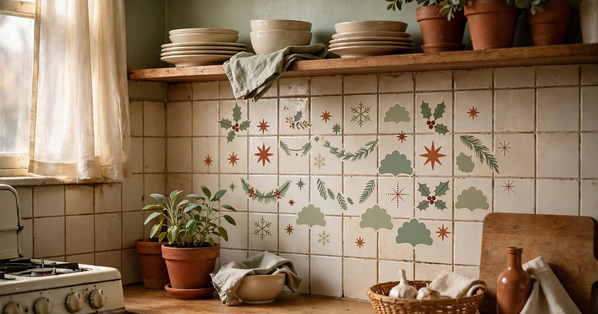

Every rental has them: the stained patch the landlord never repainted, the radiator that belongs in a museum, the fuse box at eye level in the hallway, the floor tiles that were ugly in 1998. For eleven months of the year you live with them. At Christmas, you can hide them — festively, cheaply, and without a single nail, screw, or deposit-threatening modification. Here are ten ugly rental features and the Christmas decoration that makes each one disappear.

### 1. The rusty radiator becomes a garland shelf

Old radiators are the classic rental eyesore: rusty, chipped, and impossible to ignore in winter when they are also the warmest object in the room. A [garland](/renter-friendly-christmas-garland-ideas/) draped along the top turns it into a display shelf instead. The greenery hides the rust, the ornaments distract the eye, and the radiator's own heat gently releases the scent of pine into the room.

Keep the garland light and the ornaments unbreakable — a radiator gets hot, and anything resting on it needs to tolerate warmth. Avoid real candles here entirely, and keep fabric and paper away from the hottest sections. When January comes, the garland lifts off and the radiator is exactly as ugly as before, but your deposit is untouched and December looked wonderful.

### 2. The fuse box hides behind a festive wall hanging

A fuse box at eye level in the hallway is the feature landlords never think about and tenants see a hundred times a day. A festive wall hanging — a woven tapestry, a felt banner, a simple length of fabric with a Christmas print — hung from a removable hook covers it completely, and looks like a deliberate decoration rather than a cover-up. The key is access: the hanging must lift off in one motion, because you will need the fuse box eventually, probably on a dark December evening.

Use a single removable hook above the box and a hanging with a rod pocket or loops, so it hangs flat and lifts cleanly. Never screw into the wall around a fuse box, and never block it with anything heavy or fixed. A lightweight fabric hanging is ideal: it hides the box, adds colour to a bare hallway, and folds away in January.

### 3. Stained walls disappear behind a paper star display

A stain or scuff that the landlord never fixed is hard to hide with furniture, because furniture does not reach wall height. A cluster of paper stars, hung at different heights from [removable hooks](/command-hook-christmas-decor-renters-under-20/), does. The stars draw the eye to their shapes and shadows, and the stained patch behind them simply stops registering. It is the oldest decorating trick in the book — give the eye something better to look at — and at Christmas it reads as festive rather than strategic.

Paper stars are ideal because they are light, cheap, and flat enough to hang close to the wall. Hang five to seven in a loose cluster over the problem area, varying the sizes, and keep the colour palette to one or two shades so the display reads as intentional. Removable hooks leave no mark, and the stars fold flat for storage, which matters in a flat with no spare cupboard.

### 4. Ugly floor tiles get a festive rug (or two)

Nothing dates a rental faster than its floor: cracked tiles, stained carpet, or laminate in a colour nobody would choose. A festive rug is the fastest fix, because it covers the worst of it instantly and adds the warmth and colour the room was missing. Layering helps too — a large neutral rug underneath with a smaller festive one on top covers more floor and looks deliberately styled rather than thrown down in desperation.

Choose rugs you can wash or shake out, since December floors take a beating from wet shoes and pine needles. A flat-weave rug is easier to clean than a deep pile one, and it sits better under furniture. In January, the festive layer rolls up and the neutral one stays, so the room still looks better than it did before Christmas.

### 5. The broken blind is saved by a window garland

A blind with a snapped slat or a curtain rail that sags is the kind of flaw that catches the eye every time you look at the window. A garland along the top of the frame pulls the eye upward and frames the window so the broken blind reads as a background detail rather than the main event. Add a string of lights and the whole window glows, which is a much stronger visual signal than a bent slat.

Hang the garland from removable hooks on the frame, not from the blind itself, and keep it light so it does not add to the sag. If the blind is truly beyond saving, a length of festive fabric hung from a tension rod inside the frame covers it entirely and costs less than a replacement blind you would have to leave behind anyway.

### 6. The dated kitchen backsplash gets festive decals

Rental kitchens often come with a backsplash in a colour or pattern from another decade, and replacing it is out of the question. Removable festive decals — snowflakes, stars, or a simple border — stick to tile and glass, peel off cleanly in January, and turn the backsplash into a Christmas feature. Because they are small and scattered, they break up the pattern underneath without needing to cover every centimetre.

Test one decal in an inconspicuous corner first, and leave it for a day, to make sure it peels cleanly from your particular tiles. Avoid decals on grout lines, where they stick poorly and peel messily, and keep them away from the hob, where heat can bake adhesive onto the surface. Done right, the backsplash looks dressed for Christmas and returns to its original state in ten minutes in January.

### 7. The scuffed door becomes a wreath showcase

Scuffed doors are almost universal in rentals — years of shoes, keys, and moving furniture leave their mark at exactly hand height. A [wreath](/no-drill-christmas-wreath-hanging-renters/) hung on a removable over-door hook covers the worst of it and turns the door into the festive entrance it should be. A full, lush wreath covers more door than a sparse one, so choose fullness over fanciness, and hang it at eye level where the scuffs are.

An over-door hook needs no nails and no adhesive, which makes it the most deposit-safe hanging method in the whole flat. If your door has a peephole or a knocker that a wreath would cover, hang the wreath slightly off-centre or choose a smaller one — blocking a peephole is a security issue, not just a decorating one. Inside doors work too: a wreath on a bedroom door hides scuffs just as well as one on the front door.

### 8. The empty, awkward alcove becomes a Christmas village

Awkward alcoves — too small for furniture, too deep to ignore — are where rental flats collect dust and dead cables. At Christmas, an alcove becomes a display case. A few small houses, a string of lights, and a scattering of fake snow turn it into a Christmas village, and the alcove's awkwardness becomes an asset: the recessed shape frames the display like a theatre stage.

Build the village on a tray or a board so the whole thing lifts out in one motion, and use battery lights so no cables need to trail across the room. The display does not need to be expensive — a handful of small houses and trees from a discount shop, arranged at different heights, reads as charming rather than cheap, especially in the glow of the lights. In January, the tray lifts out and the alcove goes back to being awkward, but December was lovely.

### 9. Tired kitchen cabinets get festive handles and bows

Tired cabinet doors — chipped, stained, or just dated — are hard to hide because there are so many of them. The trick is not to hide them but to distract from them: tie a small festive bow to each handle, or hang a tiny ornament from a few of them, and the eye reads "[Christmas kitchen](/small-apartment-christmas-kitchen-decor-ideas/)" instead of "old kitchen". The bows cost almost nothing, take ten minutes to tie, and transform the whole room's feel.

Use ribbon in one colour for a coordinated look, and tie the bows to the handles rather than sticking anything to the doors themselves. Avoid adhesive on cabinet doors — it can pull finish off when removed, which is exactly the deposit damage you are trying to avoid. When the bows come down in January, the cabinets are exactly as they were, and the kitchen feels strangely bare, which is how you know the trick worked.

### 10. The cracked mirror gets a garland frame

A cracked or spotted mirror is the flaw tenants notice most, because mirrors are meant to be looked into. A garland draped around the frame pulls the eye to the edges and away from the damage, and the greenery's texture competes with the crack for attention — usually winning, especially in candlelight. If the crack is in the centre of the glass, hang a small wreath or a cluster of ornaments from a removable hook at the top of the frame to draw the eye upward.

Never hang anything heavy from a mirror frame, and never stick adhesive directly to the glass — it can pull silvering off when removed. A lightweight garland draped over the top of the frame, or held by removable hooks on the wall beside it, is safe and effective. The mirror still works, the crack is still there, but nobody notices it anymore, because the frame is now the interesting part.

## Decorate the Flaw, Not Around It

The thread through all ten ideas is the same: do not fight the rental's flaws, and do not spend money fixing a flat you do not own. Cover them festively, with lightweight, removable, deposit-safe decorations, and let Christmas do the work that renovation would do. Every idea here comes down in January in minutes, leaves no mark, and costs less than a single tin of paint — which, in a rental, you probably were not allowed to use anyway.

Start with the flaw that bothers you most — the one you see first every morning — and hide it this weekend. Once one flaw disappears behind a garland or a wreath, the rest of the flat starts to look better too, because you have stopped seeing the rental and started seeing Christmas.

## Shop this look: cover-ups that come down clean

- **Peel-and-stick wall decals** — hide stains, peel off in January. [Shop wall decals](https://www.amazon.com/s?k=peel+and+stick+christmas+wall+decals&tag={{AMAZON_TAG}})
- **Festive area rug** — covers tired tiles in one move. [Shop festive rugs](https://www.amazon.com/s?k=christmas+area+rug&tag={{AMAZON_TAG}})
- **Paper star lanterns** — a glowing display over a flawed wall. [Shop paper stars](https://www.amazon.com/s?k=paper+star+lanterns+christmas&tag={{AMAZON_TAG}})
- **Artificial garland** — frames mirrors and hides cracked edges. [Shop garlands](https://www.amazon.com/s?k=artificial+christmas+garland&tag={{AMAZON_TAG}})
- **Removable wall hooks** — hang it all without losing the deposit. [Shop removable hooks](https://www.amazon.com/s?k=removable+wall+hooks+no+damage&tag={{AMAZON_TAG}})

## Frequently Asked Questions

### Can I hang Christmas decorations in a rental without losing my deposit?
Yes, if you stick to removable methods: over-door hooks, removable adhesive hooks, tension rods, and freestanding displays. Avoid nails, screws, and any adhesive that is not explicitly removable, and test decals in a hidden spot first. Everything on this list comes down without a mark when done properly.

### How do I hide a fuse box in a rental at Christmas?
Hang a lightweight festive fabric or wall hanging from a single removable hook above the box, making sure it lifts off in one motion for access. Never screw into the wall around a fuse box, and never block it with heavy or fixed furniture. Access matters more than appearance — you will need that box eventually.

### What is the cheapest way to cover ugly rental floors for Christmas?
A festive rug, or a large neutral rug layered with a smaller festive one on top. Flat-weave rugs are cheapest, easiest to clean, and sit best under furniture. In January the festive layer rolls up and the neutral rug stays, so the room keeps looking better than it did before.

### Can I put decorations on a hot radiator?
Yes, with care: use lightweight greenery and unbreakable ornaments, keep fabric, paper, and candles away from the hottest sections, and never use real candles on or near a radiator. A garland along the top is safe on most radiators, but check the surface temperature first — if you cannot rest your hand on it comfortably, keep decorations to the cooler edges.
