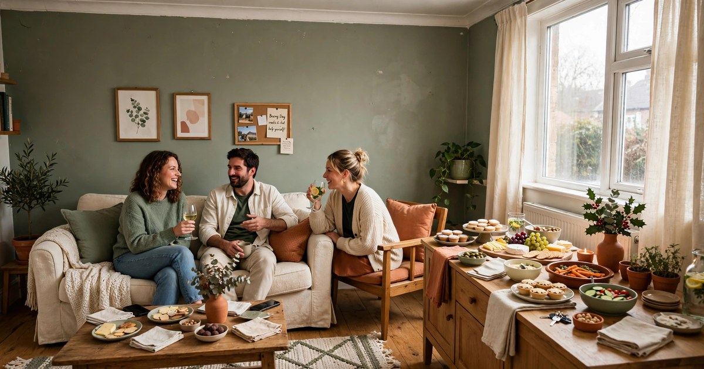
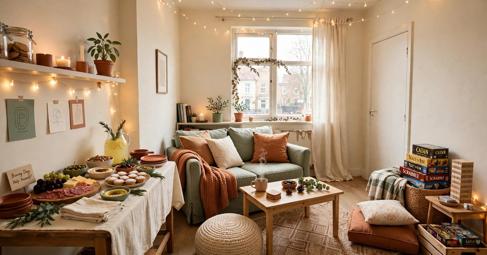
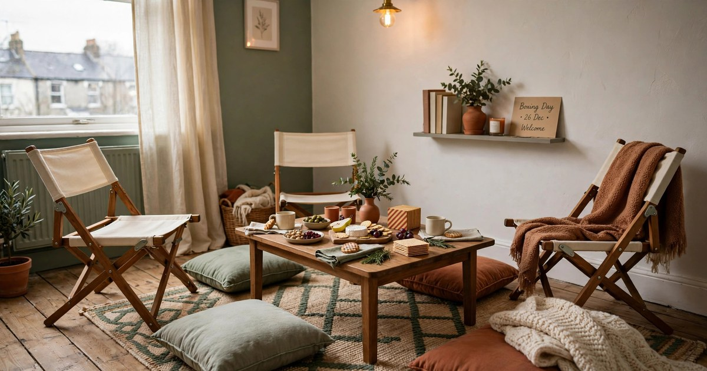
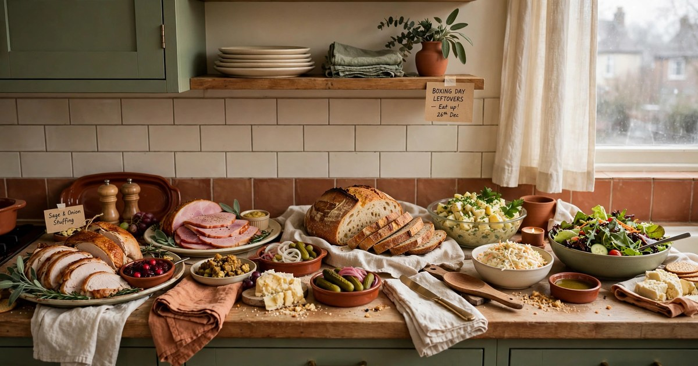
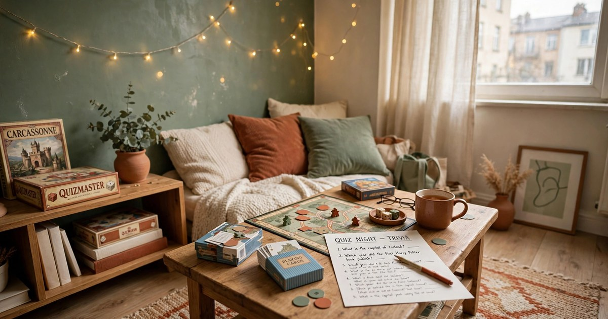
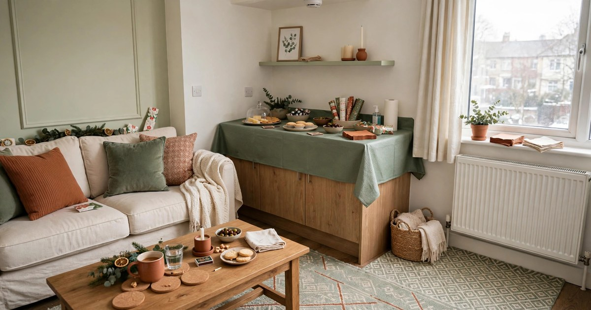

Boxing Day is the easiest party of the year, and the one most people never think to host. Christmas Day carries all the pressure — the big meal, the timings, the expectations — but 26 December is gloriously low-stakes. The fridge is already full of leftovers, everyone is in a slow, sleepy mood, and nobody expects a formal dinner. A Boxing Day gathering is really just an excuse to keep the good company going for one more day, with food that is already cooked and an atmosphere that is already half-built.

That makes it perfect for a small rental. You do not need a dining table for twelve, a second oven, or a living room the size of a village hall. You need a plan for seating, a way to turn yesterday's turkey and ham into a buffet people actually want, somewhere to put the drinks, and a couple of low-effort games to keep the afternoon moving. Everything in this guide is budget-first and renter-friendly: no drilling, no nails, no paint, no permanent changes, and nothing that puts your deposit at risk.

Think of the day as a drop-in afternoon rather than a second Christmas. Guests drift in late morning or early afternoon, help themselves to food, play a game or two, and drift home before dark. Your job is to make that flow feel effortless — which mostly means clearing space before anyone arrives and putting everything where people can reach it without asking. Follow the eight steps below and your small flat will feel cosy and generous, not cramped, and by evening it will look exactly the way it did before anyone arrived.

### 1. Decide the format: drop-in or sit-down

The single most important decision is the format, because it shapes everything else: how much food you need, how many chairs you need, and how long people stay. For a small rental, a drop-in format almost always wins. Invite people for a window — say 1 pm to 5 pm — rather than a fixed start time, and let guests arrive and leave as they please. The room never holds everyone at once, which means it never feels overcrowded, and you never have to find a seat for twelve people at the same moment.

A drop-in also suits the mood of Boxing Day. Nobody wants to sit down to a formal three-course meal the day after Christmas. They want to graze, chat, play a game, and maybe have a second helping of cold turkey sandwiches while someone else wins at Scrabble. Tell guests in the invitation that food will be out all afternoon and that they can come and go. That one sentence takes the pressure off everyone, including you, and it means latecomers do not feel rude and early leavers do not feel guilty.

A sit-down meal only makes sense if your guest list is very small — four to six people at most — and you genuinely have a table and chairs to match. Even then, keep it simple: one long table, or a table pushed against the wall with guests on three sides, and a single plated course built from leftovers. If you are torn between the two formats, choose the drop-in. It is more forgiving, cheaper, and far better suited to a small flat, and it leaves you free to enjoy the afternoon instead of serving courses.

Whichever format you choose, cap the guest list to what the room can hold comfortably. A good rule is one guest per two square metres of living space, and never more people than you have places to sit or lean. For a typical one-bedroom flat that usually means eight to ten people at a time for a drop-in, fewer for a sit-down. Send invitations a week ahead, ask for a firm reply, and tell guests what you are providing so they know not to bring a full dish — a bottle, a bag of crisps, or a box of chocolates is plenty.

### 2. Clear and zone the room

A small flat only feels small when it is cluttered, so the first job is to clear. Spend an hour the morning of the gathering moving anything that does not need to be in the living room out of it: laundry baskets, drying racks, piles of wrapping paper, the vacuum cleaner, yesterday's gift boxes. Stack them in the bedroom and shut the door. You are not cleaning for an inspection — you are creating empty floor space, and empty floor space is what makes a room feel bigger.

Next, zone the room into three areas: eating, sitting, and playing. You do not need furniture for this — a rug, a coffee table, and the position of the sofa do most of the work. Put the buffet on the sideboard or kitchen counter (step 4), cluster the seating around the coffee table, and give the games a corner with a small table or a floor cushion. When each activity has its own spot, people stop bunching up in the doorway or around the food, and the room starts to flow.

Create a clear path from the front door to the food and then to the seating. Guests should be able to walk in, put their coat somewhere obvious, and reach a plate without squeezing past the sofa. A hook on the back of the door or a single chair by the entrance works as a coat drop — just make sure it is not the chair someone needs to sit on. If your hallway is narrow, ask guests to leave shoes by the door and lay a cheap runner or old towel there to protect the floor from wet boots and salt.

Finally, do a quick safety sweep with fresh eyes. Tuck away trailing cables, move anything breakable off low surfaces, and check that nothing blocks the route to the bathroom. In a small flat, a single trip hazard is all it takes to send a plate of food across the rug. Ten minutes of clearing now saves you a cleaning bill later, and it is the cheapest decorating you will ever do — a tidy room with fairy lights looks more inviting than a cluttered one with expensive decorations.

### 3. Borrowed and folding seating that disappears after

Seating is the hardest part of hosting in a small rental, because you need enough of it for the afternoon and none of it for the rest of the year. The answer is seating that disappears: folding chairs, stackable stools, floor cushions, and borrowed chairs that go back to their owners on Monday. Buy nothing you have to store for eleven months.

Borrow first. Ask a friend or neighbour for two or three folding chairs, and ask another for a couple of floor cushions. Most people have a spare chair gathering dust in a cupboard and are glad to lend it, especially if you offer to collect and return it. Put a note on each borrowed chair — a small tag or a strip of masking tape with the owner's name — so nothing gets mixed up at the end of the day.

If you need to buy, go cheap and flat-packing. A basic folding chair costs very little, folds flat against a wall or under a bed, and doubles as spare seating for the rest of the year. Floor cushions are even better for a small flat: they stack in a corner, cost a few pounds each, and make the room feel relaxed and informal, which is exactly the mood you want. A pouffe or a sturdy storage ottoman can do double duty as both a seat and a place to stash the games when the day is over.

Arrange seating in a loose circle or horseshoe around the coffee table, not in rows against the wall. People talk more when they can see each other, and a circle makes the room feel like a gathering rather than a waiting room. Keep one or two seats free near the food so guests can perch with a plate, and leave the comfiest spot — the sofa — for whoever arrives first or for the guest who needs it most. When the day ends, fold the chairs, stack the cushions, and the flat is back to normal in five minutes. That is the whole point: seating that appears for the party and vanishes after it.

### 4. A leftovers buffet on the kitchen counter

The leftovers buffet is the heart of a Boxing Day gathering, and it is also the reason the day is so cheap to host. Christmas dinner leaves most households with sliced turkey, ham, roast potatoes, stuffing, and a fridge full of bits and pieces. Your job is to turn that into a spread that looks generous rather than like yesterday's dinner reheated.

Start by clearing the kitchen counter completely — it is your buffet table. Lay a wipe-clean tablecloth or a large piece of oilcloth over it to protect the worktop, then build the buffet in layers: a tall item at the back (a cake stand, a stack of plates, or a jug of gravy), the main dishes in the middle, and the bread, butter, and condiments at the front where hands can reach them. Slice all the meat before guests arrive and fan it out on a platter — sliced food looks twice as plentiful as a whole joint, and people serve themselves more easily.

Offer two or three simple builds rather than a dozen dishes. Cold turkey and stuffing sandwiches on soft white bread, a ham and cheese platter with pickles and chutney, and a warm tray of bubble and squeak or roast potatoes are more than enough. Add a bowl of crisps, a plate of mince pies, and a jug of something to drink, and you have a buffet that feels abundant without a single extra shop. Label anything with nuts or common allergens with a small card — a folded piece of paper works fine — so guests can help themselves safely.

Keep the flow one-directional if you can: guests start at one end of the counter, move along it, and end at the plates and cutlery. Put the plates at the far end, not the near end, so people pick up food first and a plate last — it stops the queue from bunching. And keep the hot food hot and the cold food cold: a slow cooker on warm holds gravy or bubble and squeak beautifully, and a tray of ice under the cold meats keeps them safe for the afternoon. Top up little and often rather than putting everything out at once; a half-full platter that gets refilled looks fresher than a huge one that sits out for four hours.

### 5. A drinks station that keeps traffic out of the kitchen

In a small flat, the kitchen is usually the smallest room, and it is also where everyone ends up. The fix is a drinks station in the living room: a small table, a tray on the sideboard, or even a sturdy stool by the window, stocked with everything guests need so they never have to go into the kitchen at all. One drinks station can cut kitchen traffic by half.

Set it up with a large drinks dispenser or a big jug for the main drink — mulled apple juice, a batch of punch, or just sparkling water with sliced citrus — plus a few bottles, a kettle nearby for tea and coffee, and all the glasses in one place. Put a small tray underneath the dispenser to catch drips, and keep a cloth folded beside it for spills. If you have a slow cooker, fill it with mulled wine or spiced cider on low and let guests ladle their own; it stays warm all afternoon and smells wonderful.

Keep the station simple and self-serve. A handwritten card listing what is on offer — "tea, coffee, mulled cider, sparkling water" — means nobody has to ask, and a small sign saying "help yourself" does more work than any hosting effort. Put the glasses upside down on a clean tea towel to keep dust off, and keep a few mugs out for the tea drinkers. If children are coming, add a jug of squash or hot chocolate at their height on a lower surface so they can reach it without help.

The real benefit is invisible: with drinks in the living room, the kitchen stays clear for you to top up the buffet, wash a few plates, and take a breath. It also means guests are not standing in a doorway holding a hot mug while someone else tries to get past with a platter. One small table, one dispenser, and a bit of thought about placement is all it takes — and when the day is over, the station packs away in minutes.

### 6. A low-effort games corner

A Boxing Day gathering needs something to do, but it does not need an organised entertainment programme. A games corner — a small table or a cleared coffee table with two or three games laid out — gives guests something to drift towards between plates of food, and it keeps the afternoon from turning into everyone staring at their phones.

Choose games that are quick, easy to learn, and work with a shifting group of players. A pack of cards, a classic board game, and a simple party game are enough. Card games are ideal for a small flat: they take up no space, anyone can join or leave mid-game, and they cost almost nothing. A Boxing Day quiz — ten questions on a sheet of paper, with a small prize for the winner — is another cheap winner, and you can write it in ten minutes the night before using questions about Christmas films, songs, and the year just gone.

Set the corner up so it invites people in. Lay the games out open rather than stacked in their boxes, put a few cushions on the floor around the table, and leave the rules visible. If you have a console or a tablet, a single party game on the television works well too, but keep the volume low and the game short so it does not take over the room. The goal is background fun, not a tournament.

Keep the effort low and the stakes lower. Nobody wants a complicated game with a forty-page rulebook on Boxing Day. The best games are the ones guests already know, or can learn in thirty seconds. And if nobody plays a single game, that is fine too — the corner did its job by being there, and the conversation carried the afternoon instead. A games corner is an invitation, not an obligation, and the best hosts are the ones who let guests choose.

### 7. Protect floors and surfaces (deposit-safe)

This is the step that protects your deposit, and it is the one most hosts skip. A party in a small rental puts your floors and surfaces at risk in ways that are easy to prevent and expensive to fix: red wine on a pale carpet, a hot plate on a wooden worktop, a ring mark on a coffee table. Ten minutes of prevention now is worth far more than a cleaning bill later.

Start with the floor. If you have carpet, lay a washable rug or an old flat sheet over the main traffic area and the spot where people will eat. A cheap rug from a discount shop costs less than a professional carpet clean and can be washed or thrown away after the day. If you have wooden floors, a runner by the front door catches wet shoes, and felt pads under any chair legs you have moved will stop scratches. Keep a small dustpan and brush tucked behind the door for quick clean-ups.

Protect every surface that will hold food or drink. Coasters on the coffee table and side tables are non-negotiable — a stack of cheap cork coasters costs very little and saves the varnish. A wipe-clean tablecloth on the buffet counter protects the worktop from hot trays and spills, and a tray under the drinks dispenser catches the drips that always happen. Put a bin or a large bag in an obvious spot so guests are not balancing rubbish on the windowsill.

Finally, plan for the spill before it happens. Keep a cloth, a bottle of stain remover, and a roll of kitchen paper within easy reach, and know what to do if red wine hits the carpet: blot, never rub, and treat it straight away. Most stains come out if you act in the first few minutes, and almost none do if you leave them until the next day. Tell guests where the cloth is when they arrive — a casual "spills happen, the cloth is there" makes everyone relax, and relaxed guests spill less. Your landlord will never know a party happened, and that is exactly the point.

### 8. The 20-minute reset plan for after

Every good party ends with a mess, and the difference between a relaxing evening and a miserable one is having a reset plan before the last guest leaves. The trick is to make the clean-up a twenty-minute job, not a two-hour one, and the way to do that is to plan it in advance and get a little help.

Start while guests are still there. As the afternoon winds down, pass around a bag for rubbish and a tray for glasses — most guests are happy to help, and many will offer anyway. Say yes. One person collects plates, another folds the chairs, a third bags the wrapping paper. Five minutes of shared tidying at the end of the party is worth thirty minutes of solo cleaning later, and it lets everyone leave feeling useful rather than guilty.

Once the door closes, work in order: rubbish first, then food, then surfaces, then floors. Bag all the rubbish and take it out. Pack leftovers into containers and into the fridge — label them if you like, because Boxing Day leftovers become tomorrow's lunch. Wipe the counters and tables, fold the chairs and stack the cushions, and run the vacuum or sweep the floor. Leave the washing-up to soak if you are tired; a sink full of dishes is a tomorrow problem, but a sticky floor is a tonight problem.

Set a timer for twenty minutes and race it. You will be surprised how much you can do when you are not stopping to decide what to do next. When the timer goes off, stop, put the kettle on, and sit down in your tidy flat with a mince pie. The room is back to normal, the deposit is safe, and you have the whole evening to yourself. That is the real reward of a Boxing Day gathering done well: a lovely afternoon, and a flat that looks like it never happened.

## Shop this look: Boxing Day hosting basics

- **Folding chairs** — Cheap, flat-packing extra seats that disappear under the bed after the party. [Shop folding chairs](https://www.amazon.com/s?k=folding+chairs&tag={{AMAZON_TAG}})
- **Serving platters** — Big, sturdy platters that make sliced leftovers look generous on the buffet. [Shop serving platters](https://www.amazon.com/s?k=serving+platters&tag={{AMAZON_TAG}})
- **Drinks dispenser** — A large glass dispenser keeps drinks flowing and guests out of the kitchen. [Shop drinks dispenser](https://www.amazon.com/s?k=drinks+dispenser&tag={{AMAZON_TAG}})
- **Board games** — A classic board game or two keeps the afternoon moving without any effort. [Shop board games](https://www.amazon.com/s?k=board+games&tag={{AMAZON_TAG}})
- **Tablecloth** — A wipe-clean tablecloth protects the worktop and makes the buffet look finished. [Shop tablecloth](https://www.amazon.com/s?k=wipe+clean+tablecloth&tag={{AMAZON_TAG}})
- **Fairy lights** — Warm fairy lights make a small flat feel cosy and festive in seconds. [Shop fairy lights](https://www.amazon.com/s?k=fairy+lights&tag={{AMAZON_TAG}})

## Frequently Asked Questions

### How many people can I invite to a Boxing Day gathering in a small rental?

Eight to ten guests at a time works well for a typical one-bedroom flat, using one guest per two square metres of living space as a guide. A drop-in format helps, because not everyone is in the room at once. If your list is longer, stagger arrival times or split the gathering into two shorter windows.

### What food should I serve at a Boxing Day gathering?

Serve what you already have. Cold sliced turkey and ham, stuffing sandwiches, bubble and squeak, roast potatoes, pickles, and chutney make a generous buffet with almost no extra shopping. Add crisps, mince pies, and a jug of something to drink, and you are done. The whole point of Boxing Day is leftovers, so do not cook a second Christmas dinner.

### How do I protect my deposit when hosting a party in a rental?

Cover the carpet in the eating area with a washable rug, use coasters on every table, put a wipe-clean cloth over the buffet counter, and keep a cloth and stain remover within reach. Avoid anything that marks walls — no nails, no tape on paint, no pins. Clean spills straight away and the flat will look untouched the next day.

### Can I host a Boxing Day gathering if I only have a few chairs?

Yes — borrow folding chairs from friends or neighbours, and add floor cushions and pouffes for extra seating. A loose circle of mixed seating around the coffee table feels relaxed and works better than matching chairs in a small flat. Just remember to return borrowed chairs promptly and fold your own away after the party.

### What games work best for a relaxed Boxing Day afternoon?

Choose quick, easy games that guests can join or leave at any time: a pack of cards, a classic board game, or a ten-question quiz on a sheet of paper. Avoid games with long rulebooks or that need a big table. The games corner is an invitation, not an obligation — if guests prefer to chat, that is a successful afternoon too.

If you enjoyed this guide, you might also like our guide to [host a New Year's Eve party in a small rental](/host-new-years-eve-party-small-rental-guide/) or our [winter dinner party in a small rental](/host-winter-dinner-party-small-rental-guide/) for the next festive evening.
