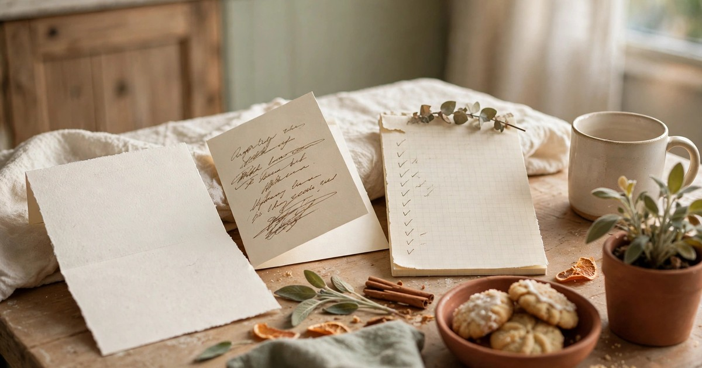
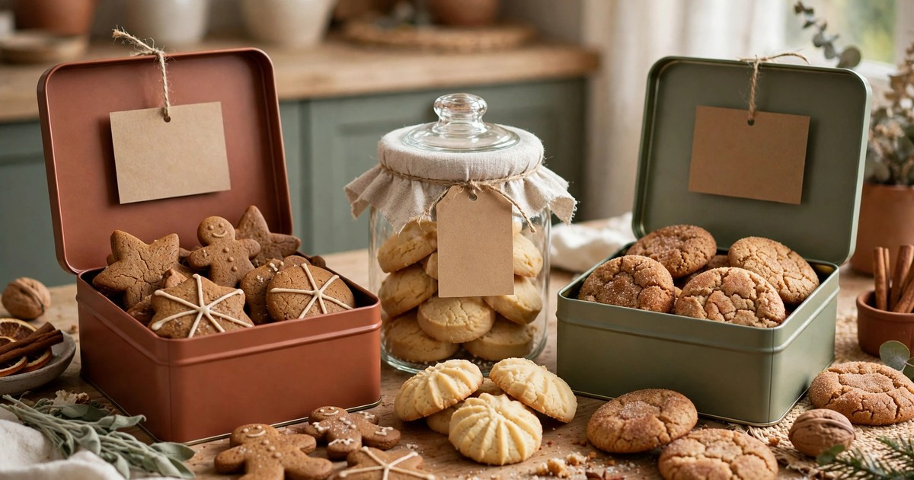
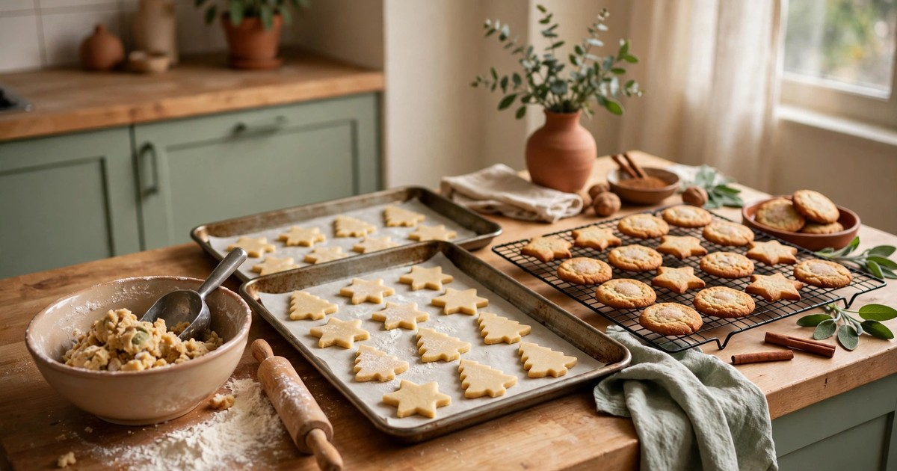
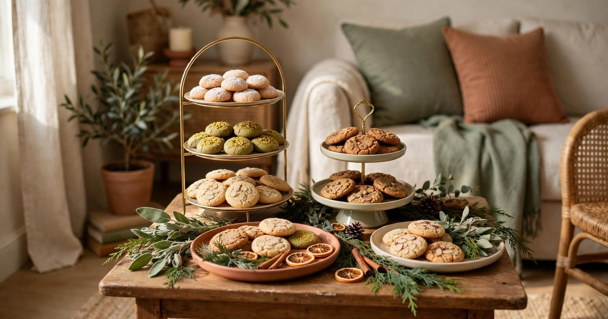
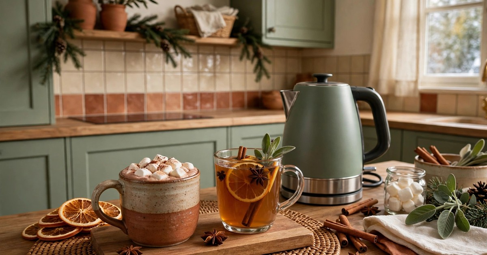
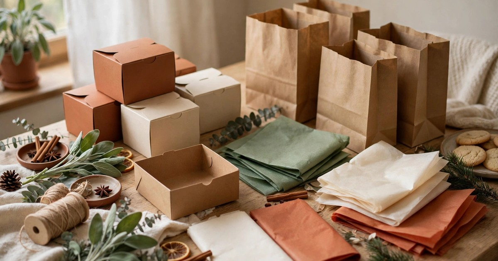
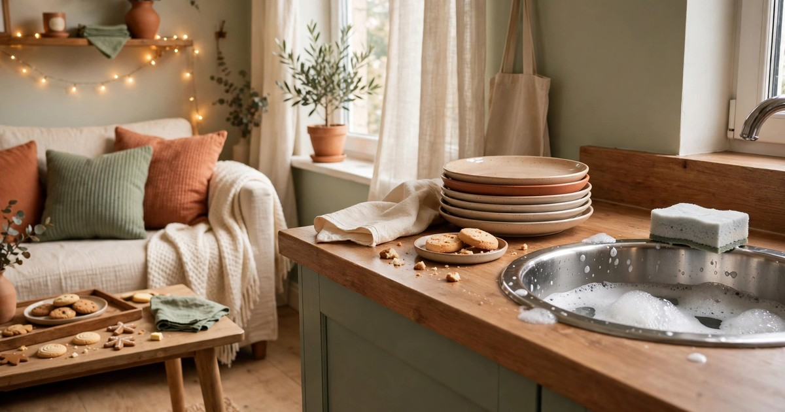
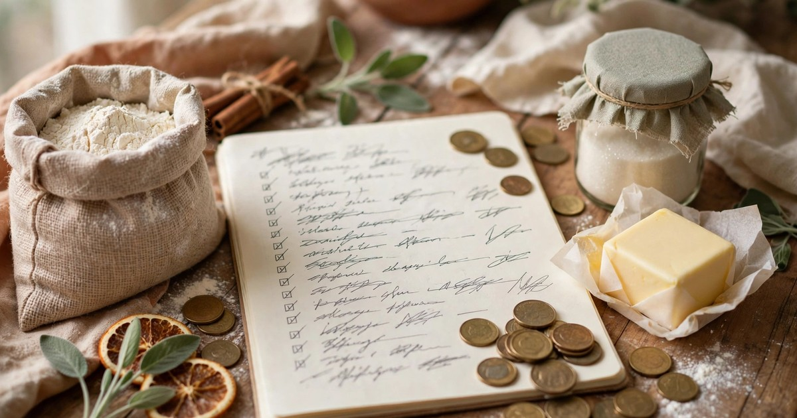

A Christmas cookie swap is one of the easiest holiday parties to host — and one of the best suited to a small rental. Nobody needs a dining table for twelve or a kitchen the size of a bakery. You need a counter, a few trays, a kettle and a group of friends who like to bake. Everyone brings the cookies, so the food is mostly handled before anyone walks through the door, and everyone leaves with a box of treats, which means the party practically packs itself up. It is festive, it is social, and it costs far less than a full dinner party.

The trick is planning for the space you actually have, not the space you wish you had. A cookie swap in a one-bedroom flat works beautifully when you keep the guest list small, set clear rules about what everyone brings, and treat your kitchen counter and coffee table as the whole venue. This guide walks you through the whole thing in eight steps, from the invitations to the final wipe-down, with renter-friendly ideas and a budget-first approach throughout.

### Step 1. Send simple invites and cap the guest list

The guest list is where a small-space cookie swap succeeds or fails, so decide it before anything else. Eight to ten guests is the sweet spot for a rental: enough people for a good variety of cookies, few enough that everyone can actually stand in your living room without elbowing the Christmas tree. With ten guests each bringing two dozen cookies, you end up with twenty dozen to share — more than enough for a generous take-home box per person and a plate to nibble from during the party.

Keep the invitation simple and send it early, at least three weeks before the party. A group text or a free digital invitation is all you need — there is no reason to buy printed cards for a casual swap. Include the date and time, your address, the cookie rules (how many to bring, and whether they need to be homemade), and a note about allergies so bakers can plan. Ask guests to reply with the cookie they plan to bring, and keep a running list so you do not end up with four batches of identical gingerbread men. A shared note or a simple message thread works perfectly for this, and it builds excitement as the list grows. Set the party for a weekend afternoon, ideally two to three hours — long enough to taste, chat and pack boxes, short enough that nobody expects a full meal — and mention that drinks and a few savoury snacks will be provided.

### Step 2. Set clear cookie rules so the swap works

A cookie swap only works when everyone brings roughly the same amount of the same kind of thing, so set the rules clearly and early. The standard is two dozen cookies per person, all of one variety, homemade. Two dozen is enough that every guest can take home a couple of each kind, and the one-variety rule is what creates the variety on the table. If someone brings two dozen of three different cookies, the maths breaks and somebody goes home short. State the rule in the invite, repeat it in a reminder message a week before, and do not be shy about it — every experienced swap host does exactly this.

Decide your policy on store-bought cookies before anyone asks. Most swaps allow one store-bought option for the friend who genuinely cannot bake, but the spirit of the party is homemade, and saying so upfront avoids an awkward moment at the door. Similarly, decide whether the cookies should be a holiday variety or anything goes. A Christmas theme keeps the table looking festive and gives bakers a fun constraint, but an open theme is kinder to the friend whose signature cookie is a chocolate chip that happens to be excellent in December too. Either way, pick one and stick to it. Allergies deserve a line of their own: ask guests to label their cookies with the variety name and any major allergens — nuts, gluten, dairy, eggs — on a small card or a strip of masking tape on the tin.

### Step 3. Plan a baking schedule that fits a small kitchen

Your own batch is the one part of the swap you fully control, so bake it on your own schedule rather than in a last-minute rush. Choose a cookie that holds well for two or three days — shortbread, gingerbread, snickerdoodles, biscotti and most drop cookies all keep beautifully in a tin, while anything with a soft frosting or a cream filling does not. Bake two or three days before the party if you can, and store the cookies in an airtight tin with a sheet of baking paper between layers. Baking early also means your oven is free on the day itself, which matters more than you think in a small kitchen.

If your kitchen is tiny, lean into recipes that need one bowl and one tray. A single baking tray used in rotation will bake two dozen cookies in two or three batches, and a wire cooling rack balanced over the sink or on top of the hob (switched off, obviously) doubles your cooling space without taking up counter room. Chill the dough in advance — slice-and-bake cookies are your friends here: the dough can be made days ahead, stored in the fridge, and sliced and baked in one calm session rather than a frantic afternoon of mixing, rolling and cutting. Do not bake your swap batch on the morning of the party; the morning is for setting up the table and the drinks. If you want the smell of fresh baking when people walk in, pop a tray of ready-made dough in the oven thirty minutes before the first guest arrives.

### Step 4. Set up the display and the cookie table

The cookie table is the heart of the party, and in a small rental it is usually your kitchen counter, a dining table, or a coffee table cleared for the occasion. Whichever surface you use, the goal is the same: every cookie visible, reachable and labelled, with room for guests to move around it. Clear the surface completely the night before, give it a good wipe, and lay down a clean tablecloth, a length of kraft paper or a festive tea towel — it makes the display look intentional and protects the surface underneath.

Height is the secret to making a small table look generous. Stack books under a tray, use an upturned sturdy box beneath a plate, or borrow a cake stand from a friend to create two or three levels. A tiered display lets you fit far more cookies on the same footprint, and it looks far more festive than a single flat row of plates. Arrange the cookies by variety, one plate or tray per baker, with the label card propped in front. Leave a little space between plates so hands can reach without knocking into the next batch, and put the most fragile cookies at the back, where they are less likely to be jostled. Think about traffic flow too: push the table against a wall or into a corner if you can, leaving one open side for serving and the rest of the room for standing and chatting.

### Step 5. Keep drinks simple and self-serve

Cookies need drinks, but drinks do not need to be complicated. A self-serve station is the right call for a small space: it keeps you out of the kitchen, lets guests help themselves, and avoids the bottleneck of one person pouring for ten. Set up a small corner of the counter or a side table with a kettle or a slow cooker of mulled cider, a jug of milk, mugs, and a few tea bags and coffee options. Hot chocolate is a natural partner for a cookie swap — make a big batch in a slow cooker or a large pan, keep it warm on the lowest setting, and set out marshmallows and a shaker of [cinnamon](/renter-friendly-christmas-scent-ideas/) for guests to dress their own mugs.

Offer one cold option as well, because a room full of people and a warm oven gets warm fast. A jug of water with orange slices, a bottle of sparkling water, or a simple cranberry spritzer covers it without taking up fridge space. If you want to offer alcohol, a single bottle of red wine or a bottle of prosecco is plenty — this is an afternoon party, and most guests will be happy with something warm. Buy paper cups if you are short on mugs, but real mugs feel more special and cost nothing if you already own them; ask a neighbour to lend a few if your cupboard only holds four. Keep the drinks station away from the cookie table if you possibly can, even if that just means opposite ends of the same counter — two separate stations stop a queue forming in one spot and spread guests around the room, which makes a small space feel bigger.

### Step 6. Sort take-home boxes and bags in advance

The take-home box is the whole point of a cookie swap, so sort the packaging before the party, not during it. Each guest needs a container that holds about two dozen cookies without crushing them — a shallow cardboard box, a paper gift bag, or a reusable container with a lid. Plain bakery boxes from a craft or pound shop cost very little bought in a pack, and a roll of tissue paper and some festive ribbon turns them into something guests will be delighted to carry home. If your budget is truly tight, ask guests to bring their own container, and keep a few spares on hand for the ones who forget.

Set up a packing station away from the tasting table, ideally on a cleared surface near the door or on a sideboard. Lay out the boxes, tissue paper, labels and a pen, and let guests pack their own selections as the party winds down. Self-service packing works better than you doing it for everyone: people choose their favourites, they pack at their own pace, and you are free to keep chatting instead of running a packing line. Put a small sign or a handwritten note at the station — "Take two of each!" — so nobody feels awkward about how many to take. Line each box with tissue paper so the cookies do not slide around, layer sturdier cookies at the bottom and delicate ones on top, and keep a marker handy so people can write their name on their box.

### Step 7. Plan the clean-up before the party starts

The best clean-up plan is the one you make before the first guest arrives. Empty the dishwasher or clear the drying rack, line the bin with a fresh bag, and stack a washing-up bowl with hot soapy water in the sink so plates can be dropped straight in. Put out a couple of tea towels, clear one shelf in the fridge for leftovers, and make sure the bin is not already full. Ten minutes of preparation here saves an hour of tidying later, and it means the end of the party feels like a gentle wind-down rather than a chore.

During the party, tidy as you go in small, invisible ways. Collect empty mugs when you pass the drinks station, fold up an empty tissue box, stack plates as they empty. Nobody will notice you doing it, and everyone will notice the difference it makes to how the room feels. Do not start washing up while guests are still there — that signals the party is over — but do keep the surfaces clear enough that the room never tips from festive into messy.

### Step 8. Keep the whole party under budget

A cookie swap is one of the cheapest parties you can host, and a little planning keeps it that way. Your main costs are your own batch of cookies, the drinks, and the take-home boxes — everything else can be borrowed, reused or skipped entirely. Bake with ingredients you already have where you can, and choose a recipe that uses store-cupboard basics like flour, butter, sugar and eggs rather than one that needs a special trip for expensive chocolate or nuts. A classic shortbread or gingerbread costs very little per dozen and tastes like Christmas, which is the whole point.

Set a budget before you shop and stick to it. A realistic target for the whole party is £20 to £30, or the equivalent in dollars: a few pounds for your baking ingredients, a few for hot chocolate and cider supplies, and a few for boxes and tissue paper. Buy the boxes and ribbon in a pack rather than individually, check the pound shop or discount aisle before the craft shop, and use what you already own for decoration — a sprig of greenery from the garden, a few [pinecones](/pinecone-decor-ideas-winter-cost-almost-nothing/), last year's [fairy lights](/hang-christmas-lights-rental-guide/). The table will look festive because of the cookies, not because of the decorations. And the biggest budget saver is the format itself: your guests supply most of the food, so you are providing the venue, the drinks and one batch of cookies — a genuinely small bill for a genuinely generous party.

## Frequently Asked Questions

### How many people should I invite to a cookie swap in a small rental?

Eight to ten guests is ideal for a small rental. That gives you nine or ten varieties of cookies on the table, which is plenty of variety, while keeping the room comfortable. Fewer than six guests and the swap feels thin; more than twelve and you will be short on space, seating and plates.

### How many cookies should each person bring?

Two dozen cookies of one variety per person is the standard. With ten guests, that means twenty dozen cookies in total, so every guest can take home two of each kind. Make sure the one-variety rule is clear in the invitation, as it is what keeps the maths — and the variety — working.

### What if a guest cannot bake?

Let them bring a store-bought option, or ask them to contribute something else useful instead, such as a bottle of wine, a bag of clementines or the take-home boxes. The spirit of the swap is homemade, but one exception keeps the party inclusive, and most guests will be glad you were flexible.

### How do I handle allergies at a cookie swap?

Ask every baker to label their cookies with the variety name and any major allergens — nuts, gluten, dairy and eggs — on a small card in front of their plate. Keep the labels visible, and make sure at least one or two varieties are safe for any guest with a dietary restriction. Masking tape and a marker pen are all you need.

### Can I host a cookie swap if I have no dining table?

Yes. A kitchen counter, a coffee table, a sideboard or even a sturdy ironing board covered with a cloth can all work as a cookie table. The key is a clear, flat surface with room for guests to reach the plates, plus a second small surface nearby for drinks so the two stations do not crowd each other.
