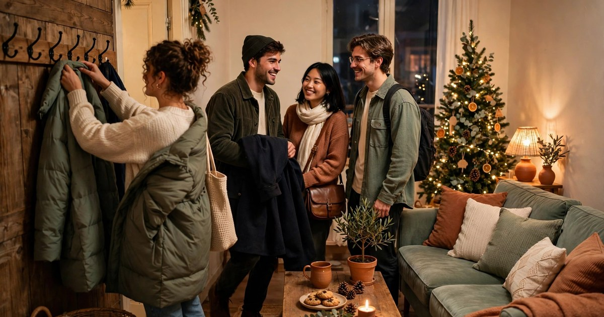
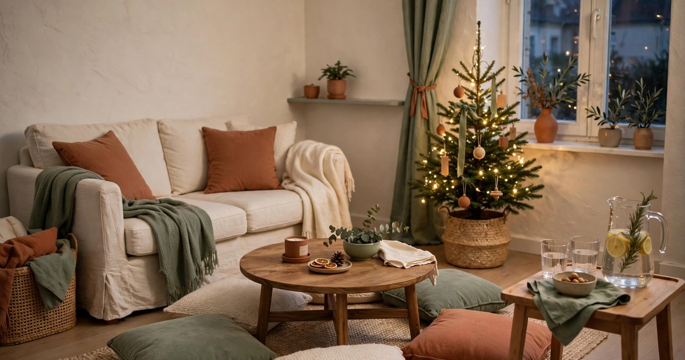
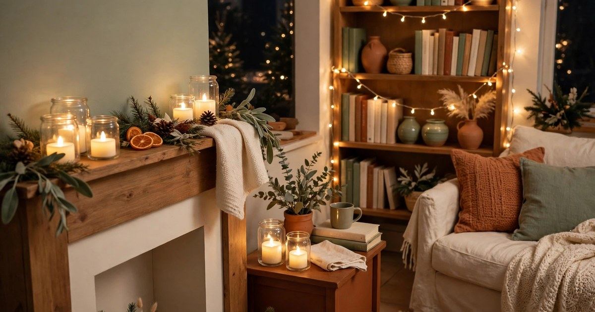
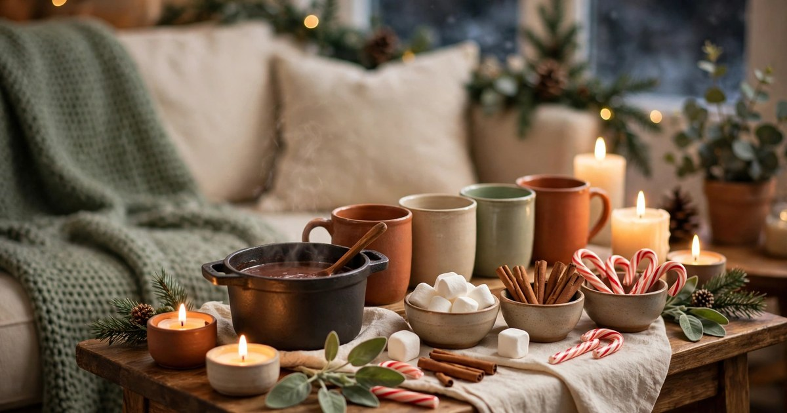
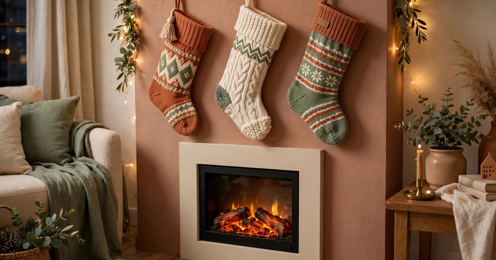
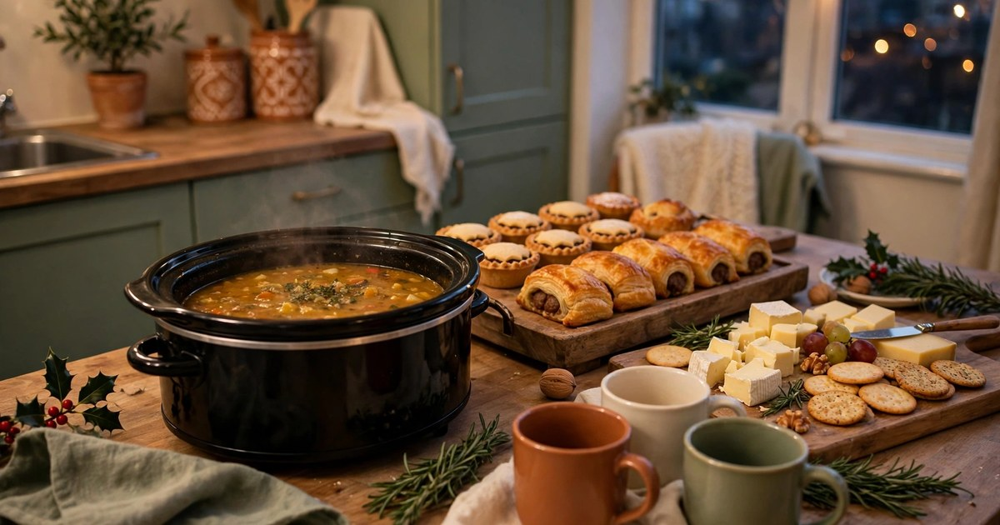
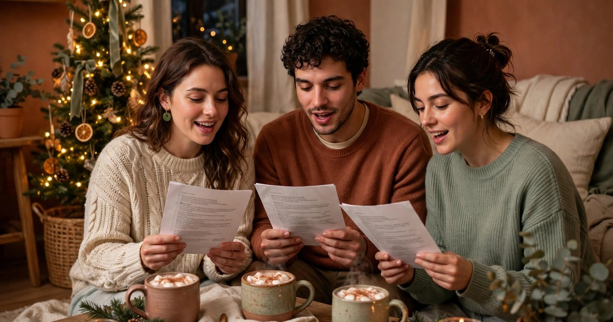
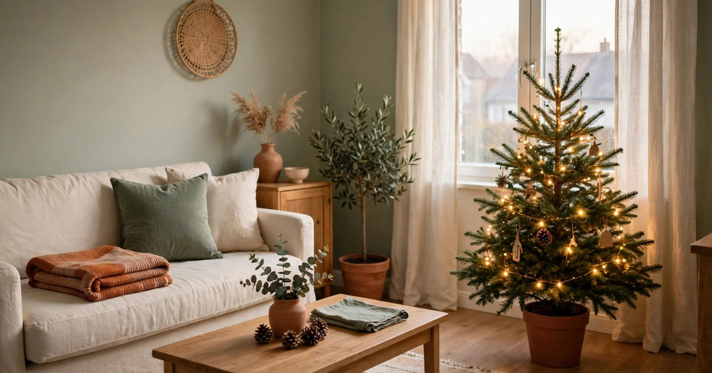

Christmas Eve is the quietest night of the festive season, and that is exactly why it suits a small rental. Nobody expects a grand dinner or a house full of people. What they expect is warmth: a dark evening outside, candlelight inside, something hot in a mug and a room full of people who are glad to be there. A small flat does that better than a big house ever could, because everyone sits close enough to talk properly, and the whole evening fits in one room.

Hosting in a rental adds one worry that homeowners never think about: the deposit. Every decoration has to come down in January without a mark, every drink has to be one that wipes up clean, and every candle has to be one that cannot set anything alight. The good news is that a Christmas Eve gathering is the easiest party to make deposit-safe, because it is a slow, seated evening built around a mug and a conversation, not a loud, sprawling party. This guide walks you through the whole evening, step by step, from the 7 pm doorbell to the 11 pm goodbyes, for under £30 of extra spending.

### 1. Keep the Guest List Small and Set the Evening Timeline

Christmas Eve in a small rental works best with six to eight guests at most. That is enough people for a proper gathering and few enough that everyone gets a real seat, not a perch on a radiator. Count your actual seats before you send the invitations, and invite that number — then stop. A guest list that fits the room is the single biggest thing standing between a cosy evening and a crowded one, and it costs nothing to get right.

Set the hours on the invitation so nobody has to guess. Ask people to arrive between 7 and 7.30 pm, and plan the evening to wind down naturally around 11 pm, so everyone is home before midnight. A Christmas Eve that ends before midnight feels thoughtful rather than cut short: guests get home in time to put out stockings, read a story, or simply fall asleep knowing Christmas morning is ahead. Saying "drop in from 7, we'll wrap up by 11" also takes the pressure off anyone who worries about overstaying.

Sketch the evening in four blocks before the day arrives. From 7 to 7.45 pm, arrivals and the first mugs of cocoa. From 7.45 to 9 pm, the main gathering: food, conversation and the cocoa bar at its busiest. From 9 to 10 pm, the slow middle: carols, stockings and whatever game or reading you have planned. From 10 to 11 pm, the wind-down: last drinks, the tidy-up begins, and people drift home with something warm in them. You do not need to announce this schedule to anyone — it is just for you, so you always know what comes next and never have to improvise in a panic.

### 2. Clear the Room and Zone It for the Evening

A small rental does not need more space for a party; it needs the space it already has used properly. Start the day before, not an hour before guests arrive. Clear every surface you will use, and move anything precious, breakable or stainable out of the room entirely. The pile of post, the laptop, the plant in the wobbly pot, the white throw you love — all of it goes into the bedroom for the night. What is left in the room is what guests can touch, lean on and spill on without consequence.

Then divide the room into three zones, even if it is only one small living room. The first zone is seating: the sofa, the armchair and the floor cushions arranged in a loose circle or horseshoe around the coffee table, so everyone can see each other and reach their mug. The second zone is [the drinks station](/host-winter-dinner-party-small-rental-guide/), which should be a side table or a kitchen counter, never the coffee table — keeping hot drinks away from the seating area is what stops the evening's only real accident before it happens. The third zone is the quiet corner: a spot by the tree or the window where the stockings hang, where someone can stand and look, take a photo, or simply have a quiet minute.

### 3. Set the Lighting With [Battery Candles](/battery-christmas-candles-small-apartments-under-20/) and Fairy Lights

Christmas Eve is a night for low light, and in a rental that means battery candles and [fairy lights](/hang-christmas-lights-rental-guide/) — never real flames near a tree, a curtain or a guest's sleeve. Turn the overhead light off for the whole evening. It is the single cheapest upgrade you can make: one switch, and the room goes from a rented flat to a candlelit room. Replace it with two or three lamps on low, a string of fairy lights along a shelf or window, and battery candles in clusters on the mantel, the side table and the windowsill.

Battery candles are the renter's best friend at Christmas. The flickering LED ones look convincing from a sofa's distance, they run for hours on a set of batteries, and they cannot burn a curtain, melt wax onto a carpet or get knocked onto a cushion by a gesturing guest. A set of three in different heights costs a few pounds and can be reused every December. Put them inside glass jars or hurricane vases if you have them — the glass makes the glow look warmer and stops the candle being knocked over in the first place. The real candles you own can stay on the shelf as decoration, unlit, where they look just as festive and cost nothing in risk.

### 4. Build a Cocoa Bar on a Side Table

The cocoa bar is the centrepiece of a Christmas Eve gathering, and it is also the cheapest one. A slow cooker or a large saucepan of hot chocolate on a side table, with a row of mugs and a handful of toppings, costs less than a bottle of wine per guest and gives people something to do with their hands all evening. It also solves the hosting problem of what to offer: everyone drinks cocoa, nobody needs to choose, and the bar refills itself.

Set it up on a side table, a tray table or a cleared kitchen counter — anywhere that is not the coffee table, so the hot pot is never within elbow range of someone's sleeve. Lay a folded tea towel or a tray underneath everything to catch drips, and put a small jug of cold milk beside the pot so anyone can cool a mug that is too hot. Make the cocoa in advance and keep it warm on the lowest heat, stirring occasionally; a slow cooker on warm is ideal because it frees up the hob and cannot boil over.

Toppings are where the cocoa bar earns its name, and they cost almost nothing. A bag of mini marshmallows, a shaker of cinnamon, a jar of chocolate sprinkles, a small bowl of crushed candy canes and a tin of squirty cream — five toppings, all from a supermarket, for under a fiver. Arrange them in small bowls or ramekins in a row, with a spoon in each, and put a little handwritten card beside each one so guests can serve themselves without asking. Label the cocoa too: "Hot chocolate — help yourself" is an invitation, and it stops you spending the evening playing bartender.

### 5. Hang the Stockings and Make Them Part of the Evening

Stockings are the most Christmas Eve thing there is — they are literally made for tonight — and they are also the easiest decoration to do in a rental, because they hang from hooks that come off without a trace. Use removable adhesive hooks on a mantel, a shelf, a picture rail or the back of a door, and hang one [stocking](/christmas-stocking-holders-no-mantel/) per guest plus one for the household. Lightweight stockings filled with tissue paper hold their shape on the hook; heavy ones filled with real gifts pull the hook off the wall, so save the real presents for Christmas morning and let the display stockings be decoration tonight.

Give each stocking a name tag. A folded card, a luggage tag, or a piece of card cut into a star with a name written on it turns a row of identical stockings into something personal, and it gives guests something to find and smile at when they arrive. If children are coming, their stockings go lowest, where they can reach them, and a tiny treat inside — a chocolate coin, a small toy — makes the whole evening for them. The stockings do not need to match; a row of different colours and patterns looks more charming than a matching set, and it is far cheaper to build from charity shops and sale bins.

### 6. Serve Food That Is One-Pot, One-Handed and Stain-Free

Christmas Eve food should be the easiest meal you serve all year, because you are the host, the cook and the cleaner-up, all in one small kitchen. The rule is simple: one hot dish, one tray of nibbles, and nothing that stains. A slow cooker of soup or chilli, served in mugs rather than bowls, is the perfect Christmas Eve main — it cooks itself, it is eaten with one hand while the other holds a conversation, and a mug is far harder to knock over than a plate balanced on a knee. A pot of spiced squash soup or a slow-cooked beef stew, with bread for dipping, feeds eight people for under £10.

The nibble tray does the rest. Mince pies, sausage rolls, cheese cubes, grapes, crackers and a bowl of crisps cover every taste, and everything on it can be eaten standing up or sitting on a cushion without a knife and fork. Keep the food on the kitchen counter or the side table, not on the coffee table, so crumbs and grease never reach the seating area. Put a small plate under every bowl so spills land on a plate, and keep kitchen paper and a damp cloth within reach so a spill gets dealt with in seconds instead of soaking into the carpet.

### 7. Let the Carols and the Conversation Carry the Middle of the Evening

Every gathering has a middle that sags, and on Christmas Eve that middle is around 9 pm, when the food is finished and the cocoa is cooling. Carols are the fix, because they are the one form of entertainment that needs no equipment, no space and no skill. You do not need a piano or a good voice; you need a playlist, a few printed song sheets, and someone willing to start. Put a carol playlist on a speaker at low volume from 7 pm, so the room has music under the conversation, then around 9 pm turn the volume down and invite everyone to sing along to three or four favourites.

Print the words. Nobody remembers the second verse of "Silent Night", and a phone passed around a room is a poor song sheet. Print one sheet per person — a free carol sheet from the internet, printed at home, costs pennies — or write the first lines of four carols on a piece of card and prop it on the coffee table. Keep it to three or four songs: "Silent Night", "O Holy Night", "Hark! The Herald Angels Sing" and "Jingle Bells" are the ones everyone knows, and four songs take ten minutes, which is exactly long enough. If singing feels too much for your group, read a short Christmas story aloud instead — a page or two of "A Christmas Carol" by candlelight, read by whoever wants a turn, is just as magical and just as free.

### 8. Wind Down by 11 pm and Leave the Flat Exactly as You Found It

The ending of a Christmas Eve gathering matters as much as the beginning, because a good ending is what makes people say yes next year. Start the wind-down at 10 pm, not at 11, so nobody feels pushed out. Turn the fairy lights back up a notch, put the kettle on for a last round of cocoa, and let the room know the evening is drawing to a close without saying it outright. People take the hint gracefully when the host starts clearing plates; they resent it when the host announces the party is over.

The morning after is the real test of a deposit-safe party. Walk the room slowly with fresh eyes: check the carpet for stains, the walls for scuffs, the table for rings, the hooks for any paint pulled away. Peel the removable hooks off slowly, following the pull tab, and the wall is exactly as it was. Take the fairy lights down, fold the throw, and put the furniture back where it started. A Christmas Eve gathering that leaves no trace is the best kind of hosting in a rental — your guests remember the cocoa and the carols, your landlord remembers nothing at all, and your deposit stays exactly where you left it.

## Frequently Asked Questions

### How many guests can a small rental hold on Christmas Eve?

Six to eight guests is the sweet spot for most one-bedroom flats and small living rooms. Count your real seats before inviting anyone, and keep the guest list to that number. Fewer guests means everyone gets a proper seat, the cocoa bar stays manageable, and the noise stays neighbour-friendly.

### Can I use real candles at a Christmas Eve gathering in a rental?

Battery candles are the safer choice, and they look just as warm from a sofa's distance. Real candles near a tree, curtains or a guest's sleeve are a fire risk and a wax-on-carpet risk, and either one can cost you part of your deposit. Use flickering LED candles in clusters, and keep any real candles on a shelf as unlit decoration.

### What time should a Christmas Eve gathering end?

Aim to wind down from 10 pm and say goodbye by 11 pm, so everyone is home before midnight. A Christmas Eve that ends before midnight feels thoughtful: guests get home in time for their own stockings and stories, and the evening ends while it is still magical rather than dragging on into tiredness.

### How do I hang stockings without damaging the walls?

Use removable adhesive hooks on a mantel, shelf, picture rail or door, and keep the stockings light by filling them with tissue paper while they are on display. Peel the hooks off slowly, following the pull tab, and they come away without a mark. Never use nails, pins or tape on painted walls in a rental.

### What is the cheapest way to feed guests on Christmas Eve?

One slow-cooker soup or stew served in mugs, plus a tray of mince pies, sausage rolls, cheese and crackers, feeds eight people for under £20. Make the cocoa yourself, buy toppings from a supermarket, and skip alcohol for the evening — the cocoa bar is cheaper, warmer and far kinder to the carpet than red wine.
