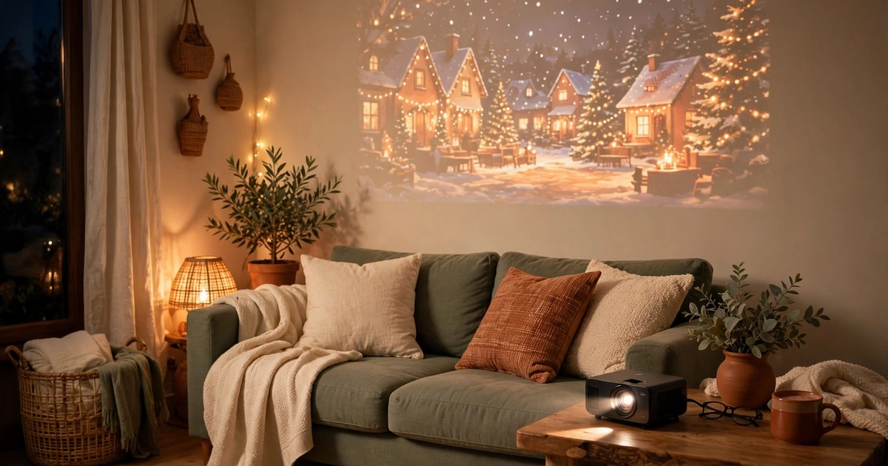

You do not need a sprawling living room, a dedicated media room or a landlord's permission to host a brilliant Christmas movie night. Some of the cosiest film nights happen in the smallest flats, where everyone is close enough to share a blanket, pass the popcorn and actually hear each other laugh. A small rental is not a limitation here — it is the whole point. The room fills up fast, the fairy lights bounce off every wall, and the whole evening feels warm and full with almost no effort at all.

The trick is to plan for the space you actually have, not the one you wish you had. That means seating that stacks or folds away, snacks that fit on a tray rather than a table, lighting that runs on batteries instead of drilling holes, and a setup you can clear in ten minutes flat when the credits roll. Everything in this list is renter-friendly — no nails, no damage, no permanent changes — and budget-first, with most ideas costing under £20 and several costing nothing at all. Pick three or four, add your favourite festive film, and your tiny living room becomes the cinema everyone wants an invitation to.

### 1. Build a Floor-Cushion Cinema

Forget the sofa — for a Christmas movie night, the floor is the best seat in the house. Pull every cushion, pillow and folded duvet you own onto the rug, layer them thickly, and you have instant cinema seating for four or five people at absolutely no cost. Stack two cushions for a backrest, lean them against the sofa base or the wall, and drape a blanket over each pile so it feels intentional rather than improvised. If you already own a couple of large floor cushions, brilliant; if not, charity shops and discount stores usually have them for a few pounds each, and they double as everyday seating long after the film ends.

The real secret is zoning. Give each guest a little territory — a cushion, a blanket and a square of rug — so nobody ends up awkwardly sharing a single throw or sitting on a cold floorboard. A folded blanket under the cushions adds padding and stops them sliding around on hard floors, while a second blanket on top keeps everyone warm without anyone needing to crank the heating up. Ask guests to bring their own favourite blanket if they have one, which costs nothing and makes the whole evening feel more communal. When the film finishes, the cushions stack in a corner and the room is back to normal in two minutes.

### 2. Make a Blanket Fort (Yes, Really)

A blanket fort sounds like something for children, but it is genuinely one of the best ways to make a small room feel magical on a movie night — and it costs nothing. Drape a large sheet or two over the backs of chairs, hook the corners over a curtain rail or a tall bookshelf with removable adhesive hooks, and weigh the edges down with books. Inside, the space feels snug and private, the light goes soft, and suddenly your ordinary living room has a den. It works especially well in rentals because nothing is fixed to the walls and everything comes down without a trace.

Keep the fort simple and safe. Use lightweight sheets rather than heavy blankets for the roof so nothing sags onto anyone mid-film, and leave one side open so air can circulate and people can slip in and out easily. A string of battery fairy lights threaded along the top edge gives a warm glow without any mains cables trailing across the floor. Add a couple of cushions and a small rug inside and you have a front-row seat that feels like a secret cinema. The fort also solves a real small-space problem: it hides the clutter behind it, so the room looks tidy on camera and in person with almost no tidying required.

### 3. Projector or TV? Choose What Fits Your Room

A projector feels wonderfully cinematic, but in a small rental the humble TV usually wins — and that is fine. A projector needs a clear wall, a throw distance of at least two metres, and darkness, which is a lot to ask of a studio flat with a kitchen in the corner. If you already own a mini projector, by all means use it: point it at the largest blank wall, hang a white sheet with removable hooks as a screen, and close the curtains. For everyone else, the TV you already have is the right answer, and the money stays in your pocket.

What matters far more than screen size is viewing distance and sound. Pull the sofa forward or move the cushions closer so everyone sits about one and a half to two metres from the screen — close enough to feel immersed, far enough that nobody gets a stiff neck. If your TV speakers are thin and tinny, a small Bluetooth speaker placed on a cushion in the middle of the group adds warmth for less than the cost of a takeaway. Dim the overhead light, draw the curtains, and the TV disappears into the dark while the film takes over. A bigger screen never made a movie night better; a comfortable seat and decent sound always do.

### 4. Light the Room with Fairy Lights Only

Overhead lights are the enemy of a good movie night — they are harsh, they wash out the screen, and they make a small room feel like an office. Fairy lights are the renter's best friend instead. A couple of battery-operated strings draped along a shelf, around a window frame or across the top of the TV unit give off a warm, low glow that is bright enough to find the popcorn but dim enough for the film to shine. Battery lights mean no trailing cables, no socket hunting and no damage to the walls, since they hang from removable hooks or simply rest on surfaces.

Warm white is the colour to choose; cool white looks clinical and blue-toned, which fights the cosy feeling you are building. If you want a little more atmosphere, add a cluster of [battery Christmas candles](/battery-christmas-candles-small-apartments-under-20/) on a side table or windowsill — they flicker like real flames, they are completely safe around blankets and cushions, and they cost very little. Keep one string of lights near the snack area so guests can see what they are reaching for, and switch everything else off once the film starts. The room will look like a film set, and your electricity bill will barely notice.

### 5. Set Up a Hot Cocoa Bar on a Side Table

A hot cocoa bar sounds extravagant, but in practice it is just a tray, a kettle and a few jars on a side table — and it is the single thing guests remember most. Start with a large tray or a baking sheet to contain any spills and protect your furniture. On it, place the cocoa powder or a jug of ready-made hot chocolate, a small pile of mugs, and three or four toppings in jam jars or ramekins: mini marshmallows, chocolate chips, a cinnamon shaker and a few crushed candy canes. Everything can come from the supermarket for a few pounds, and most of it keeps for the next movie night too.

Let guests build their own. Self-serve means nobody is stuck in the kitchen making drinks while the film starts, and it turns a simple mug of cocoa into a little event. Boil the kettle just before the opening credits so the first round is ready on time, and keep a second kettle-full on standby. If you want a grown-up twist, a small bottle of Baileys or peppermint schnapps beside the jars lets adults add a splash. Keep the bar close to the seating but off the rug, ideally on a side table or a sturdy stool, so a knocked-over mug lands on wood rather than fabric. A tea towel underneath the tray catches drips and doubles as a quick wipe-down when the night ends.

### 6. Run a Popcorn Station, Not a Bowl

One big bowl of popcorn in the middle of the room sounds communal, but in a small space it becomes a traffic jam of reaching arms and spilled kernels. A popcorn station works far better. Pop a large batch before guests arrive — a bag of popping kernels costs pennies and makes far more than any microwave bag — and set it out in a big bowl on the kitchen counter or a side table with a scoop. Beside it, put three or four small bowls of seasonings: sea salt, smoked paprika, cinnamon sugar and a little grated parmesan. Guests fill a paper bag or a small bowl, shake in their seasoning of choice, and take it back to their cushion.

Individual portions also solve the hygiene question nobody wants to raise and stop the bowl from being emptied in the first ten minutes. Keep the popping going in batches so there is always a fresh, warm bowl ready at the interval, and save the sweet toppings — crushed toffee, a drizzle of melted chocolate — for a second-round treat halfway through the film. Paper bags are cheap, they fold flat for storage, and they mean no extra washing up. For a finishing touch, label each seasoning with a scrap of card and a marker pen; it takes two minutes and makes the whole setup feel like a proper cinema concession stand.

### 7. Plan Themed Snacks Around the Film

Themed snacks turn an ordinary film night into an event, and they do not need to be elaborate. Match the food to the film: mince pies and gingerbread for a classic like *It's a Wonderful Life*, candy canes and peppermint bark for *Elf*, or pigs in blankets and sausage rolls for a British favourite. Supermarket own-brand versions of all of these cost very little, and a single platter of two or three themed items feels far more special than a random pile of crisps. Arrange everything on one board or tray so it fits on a coffee table or a lap tray without taking over the room.

Think finger food and nothing that needs a knife and fork — guests are sitting on cushions, not at a dining table. Bite-sized pieces, things that can be eaten with one hand, and nothing too saucy or crumbly near pale cushions are the rules. A small plate or a napkin per person catches the crumbs and saves your rug. If you are short on time, buy one themed item and make one yourself: shop-bought mince pies plus a quick bowl of cinnamon popcorn still feels considered. The theme is a flourish, not a burden, so keep it to one or two ideas and spend the rest of your energy enjoying the film.

### 8. Print Tickets and a Film Menu

Printed tickets are the cheapest bit of theatre you can add to a movie night — a sheet of card, a free template, and five minutes with scissors. Hand each guest a little ticket as they arrive, with the film title, the date and a seat number, even if the seat is a cushion on the floor. It makes people smile, it gives the evening a sense of occasion, and it costs almost nothing. Children especially love it, but adults secretly do too, and the tickets make a lovely keepsake photo for the group chat afterwards.

Pair the tickets with a tiny printed film menu: the evening's film, the snacks on offer, and the running order, all on one small card propped on the side table. It tells guests what to expect, stops the endless "what are we watching?" debate, and quietly manages the evening without you having to play compère. If you are hosting more than one movie night this December, give each one a different film and a different ticket colour so they feel like a series rather than a repeat. Keep the design simple — a festive border, the film title in large letters, and the essentials — and print at home on ordinary paper. Nobody will remember the paper quality; everyone will remember being handed a ticket.

### 9. Pick Films That Work for a Group

The film makes or breaks the night, and the best group choice is rarely the one you would watch alone. In a small room with mixed tastes, go for something warm, funny and familiar — a film people have seen before is often better than a brand-new one, because nobody minds chatting over the slow bits and everyone laughs at the same lines. Classics like *Home Alone*, *Elf* and *Love Actually* work because they are quotable, undemanding and forgiving of a room full of people talking. Save the slow, subtitled drama for a solo night.

Let the group vote, but keep the vote short. Offer three options the day before, take the most votes, and move on — an open-ended "what should we watch?" thread will still be running at midnight. Think about your audience too: if children are coming, check the age rating and the scary bits in advance, and have a lighter backup ready. And agree on the start time and stick to it, because in a small flat the evening can easily dissolve into snack preparation and phone scrolling. Press play, phones go face-down in a basket by the door, and for the next two hours the only job is watching the film together.

### 10. Make Cleanup a Ten-Minute Job

The best movie nights end without a dreaded hour of cleaning, and that takes five minutes of planning before the film starts. Put a bin bag or a small rubbish bin right beside the seating area so wrappers, napkins and popcorn bags have somewhere to go immediately. Use a tray under the cocoa bar and the snack bowls, keep drinks off the rug, and hand everyone a single plate or napkin so crumbs stay contained. If you are using real mugs, stack them on the tray as people finish; if you are using paper cups, they go straight in the bag.

When the credits roll, do a quick three-step reset: cushions back on the sofa, blankets folded into one pile, and the tray carried to the kitchen. The fairy lights come down with a gentle pull on the removable hooks, and the room is back to normal before the kettle boils for a last cup of tea. That is the whole point of a renter-friendly setup — nothing is stuck, screwed or stained, and the deposit stays safe. If you host regularly, keep a small box with the tickets, fairy lights, paper bags and seasonings together so the next movie night sets itself up in minutes. For more ideas on hosting in a small space, see our guide to [hosting a Christmas cookie swap](/host-christmas-cookie-swap-small-rental-guide/) — many of the same tricks apply — and our roundup of [cosy throw blankets for renters](/cozy-throw-blankets-renters-under-25/) to stock up your cushion pile.

## Frequently Asked Questions

### How many people can I host in a small rental for a movie night?

Four to six people is the sweet spot for most small living rooms. That is enough for a lively atmosphere without anyone sitting on a radiator or blocking the kitchen. Count your cushions and your mugs before you send invitations — if you have four mugs, invite four people, or ask guests to bring their own.

### Can I use a projector in a rented flat?

Yes, as long as nothing is fixed to the walls. A mini projector on a stool or a shelf, aimed at a plain wall or a white sheet hung with removable adhesive hooks, works perfectly and leaves no trace. Just check the throw distance first, because most small projectors need at least two metres between the lens and the wall.

### How do I keep the room dark enough without blackout curtains?

Close the curtains you already have, then hang a dark bedsheet over the curtain rail with removable clips or hooks to block the remaining light. A towel rolled along the bottom of the door stops hallway light creeping in. Both come down in seconds and cost nothing.

### What is the cheapest way to feed guests at a Christmas movie night?

Popcorn from kernels, a jug of homemade hot chocolate and one tray of themed snacks will feed six people for under £10. Buy supermarket own-brand for everything, ask each guest to bring one snack, and skip anything that needs cooking — the film is the entertainment, not a dinner party.

### How do I protect my deposit during a movie night?

Keep all drinks on a tray on a hard surface, never on the rug, and use battery lights and candles instead of real flames near blankets. Lay a cheap throw or an old sheet over pale cushions before guests arrive, and wipe up any spill straight away. A quick tidy before bed means nothing gets the chance to stain.
