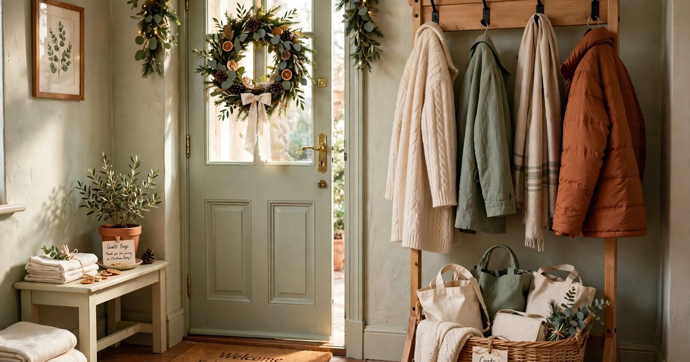

Hosting a Christmas party in a rental feels risky in a way that hosting in your own home does not. Every guest is a potential scuff on the wall, a red wine stain on the carpet, a decoration pulling paint off with it. But a rental is no reason to skip the party — it just means planning the party around the deposit. With the right setup, a rented flat can host a brilliant Christmas evening and look exactly the same the morning after.

The secret is to protect first and decorate second. Floors, walls and surfaces get their protection before a single decoration goes up, the party layout is planned around traffic flow rather than looks alone, and the cleanup starts before the first guest arrives. Here is the full plan, step by step.

### 1. Protect the floors before anything else

Floors take the most damage at a party, and in a rental that damage comes straight out of your deposit. Start by covering the high-traffic zones: a washable rug or a cheap runner over the carpet in the main room, a wipeable mat by the front door for wet shoes, and coasters or a tray under every drinks station. If your floors are light-coloured carpet, this step is non-negotiable — one glass of red wine on an unprotected carpet can cost more than the entire party.

The protection does not have to look like protection. A festive runner in the hallway, a patterned rug in the living room, a large tray under the drinks table — all of these read as decoration while quietly doing the job of a drop cloth. Keep a small stain kit ready too: clean cloths, soda water and a carpet stain remover tucked in a cupboard, so a spill gets dealt with in minutes rather than discovered the next morning. Speed is everything with stains, and a host who handles one calmly looks far more in control than a host who panics.

### 2. Decorate with nothing that touches the walls

Party decorations are where rental damage usually happens: tape that pulls paint, pins that leave holes, garlands hung from nails that were never meant to hold them. The rule for a rental party is simple — nothing that touches the walls except removable adhesive hooks, and nothing heavy hanging from those hooks. Freestanding decorations do the rest: a tabletop tree, lanterns on surfaces, a wreath on an over-door hook, balloons weighted to the floor.

Adhesive hooks are your best friend, but use them correctly. Clean the wall first, press firmly, wait an hour before hanging anything, and remove them slowly by pulling the tab straight down — never yanking sideways. For a party, you need far fewer wall decorations than you think: one garland along a picture rail, a banner across a doorway, and the rest of the festive feeling comes from the table, the lighting and the people. If a decoration needs a nail, it does not go up. Full stop.

### 3. Plan the layout for traffic, not just looks

A party layout in a small rental has one job above all others: keep people moving without bottlenecks. Map the room before guests arrive. The drinks station goes away from the door, so people do not cluster in the entrance. Food goes on a surface with space around it, not against a wall where a queue forms. Seating is arranged in small groups rather than one big circle, which keeps conversations flowing and stops a crowd forming in one corner and wearing out one patch of floor.

Clear a path from the door to the drinks, from the drinks to the food, and from both to the seating. Move anything fragile or precious — the vase from your grandmother, the plant on the low table — into a bedroom with the door closed. This is not being precious; it is being realistic. A party is a high-traffic event, and the things that break are always the things that were in the way. Pushing furniture to the walls to create a dance floor might look fun, but in a rental it creates scuff marks along the skirting boards that are very hard to explain to a landlord.

### 4. Set up a self-serve drinks station

A self-serve drinks station is the single best damage-prevention move at a rental party, because it concentrates all the spill risk in one protected spot. Set it up on a tray or a wipeable tablecloth, with a bin or a large bowl nearby for empties, and keep it away from walls, soft furnishings and electronics. Guests serve themselves, spills happen on the tray, and you are not running around with a bottle in one hand and a glass in the other.

Keep the station simple and festive: a batch cocktail or mulled wine in a large jug, a few bottles, glasses, and a small sign saying what is what. Put a stack of coasters beside it and a cloth underneath everything — a tea towel works perfectly. The station also frees you as a host: you are not playing bartender all evening, and guests who can help themselves relax faster. Just keep the station stocked and the tray wiped, and the rest of the flat stays dry.

### 5. Use disposable that looks deliberate

In a rental, the washing-up problem is also a damage problem: a sink full of glasses, a dishwasher overloaded, a red wine glass knocked off a crowded counter. Good-looking disposables solve all of it. Choose sturdy, festive paper plates and cups in a single colour scheme — deep red and gold, or cream and green — and they will look intentional rather than cheap. Avoid flimsy plates that fold under food; a guest holding a collapsing plate is a guest about to drop dinner on your floor.

The trick is to commit to the look. Matching disposables, proper napkins, and real cutlery if you have enough — or good-quality wooden cutlery — will look far better than a mismatched jumble of your everyday plates and three borrowed ones. And the cleanup advantage is enormous: at the end of the night, plates go in the bin, the table is wiped, and you are done in twenty minutes instead of an hour at the sink. In a rental, that speed matters, because the faster the cleanup, the sooner you can check for damage while it is still fresh.

### 6. Light with flameless candles and fairy lights

Real candles at a party in a small rental are a risk nobody needs: crowded rooms, people moving with drinks, long curtains, a tenancy agreement that may ban open flames outright. Flameless candles and fairy lights give you the same warm glow with none of the risk. Cluster battery pillars on the table, run fairy lights along a shelf or window frame, and turn the overhead lights down or off — the room will look more festive than it ever does under a ceiling light.

The lighting also does quiet work for your deposit. Dim, warm light makes a room feel cosy and hides the everyday wear — the scuffed skirting, the tired carpet — that bright overhead light exposes. It also encourages guests to stay in the main room rather than wandering into bedrooms and bathrooms, where damage is harder to spot. Set the lights on timers before guests arrive, scatter the candles while the room is still empty, and you will not think about lighting again all evening.

### 7. Create a coats and bags zone by the door

Coats and bags are the silent destroyers of a rental party. Left in a pile on the bed, they stain the bedding. Hung on every door handle, they pull at hinges and leave marks. Draped over chairs, they knock drinks off tables. The fix is a dedicated zone by the door: a freestanding coat rack if you have one, or a row of adhesive hooks on the inside of a door, plus a basket or a low bench for bags. Guests drop their things the moment they arrive, and the rest of the flat stays clear.

Make the zone obvious — a small sign, or simply greeting guests at the door and pointing them to it. A basket for bags is worth its weight in gold: bags on the floor get stepped on, tripped over and knocked into drinks, while bags in a basket stay put. If you do not have a coat rack, a bedroom with the door open and a bed cleared for coats works, but protect the bed with a spare sheet first. The goal is simple: every coat and bag has a home that is not your furniture.

### 8. Build the cleanup into the party

The best cleanup plan is one that runs during the party, not after it. Put a small bin and a recycling bag in plain sight near the food and drinks — not hidden in the kitchen — so guests clear their own plates without being asked. Keep a cloth and a stain remover within reach, not buried in a cupboard. And halfway through the evening, do a quiet lap: collect empties, wipe the drinks station, check the floor by the door.

When the party ends, the final cleanup should take under an hour. Work in order: bins out, surfaces wiped, floors checked, decorations down, furniture back. Then do the deposit check while the evening is still fresh: walk the flat slowly, looking for scuffs, stains and marks, and deal with anything immediately — a scuff buffs out with a magic eraser, a stain lifts with soda water, and both are far easier tonight than tomorrow. Photograph the flat once it is clean, so you have a record of its condition. That photograph is your insurance, and it takes ten seconds.

## A Party That Leaves No Trace

Hosting a Christmas party in a rental is not about being cautious — it is about being prepared. Protect the floors, keep decorations off the walls, plan the layout for movement, concentrate the drinks, use disposables that look deliberate, light without flames, corral the coats, and build the cleanup into the evening itself. None of this stops the party from being a party; it just means the morning after looks like the morning before.

The real test of a rental party is not whether guests had fun — they will — but whether you wake up relaxed instead of anxious. Plan for the deposit, and you get to enjoy the party twice: once while it happens, and once the next morning when the flat is exactly as you left it.

## Frequently Asked Questions

### Can I hang Christmas party decorations in a rental without losing my deposit?
Yes, as long as nothing damages the walls. Use removable adhesive hooks correctly — clean wall, firm press, wait before hanging, pull the tab straight down to remove — and lean on freestanding decorations for the rest. Avoid tape, pins and nails entirely; even small holes and paint pulls can cost you at checkout.

### How do I protect rental floors during a Christmas party?
Cover high-traffic areas with washable rugs or runners, put a wipeable mat by the door, and concentrate drinks on a tray or a wipeable tablecloth. Keep a stain kit ready — clean cloths, soda water and stain remover — so spills are dealt with in minutes. Light carpets need the most protection; one red wine stain can cost more than the party itself.

### What is the best party food setup for a small rental?
A self-serve buffet on one protected surface works best: guests help themselves, there is no formal seating to arrange, and the food stays in one zone. Use disposables that look deliberate, keep the drinks station separate from the food, and leave clear paths so nobody queues against a wall or a piece of furniture.

### How long should cleanup take after a rental Christmas party?
With disposables and a bin in plain sight during the party, the final cleanup should take under an hour. Work in order — bins, surfaces, floors, decorations, furniture — then do a slow deposit check for scuffs and stains while they are still fresh. Photograph the clean flat as a record of its condition.
