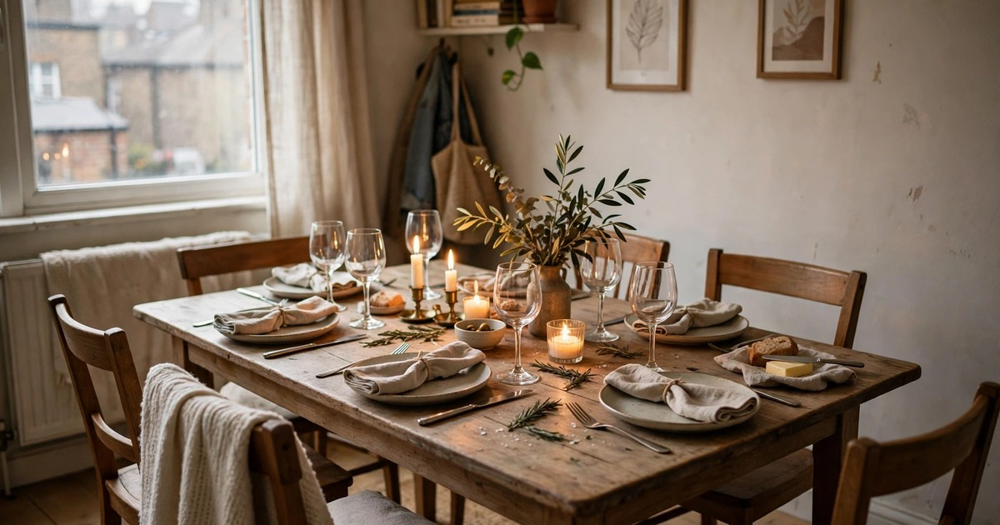
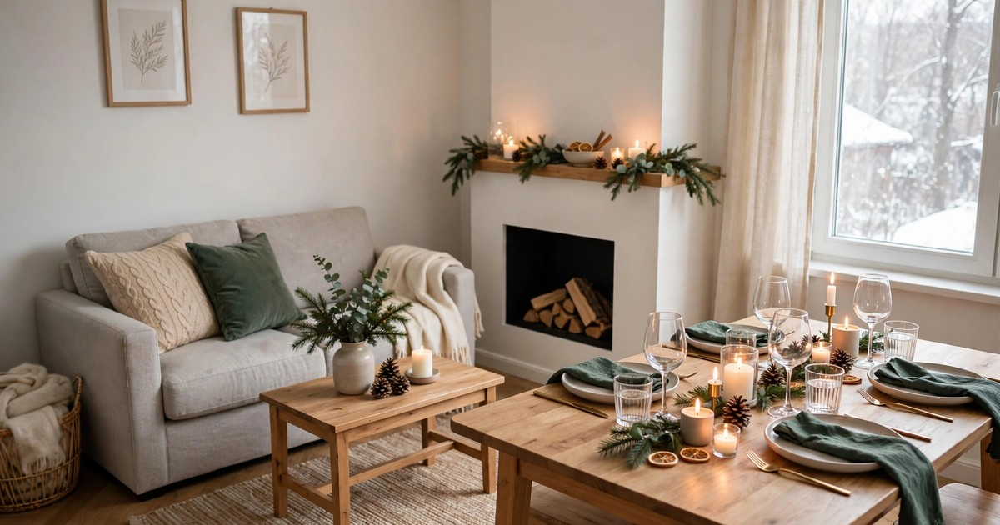
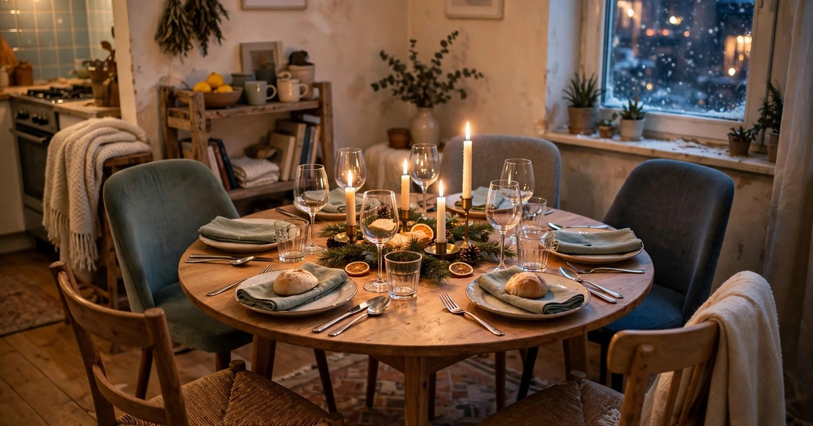
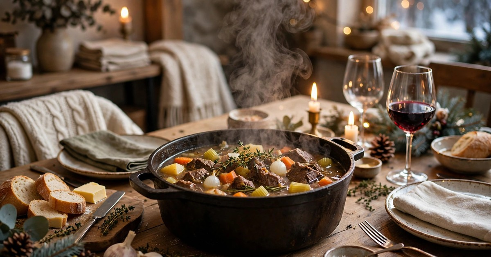
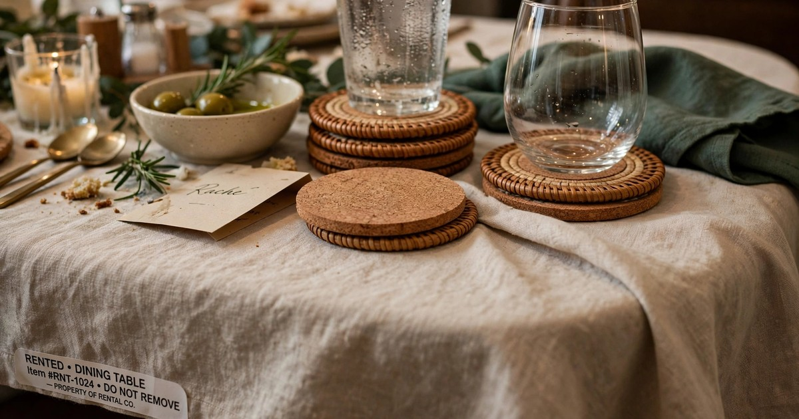
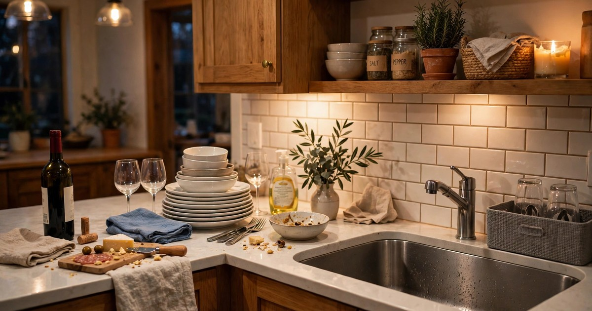

A winter dinner party in a small rental sounds like a bad idea until you realise that small rooms are actually better for it. Guests sit close, conversation carries without shouting, the food stays warm because the kitchen is three steps from the table, and a room full of people generates its own heat. The trick is planning for the size of the room rather than fighting it: six guests, one table, one make-ahead menu, and a clean-up plan that protects your deposit.

This guide walks through the whole evening in eight steps, from the guest list to the last plate in the sink. Nothing here needs drilling, painting or new furniture, and everything works in a rented flat with a landlord who will inspect it one day. Keep the guest list small, keep the menu simple, and let the room do what small rooms do best — make people feel close.

### 1. Keep the Guest List to Six

Six guests plus you is the sweet spot for a small rental: enough people for a lively table, few enough that everyone can sit down at once and hear each other. More than seven and somebody ends up perched on a stool in the kitchen doorway, which is not a seat, it is a punishment. Count your chairs before you invite anyone, and remember that a dining chair borrowed from a neighbour or a sturdy folding chair counts — a camping chair does not.

Invite people who already know each other, or at least share one friend in common, because a small room has nowhere to hide an awkward silence. Send the invitation a week ahead with a start time and a clear end time — "7 until 10" — so guests know the evening is a dinner, not an open-ended house party, and so you have a reason to start clearing up at a civilised hour.

### 2. Reset the Room Before You Cook

Clear the room before you start cooking, not after. Move the laundry airer, the pile of books, the charging cables and anything else that lives on flat surfaces into the bedroom and shut the door. A clear room looks twice as big, and guests will use every surface you leave free — coats on the bed, bags on a chair, drinks on a side table. Decide in advance where coats and bags go, and put a hook or a chair there so nobody has to ask.

Protect the floors and the table now, while the room is empty. Lay a washable rug or an old sheet under the dining area if you have hard floors, put felt pads under chair legs if they are missing, and cover the table with a proper tablecloth or a runner that hangs over the edges. Red wine on a rented table is a deposit dispute; red wine on a $12 tablecloth is laundry. For more deposit-safe ideas, see our guide to [hosting a Christmas party in a rental without damage](/host-christmas-party-rental-no-damage-guide/).

### 3. Seat Everyone at One Table

One table, everyone together, is the whole point of a dinner party, and in a small flat it usually means pulling the dining table away from the wall and adding a leaf, a board or a borrowed card table at the end. Measure first: each guest needs about 60 centimetres of table edge, so six guests need 3.6 metres around the table, which a 120-centimetre table with two people at each side and one at each end just about provides. If the maths does not work, drop to four guests rather than squeezing six.

Mismatched chairs are fine and even charming, as long as they are all the same height — a tall bar stool next to a low dining chair makes one guest eat at chin level. Tie the chairs together visually with matching cushions or a folded throw over each back. Set the table the night before if you can: plates, glasses, cutlery and a simple centrepiece, so the morning of the party is for cooking, not for hunting for the good glasses.

### 4. Cook a Make-Ahead, One-Pot Menu

A small rental kitchen has one oven, two or three hob rings and almost no worktop, so the menu has to respect that. Choose one main dish that cooks in a single pot and improves with waiting — a beef stew, a chicken casserole, a lentil and sausage bake — and make it the day before so the party day is reheating, not cooking. Add a bought starter, a simple salad, good bread and one dessert, and the menu is done.

Serve family-style from the pot in the middle of the table rather than plating in the kitchen: it saves worktop space, it saves washing up, and it makes the table look generous. Keep the dessert simple — a baked fruit crumble, a chocolate pot, or bought ice cream with a warm sauce — and make it the day before too. Write the menu on a card and put it on the table; guests love knowing what is coming, and it stops you answering the same question six times.

### 5. Light It Warm, Not Bright

Winter dinner parties live or die on lighting. Turn the overhead light off, light the candles, and let the room glow. Three or four candles of different heights down the centre of the table, a string of warm fairy lights along a shelf or a window, and one low lamp in the corner are enough for a whole room. Warm light flatters food, flatters faces and hides the fact that the room is small.

Use battery candles if you are nervous about flames near a tablecloth, and never put a lit candle under a shelf or near a curtain. Keep one small light on in the kitchen or hallway so guests can find the bathroom without a torch. The right lighting also saves you decorating: a room that glows needs almost no other decoration, which is why this step matters more than any centrepiece you could buy.

### 6. Set Up a Drinks Station

A drinks station keeps guests out of your tiny kitchen and stops the evening turning into a queue at the fridge. Clear a side table, a windowsill or the top of a bookcase, and put the bottles, glasses, a jug of water and a small ice bucket there with a cloth underneath to catch drips. Guests help themselves, you stay at the table, and the kitchen stays clear for cooking.

Offer one red, one white and one non-alcoholic option, and put the glasses out in advance so nobody has to ask. A large jug of water on the table itself saves constant trips to the station, and a bottle opener tied to the station with string is the kind of small detail that prevents a ten-minute hunt through a drawer mid-party. Keep the station away from the front door so arriving guests do not have to squeeze past it with coats on.

### 7. Protect the Deposit All Evening

Deposit protection during a party is mostly about coasters, cloths and quick reactions. Put a coaster under every glass, a trivet under every hot dish, and keep a cloth and a small bowl of water on the side table so a spill can be blotted in seconds rather than discovered in the morning. Red wine on a light carpet is a disaster after an hour and a funny story after thirty seconds, so speed matters more than any cleaning product.

Ban the two deposit killers outright: no candles on a wooden surface without a plate underneath, and no drinks on the windowsill above the radiator where condensation and heat meet. Tell guests where the bathroom is and where the spare loo roll lives so nobody opens the wrong cupboard, and keep the bedroom door shut so coats stay on the bed rather than draped over your plants. If something does get damaged, photograph it and deal with it in the morning — a calm host is worth more than a perfect table.

### 8. Plan the Clean-Up Before the First Guest Arrives

The best dinner parties end with a clean-up plan, not a mountain of dishes at midnight. Before guests arrive, empty the dishwasher or clear the drying rack, put a bin bag by the kitchen door, and stack a washing-up bowl with hot soapy water ready to go. When the evening ends, plates go straight into the bowl to soak, glasses get a quick rinse, and the table gets wiped down while guests are putting their coats on — five minutes of tidying with company is far easier than an hour alone.

Do not try to finish everything on the night. Soak the roasting tin, wipe the table, take the rubbish out, and leave the rest for the morning. A small rental kitchen cannot hold a whole dinner party's washing up at once, so work in waves: glasses first, then plates, then pots. Thank your guests at the door, lock up, and go to bed knowing the deposit is safe and the room is already half clean.

## Frequently Asked Questions

### How many guests can a small rental handle for a dinner party?

Six guests plus the host is the comfortable maximum for most small flats. Count your chairs first, and allow about 60 centimetres of table edge per person. If the maths does not work, invite four guests rather than squeezing in six — a cramped guest is a guest who will not come back.

### What should I cook for a winter dinner party in a small kitchen?

One make-ahead, one-pot main dish — a stew, a casserole or a bake — made the day before, plus a bought starter, a simple salad, good bread and one simple dessert. Family-style serving from the pot saves worktop space and washing up.

### How do I protect my deposit during a dinner party?

Use a tablecloth, coasters under every glass, trivets under hot dishes, and keep a damp cloth nearby for instant spill blotting. Keep candles on plates, drinks off the windowsill, and the bedroom door shut. Quick reactions matter more than any cleaning product.

### Do I need to buy extra furniture to host?

No. Borrow a folding chair or two, pull the table away from the wall, and use a drinks station on an existing side table instead of buying a bar cart. Mismatched chairs at the same height, tied together with matching cushions, look intentional rather than improvised.
